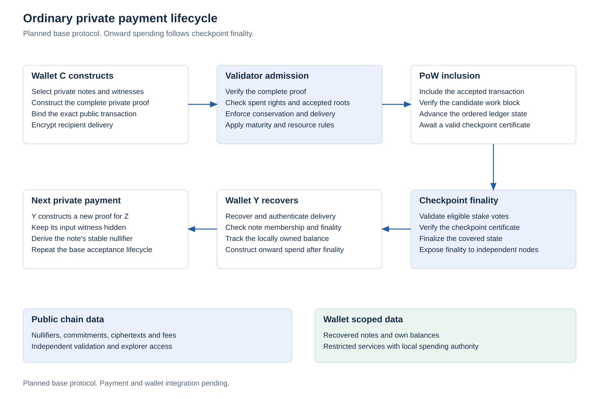
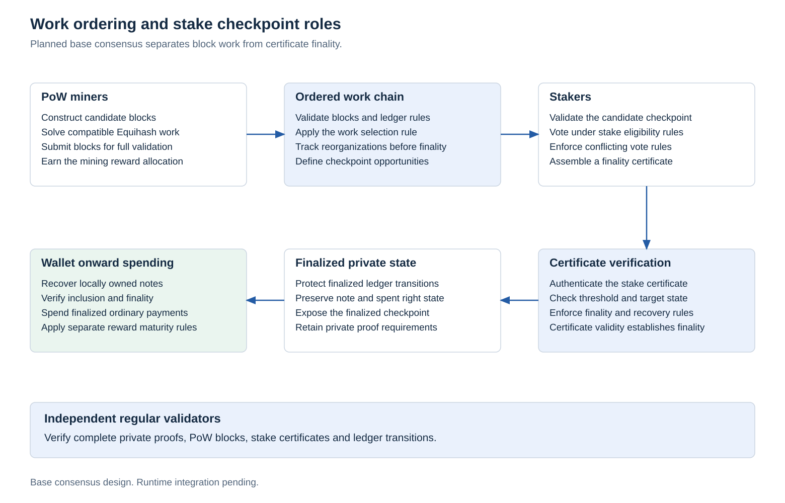
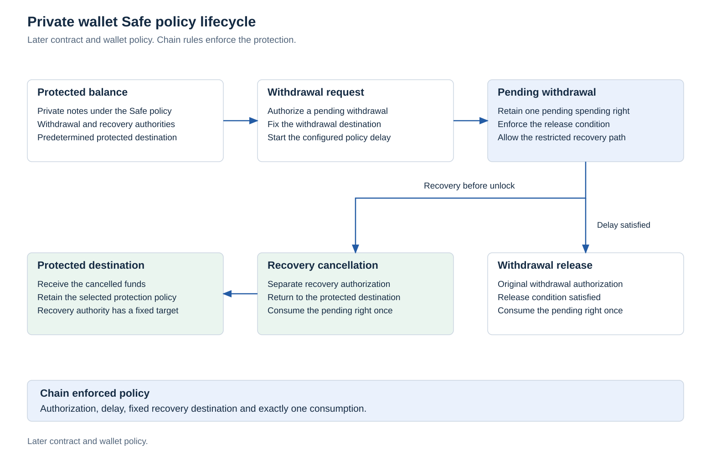
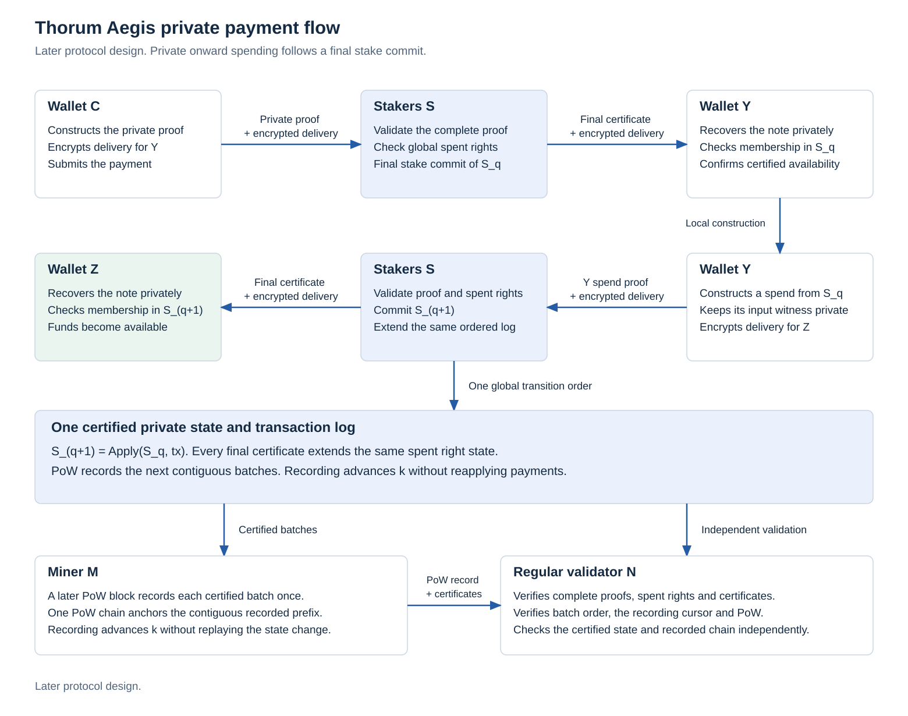

# Kova

**Private cash. Protected by design.**

Kova is a custom blockchain research implementation for private electronic cash. Its objective is to give users a confidential way to hold and transfer value, protect savings through explicit spending policies, and retain independent verification as cryptographic technology evolves.

The protocol is being developed around local witness construction, post quantum authorization and recipient encryption, auxiliary proof of work and stake checkpoint consensus. Private contracts, protected wallet balances and cryptographic migration extend the same ledger architecture. The standard payment path targets privacy by default.

[Website](https://kova.cash/), [protocol specification](docs/research-target.md), [architecture](docs/architecture.md), [research index](docs/research-index.md), [implementation](docs/development.md), [build instructions](#build-and-reproduce).

Research and development led by [th0rigin](https://github.com/th0rigin).

## Architecture

Wallets retain spending secrets, construct private witnesses, execute application logic and encrypt recipient data locally. Validators check the public transition statement and its proof against authenticated state. Work, staking and ordinary node operation have distinct responsibilities.

<picture>
  <source media="(prefers-color-scheme: dark)" srcset="research/protocol-figures/figures/base-architecture-dark.svg">
  
</picture>

The diagrams express required interfaces and ordering. The repository currently implements research components and bounded experiments. Complete private payments, confidential staking, a network node and a desktop wallet remain implementation milestones.

## Foundations

Let a private note be $n=(a,v,P,s,\rho)$, where $a$ is its asset, $v$ its bounded integer value, $P$ its spending policy, $s$ its private application state and $\rho$ its note randomness. The target commitment relation is

$$
c=\operatorname{Com}_{D_C}\bigl(\operatorname{Encode}(n),r\bigr).
$$

Here $D_C$ separates the commitment domain and $r$ denotes commitment randomness. Exact encodings, constructions and assumptions belong to the versioned protocol. Hiding input commitments requires proving membership without publishing the consumed commitment or its authentication path.

A complete payment must satisfy one connected relation over the same private witness $w$ and public statement $x$:

$$
\begin{aligned}
\mathcal R(x;w)={}&\mathcal R_{\mathrm{membership}}\land\mathcal R_{\mathrm{ownership}}\\
&\land\mathcal R_{\mathrm{authorization}}\land\mathcal R_{\mathrm{nullifier}}\\
&\land\mathcal R_{\mathrm{value}}\land\mathcal R_{\mathrm{policy}}\land\mathcal R_{\mathrm{delivery}}=1.
\end{aligned}
$$

Authorization binds the hidden verification key and signature to the exact canonical transaction. Nullifiers identify consumption of a spending right consistently across roots, transactions and alternative execution paths:

$$
\begin{aligned}
\operatorname{Verify}(pk_i,A_D(T),\sigma_i)&=1,\\
\nu_i&=\operatorname{PRF}_{k_{N,i}}\bigl(D_N\mathbin{\|}\operatorname{Id}(n_i,c_i)\bigr).
\end{aligned}
$$

The owner policy must bind $pk_i$ and $k_{N,i}$ to the same eligible hidden note. Validators also require distinct transaction nullifiers and $\nu_i\notin U_N$, where $U_N$ is authenticated persistent spent state. Changing the selected root or transaction must not create another spending identity for the same right.

For every asset $a$, exact integer conservation requires

$$
\sum_i v^{\mathrm{in}}_{i,a}+m_a
=\sum_j v^{\mathrm{out}}_{j,a}+b_a+f_a.
$$

The terms $m_a$, $b_a$ and $f_a$ denote authorized issuance, destruction and applicable fees. Ordinary payments have no subsidy minting. Bounds and canonical integer arithmetic prevent field wraparound from substituting for monetary conservation.

These equations specify obligations. Separate proofs or native checks establish their recorded scope. The complete payment construction must connect all obligations and ledger authority under the same hidden witnesses.

<picture>
  <source media="(prefers-color-scheme: dark)" srcset="research/protocol-figures/figures/private-payment-flow-dark.svg">
  
</picture>

### Information boundaries

| Local private data | Public validation and observable data |
|---|---|
| Input note openings, commitments and membership paths | Accepted roots and public nullifiers |
| Owner keys, signatures and signature intermediates | Transition proof and output commitments |
| Amounts, asset details and application witnesses within the private target | Fees, sizes and explicitly public application effects |
| Spending, viewing and recovery secrets | Bound recipient ciphertext and delivery metadata |

Selective viewing grants a defined disclosure capability separately from spending authority. Recovery requires authenticated encrypted data and a tested reconstruction path. Timing, peer traffic, wallet queries and ciphertext shape remain part of the [privacy evaluation](docs/private-transactions.md#privacy-evaluation). Public explorers and service APIs expose [defined public data](docs/rpc-and-data.md), while wallets and exchanges recover their own authorized notes locally.

## Post quantum cryptographic design

The evaluation baseline includes ML-DSA-87 authorization, ML-KEM-1024 recipient key establishment, authenticated symmetric encryption and hash based commitments and proof research. Primitive selection is one part of the system design.

| Boundary | Required analysis |
|---|---|
| Authorization | Canonical decoding, full signature verification, exact transaction binding and hidden owner permission |
| Confidential delivery | Key establishment, authenticated ciphertext binding, recipient discovery and recovery |
| Commitments and nullifiers | Hiding, binding, domain separation, stable consumption identities and quantum query assumptions |
| Private proofs | Constraint completeness, hiding, soundness, transcript construction and knowledge requirements |
| Cryptographic migration | Versioned rules and private movement into an accepted successor scheme before an old assumption fails |

The [cryptographic specification](docs/research-target.md), [primitive measurements](docs/crypto-lab.md) and [proof feasibility record](docs/proof-feasibility.md) separate implemented experiments from outstanding composition and security requirements. A complete system post quantum security claim remains a research and review goal.

## Work, staking and independent verification

Auxiliary proof of work targets compatible Equihash (200,9) parent work. A valid auxiliary witness must authenticate the Kova candidate, the complete relevant parent commitment path, chain domains and target rules. Additional parent profiles require explicit versioned verification rules and compatibility tests. Mining adapters and consensus changes have different activation boundaries.

Stake checkpoints certify eligible chain state under a defined consensus protocol. If $E_e$ is the eligible stake set for epoch $e$, a weighted quorum has the schematic requirement

$$
\sum_{i\in Q}w_i\geq\theta\sum_{i\in E_e}w_i.
$$

Here $Q\subseteq E_e$ is the voting subset and $w_i$ is eligible voting weight. The threshold $\theta$, eligibility proofs, voting rounds, conflicting vote handling and recovery rules require a complete confidential consensus specification. Splitting one stake across more wallets must not increase its combined weight. Work and staking provide state ordering and agreement around independently checked private transitions.

<picture>
  <source media="(prefers-color-scheme: dark)" srcset="research/protocol-figures/figures/work-checkpoint-flow-dark.svg">
  
</picture>

Ordinary nodes validate and relay the network without mining or staking authority. Compatible pool and solo operators require the child node, parent node and mining integration. The development target tests 60 second work blocks, checkpoint opportunities every four blocks and separate reward maturity. Finality follows a valid consensus decision. Block counts alone do not establish it.

[Mining interfaces](docs/mining.md), [checkpoint rules](docs/checkpoints.md), [node requirements](docs/node-integration.md) and [development parameters](docs/parameters.md) define the open integration work. Production emission and genesis parameters remain open. Existing accounting and allocation models retain their explicitly frozen research scope.

## Protected and programmable cash

Private escrow and confidential assets are the first contract targets. Release and refund paths must consume one shared spending right. Asset issuance, burning and conservation require enforced policy rather than application supplied balance assertions.

The wallet Safe reserves a protected balance with chain enforced delayed withdrawals and a separate cancellation authority. For a policy expressed in block heights, its eligibility boundary is

$$
\begin{aligned}
h_0&=H_f(S_{\mathrm{first\ final\ request}}),\\
h_{\mathrm{ready}}&=h_0+\Delta_h.
\end{aligned}
$$

Here $H_f(S)$ is authenticated finalized mined height, $h_0$ binds the request's first finalized state and $\Delta_h$ is its supported positive bounded policy delay. Request creation or inclusion alone does not start the timer. The withdrawal and cancellation paths must remain mutually exclusive. Cancellation returns value to the predetermined protected destination. The recovery authority has a restricted role. User selected delays, key separation, protected receiving and loss scenarios are specified in the [Safe design](docs/private-safe.md).

<picture>
  <source media="(prefers-color-scheme: dark)" srcset="research/protocol-figures/figures/wallet-safe-lifecycle-dark.svg">
  
</picture>

Contracts, confidential staking, the Safe and its desktop interface retain separate delivery stages. [Capacity reservations](docs/protocol-extensions.md) protect the ordinary payment workload through explicit resource and fee rules. Compact history verification and private cryptographic migration have additional research gates.

### Aegis

The later Aegis protocol targets spendable private payments after completed stake consensus, without waiting for the next mined block. Miners subsequently record the same ordered certified transitions while retaining their own block cadence:

$$
S_{q+1}=\operatorname{Apply}(S_q,T_q),
\qquad
\operatorname{Certify}(S_{q+1})\prec\operatorname{Record}_{\mathrm{PoW}}(S_{q+1}).
$$

The ordering symbol denotes certification before recording. Each onward payment needs its own valid proof, eligible certified state, complete payload and consensus decision. Preliminary locks are distinct from spendable finalized outputs. Aegis requires its own later implementation and activation. No transfer latency has been measured.

<picture>
  <source media="(prefers-color-scheme: dark)" srcset="research/aegis/figures/aegis-architecture-dark.svg">
  
</picture>

The [Aegis specification](docs/aegis.md) records its certified state, mining interface, privacy boundaries and failure recovery obligations. The initial test chain retains checkpoint finality for onward spending.

## Implementation status

The active stage is cryptographic feasibility and connected private authorization. The implementation distinguishes mathematical references, actual native constraint checks, hiding proof components and future network capabilities.

| Area | Current executable scope | Next integration boundary |
|---|---|---|
| Monetary accounting | Atomic amounts, bounded issuance, earned stake allocation and burns | Owned payout notes, persistent ledger and consensus context |
| Primitive and proof components | Exact reference vectors, bounded relations and adversarial proof rejection tests | Complete private payment composition and security analysis |
| Signature and ownership | Complete bounded native reference relations and a full streamed AIR scan | Hiding authorization proofs and same witness ledger composition |
| Committed quotient construction | Actual main data, canonical output, independent arithmetic references and source consuming coupled commitment | Live transcript composition and complete hiding proofs |
| Source pipeline | Complete fixed class construction and full native signature constraint scan | Prover resources, hiding and authenticated ledger joins |
| Mining, stake and networking | Architecture, interfaces and integration requirements | Runtime implementation and independent network agreement |
| Wallet, contracts, Safe and Aegis | Authority, state and recovery architecture | Separate executable applications and consensus milestones |

## Proof research map

| Component | Recorded relation scope |
|---|---|
| [Conservation](docs/proof-lab.md) | Bounded private integer conservation |
| [Canonical notes](docs/note-proof-lab.md) | Exact note commitments connected to private amounts |
| [Hidden membership](docs/membership-proof-lab.md) | Hidden input commitments, common roots, private paths and conservation |
| [Stable nullifiers](docs/nullifier-proof-lab.md) | Stable public consumption identities from the same private inputs |
| [Hash and XOF](docs/hash-proof-lab.md) | Bounded SHA3 and SHAKE computation |
| [Exact arithmetic](docs/arithmetic-proof-lab.md) | Canonical modular multiplication and coefficient constraints |
| [Polynomial transforms](docs/ntt-proof-lab.md) | Complete forward and inverse transform components |
| [Owner binding](docs/owner-binding-proof-lab.md) | Hidden key preimages bound to the same private note owners |

The [committed quotient construction](research/quotient-source/README.md) connects actual main commitment data to checked quotient evaluation in the fixed research relation.

The [coupled quotient commitment](research/quotient-mask/README.md) consumes that sealed source and commits eight masked chunks. Its fixed diagnostic compares every stored field, both commitment roots and continuing randomness with the retained dense route. Source and storage failures close the shared owner. Construction stops before opening or proof generation.

The [eight domain normalization reference](research/mask-normalization/README.md) independently checks the actual domain ordering, normalized vanishing constants and every final coupled mask coordinate. Six arithmetic mutations separate under the fixed public test bank. The following experiment integrates the uninterrupted proof transcript.

The [uninterrupted source prover](research/source-prover/README.md) connects actual committed main data, canonical quotient construction, coupled commitment, auxiliary sampling and the original single opening. One complete small relation proof is accepted by the retained verifier and ten public, commitment, opened value and transcript mutations reject. The owner records completion only after actual proof construction. This is a bounded backend integration result. Complete private signature proofs, hiding security composition and the same witness payment ledger remain separate gates. The [live source failure controls](research/source-failure/README.md) exercise actual quotient truncation and auxiliary output collision through that lifecycle. First causes survive cleanup, committed lease aliases close and the failed writer releases its busy claim without reopening the owner.

The [private opening authority controls](research/source-consumption/README.md) distinguish budget refusal before consumption from repeated requests sharing the original private flag. Both actual refused calls close their owner and retained committed leases. These controls select no inner opening or new complete proof.

The [complete proof composition analysis](research/proof-composition/README.md) connects the packed relation to retained source, commitment and transport contents. Independent small records crosscheck the arithmetic. Full signature construction, security composition and same witness payment integration remain open.

The [packed lifetime inventory](research/packed-lifetimes/README.md) maps all 67 physical regions and their source obligations. It identifies overlapping product work and a separate arithmetic mode overlay design. The following component and complete source experiments retain their own validation boundaries.

The [arithmetic workspace component](research/arithmetic-overlay/README.md) implements clock bound modes, original integer gadgets, held operand sources and result updates in one shared bank. A complete component trace passes and sixteen hostile controls reject.

The [complete signature overlay](research/signature-overlay/README.md) integrates those modes with the actual private source operands, transform and hint consumers. Its 42,178 column relation has 71,623 symbolic assertions of degree four. The [streamed native validation](research/signature-overlay-native/README.md) checks all 8,192 genuine frames from one synthetic owner against that complete relation, matches 27,648 independent saved values and rejects twelve altered frames. Hiding proofs and private ledger integration remain separate stages.

The [research implementation index](docs/research-index.md) preserves the complete laboratory catalogue, source lineage, measurements and narrower evidence boundaries. The [implementation record](docs/development.md) and [delivery roadmap](docs/delivery-roadmap.md) track the chain, wallet and later protocol milestones.

## Build and reproduce

The repository currently builds research crates and executable tests. Node, mining and wallet launch interfaces follow their runtime milestones. The validated toolchain is Rust 1.94.1. Exact dependencies are recorded in the lock files.

```text
git clone https://github.com/th0rigin/Kova.git
cd Kova
rustup toolchain install 1.94.1 --profile minimal --component rustfmt --component clippy
rustup run 1.94.1 cargo fetch --locked
rustup run 1.94.1 cargo test -p thorum-core --locked --offline
```

The historical `thorum-*` package identifiers remain part of retained laboratory interfaces and fixture compatibility. Project identity and the intended `kova` address namespace are defined in the [identity record](docs/project-identity.md).

Each [laboratory](docs/research-index.md) supplies its own reproduction instructions, source pins, hardware and exact tested scope. Large provers execute serially with explicit resource limits. [Component check instructions](docs/development.md#proof-component-checks) and [verification scope](docs/verification-scope.md) document the test organization.

| Research artifacts | Source and reproduction |
|---|---|
| Architecture and payment diagrams | [Protocol figures](research/protocol-figures/README.md) |
| Aegis ordering and certification diagrams | [Aegis figures](research/aegis/README.md) |
| Accounting reference and analytical charts | [Monetary research](research/emission/README.md) |
| Primitive measurements and provenance | [Cryptographic research](research/crypto/README.md) |
| Proof measurements | [Proof research](research/proofs/README.md) |
| Transparent chart variants | [Presentation artifacts](research/presentation/README.md) |

Project source uses the [MIT license](LICENSE). [Third party notices](THIRD_PARTY_NOTICES.md), [security status](SECURITY.md) and [contribution requirements](CONTRIBUTING.md) retain their separate scope.
