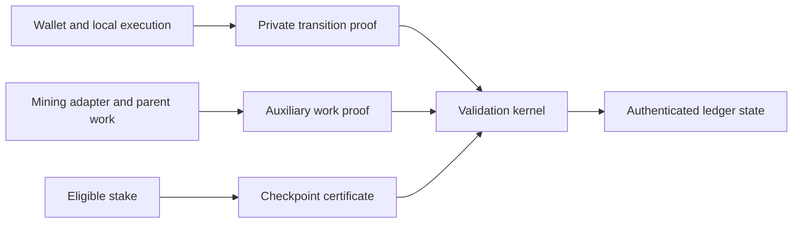

# Thorum

Thorum (THM) is a privacy blockchain research implementation focused on post quantum cryptography, confidential smart contracts, auxiliary proof of work, and stake checkpoint finality.

The protocol architecture separates the private transaction relation, deterministic state validation, parent work verification, and checkpoint consensus. Each boundary has explicit validation requirements and implementation milestones.

## Implementation status

The workspace contains deterministic monetary accounting, an independent reference model, isolated primitive, transparent relation and hiding proof laboratories, reproducible research data, and protocol specifications. The original proof laboratory constrains integer conservation without note linkage. The note proof laboratory connects four canonical SHA3-512 payment commitments to their private amount bits. The membership proof laboratory additionally hides both input commitments, creation versions, indices and depth 32 paths while proving common root membership, distinct input commitments and exact conservation in the same proof. The nullifier proof laboratory further derives input secret bindings and stable public nullifiers from the same private retained secrets and commitments. A separate hash proof laboratory adds unframed SHA3 and SHAKE with exact squeezing as a foundation for later private signature verification. Ownership, recipient encryption, global spent state and accepted root policy remain outside these components. The transparent relation laboratory still receives private witnesses directly. The workspace does not yet implement a network, complete private payment proofs, private staking, a wallet, or a mining service. No combined cryptographic security claim or independent audit is asserted.

The membership component's statement exposes one root, two output commitments, the shared asset, chain, output creation versions, fee, context and fixed two input, two output shape. The nullifier component adds two complete public nullifiers while retaining hidden input commitments and paths. The earlier note component retains its public input commitments as an isolated experiment. None is a production transaction format. A caller supplied root has no ledger authority. Knowledge of a retained nullifier secret does not establish owner permission, and a stable nullifier proof does not replace atomic consumption against persistent spent state.

| Area | Current scope |
|---|---|
| [Core accounting](crates/thorum-core/src/lib.rs) | Atomic unit arithmetic, subsidy schedule, issuance ceiling, 60/20/10/10 allocation, actual issuance and burns |
| Research | Independent schedule construction, golden vectors, analytical projections, reproducible figures |
| [Primitive laboratory](docs/crypto-lab.md) | Real signature, key establishment and encrypted envelope experiments, selected official vectors, tamper rejection and local measurements |
| [Relation laboratory](docs/relation-lab.md) | Transparent local ownership, membership, nullifier, conservation, recipient capability, typed note recovery and stake eligibility checks |
| [Hiding proof laboratory](docs/proof-lab.md) | Four private u64 amounts, bounded integer conservation, public fee and context, fixed proof verification without note or authority linkage |
| [Canonical note proof laboratory](docs/note-proof-lab.md) | Four exact v2 payment commitments and bounded conservation in the same proof, with public input commitments and no authorization, membership or nullifier proof |
| [Hidden membership proof laboratory](docs/membership-proof-lab.md) | Private input commitments, creation versions and depth 32 paths, common root membership, distinct input commitments and exact conservation, without ownership, nullifiers, encryption or accepted root policy |
| [Stable nullifier proof laboratory](docs/nullifier-proof-lab.md) | Private retained secrets linked to input bindings and stable public nullifiers in the same hidden membership and conservation proof, without owner permission, global spent state, encryption or accepted root policy |
| [SHA3 and SHAKE proof laboratory](docs/hash-proof-lab.md) | Bounded private input hashing and XOF squeezing with public expected outputs, as a primitive foundation without signature verification, owner permission or complete transaction binding |
| [Authorization arithmetic laboratory](docs/arithmetic-proof-lab.md) | Canonical multiplication modulo 8380417, reusable coefficient decoding and exact hint constraints, with synthetic primitive tests rather than complete signature verification or owner permission |
| [Normal residue NTT laboratory](docs/ntt-proof-lab.md) | Exact forward and inverse polynomial transforms, including a separate compact register profile with canonical writes and complete holds, in a public polynomial diagnostic harness |
| [Private owner key binding laboratory](docs/owner-binding-proof-lab.md) | Private verification key preimages linked to owner fields in the same hidden note, membership, nullifier and conservation proof, without signature verification or spending permission |
| [Proof feasibility](docs/proof-feasibility.md) | Pinned backend inspection, isolated component adoption and unresolved complete relation, knowledge soundness and quantum security gates |
| Private ledger | Transaction relation and kernel requirements |
| Consensus | Work/checkpoint boundaries and open construction questions |
| Mining | Parent work validation and operator interface requirements |
| Wallet | Local validation, `thm` address namespace, restricted staking authority, disclosure and recovery requirements |

The [recipient capability experiment](docs/recipient-capability.md) lets a sender construct a v2 output using public bindings without receiving the recipient's nullifier secret. Typed recovery checks the original commitment, recipient capability and retained secret. Legacy v1 notes retain their original encodings and sender linkage. These local checks do not establish formal unlinkability, anonymous discovery or a production address format.

The eight isolated proof laboratories adopt exact `p3-* 0.8.0` dependencies. The note, membership, nullifier, hash and owner binding components use `p3-keccak-air 0.8.0` for constrained permutation computations. Their verifiers take proof bytes and independently supplied typed public statements. The nullifier component constrains the chain, shared asset, output versions, root, output commitments, stable nullifiers and fee, while its 64 byte context remains opaque transcript data. The inspected statistical hiding configurations lack a complete quantum knowledge bound and independent review of the local hash composition. The experimental keyed hash requires analysis with a known secret binding image, sender chosen commitments and reused authority. This adoption does not select a backend for consensus or complete the private payment and confidential stake gates.

The separate hash component publishes mode, lengths and hash output only within its primitive experiment. It is not a ledger payment path. Hashing a public verification key does not grant spending permission. The future complete authorization relation must keep owner keys, owner bindings, `tr`, `mu` and signatures internal while verifying the exact authorized transaction against the same hidden note. Exact modular multiplication and standalone NTT stages are separate foundations. Signature decoding, sampling, complete signature dataflow and signature challenge verification remain unimplemented in the proof.

The arithmetic component publishes operands and result only in an isolated test harness. Its bounded carries and canonical values establish exact multiplication under the ML-DSA modulus rather than an equality only modulo the AIR field. This does not prove a private NTT, signature or owner authorization. Future composition must link the gadget's private operands and results to the actual internal computation without exposing keys, signatures or derived matrices.

The NTT component connects complete forward and inverse stages over canonical normal residues, including both normalization halves and exact bytewise input and output binding. Its polynomials are public. The transform is invertible and provides no polynomial confidentiality or owner permission. Future signature composition must keep coefficients, keys, signatures, hashes and matrices internal and connect them to the same hidden note and authorized transaction. Signed decoding, sampling, hints, norm checks and full challenge verification remain open.

The owner binding component adds two private unframed SHA3-512 key hashes to the existing private note relation. Each exact 2592 byte key is linked to the owner field of the same hidden input opening, while the public vector stays at 520 fields and old note and nullifier identities remain unchanged. Verification keys are public knowledge, so a private hash preimage is not a signature or permission to spend. The same hidden key and valid signature still need complete coupling to the exact authorized transaction.

The separate [transparent signature reference](research/signatures/README.md) retains complete independent ML-DSA-87 verification calculations, official answers, public synthetic authorization signatures and native comparison cases. It exposes its keys, signatures and intermediate values. It is a reference artifact rather than a ninth proof component, a private signature verifier or a payment acceptance path.

## Research targets

1. Private payments and contract state by default. Wallets construct witnesses and proofs locally. Validators check authorized transitions, conservation, and double spending without receiving spending secrets or plaintext private values.
2. Post quantum protection across authorization, recipient encryption, commitments, nullifiers, proofs, and recovery. Individual standardized primitives do not establish the security of their composition.
3. Native private payments, timed escrow, and confidential fungible assets under common ledger rules and resource limits.
4. User controlled viewing permissions, restricted staking authority, encrypted backups, and recovery tests covering lost devices, missing data, and branch changes.
5. Explicit metadata boundaries with reproducible measurements of transaction shape, fees, timing, application identifiers, wallet queries, and network observations.

These are full protocol requirements. The accounting tests, primitive experiments, transparent checks and isolated conservation or membership proofs do not establish their combined privacy and security properties. The standard wallet payment path must satisfy the complete private relation. It has no transparent fallback. The [research specification](docs/research-target.md) defines formal relations, information flow, evaluation methods, and acceptance gates.

For each asset $a$, an ordinary valid transition must satisfy

$$
\sum_i v_{i,a}^{\mathrm{in}} + m_a
= \sum_j v_{j,a}^{\mathrm{out}} + b_a + f_a
$$

Here $m_a$ is authorized minting, $b_a$ is authorized destruction, and $f_a$ is the fee in that asset. Ordinary transactions have $m_{\mathrm{THM}}=0$. Native subsidy creation follows a separate kernel rule. This conservation relation is necessary but does not by itself provide authorization, privacy, or proof soundness.

## Architecture



This diagram describes component boundaries. Implementation status is recorded separately above.

## Native subsidy allocation

The current native subsidy profile assigns 60 percent to miners, 20 percent to eligible staking duties, 10 percent to the protocol pool, and 10 percent to development maintenance for the designated project developer. Atomic rounding remainders belong to the miner. The first 16 THM budget gives 9.6, 3.2, 1.6, and 1.6 THM respectively. Unearned staking budget remains unissued. Pool and developer allocations count as issued immediately, even while unspent.

The developer allocation is temporary and requires retirement through a future consensus hard fork after work completion and community handover. Its future 10 percent is to be redistributed to mining and staking. The successor ratio, criteria, process, and activation height remain unresolved. The pool share remains 10 percent absent a separate explicit change. Existing legitimately earned credits are unaffected, and the code contains no automatic sunset.

The [allocation specification](docs/subsidy-allocation.md) defines the exact integer rule and issuance boundary. It applies to block subsidy, with fee distribution left separate. The core does not create payout notes or validate destinations. Pool governance remains unimplemented and separate from developer credits, checkpoint voting, and the operator controlled external mining treasury. Its [research specification](docs/governance.md) records the spending and ballot requirements. No production genesis has been released.

## Build and check

The monetary core has no external crate dependencies. The separate laboratories use the exact dependency versions in Cargo.lock. The validated toolchain is Rust 1.94.1. Locked dependencies are fetched once before offline checks.

```text
cargo fetch --locked
cargo test --workspace --locked --offline -- --test-threads=1
cargo test -p thorum-proof-lab --release --locked --offline
cargo test -p thorum-note-proof-lab --release --locked --offline
cargo test -p thorum-membership-proof-lab --release --locked --offline -- --test-threads=1
cargo test -p thorum-nullifier-proof-lab --release --locked --offline -- --test-threads=1
cargo test -p thorum-hash-proof-lab --release --locked --offline -- --test-threads=1
cargo test -p thorum-arithmetic-proof-lab --release --locked --offline -- --test-threads=1
cargo test -p thorum-ntt-proof-lab --release --locked --offline -- --test-threads=1
cargo test -p thorum-owner-binding-proof-lab --release --locked --offline -- --test-threads=1
cargo fmt --all -- --check
cargo clippy --workspace --all-targets --locked --offline -- -D warnings
python research/relations/reference_vectors.py --check
python research/relations/recipient_vectors.py --check
python research/proofs/reference_vectors.py --check
python research/proofs/profile_check.py
python research/note-proofs/reference_vectors.py --check
python research/note-proofs/profile_check.py
python research/membership-proofs/reference_vectors.py --check
python research/membership-proofs/profile_check.py
python research/nullifier-proofs/reference_vectors.py --check
python research/nullifier-proofs/profile_check.py
python research/hash-proofs/reference_vectors.py --check
python research/hash-proofs/profile_check.py
python research/arithmetic-proofs/reference_vectors.py --check
python research/arithmetic-proofs/profile_check.py
python research/ntt-proofs/reference_vectors.py --check
python research/ntt-proofs/profile_check.py
python research/owner-bindings/reference_vectors.py --check
python research/owner-bindings/profile_check.py
```

Reference model and figure generation commands are documented in [research/emission](research/emission/README.md).

The [cryptographic research record](research/crypto/README.md) retains selected official vectors, dependency provenance, local measurements, and reproducible latency figures. Historical primitive measurements describe their recorded source snapshot. The [original proof research record](research/proofs/README.md) retains independent integer, trace, public value and hash checks, plus measured costs and sizes for its unbound conservation component. Neither measurement set describes the canonical note, membership, nullifier, hash, arithmetic, NTT or owner binding relation. The separate [note proof record](research/note-proofs/README.md), [membership proof record](research/membership-proofs/README.md), [nullifier proof record](research/nullifier-proofs/README.md), [hash proof record](research/hash-proofs/README.md), [arithmetic proof record](research/arithmetic-proofs/README.md), [NTT proof record](research/ntt-proofs/README.md) and [owner binding record](research/owner-bindings/README.md) retain relation cases, exact messages or integer bounds, stage data, hash adapter goldens and reproduction commands, without a performance claim. Sparse tree fixtures are public synthetic relation data, without an anonymity size or linkage experiment.

## Documentation

1. [Architecture](docs/architecture.md)
2. [Private transaction relation](docs/private-transactions.md)
3. [Checkpoint consensus](docs/checkpoints.md)
4. [Mining integration](docs/mining.md)
5. [Wallet and recovery](docs/wallet.md)
6. [Treasury operations](docs/treasury.md)
7. [Development parameters](docs/parameters.md)
8. [Implementation milestones](docs/development.md)
9. [Security policy](SECURITY.md)
10. [Contribution guide](CONTRIBUTING.md)
11. [Privacy and post quantum research specification](docs/research-target.md)
12. [Protocol pool governance](docs/governance.md)
13. [Cryptographic feasibility laboratory](docs/crypto-lab.md)
14. [Third party notices](THIRD_PARTY_NOTICES.md)
15. [Native subsidy allocation](docs/subsidy-allocation.md)
16. [Transparent relation laboratory](docs/relation-lab.md)
17. [Proof backend feasibility](docs/proof-feasibility.md)
18. [Recipient capability and typed recovery](docs/recipient-capability.md)
19. [Hiding conservation proof laboratory](docs/proof-lab.md)
20. [Canonical note conservation proof laboratory](docs/note-proof-lab.md)
21. [Hidden input membership proof laboratory](docs/membership-proof-lab.md)
22. [Stable nullifier proof laboratory](docs/nullifier-proof-lab.md)
23. [SHA3 and SHAKE proof laboratory](docs/hash-proof-lab.md)
24. [Exact modular multiplication proof laboratory](docs/arithmetic-proof-lab.md)
25. [Normal residue NTT proof laboratory](docs/ntt-proof-lab.md)
26. [Private owner key binding proof laboratory](docs/owner-binding-proof-lab.md)

## Source and research practice

Specifications identify assumptions and unresolved constructions. Benchmarks identify the implementation, hardware, configuration, and measurement method. Analytical projections are distinguished from measurements. Required dependency attribution and license notices are retained when components are incorporated.

Original project source is available under the [MIT license](LICENSE). External components retain their own licenses and notices, recorded in the [dependency inventory](research/crypto/dependency-inventory.json). Source and binary distributions must preserve the applicable notices.
