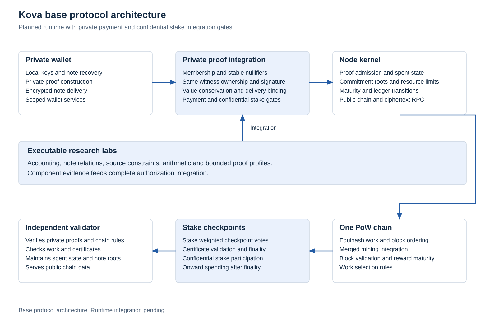

# Kova

Kova is a privacy blockchain research implementation focused on post quantum authorization and encryption, confidential applications, auxiliary proof of work and stake checkpoint finality.

Project identity and the intended `kova` address namespace are defined in the [protocol identity record](docs/project-identity.md). Historical laboratory names and cryptographic fixtures retain their exact bytes until a separately verified protocol version replaces them.

The protocol separates private transition proofs, deterministic ledger validation, parent work and stake consensus. Each component has a documented interface, explicit assumptions and reproducible acceptance requirements. The standard wallet payment path targets privacy by default.

| Reading path | Contents |
|---|---|
| [Protocol research specification](docs/research-target.md) | Definitions, private relations, information boundaries and security requirements |
| [Architecture](docs/architecture.md) | Wallet, proof, kernel, work, consensus and storage boundaries |
| [Implementation record](docs/development.md) | Executable scope and supporting component evidence |
| [Signature and ownership references](research/signature-ownership/README.md) | Exact transaction signatures, complete integer verification and canonical note owner comparisons |
| [Private signature sources and transforms](research/signature-native/README.md) | Native source and ownership constraints with sixteen connected private forward transforms |
| [Private signature and ownership constraints](research/signature-complete-native/README.md) | Complete bounded native signature arithmetic and note owner binding under one private witness |
| [Delivery roadmap](docs/delivery-roadmap.md) | Initial chain gates and separate later application milestones |
| [Private Safe design](docs/private-safe.md) | Protected receiving, user selected delays, independent authorities and local key protection |

## Implementation status

The current stage is private cryptographic feasibility. Monetary accounting, primitive integration, transparent references and isolated hiding proof components are executable. A complete private payment relation, confidential stake, a network node and a desktop wallet are not implemented. No production network or combined security audit is asserted.

| Area | Executable boundary | Remaining boundary |
|---|---|---|
| [Monetary core](crates/thorum-core/src/lib.rs) | Atomic arithmetic, capped scheduled subsidy, earned stake allocation, actual issuance and burns | Owned payout notes, duty evidence, destinations and ledger persistence |
| [Primitive laboratory](docs/crypto-lab.md) | Signatures, key establishment, authenticated envelope experiments and official vector comparisons | Complete protocol composition, anonymous discovery and production recovery |
| [Transparent relation](docs/relation-lab.md) | Local payment, capability, recovery and stake checks with plaintext witnesses | Private proofs, authenticated state and consensus admission |
| Hiding proof components | Exact bounded relations with independent vectors and actual proof rejection tests | Complete same witness authorization, delivery and ledger coupling |
| Ledger, stake, mining and networking | Specifications and integration gates | Runtime implementation and independent server agreement |
| Contracts, Qt wallet and Safe | Authority, state, recovery and application architecture | Executable applications and wallet integration |
| [Aegis](docs/aegis.md) | Later protocol architecture and reproducible diagrams | Separate consensus implementation, review and activation |

The base chain design is illustrated below. Arrows identify required interfaces. They do not represent a completed runtime.

<picture>
  <source media="(prefers-color-scheme: dark)" srcset="research/protocol-figures/figures/base-architecture-dark.svg">
  
</picture>

## Private transition requirements

Wallets construct witnesses and proofs locally. Validators must verify the same hidden input ownership, accepted membership, stable nullifiers, conservation, restrictions and encrypted output delivery. They also enforce authenticated roots, persistent spent state, replay prevention and bounded resources. Successful separate component proofs do not establish that combined relation.

For each asset a, a valid transition requires

$$
\sum_i v_{i,a}^{\mathrm{in}} + m_a
= \sum_j v_{j,a}^{\mathrm{out}} + b_a + f_a.
$$

Here m denotes authorized minting, b completed destruction and f the applicable fee. Ordinary native payments have no subsidy minting. Native reward issuance has separate consensus rules. Conservation is necessary but does not establish ownership or privacy.

Input commitments, membership paths, owner keys, signatures and signature intermediates remain private in the complete payment target. Public roots, nullifiers, output commitments, fees, sizes and network observations retain explicit leakage analysis. The normal Send path has no transparent fallback.

The [recipient capability experiment](docs/recipient-capability.md) separates sender construction from the recipient's nullifier secret and checks typed local recovery. Legacy sender known v1 behavior remains documented. Neither interface supplies a formal unlinkability result, authenticated discovery or the intended `kova` address codec.

## Proof research map

The workspace contains eight isolated hiding proof crates. Their component and diagnostic statements are research interfaces rather than a production payment format. Exact dependencies, independent references, closed transport profiles and test scope are recorded with each component.

| Component | Verified relation scope |
|---|---|
| [Conservation](docs/proof-lab.md) | Four private u64 amounts and bounded integer conservation without note linkage |
| [Canonical notes](docs/note-proof-lab.md) | Four exact commitments linked to private amounts, with public input commitments |
| [Hidden membership](docs/membership-proof-lab.md) | Hidden input commitments and depth 32 paths, common root membership, distinct inputs and conservation |
| [Stable nullifiers](docs/nullifier-proof-lab.md) | Same retained secrets and hidden commitments linked to stable public nullifiers within membership and conservation |
| [Hash and XOF](docs/hash-proof-lab.md) | Bounded SHA3 and SHAKE, with further signature source and sampling components |
| [Exact arithmetic](docs/arithmetic-proof-lab.md) | Canonical integer multiplication modulo 8380417 and reusable coefficient constraints |
| [Polynomial transforms](docs/ntt-proof-lab.md) | Complete forward and inverse normal residue transforms in a public polynomial harness |
| [Owner key binding](docs/owner-binding-proof-lab.md) | Private verification key preimages connected to owner fields in the same hidden note relation |

The hash crate additionally contains [matrix sampling](docs/matrix-sampling.md), [sparse challenge sampling](docs/challenge-sampling.md), [canonical signature and challenge linkage](docs/signature-challenge.md), [private key source constraints](docs/key-source.md) and a [conditional private signature row](docs/reconstructed-row.md). Canonical key parsing and conditional row computation are implemented components. Their actual key, signature, all eight row, note and transaction connections remain incomplete. Knowledge of a verification key or its hash preimage grants no spending permission.

[Coefficient constraints](docs/coefficient-constraints.md) and [compact transforms](docs/compact-ntt.md) retain their exact arithmetic and layout evidence. The [transparent signature reference](research/signatures/README.md) supplies full independent verification calculations over public synthetic data. It is an oracle, not private authorization.

The [transaction signature and note ownership reference](research/signature-ownership/README.md) adds six existing signatures over exact typed transactions, two native verification paths and complete independent integer calculations through all eight signature rows and final challenge equality. Canonical v2 notes supply explicit owner match and mismatch cases. This is reference evidence for the missing complete private authorization relation, without a native AIR, backend proof or payment authority claim.

The [native signature laboratory](research/signature-native/README.md) constrains the same private key, signature and canonical note sources together with sixteen forward transforms. The note owner field is bound to the private key hash and transaction authorization supplies the public 196 byte input. The transform outputs and input note commitment remain private witness columns. This retained snapshot ends before matrix reconstruction and final signature verification.

The [complete bounded native relation](research/signature-complete-native/README.md) adds all 56 matrix streams, eight reconstructed rows, normalized inverse transforms, actual hints, private packed bytes and the full final challenge equality. It binds the same key and note owner to authorization derived from the typed transaction. Native evaluation receives private data directly. A hiding proof backend, private ledger composition and their security and resource analysis remain separate gates before payment acceptance.

The [private verifier scheduling experiment](research/signature-scheduling/README.md) uses two constrained clock banks and explicit activity producers in the complete degree four relation. Ten native reference verdicts match, and 77 hostile source routes reject with baseline and restoration controls. These are native witness checks. A complete hiding signature proof remains separate work.

The [retained constraint folding experiment](research/constraint-folding/README.md) evaluates that actual AIR on finite synthetic row groups through the backend constraint folder. Captured residuals match a separate scalar fold and independent integer arithmetic. This isolates evaluation and folding from the outstanding polynomial commitment, complete proof and security composition requirements.

The [conditional proof profile analysis](research/proof-profile/README.md) includes all batched columns, masking budgets and field storage in the retained classical model. Its scenarios separate numerical model output from the remaining protocol, knowledge and quantum security obligations.

The [output lifetime laboratory](research/output-lifetimes/README.md) constrains nine shared banks against dedicated storage under the retained schedule. Independent full-coordinate intervals and actual synthetic native rejection controls test temporal reuse before any complete signature layout change.

The [private signature storage laboratory](research/signature-storage/README.md) connects that mapping to actual canonical transform writes and matrix consumers. Its separate native records retain complete signature and note ownership constraints while reducing the physical output layout. The original scheduling source remains the reference.

The [checked storage matrix](research/storage-matrix/README.md) supplies owned synthetic rows through the retained matrix interface, with canonical field decoding, checked windows and explicit storage failures. It is a storage integration component. Complete commitment, quotient and FRI integration remains separate from these accessor tests.

The [storage commitment experiment](research/storage-commitments/README.md) connects those rows to the actual retained salted MMCS. Independent integer and SHA3 references cover four roots, including a mixed height batch. Memory and storage paths are compared through ordinary openings and pruned multiproofs.

The [stored polynomial proof laboratory](research/storage-pcs/README.md) carries checked storage through a complete small quartic STARK, including actual coupled quotient masks, the randomization polynomial and FRI openings. Main randomization writes directly to storage. Main, quotient and randomization commitments are constructed one column at a time. Its proof bytes match the retained dense prover and its ordinary verifier rejects raw false traces and corrupted mask coupling. Remaining resident inputs, larger proofs and private payment integration remain separate work.

The [proof feasibility record](docs/proof-feasibility.md) distinguishes implemented experiments from open hiding, knowledge soundness, quantum model, resource and composition obligations. Standardized primitives and full digests do not establish the composed protocol's security level.

## Native accounting and consensus targets

The retained development accounting reference uses eight decimal places and a cumulative actual issuance ceiling of 63,000,000 THM. Production emission parameters remain open before genesis and require a versioned specification with independent vectors. Burns reduce outstanding value without reopening the current reference ceiling.

| Subsidy destination | Nominal budget |
|---|---:|
| Miners | 60 percent plus all atomic rounding remainders |
| Eligible staking duties | 20 percent, with only earned value issued |
| Protocol pool | 10 percent |
| Temporary development maintenance | 10 percent |

Unearned staking remains unissued. Fee distribution, native pool governance and operator controlled external receipts have separate authorities. Development allocation retirement requires a future consensus hard fork after completion and community handover, with criteria, activation and successor mining/staking ratio still undefined. No automatic sunset is implemented. The [allocation specification](docs/subsidy-allocation.md) defines the exact integer rules.

The testnet target is 60 second work blocks, checkpoint opportunities every four blocks and 10080 block maturity for new mining and staking rewards. Ordinary payments do not inherit a new reward delay. The executable 120 second accounting model remains a frozen reference pending a separately versioned cadence mapping. [Development parameters](docs/parameters.md) distinguish those profiles.

## Delivery boundaries

Complete private payment and confidential stake feasibility precede ledger integration. The initial chain milestone includes ledger, work, checkpoints and independent network testing, followed by the private wallet. Private escrow, confidential assets, the wallet Safe and Aegis retain separate executable milestones.

[Aegis](docs/aegis.md) studies spendable private state after completed stake consensus and before subsequent mining. The architecture is documented now. It does not change the initial checkpoint finality rule or add a requirement to the first test chain scope. No Aegis latency has been measured.

The [node and service boundary](docs/node-integration.md) includes ordinary validating nodes without mining or stake authority, server operation and future private exchange integration. Exchange listing remains an external decision.

[RPC and private data access](docs/rpc-and-data.md) separates public explorer and synchronization data from scoped wallet discovery, viewing, balances and local authorization. Services recover their own notes while public verification keeps hidden inputs and spending authority private.

## Reproduction and evidence

The validated Rust toolchain is 1.94.1. Laboratory dependencies use the exact versions in Cargo.lock. Fetch locked dependencies once before offline checks.

```text
cargo fetch --locked
cargo test --workspace --locked --offline -- --test-threads=1
cargo fmt --all -- --check
cargo clippy --workspace --all-targets --locked --offline -- -D warnings
```

The [implementation record](docs/development.md#proof-component-checks) lists the required serial release suites. Each research directory retains its source data and independent reproduction commands. Large provers execute serially.

1. [Monetary reference and analytical figures](research/emission/README.md).
2. [Primitive measurements and provenance](research/crypto/README.md).
3. [Conservation proof measurements](research/proofs/README.md).
4. [Transparent display variants of canonical charts](research/presentation/README.md).
5. [Protocol architecture figures](research/protocol-figures/README.md).
6. [Aegis design figures](research/aegis/README.md).

Historical measurements describe their recorded source, hardware and workload. They do not measure a complete private payment, wallet, consensus service or deployed chain.

Project source uses the [MIT license](LICENSE). [Third party notices](THIRD_PARTY_NOTICES.md), [security status](SECURITY.md) and [contribution requirements](CONTRIBUTING.md) retain their separate scope.
