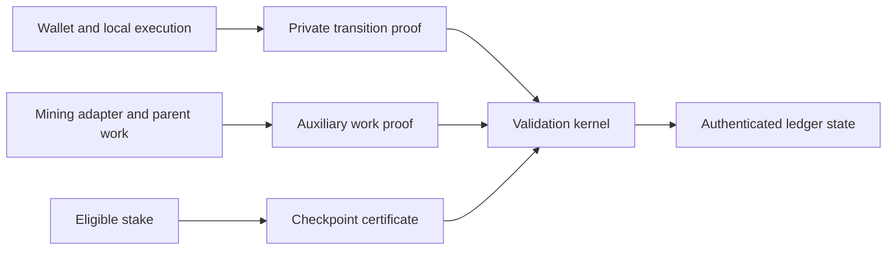

# Thorum

Thorum (THM) is a privacy blockchain research implementation focused on post quantum cryptography, confidential smart contracts, auxiliary proof of work, and stake checkpoint finality.

The protocol architecture separates the private transaction relation, deterministic state validation, parent work verification, and checkpoint consensus. Each boundary has explicit validation requirements and implementation milestones.

## Implementation status

The initial workspace contains deterministic monetary accounting and its tests, an independent reference model, reproducible research data, and protocol specifications. It does not yet implement a network, private payment proofs, private staking, a wallet, or a mining service. No combined cryptographic security claim or independent audit is asserted.

| Area | Current scope |
|---|---|
| [Core accounting](crates/thorum-core/src/lib.rs) | Atomic unit arithmetic, subsidy schedule, issuance ceiling, reward allocation, burns |
| Research | Independent schedule construction, golden vectors, analytical projections, reproducible figures |
| Private ledger | Transaction relation and kernel requirements |
| Consensus | Work/checkpoint boundaries and open construction questions |
| Mining | Parent work validation and operator interface requirements |
| Wallet | Local validation, restricted staking authority, disclosure and recovery requirements |

## Research targets

1. Private payments and contract state by default. Wallets construct witnesses and proofs locally. Validators check authorized transitions, conservation, and double spending without receiving spending secrets or plaintext private values.
2. Post quantum protection across authorization, recipient encryption, commitments, nullifiers, proofs, and recovery. Individual standardized primitives do not establish the security of their composition.
3. Native private payments, timed escrow, and confidential fungible assets under common ledger rules and resource limits.
4. User controlled viewing permissions, restricted staking authority, encrypted backups, and recovery tests covering lost devices, missing data, and branch changes.
5. Explicit metadata boundaries with reproducible measurements of transaction shape, fees, timing, application identifiers, wallet queries, and network observations.

These are specification requirements. Their security properties have not been implemented or established by the accounting tests. The [research specification](docs/research-target.md) defines formal relations, information flow, evaluation methods, and acceptance gates.

For each asset $a$, an ordinary valid transition must satisfy

$$
\sum_i v_{i,a}^{\mathrm{in}} + m_a
= \sum_j v_{j,a}^{\mathrm{out}} + b_a + f_a
$$

Here $m_a$ is authorized minting, $b_a$ is authorized destruction, and $f_a$ is the fee in that asset. Ordinary transactions have $m_{\mathrm{THM}}=0$. Native subsidy creation follows a separate kernel rule. This conservation relation is necessary but does not by itself provide authorization, privacy, or proof soundness.

## Architecture



This diagram describes component boundaries. Implementation status is recorded separately above.

## Ecosystem governance research

The governance extension studies native ecosystem funding with stake voting through the desktop wallet. It separates treasury decisions from automatic checkpoint votes and from the operator controlled external mining treasury. The current accounting implementation uses a 70 percent miner allocation and a 30 percent staking budget. A 60 percent miner, 30 percent staking, and 10 percent ecosystem profile remains a separate research design, with no treasury minting or governance code implemented.

The [governance specification](docs/governance.md) defines the authority boundary, exact allocation model, voting weight, funding lifecycle, and unresolved privacy and security requirements.

## Build and check

The Rust workspace has no external crate dependencies at this stage. The validated toolchain is Rust 1.94.1.

```text
cargo test --workspace --offline
cargo fmt --all -- --check
cargo clippy --workspace --all-targets --offline -- -D warnings
```

Reference model and figure generation commands are documented in [research/emission](research/emission/README.md).

## Documentation

1. [Architecture](docs/architecture.md)
2. [Private transaction relation](docs/private-transactions.md)
3. [Checkpoint consensus](docs/checkpoints.md)
4. [Mining integration](docs/mining.md)
5. [Wallet and recovery](docs/wallet.md)
6. [Treasury operations](docs/treasury.md)
7. [Development parameters](docs/parameters.md)
8. [Implementation milestones](docs/development.md)
9. [Security policy](SECURITY.md)
10. [Contribution guide](CONTRIBUTING.md)
11. [Privacy and post quantum research specification](docs/research-target.md)
12. [Ecosystem governance](docs/governance.md)

## Source and research practice

Specifications identify assumptions and unresolved constructions. Benchmarks identify the implementation, hardware, configuration, and measurement method. Analytical projections are distinguished from measurements. Required dependency attribution and license notices are retained when components are incorporated.

Project licensing and third party source inventory must be completed before external components are incorporated or a distribution is prepared.
