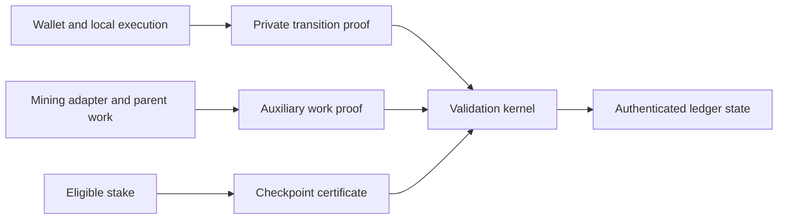

# Thorum

Thorum (THM) is a privacy blockchain research implementation focused on post quantum cryptography, confidential smart contracts, auxiliary proof of work, and stake checkpoint finality.

The protocol architecture separates the private transaction relation, deterministic state validation, parent work verification, and checkpoint consensus. Each boundary has explicit validation requirements and implementation milestones.

## Implementation status

The workspace contains deterministic monetary accounting, an independent reference model, isolated primitive and relation laboratories, reproducible research data, and protocol specifications. Local relation checks receive private witnesses directly and do not establish a private proof. The workspace does not yet implement a network, private payment proofs, private staking, a wallet, or a mining service. No combined cryptographic security claim or independent audit is asserted.

| Area | Current scope |
|---|---|
| [Core accounting](crates/thorum-core/src/lib.rs) | Atomic unit arithmetic, subsidy schedule, issuance ceiling, 60/20/10/10 allocation, actual issuance and burns |
| Research | Independent schedule construction, golden vectors, analytical projections, reproducible figures |
| [Primitive laboratory](docs/crypto-lab.md) | Real signature, key establishment and encrypted envelope experiments, selected official vectors, tamper rejection and local measurements |
| [Relation laboratory](docs/relation-lab.md) | Transparent local ownership, membership, nullifier, conservation, encrypted delivery and stake eligibility checks |
| [Proof feasibility](docs/proof-feasibility.md) | Pinned backend evidence and unresolved hiding, knowledge soundness and quantum security gates |
| Private ledger | Transaction relation and kernel requirements |
| Consensus | Work/checkpoint boundaries and open construction questions |
| Mining | Parent work validation and operator interface requirements |
| Wallet | Local validation, `thm` address namespace, restricted staking authority, disclosure and recovery requirements |

## Research targets

1. Private payments and contract state by default. Wallets construct witnesses and proofs locally. Validators check authorized transitions, conservation, and double spending without receiving spending secrets or plaintext private values.
2. Post quantum protection across authorization, recipient encryption, commitments, nullifiers, proofs, and recovery. Individual standardized primitives do not establish the security of their composition.
3. Native private payments, timed escrow, and confidential fungible assets under common ledger rules and resource limits.
4. User controlled viewing permissions, restricted staking authority, encrypted backups, and recovery tests covering lost devices, missing data, and branch changes.
5. Explicit metadata boundaries with reproducible measurements of transaction shape, fees, timing, application identifiers, wallet queries, and network observations.

These are specification requirements. Their security properties have not been implemented or established by the accounting tests. The [research specification](docs/research-target.md) defines formal relations, information flow, evaluation methods, and acceptance gates.

For each asset $a$, an ordinary valid transition must satisfy

$$
\sum_i v_{i,a}^{\mathrm{in}} + m_a
= \sum_j v_{j,a}^{\mathrm{out}} + b_a + f_a
$$

Here $m_a$ is authorized minting, $b_a$ is authorized destruction, and $f_a$ is the fee in that asset. Ordinary transactions have $m_{\mathrm{THM}}=0$. Native subsidy creation follows a separate kernel rule. This conservation relation is necessary but does not by itself provide authorization, privacy, or proof soundness.

## Architecture



This diagram describes component boundaries. Implementation status is recorded separately above.

## Native subsidy allocation

The current native subsidy profile assigns 60 percent to miners, 20 percent to eligible staking duties, 10 percent to the protocol pool, and 10 percent to development maintenance for the designated project developer. Atomic rounding remainders belong to the miner. The first 16 THM budget gives 9.6, 3.2, 1.6, and 1.6 THM respectively. Unearned staking budget remains unissued. Pool and developer allocations count as issued immediately, even while unspent.

The developer allocation is temporary and requires retirement through a future consensus hard fork after work completion and community handover. Its future 10 percent is to be redistributed to mining and staking. The successor ratio, criteria, process, and activation height remain unresolved. The pool share remains 10 percent absent a separate explicit change. Existing legitimately earned credits are unaffected, and the code contains no automatic sunset.

The [allocation specification](docs/subsidy-allocation.md) defines the exact integer rule and issuance boundary. It applies to block subsidy, with fee distribution left separate. The core does not create payout notes or validate destinations. Pool governance remains unimplemented and separate from developer credits, checkpoint voting, and the operator controlled external mining treasury. Its [research specification](docs/governance.md) records the spending and ballot requirements. No production genesis has been released.

## Build and check

The monetary core has no external crate dependencies. The separate primitive laboratory uses the exact dependency versions in Cargo.lock. The validated toolchain is Rust 1.94.1. Fetch the locked dependencies once before running offline checks.

```text
cargo fetch --locked
cargo test --workspace --locked --offline
cargo fmt --all -- --check
cargo clippy --workspace --all-targets --offline -- -D warnings
```

Reference model and figure generation commands are documented in [research/emission](research/emission/README.md).

The [cryptographic research record](research/crypto/README.md) retains selected official vectors, dependency provenance, local measurements, and reproducible latency figures.

## Documentation

1. [Architecture](docs/architecture.md)
2. [Private transaction relation](docs/private-transactions.md)
3. [Checkpoint consensus](docs/checkpoints.md)
4. [Mining integration](docs/mining.md)
5. [Wallet and recovery](docs/wallet.md)
6. [Treasury operations](docs/treasury.md)
7. [Development parameters](docs/parameters.md)
8. [Implementation milestones](docs/development.md)
9. [Security policy](SECURITY.md)
10. [Contribution guide](CONTRIBUTING.md)
11. [Privacy and post quantum research specification](docs/research-target.md)
12. [Protocol pool governance](docs/governance.md)
13. [Cryptographic feasibility laboratory](docs/crypto-lab.md)
14. [Third party notices](THIRD_PARTY_NOTICES.md)
15. [Native subsidy allocation](docs/subsidy-allocation.md)
16. [Transparent relation laboratory](docs/relation-lab.md)
17. [Proof backend feasibility](docs/proof-feasibility.md)

## Source and research practice

Specifications identify assumptions and unresolved constructions. Benchmarks identify the implementation, hardware, configuration, and measurement method. Analytical projections are distinguished from measurements. Required dependency attribution and license notices are retained when components are incorporated.

Original project source is available under the [MIT license](LICENSE). External components retain their own licenses and notices, recorded in the [dependency inventory](research/crypto/dependency-inventory.json). Source and binary distributions must preserve the applicable notices.
