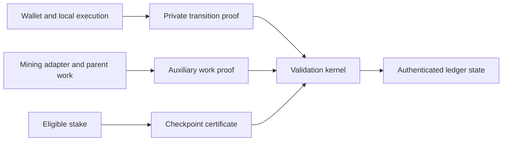

# Thorum

Thorum (THM) is a research and implementation effort for a private application blockchain with post-quantum authorization, confidential state transitions, auxiliary proof of work, and stake checkpoint finality.

The protocol architecture separates the private transaction relation, deterministic state validation, parent-work verification, and checkpoint consensus. Each boundary has explicit validation requirements and implementation milestones.

## Implementation status

The initial workspace contains deterministic monetary accounting and its tests, an independent reference model, reproducible research data, and protocol specifications. It does not yet implement a network, private payment proofs, private staking, a wallet, or a mining service. No combined cryptographic security claim or independent audit is asserted.

| Area | Current scope |
|---|---|
| [Core accounting](crates/thorum-core/src/lib.rs) | Atomic-unit arithmetic, subsidy schedule, issuance ceiling, reward allocation, burns |
| Research | Independent schedule construction, golden vectors, analytical projections, reproducible figures |
| Private ledger | Transaction relation and kernel requirements |
| Consensus | Work/checkpoint boundaries and open construction questions |
| Mining | Parent-work validation and operator interface requirements |
| Wallet | Local validation, restricted staking authority, disclosure and recovery requirements |

## Architecture



This diagram describes component boundaries. Implementation status is recorded separately above.

## Build and check

The Rust workspace has no external crate dependencies at this stage. The validated toolchain is Rust 1.94.1.

```text
cargo test --workspace --offline
cargo fmt --all -- --check
cargo clippy --workspace --all-targets --offline -- -D warnings
```

Reference-model and figure generation commands are documented in [research/emission](research/emission/README.md).

## Documentation

- [Architecture](docs/architecture.md)
- [Private transaction relation](docs/private-transactions.md)
- [Checkpoint consensus](docs/checkpoints.md)
- [Mining integration](docs/mining.md)
- [Wallet and recovery](docs/wallet.md)
- [Treasury operations](docs/treasury.md)
- [Development parameters](docs/parameters.md)
- [Implementation milestones](docs/development.md)
- [Security policy](SECURITY.md)
- [Contribution guide](CONTRIBUTING.md)

## Source and research practice

Specifications identify assumptions and unresolved constructions. Benchmarks identify the implementation, hardware, configuration, and measurement method. Analytical projections are distinguished from measurements. Required dependency attribution and license notices are retained when components are incorporated.

Project licensing and third-party source inventory must be completed before external components are incorporated or a distribution is prepared.
