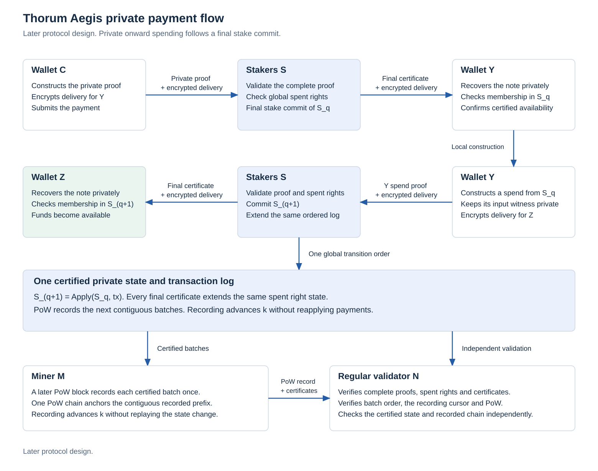
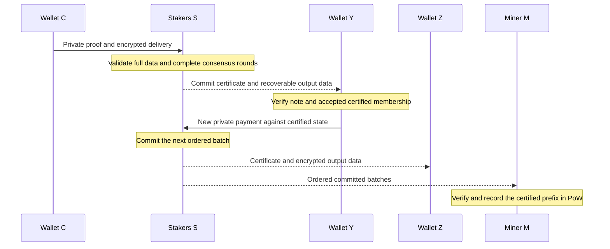
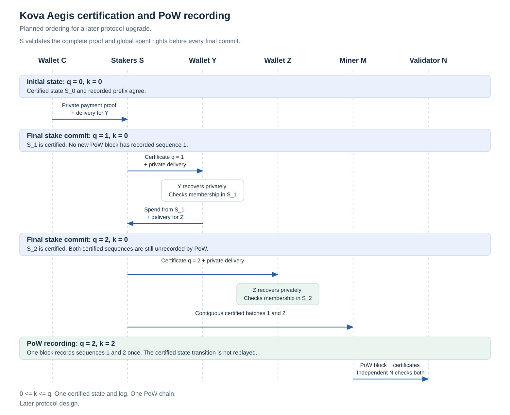

# Kova Aegis Protocol

Kova Aegis is the later protocol design for private payments that become spendable after stake consensus, before their recording in the mined chain. Wallets construct complete private payment proofs locally. Eligible stakers commit an ordered state transition. Miners subsequently record that committed history under the existing auxiliary work rules.

## Development boundary

| Area | Status |
|---|---|
| Aegis architecture and acceptance requirements | Documented here |
| Consensus state machine and confidential quorum construction | Specification and feasibility work |
| Aegis runtime, simulator and wallet integration | Not implemented |
| Spendable payments before mining | Later activation target |
| Latency measurements | None |

Aegis is a separate later milestone. The initial chain scope retains complete private payments, confidential stake, the ledger, auxiliary mining, checkpoint consensus, networking and the private wallet. Its initial onward spending rule remains checkpoint finality. A preliminary payment lock remains insufficient. Aegis changes that eligibility rule only through a separately specified and reviewed consensus version. It is not required to complete the first chain test milestone.

The architecture uses one ordered certified history and one PoW chain. Contracts and the wallet Safe retain their own delivery stages. Unsupported application rights cannot become spendable merely because a committee signs them.

<picture>
  <source media="(prefers-color-scheme: dark)" srcset="../research/aegis/figures/aegis-architecture-dark.svg">
  
</picture>

The figures show planned dependencies and ordering. They contain no measured performance data. Their [source and reproduction record](../research/aegis/README.md) are retained separately.

## Payment sequence

C, Y and Z denote independent wallets. S denotes the eligible staking committee, M a miner and N a regular validating node.

1. C constructs a complete private transaction using eligible notes. The proof binds the same hidden inputs, ownership, conservation, restrictions, stable nullifiers, exact public transaction and encrypted output delivery.
2. S verifies the proof and referenced certified state, checks global consumption and resource limits, obtains the complete payload and runs the consensus rounds.
3. A completed commit certificate advances the certified state. Proposal receipt, prevotes, a preliminary quorum or a payment reservation do not make an output spendable.
4. Y obtains the certificate and encrypted note data, verifies consensus and state membership locally, recovers the note and checks its spending policy. The wallet can then mark an eligible ordinary output available under Aegis.
5. Y constructs its own private proof against an accepted accumulated root. It can pay Z in a subsequent certified batch before either payment has been mined. Each hop requires its own proof and consensus decision.
6. M records the same certified batches in order. N independently verifies both the committed transitions and their work recording. Neither role receives private witnesses.

The first Aegis payment class consumes notes from earlier committed batches. It does not consume an output created earlier within the same uncommitted batch. This keeps the first dependency rule explicit while permitting C to Y and Y to Z in successive decisions before mining.

## Certified state and recorded prefix

Let q be the certification sequence, r a consensus round within that sequence, e the committee epoch and h a mined block height. These are different coordinates. A certification round is not a mined block.

The certified state S_q authenticates at least the following components:

| Component | Required contents |
|---|---|
| A_q | Append only accumulated note commitments and accepted root history |
| N_q | Global consumed nullifiers and other shared consumption identities |
| R_q | Asset, application, reward origin, stake and protected right restrictions |
| I_q | Monetary accounting, imported issuance identities and reserved fee obligations |
| P_q | Last finalized PoW anchor, finalized mined height H_f and its recorded prefix |
| E_q | Committee epoch, eligibility snapshot and permitted transition versions |

A batch B_q binds the chain, Aegis version, e, q, parent certified decision, prestate and poststate roots, ordered complete transaction payload commitment, encrypted delivery commitment and applicable PoW anchor. It binds the authorizing proof bytes as well as effecting transaction data. A transaction ID alone cannot identify every accepted authorization representation.

The certificate certifies that exact batch. All nodes must obtain its bounded payload, verify its proofs and deterministically reproduce the transition. A signed state root alone does not supply validity or private recovery data.

For ordered transactions t_1 through t_m, validation requires

$$
S_q=\operatorname{Apply}(S_{q-1},[t_1,\ldots,t_m]),
\qquad
\operatorname{NF}(t_i)\cap N_{q-1}=\varnothing,
$$

and pairwise disjoint consumed identities within the batch. Application release, cancellation, migration and ordinary spending share those identities where they consume the same right. Every failure leaves the prior durable state unchanged.

Let k_h be the last certified sequence recorded by a particular valid PoW branch at height h. Then

$$
0\le k_h\le q,\qquad
\operatorname{Recorded}(h)=[B_1,\ldots,B_{k_h}].
$$

A mined block authenticates a contiguous extension from its parent's cursor. It cannot skip a batch, reorder transactions, alter encrypted data or replace a committed spend. Recording does not append commitments, consume nullifiers, debit fees or issue the same reward twice. Replaying history on a new node reconstructs each transition exactly once.

<picture>
  <source media="(prefers-color-scheme: dark)" srcset="../research/aegis/figures/aegis-certification-order-dark.svg">
  
</picture>

A reorganization of unfinalized work can change a branch's recording cursor. It cannot erase the certified state or make an already committed nullifier unused. Nodes retain the committed data needed to record it again. Work selection remains restricted to branches compatible with finalized work anchors and the certified history. Greater work does not override a conflicting valid Aegis commitment.

Exact header fields, recording obligations, checkpoint cuts and fork selection remain specification gates. A block validity rule cannot require knowledge of a node's locally highest certificate, since different honest nodes can receive it at different times. Any mandatory recording floor must derive from authenticated prior controls and bounded rules.

## Consensus and quorum

The consensus evaluation baseline is a round based proposal, prevote and precommit protocol with persistent locks, justified lock changes, leader replacement and explicit commit decisions. Its specification must preserve the complete state machine and evidence rules. A single signature collection is insufficient. The pinned [consensus state machine](https://github.com/cometbft/cometbft/blob/d03254d3599b973f979314e6383b89fa1802e679/spec/consensus/consensus.md) and [signing rules](https://github.com/cometbft/cometbft/blob/d03254d3599b973f979314e6383b89fa1802e679/spec/consensus/signing.md) are research references, without code adoption or an inherited security claim.

Let W_e be the fixed positive total eligible voting weight for epoch e, and Q the distinct authorized signers for one exact phase, round and batch. The threshold requirement is

$$
3\sum_{i\in Q} w_i>2W_e,\qquad
3W_{\mathrm{Byzantine}}<W_e.
$$

All arithmetic needs exact bounded integers. Offline signers do not shrink W_e. Duplicate signatures, split positions, delegates and repeated eligibility credentials cannot increase weight. The quorum intersection calculation is necessary but does not establish the adapted protocol's safety, liveness or committee selection security.

The model requires eventual communication, sufficient honest online weight, valid data and correct persistent signing. It does not promise progress during every partition. A loss of quorum pauses new decisions while preserving prior commitments. Two conflicting valid commit certificates are a safety failure requiring an explicit halt and recovery procedure. Neither the heaviest work branch nor a local timeout silently chooses away that failure.

### Confidential eligibility and post quantum certificates

Voting authority is separate from wallet spending authority. The epoch construction must authenticate eligible bonded stake, private weight, an epoch scoped voting authority and unique stake consumption. The denominator and signer weights must correspond to the same fixed snapshot.

Explicit ML-DSA-87 signatures are the initial certificate evaluation baseline. Their signer authorities may be visible as epoch scoped pseudonyms. They must not expose private payment owners or balances. A signature carries 4627 bytes under the retained primitive profile, before signer references, eligibility, weight evidence, headers and justification data. Inline verification keys add 2592 bytes each. Committee size, bandwidth and verification cost need measured limits.

Confidential eligibility requires an actual construction proving authorized distinct signers and the hidden weight threshold. Separate individual eligibility proofs do not automatically provide an aggregate of hidden weights. Distributed generation of that evidence, transcript privacy, canonical ordering, signer accountability and bounded verification are unresolved gates. Revealing holdings or adopting an unsupported classical aggregate is not a completion of this requirement.

Votes bind chain, version, epoch, sequence, round, phase, batch digest and eligibility snapshot. Persistent signing records must survive crashes, restores and duplicated services before votes leave the signer. The [durable signing and replay reference](https://github.com/cometbft/cometbft/blob/d03254d3599b973f979314e6383b89fa1802e679/spec/consensus/wal.md) motivates a dedicated crash and replay test gate. Exact Kova domains and encodings remain unfrozen.

Proofs, commitments, nullifiers, encryption, consensus signatures, history and recovery each retain their own post quantum analysis. Current component experiments do not establish a combined quantum security level or confidential quorum protocol.

### Handover and bootstrap

The outgoing epoch must commit its last state, pending recording obligations and authorized successor snapshot. The incoming committee starts from that unique state and obtains the full data. Overlap, activation sequence, voting key rotation, evidence retention, withdrawals and unavailable successors need explicit rules and adversarial tests.

The first committee requires a public bootstrap construction. Immature mining rewards cannot already supply mature eligible stake, and a committee cannot be assumed merely to finalize its own creation. No Aegis status exists before that activation gate. Restored and new nodes also need a reviewed history authenticity and long range recovery policy. Post quantum signatures alone do not solve later compromise of old voting keys.

## Privacy and recipient recovery

Y's onward proof establishes ownership of an eligible unspent note in an accepted accumulated state. It does not publish C's output commitment, its leaf index, the hidden ownership key or a reference declaring that particular output consumed. Stable nullifiers and global consumption enforce uniqueness without changing note identity when mining catches up.

Accepted anchors come from authenticated certified history, with explicit retention and resource bounds. The protocol must not force a recipient to use a separate single payment tree or a public dependency pointer. Witness updates, root selection and stale root recovery must work with the same hidden membership construction.

Public nullifiers, output commitments, fee information, certificate sequence, batch membership, ciphertext sizes and network timing remain observable. An immediate onward payment may have a small plausible source set. A shared tree does not establish a minimum anonymity set or eliminate timing analysis. Padding, relay behavior, root selection and optional wallet waiting policies require measured observer tests without a transparent payment fallback.

Before voting, an honest participant needs the complete transaction proofs and encrypted delivery data, validates their commitments and retains them under the availability policy. A certificate or ciphertext digest is not the missing data. Nodes fetch and verify data before accepting state. Wallets recover only after local note checks and authenticated membership reconstruction.

The availability construction must define replication, retention through mining delays, archival recovery, pruning, witness update material and committee handover. It must address withheld data, corrupted chunks, loss after committee rotation and restored wallets with outstanding unmined notes. Availability assumptions remain explicit. No unimplemented availability proof or a remote acknowledgement substitutes for data.

## Mining, rewards and policy clocks

PoW retains the 60 second development block target and supported Equihash auxiliary mining requirements. Aegis has its own certification sequence and latency budget. It neither shortens the work target nor proves that external mining revenue was earned.

Checkpoint advancement, finalized reward imports and epoch changes require serialized control transitions in the same certified history. They must authenticate an already existing valid PoW prefix. That prefix's recording cursor precedes the new control transition. It cannot be required to have already recorded the entry that first certifies it.

Unfinalized work rewards are ineligible to fund an irrevocably spendable Aegis note or committee stake. Finalized imports have a unique issuance identity and occur once. Aegis batch count creates no subsidy. The existing cumulative issuance ceiling, 60/20/10/10 subsidy allocation, unissued unearned stake budget and temporary developer retirement requirements remain applicable. Duty evidence and fee distribution require separate exact rules. Certification must not pay the same fees or duties again on later recording.

For finalized mined height H_f and authenticated reward origin h_r, a reward input requires

$$
H_f\ge h_r,\qquad H_f-h_r\ge10080.
$$

Using finalized height is a conservative Aegis eligibility boundary. Certification sequence, wall time, wallet receipt time and a candidate miner height cannot replace it. Ordinary payments do not acquire a new reward delay. Bonding and principal withdrawal rules remain separate.

Safe request origins and deadlines must also use a specified authenticated policy clock. Aegis must not turn q into mined height, backdate a request or let extra rounds shorten a withdrawal delay. Cancellation and completion retain one pending consumption identity and the predetermined protected return destination. Ordering at the exact deadline, checkpoint jumps, unavailable quorum and monitoring failure need dedicated tests. An unavailable committee does not guarantee that a cancellation can meet its deadline.

## Bounded backlog and failure behavior

Let k_f be the recorded cursor of the last finalized PoW anchor. New payment admission must account for every outstanding certified batch after k_f, including complete bytes, proof work, state effects and reserved control capacity. A possible budget boundary is

$$
q-k_f\le Q_{\max},\qquad
\sum_{j=k_f+1}^{q}|B_j|\le B_{\max}.
$$

Additional deterministic verification and state budgets are required. Parameter values are not selected. Limits must use authenticated state, not a claimed local tip or elapsed timer. Reserved bounded control capacity must allow recording and checkpoint progress to relieve backpressure without accepting more payments or deadlocking at the payment limit.

| Condition | Required response |
|---|---|
| Conflicting or already consumed payment | Reject before commitment |
| Quorum unavailable | Pause new commits and preserve committed state |
| Payload unavailable | Fetch and verify it before accepting state or displaying an available note |
| Mining stalled or backlog full | Pause new payment commits under the bounded admission rule |
| Preliminary vote or uncommitted transaction expires | Release only provisional reservations under the specified round rules |
| Mining delayed after commit | Preserve the payment and all descendant committed obligations |
| Work branch reorganizes | Update only the provisional recording branch and replay recording as required |
| Node restarts | Recover state, certificates, payloads, cursor and signing journal atomically |
| Epoch changes | Carry forward the unique committed state and pending data obligations |
| Conflicting valid commit certificates | Enter the specified safety failure state with evidence |

A committed payment does not expire to reclaim backlog space. A PoW only fallback that discards committed history is incompatible with spending its outputs. Exact deterministic inclusion incentives, reserved control budgets and restart journals are launch gates.

## Relationship to other features

| Feature | Aegis obligation |
|---|---|
| Private payments | Complete same witness ownership, membership, nullifiers, conservation, policies and encrypted delivery |
| Confidential stake | Fixed authenticated eligibility and quorum proof without disclosed holdings or duplicated weight |
| Escrow and confidential assets | Activate supported types only after deterministic order, resource and time semantics are defined |
| Wallet Safe | Preserve delayed withdrawal, restricted recovery and shared pending identity |
| Migration | Preserve consumption identity and restrictions across certified and recorded representations |
| Governance | Keep manual fund ballots separate from automatic payment consensus and duty rewards |
| Ordinary nodes | Verify both histories without holding spending or voting authority |
| Service integration | Use idempotent owned note credits and explicit certified, recorded, mature and unavailable states |
| Compact history | Bind certified state, work recording, versions, freshness and availability separately |

## Latency target and wallet states

The initial experiment target is approximately eight seconds from submission of a complete valid transaction to a completed commit decision under normal test conditions. This is neither a measurement nor a guaranteed deadline. It excludes local proof generation and recipient synchronization.

$$
L_{\mathrm{usable}}=L_{\mathrm{build}}+L_{\mathrm{prove}}+
L_{\mathrm{submit}}+L_{\mathrm{consensus}}+
L_{\mathrm{fetch}}+L_{\mathrm{recover}}.
$$

Each term needs its own workload, hardware, network and resource record. Y's onward payment incurs another local proof and consensus decision. Tests report failures, tail latency, load, unavailable quorum and stalled mining rather than only an ideal average.

The wallet separates proving, submitted, provisionally locked, committed awaiting data, certified available, restricted by policy and recorded by mining. Recording is an independent status. A committed but immature reward remains restricted. A preliminary lock never uses the available balance label.

## Delivery and review gates

| Gate | Required evidence |
|---|---|
| Base chain | Complete private payment and confidential stake feasibility, ledger, work, checkpoints, network and wallet milestones |
| Aegis state specification | Versioned batch, certificate, state, anchor, nullifier, control, clock and replay rules |
| Consensus model | Complete weighted round and lock rules, durable signing, handover, bootstrap, fork selection and formal safety analysis |
| Deterministic simulator | Conflicts, partitions, leader changes, stale messages, duplicate signers, restarts, handover, stalled work and full backlog |
| Private integration | Actual complete proofs, confidential quorum evidence, delivery, recovery and C to Y to Z across successive commits before mining |
| Work and policy integration | Exact once recording/imports, reorganization, fee and duty identity, maturity and Safe deadline cases |
| Performance and privacy | Named hardware, component and end to end costs, bounded worst cases, bandwidth and observer experiments |
| Activation | Independent review, reproducible multi node trials, version transition and explicit recovery policy |

The simulator must identify any modeled cryptographic assumptions. Synthetic signatures or a validity flag are not production proof evidence. No activation height, production encoding, resource constant or completed security argument is supplied by this architecture record.
