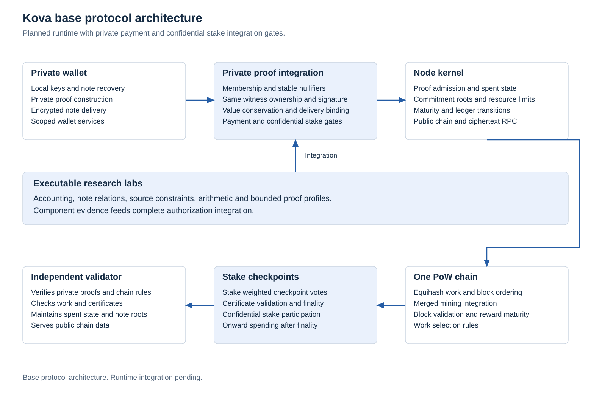
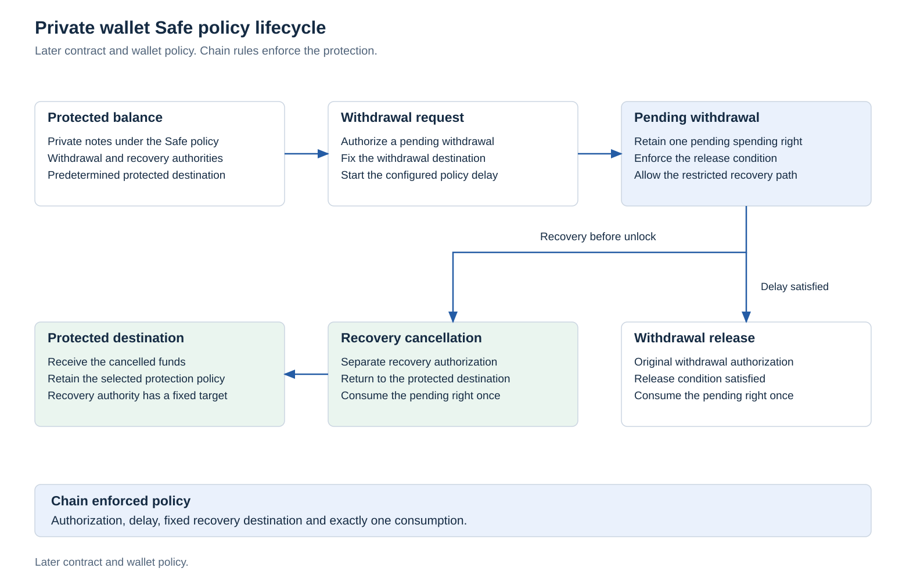

# Architecture

## Component boundaries

Kova uses one ledger and one set of native conservation and authorization rules. Payment, asset, application, and staking transitions must share compatible ownership, nullifier, commitment, and rollback semantics.

The implementation targets a custom chain with reviewed cryptographic dependencies. [Node operation and service integration](node-integration.md) defines ordinary validation independently from mining, staking and wallet authority. Server and exchange interfaces remain subject to the same private relation and consensus gates.

## First release and later applications

The [minimum private cash launch](minimal-launch.md) is the first release target. It includes complete private native payments, independent validation, atomic authenticated state, supported work, confidential checkpoint consensus and bootstrap, recovery and a basic payment client. General contracts and the Safe can activate later through explicit protocol upgrades. This delivery split does not waive any base privacy, proof, consensus, recovery or network gate.

The [private programmable application architecture](private-contracts.md) retains Kova's own general private smart contract target. EVM compatibility is not required. Programs must share the same private source bindings, authorization, global consumption, conservation and encrypted-delivery rules as native payments. Their execution model, compiler, supported resources, matched proof/verifier and activation remain separate construction work.

Unsupported contract and Safe transitions are rejected before their activation. A later version must preserve old note meaning, stable nullifiers, reward origin/maturity, finality and bond restrictions. It cannot turn an unimplemented application into a successful no-op or reinterpret old notes through a wallet setting. The full Qt/mobile experience, broad service integration, governance interface and later Aegis retain their delivery milestones.

## Components

| Component | Responsibility | Evidence required |
|---|---|---|
| Wallet and executor | Discover notes, construct witnesses, execute private application logic, encrypt recovery data | Local reconstruction, restricted key handling, recovery and leakage tests |
| Private proof relation | Bind ownership, asset/value policy, nullifiers, ciphertext commitments and resulting state | Formal relation, adversarial vectors, security analysis and review |
| Later private execution | Execute supported private programs and calls under the common ledger rules | Complete semantics, compiler/constraint correspondence, bounded resources, private state and matched verification |
| Validation kernel | Canonical decoding, proof verification, resource limits, global uniqueness and state transitions | Independent validation agreement and rejection vectors |
| Monetary accounting | Scheduled allocation, actual issuance, cumulative cap, completed burns | Integer boundaries, conservation and reference vectors |
| Work adapter | Construct and authenticate child commitments within supported parent jobs | Acceptance of the same work, malformed witness rejection, compatible operator integration |
| Checkpoint consensus | Select eligible support and finalize a valid branch | Explicit assumptions, quorum/liveness rules and adversarial simulations |
| Aegis later protocol | Certify ordered private state for spending before PoW recording after separate activation | Confidential quorum, complete consensus, availability, replay and work interaction gates |
| Storage and synchronization | Persist authenticated state and perform consistent rollback | Crash/restart, branch change, pruning and recovery tests |
| RPC and indexing | Serve bounded public verification data and capability scoped wallet operations | Authenticated state, query privacy, idempotent service accounting and recovery |

## State separation

<picture>
  <source media="(prefers-color-scheme: dark)" srcset="../research/protocol-figures/figures/base-architecture-dark.svg">
  
</picture>

The monetary module owns a narrow accounting transition. A future chain state additionally needs authenticated commitment roots, spent nullifier state, asset policy, execution commitments, block identity/order, and finalized checkpoint context. Passing an amount to an accounting function does not authorize its creation or destruction.

State changes are atomic at the kernel boundary. Failed decoding, authorization, proofs, limits, or checkpoint checks must leave persisted state unchanged. Branch rollback restores monetary counters and private ledger roots from the same state version.

The [private transition context and atomic acceptance specification](private-transition-state.md) defines the proposed snapshot, verifier context, current state recheck, durable publication and recovery boundary. Its state fields and failure cases remain specification work. It introduces no accepting kernel or network service.

The [RPC and data boundary](rpc-and-data.md) separates public explorer/index data from private wallet views and local spending authority. Data availability and an authenticated state context are part of every supported service mode.

## Later Aegis state boundary

The [Kova Aegis Protocol](aegis.md) extends this architecture through a separately versioned later consensus milestone. It is not part of the initial onward spending rule. Under its design, eligible stakers commit one authoritative private transition sequence and miners record its contiguous prefix. Recording advances a cursor without executing the transition again. An unfinalized work reorganization cannot erase already committed Aegis consumption or its dependent payments.

Certified note roots, global spent identities, restrictions, finalized mined height, monetary imports, encrypted data and epoch authority must share the same authenticated state. Checkpoint advancement and epoch changes are serialized controls. Aegis requires its own consensus, confidential quorum, data availability, bootstrap and activation review. Current runtime behavior and the first chain milestone remain unchanged. Its [figures](../research/aegis/README.md) illustrate planned ordering without a performance claim.

## Private wallet Safe

The Safe is a protected savings vault within the Qt wallet. Its consensus policy and private state are part of the architecture before the ledger and application interfaces are frozen. The executable transitions and wallet view remain a later [delivery milestone](delivery-roadmap.md#private-safe-milestone).

The [detailed Safe design](private-safe.md) defines direct protected receiving, user selected supported delays, independent everyday, withdrawal and recovery authorities, and optional separate local Safe encryption. Consensus consumes the committed private policy. Wallet passwords and backup phrases stay outside consensus and application calls.

<picture>
  <source media="(prefers-color-scheme: dark)" srcset="../research/protocol-figures/figures/wallet-safe-lifecycle-dark.svg">
  
</picture>

The common private note and application relation must support three typed rights: a protected balance, a pending withdrawal and its authorized completion or protected return. Their commitments bind the policy version, asset and value, spending authority, distinct recovery authority, protected return destination and applicable delay. A pending right also binds its fixed withdrawal destination and authenticated request origin. Exact encodings and field visibility require a versioned specification before implementation.

| Boundary | Safe responsibility |
|---|---|
| Private application relation | Deposit, authorized request, deadline constrained completion and restricted recovery cancellation under the same policy |
| Ledger kernel | Authenticated request origin, eligible state, shared consumption identity, maturity restrictions and atomic branch rollback |
| Wallet service | Local private scanning, separate protected and pending balances, recovery authority handling, request monitoring and encrypted restoration data |
| Qt view | Safe deposit, withdrawal request, pending deadline and recovery cancellation through the same wallet service |

Cancellation and completion consume the same pending right and nullifier. Recovery cancellation can return value only to the protected destination committed by the policy. It grants no unrestricted spending authority. A different client must enforce the same deadline, destination and consumption rules.

Reward maturity, asset conservation, fees and staking restrictions remain applicable when value enters or leaves the Safe. Application routing cannot strip those conditions. Restart, missing encrypted data, provisional branch changes and restoration must preserve both the policy and pending request state. Monitoring needs the material required to detect requests without granting general spending control.

The [Safe requirements](protocol-extensions.md#private-safe) define the initial cancellation boundary and remaining policy questions. Implementing its chain relation precedes the protected savings interface. This architecture reserves the necessary authority and state boundaries without claiming a working Safe or a guaranteed recovery outcome.

## Cryptographic evaluation

Primitive and backend evaluation targets include ML-DSA authorization, ML-KEM key establishment, authenticated symmetric encryption, and zero knowledge STARK execution. The isolated [primitive laboratory](crypto-lab.md) supplies executable signature, encapsulation, and encrypted envelope experiments. Separate hiding proof laboratories implement bounded relations. No complete private payment proof is integrated into a running ledger. These experiments do not define a complete private protocol.

Evaluation must include recipient anonymity, ciphertext binding, commitment hiding/binding, unique nullifiers, value ranges, execution soundness, quantum model assumptions, and confidential stake eligibility. Public key exposure and historical ciphertext retention are part of the threat model.

The protocol cannot inherit a complete security claim from a primitive's standardization or from a proof engine. Exact versions, parameters, composition, and known limitations need recorded analysis. Primitive/key upgrades require versioned migration rules without an administrative mint or spending bypass.

Primary specifications: [ML-DSA](https://csrc.nist.gov/pubs/fips/204/final), [ML-KEM](https://csrc.nist.gov/pubs/fips/203/final).

## Research gates

The private transaction relation and private stake construction must be demonstrated and reviewed before dependent production interfaces are frozen. No classical voting or eligibility mechanism based on curves can silently satisfy a post quantum native authorization requirement.
