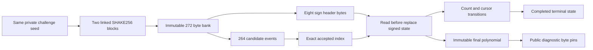

# Connected sparse challenge constraints

The [challenge sampler](../crates/thorum-hash-proof-lab/src/challenge_sampler.rs) constrains a private 64 byte seed, two full SHAKE256 blocks and exact sparse polynomial sampling in one AIR. It follows the `SampleInBall` update order for ML-DSA-87, with 256 coefficients in $\{-1,0,1\}$ and exactly 60 nonzero entries. The algorithm definition is in [FIPS 204, Algorithm 29](https://nvlpubs.nist.gov/nistpubs/FIPS/NIST.FIPS.204.pdf).

This diagnostic interface publishes the expected polynomial and a 64 byte context. A repeated polynomial can identify a repeated challenge. The interface supplies no challenge anonymity, signature permission or production payment route. The complete private authorization relation must retain the polynomial internally and connect the same private seed to signature decoding and final challenge equality. Hidden input commitments, stable nullifiers and mandatory private payments remain separate preserved requirements.

## Hash and byte linkage

The same private seed bank supplies the exact 64 byte message. SHAKE256 uses rate 136 and capacity 64 bytes. Initial padding has suffix 31 at byte 64 and the terminal 128 bit at byte 135. The second permutation starts from all 200 bytes of the first result, including the complete capacity. It absorbs no additional seed or padding.

All 272 output bytes are individually linked to eight Boolean bits and retained in one immutable XOF bank. The first eight bytes give 64 little endian sign bits. Only the first 60 signs are used. The remaining four header bits are not required to be zero. All second block bytes remain bound even when the sampler completes in the first block.

## Accepted indices and signed relocation

At accepted count $s\in[0,59]$, the destination is $i=196+s$. Each active event consumes the next byte $j$. It accepts exactly when $j\le i$. Boolean take $t$, active flag $a$ and unsigned eight bit slacks $l,u$ satisfy

$$
t=1\Longrightarrow j+l=i,\quad u=0,
\qquad
a-t=1\Longrightarrow i+1+u=j,\quad l=0.
$$

All values in these residuals are bounded by 511 in magnitude, strictly below the BabyBear characteristic $2013265921$. Their field equalities therefore enforce integer comparisons without wraparound. A 256 position Boolean index selector sums to $t$ and its weighted index equals $tj$.

Let $C_k^+,C_k^-$ be exclusive Boolean encodings of the current signed coefficient. The selected old value is read before replacement. With destination selector $I_k$, accepted index selector $E_k$ and the sign bit $b_s$, the transitions are

$$
\begin{aligned}
(C_k^+)'&=C_k^++tI_k(\mathrm{old}^+-C_k^+)+E_k(1-b_s-C_k^+),\\
(C_k^-)'&=C_k^-+tI_k(\mathrm{old}^--C_k^-)+E_k(b_s-C_k^-).
\end{aligned}
$$

The old value auxiliaries equal $\sum_k E_k C_k^+$ and $\sum_k E_k C_k^-$. This prevents substituting the new sign or a different cell for the read. Repeated occupied indices and $j=i$ are valid. Untouched cells hold. The signed state starts at zero and its nonzero weight equals the accepted count on every row. Rejection consumes a byte without consuming a sign or advancing that count.

## Program and completion

A fixed 265 position selector executes 264 candidate events followed by a sticky terminal state. A separate 61 position selector starts at zero and advances only on acceptance. Count 60 disables further sampling. The byte cursor starts at eight, increments on each active event and freezes after completion. While active it equals eight plus the event position.

The first terminal program row requires count 60. An incomplete stream cannot obtain extra candidates from padding rows. Candidate, comparison and index auxiliaries are inactive after completion. The seed, XOF, sign and final coefficient banks remain immutable through the entire trace.

At completion, each final coefficient equals $C_k^++(q-1)C_k^-$ for $q=8380417$. Separate byte pins give the canonical u32 encoding of zero, one or $q-1$. A public integer differing by the field characteristic cannot exploit modular reduction. The expected statement constructor and verifier additionally validate public coefficient encoding and weight.

## Fixed diagnostic profile

The public API is `prove_challenge_sampler(&Witness,&Statement)` and `verify_challenge_sampler(&[u8],&Statement)`. `Witness::from_challenge_seed` has no general plaintext export or serialization interface. Verification consumes no private witness, host signature verdict or private equality callback.

| Property | Fixed value |
|---|---|
| Profile | `thorum.challenge-sampler-proof-lab.shake256.sampleinball.two-blocks.serial.p3-0.8.0.v1` |
| Trace | 512 rows and 6598 columns |
| Actual symbolic degree | Three |
| Public vector | 1024 coefficient bytes and 64 context bytes |
| Stored hiding degree | Ten bits |
| Quotient chunks and FRI rounds | Eight chunks of four extension elements and ten binary rounds |
| Queries and log blowup | 64 and 3 |
| Challenge extension | Degree four over BabyBear |
| Random codewords and row salts | Four and sixteen base field elements |
| Grinding work | Zero |
| Transport bounds | 16 MiB, 2000000 tokens, 16384 members, depth 24, strings 64 bytes and integers 20 digits |

Both commitment layers retain hiding MMCS, with fresh independent OS seeded generators per proof. Full SHA3-512 domains are `thorum.challenge-sampler-proof-lab.leaf.v1`, `thorum.challenge-sampler-proof-lab.node.v1` and `thorum.challenge-sampler-proof-lab.transcript.v1`. Verification requires no private entropy. The local mask budget is $512\ge2(64+4\cdot2)=144$. Bounded JSON preflight precedes decoding, fixed shape and canonical reencoding checks. These settings alone establish no composed privacy, quantum knowledge soundness or security bit claim. Context is opaque public transcript data rather than authenticated transaction semantics.

## Evidence and scope

The [reference record](../research/challenge-sampling/README.md) reproduces six genuine challenge seeds, 12 complete sponge states, 288 round states and 267 injected streams. Separate dictionary and array algorithms agree with the retained complete signature oracle. Genuine fixtures include seeds extracted from valid and invalid signatures. Correct sampling of an invalid signature's seed does not establish signature validity.

The injected corpus covers repeated zero and occupied indices, both signs, unused sign bits, rejection boundaries, continuation past byte 136, completion exactly at byte 272 and every possible final index at $i=255$. Two streams exceed supported capacity. Injected bytes have no claimed SHAKE preimage.

Actual honest proofs verify, fresh repetitions have different commitments, and changes to all 1088 public fields reject. Thirteen raw false proofs bypass witness prechecks and reject at direct backend verification. Five faults retain real Keccak rows and matching sampler data while altering seed or continuation. Four locally Boolean state faults preserve weight and matching final polynomials while corrupting old reads, relocation destinations, sign consumption or untouched cells. Four further faults cover unused byte aliases, count skips, cursor reset and padding acceptance. Canonical transport corruption is tested separately.

Raw trace payload is $512\cdot6598\cdot4=13512704$ bytes. Randomized trace payload is $1024\cdot6602\cdot4=27041792$ bytes and main LDE payload is $8192\cdot6602\cdot4=216334336$ bytes. These are analytical array dimensions, without a measured peak memory, runtime or throughput claim.

The bounded class supports at most 272 XOF bytes. `UnsupportedCapacity` is distinct from invalidity of the complete signature scheme. A production resource policy remains unselected. No standard completeness or conformance certification follows from this diagnostic.

The [joint signature child](signature-challenge.md) reuses this AIR while connecting canonical private response and hint decoding to the same represented signature. Full key parsing, all connected matrix accumulation and transforms, hint application, final challenge equality and binding to the same hidden key, note and exact authorized transaction remain required. Independently valid component proofs do not prove their private witnesses agree. Complete private payment and confidential stake feasibility remain prerequisites for ledger kernel integration.
