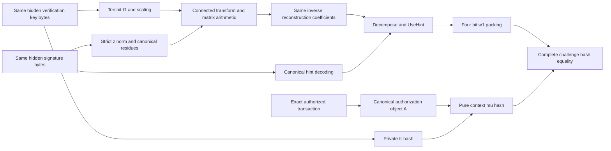

# Canonical coefficient and hint constraints

The arithmetic laboratory exposes reusable `packing` and `hints` evaluators for the fixed ML-DSA-87 parameter set. They constrain byte decoding, strict response norms, conversion to canonical residues, rounded decomposition and hint application over BabyBear. They return expressions from the same constrained columns for use by a surrounding private computation.

These evaluators do not verify a signature or authorize a payment. The enclosing relation must connect their inputs to the same hidden verification key and signature, their outputs to the actual transforms and reconstruction, and the final challenge to the exact authorized transaction. The existing private input commitments, stable nullifiers and private payment default retain their original requirements.

## Five byte coefficient windows

Let $q=8380417$, $\gamma_1=524288$ and $\beta=120$. `packing::decode_t1` constrains 40 Boolean input bits and returns the four consecutive 10 bit little endian coefficients in that window. `packing::scaled_t1` returns those same coefficients multiplied by $2^{13}$. Each decoded coefficient is in $[0,1023]$, and each scaled coefficient is in $[0,q-1]$.

`packing::decode_z_pair` consumes the same 40 input bits as two consecutive 20 bit unsigned words $d_0,d_1$. Its 174 auxiliary Boolean columns establish, for each word,

$$
d=121+\ell,\qquad d+u=1048455,
\qquad \ell,u\in[0,2^{20}-1].
$$

These exact integer equalities are equivalent to $121\le d\le1048455$. With $z=\gamma_1-d$, they enforce the strict verification bound

$$
|z|<\gamma_1-\beta=524168.
$$

The returned canonical residue $z_q$ has 23 Boolean bits and a 23 bit complement satisfying $z_q+\bar z_q=q-1$. A Boolean negative flag $s$ enforces

$$
z_q=\gamma_1-d+sq.
$$

Canonicality forces $s=0$ for nonnegative $z$ and $s=1$ for negative $z$. At $z=0$, the canonical range excludes the alternative value $q$. The Boolean ranges bound every scalar equality residual strictly inside $(-2013265921,2013265921)$, so no nonzero field characteristic alias can satisfy an integer equation. The evaluator is specific to `AirBuilder<F=BabyBear>`.

| Residual under the declared bit ranges | Conservative integer interval |
|---|---|
| $d-121-\ell$ | $[-1048696,1048454]$ |
| $d+u-1048455$ | $[-1048455,1048695]$ |
| $z_q+\bar z_q-(q-1)$ | $[-8380416,8396798]$ |
| $z_q-\gamma_1+d-sq$ | $[-8904705,8912894]$ |

The functions return shared expressions. A caller must use them as the actual coefficient source. Recomputing unconstrained host arrays or checking a host decoder verdict does not establish this connection. The window functions do not implement the full 2592 byte key parser, 4627 byte signature parser or canonical hint index state machine.

## Rounded decomposition and hints

Define $\alpha=523776$ and $\gamma_2=261888$, so $q=16\alpha+1$ and $\alpha=2\gamma_2$. The 125 Boolean columns of `hints::eval_use_hint` establish

$$
0\le r<q,\qquad r+\gamma_2-1=\alpha n+u,
\qquad 0\le n\le16,\quad 0\le u<\alpha,
$$

$$
n=a_1+16e,\qquad 0\le a_1\le15,
\qquad a_0=u-\gamma_2+1-e.
$$

The Boolean edge flag $e$ is one exactly when $r\in[q-\gamma_2,q-1]$. Substitution gives the integer identity $r=\alpha a_1+a_0+qe$. The returned low part $a_0$ is a signed field expression in $[-\gamma_2,\gamma_2]$. It is not a canonical residue modulo $q$ and requires an explicit conversion before modular use.

A Boolean positive flag $b$ and an 18 bit slack $t$ enforce the strict sign through mutually exclusive equations:

$$
b=1\Longrightarrow u=\gamma_2+e+t,
\qquad
b=0\Longrightarrow u+t=\gamma_2+e-1.
$$

Thus $b=1$ exactly when $a_0>0$. A zero low part takes the nonpositive branch. For the same decoded Boolean hint $h$, the four bit output $w$ satisfies

$$
w=a_1+h(2b-1)+16(c_--c_+),
\qquad c_-,c_+\in\{0,1\},\quad c_-c_+=0.
$$

The range $0\le w\le15$ forces the unique increment or decrement modulo 16, including both wrap boundaries. All equalities have integer residuals strictly inside the BabyBear characteristic. The actual derived symbolic degree is two before any caller phase selector.

## Required private dataflow

This graph records required composition. The final challenge preimage is $\mu\mathbin\Vert\operatorname{Encode}(w_1)$. The intermediate $\mu$ derives from the same key hash $tr$, the exact pure signature context and the canonical authorization object $A$. The reusable evaluators do not implement the complete graph. Separate valid component proofs cannot establish that their hidden values agree. Sampling, hash continuation, canonical full parsing, key identity, immutable witness connections and transaction binding retain separate completion gates.

## Reproducible evidence

The [reference record](../research/coefficient-constraints/README.md) contains 2602 public key windows and 4624 response windows, including all windows from five genuine retained signature fixtures. It compares explicit byte formulas against the independently implemented full signature decoder. The response corpus has 4529 valid windows and 95 strict norm rejections. Boundary cases cover all 40 input bit positions, maximal key coefficients, both response signs and both strict norm endpoints.

The hint corpus contains 322 rounding boundary cases, 10240 reconstruction coefficient cases from those five signatures and 169 invalid diagnostics. Actual AIR tests cover these cases, detached public values, nonboolean encodings and causal sign, edge, quotient and wrap faults. An exhaustive mathematical test compares both hint values for every canonical residue. That is a mathematical function comparison, not millions of proofs.

## Test only hint proof boundary

The arithmetic crate's `cfg(test)` hint harness publishes synthetic $r$, hint and output diagnostics plus a 64 byte context. Its 70 public fields use four separate little endian input bytes, one hint byte, one output byte and the context. The AIR holds all 125 columns constant through 256 rows. The fixed verifier supplies its expected statement and profile, rather than accepting either from a proof.

| Parameter | Fixed test value |
|---|---|
| Profile | `thorum.use-hint-proof-lab.mldsa87.decompose.serial.p3-0.8.0.v1` |
| Stored hiding degree and actual constraint degree | Nine bits and degree two |
| Quotient and FRI rounds | Four extension chunks and nine binary rounds |
| FRI queries and log blowup | 64 and 2 |
| Random codewords and row salts | Four and sixteen base field elements |
| Grinding work | Zero |
| Byte, token and collection caps | 2097152 bytes, 200000 tokens and 16384 members |
| Nesting, string and integer caps | 24 levels, 64 unescaped bytes and 20 decimal digits |

Both commitment layers use the retained hiding configuration with separate fresh OS seeded proving generators. Verification uses no fresh private entropy. Full SHA3-512 adapters have distinct `thorum.use-hint-proof-lab.leaf.v1`, `node.v1` and `transcript.v1` domains with independently reproduced goldens. The trace meets the local mask budget $256\ge2(64+4\cdot2)=144$. These fixed declarations do not establish a whole protocol security level or quantum knowledge soundness.

The tests construct honest proofs at strict sign and wrap boundaries, require fresh commitments for a repeated witness, and reject changes to all 70 public fields and the profile. Eight raw false proof constructions bypass witness prechecks and fail direct backend verification. They cover a false rounding quotient, oversized remainder, wrong edge high part, false strict sign at zero and at $q-1$, missing overflow, detached output and a byte distinct public integer alias. Canonical reencoding, exact closed shape and bounded preflight checks also reject altered or malformed proof transport. Acceptance limits are not peak memory measurements.

The original multiplication proof profile, transcript domains, public API and historical results remain unchanged. No full signature proof, private spending permission, combined security level, independent audit, new benchmark or production wallet capability follows from these component results.

The algorithms follow [FIPS 204](https://csrc.nist.gov/pubs/fips/204/final) and the [retained implementation revision](https://github.com/RustCrypto/signatures/tree/f75d5b829948988f18d9463f286805fb9410bcdd/ml-dsa). The existing [signature reference record](../research/signatures/README.md) retains source versions and exact fixture provenance.
