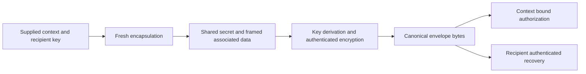

# Primitive and encrypted delivery laboratory

## Scope and evidence

The [laboratory crate](../crates/thorum-crypto-lab/src/lib.rs) integrates real authorization, key establishment, and authenticated encryption for synthetic local experiments. It is separate from the monetary core and is not a network transaction format. Its public signatures expose authorization keys. Its envelopes do not provide recipient anonymity or a private ledger proof.

The executable checks cover exact recovery, context binding, bounded canonical decoding, malformed inputs, and tampering. Six additional tests compare eight selected official ML-DSA-87 and ML-KEM-1024 cases with their complete expected outputs or verification verdicts. The [vector record](../research/crypto/vectors/README.md) identifies the upstream revision, original source hashes, case identifiers, and extraction procedure. This selected coverage is not a complete ACVP run or FIPS module validation.

## Experimental suite

| Component | Evaluation profile |
|---|---|
| Authorization | ML-DSA-87 with randomized signing and a nonempty FIPS context |
| Recipient key establishment | ML-KEM-1024 with fresh operating system randomness for every encapsulation |
| Payload encryption | AES-256-GCM, 96 bit nonce, 128 bit tag |
| Recipient key binding | Full SHA3-512 digest over a framed domain and public recipient key |
| Experimental key derivation | First 32 bytes of SHA3-512 over a framed domain, shared secret, and associated data |
| Payload bound | 16,384 plaintext bytes per envelope |
| Authorization bound | 65,536 message bytes |
| Suite identifier | 1, local laboratory use only |

The exact implementation versions and resolved checksums are recorded in [the dependency inventory](../research/crypto/dependency-inventory.json) and [third party notices](../THIRD_PARTY_NOTICES.md). ML-KEM 0.3.3 incorporates the upstream correction for secret indexed CBD table access. The resolved dependency set also includes the patched constant time utility release. These facts do not establish that the implementations or their composition are free of vulnerabilities. [ML-KEM security correction](https://github.com/RustCrypto/KEMs/pull/386), [utility advisory](https://rustsec.org/advisories/RUSTSEC-2026-0385.html).

The key derivation construction is an experiment, with no formal security reduction claimed. This suite does not select the ledger commitment, nullifier, proof, recursion, wallet address, or private staking construction. Its key sizes and tag size must not be described as a demonstrated quantum security level for the complete system.

`validate_recipient_key` checks exact public key size and the backend's canonical ML-KEM coefficient decoding without using randomness. Canonical decoding is not proof of secret key possession, honest key generation or recipient identity. The [recipient capability experiment](recipient-capability.md) uses this validation when constructing or decoding public capabilities. A complete valid capability can still be substituted if its application delivery is unauthenticated.

## Framing and context

For a byte string $x$, define an unambiguous frame

$$
F(x)=\operatorname{u32be}(|x|)\mathbin{\|}x
$$

The supplied context is

$$
q=F(\mathrm{chain}_{32})\mathbin{\|}F(\operatorname{u32be}(v))\mathbin{\|}F(\mathrm{outputTag}_{32})
$$

It has 80 bytes. The caller must authenticate its chain, version, and output tag independently. The tag is opaque laboratory input and is not a commitment construction, final transaction identifier, or authenticated state root.

Let $P$ be the public recipient key, $C_K$ the encapsulation ciphertext, $z$ the shared secret, and $n$ the fresh nonce. The implementation defines

$$
r=\operatorname{SHA3\!\_512}(F(D_R)\mathbin{\|}F(P))
$$

$$
A=F(D_E)\mathbin{\|}F(\operatorname{u16be}(1))\mathbin{\|}F(q)\mathbin{\|}F(r)\mathbin{\|}F(C_K)\mathbin{\|}F(n)
$$

$$
k=\operatorname{first}_{32}\left(\operatorname{SHA3\!\_512}(F(D_K)\mathbin{\|}F(z)\mathbin{\|}F(A))\right)
$$

$$
C_N=\operatorname{AES256GCM.Enc}(k,n,\mathrm{plaintext},A)
$$

The domain bytes are fixed by the [source constants](../crates/thorum-crypto-lab/src/lib.rs). $D_K$ explicitly identifies an experimental derivation. Associated data excludes the final encrypted payload, signature, proof, and final transaction identifier, avoiding a circular construction dependency.

The envelope encoding is

```text
THMLAB01 || u16be(1) || F(kem_ciphertext) || F(nonce) || F(authenticated_ciphertext)
```

Its overhead is exactly 1,618 bytes above plaintext length. The parser rejects unsupported suites, incorrect fixed lengths, oversized payloads, truncated fields, and trailing bytes before cryptographic processing. Parsing alone does not establish authenticity.

## Authorization and information flow

Authorization signs framed domain, suite, context, and bounded message bytes using the fixed FIPS context `Kova crypto laboratory authorization v1`. A completed envelope can be serialized first and then authorized. Neither encryption nor key derivation depends on its later signature.



This diagram describes the implemented laboratory ordering. It does not include private ownership proofs or kernel acceptance. KEM encapsulation does not authenticate a sender. The public authorization test does not satisfy the private authorization target.

Secret key wrappers have no serialization or Debug interface. Secret seeds, shared secrets, derived keys, and returned plaintext use available erasure support. This does not establish complete removal of stack copies, compiler intermediates, allocator history, swap, crash dumps, or hardware state.

## Sender encryption witness

`seal_for_relation` retains the fresh 32 byte ML-KEM encapsulation randomness in an `EncryptionWitness`. Its envelope uses the same suite, framing, associated data and nonce rules as `seal`. The witness has no Debug, cloning, serialization or secret export interface and uses erasure support on drop.

`verify_encryption_witness` receives the recipient public key, context, plaintext, witness and completed envelope. It recomputes deterministic encapsulation from that private randomness, derives the same key, encrypts with the envelope nonce and compares the complete encapsulation and authenticated ciphertexts. It does not require the recipient secret key. This permits a sender relation to bind the encrypted note to the same opening used by its output commitment.

The witness reveals enough information to reproduce the shared secret and payload. It belongs inside a trusted local witness boundary and must never appear in public transactions, logs, proof transport or remote validation requests. The local checker is transparent to its own process. It provides no zero knowledge, recipient anonymity or formal composition result. Equality checks in this research path do not establish constant time behavior.

## Rejection and state boundaries

Tests alter keys, messages, signatures, chains, protocol versions, output tags, encapsulation bytes, nonces, encrypted payloads, tags, lengths, and suite fields. Valid length KEM corruption follows implicit rejection and must ultimately fail authenticated decryption. Malformed lengths are rejected separately. No plaintext value is returned on authentication failure.

Reopening the same valid envelope is allowed. Global replay and double spending prevention belong to the future ledger. The caller also owns authenticated context selection, data availability, and authorized recipient selection. Local typed errors are not a remotely safe decryption service interface.

Fresh operating system entropy is used for key generation, randomized signatures, encapsulation, and envelope nonces. Deterministic vector inputs are confined to tests. Entropy failure paths return errors, but operating system failure injection and complete side channel analysis are not demonstrated by the present tests.

## Measurements and reproduction

From the repository root:

```text
cargo fetch --locked
cargo test --workspace --locked --offline
cargo run --release -p thorum-crypto-lab --example measure --locked --offline -- 50
python research/crypto/dependency_inventory.py --check
```

The measurement example emits raw CSV samples. It separates key generation, signing, verification, encapsulation, decapsulation, SHA3 digest, AES encryption/decryption, and full envelope seal/open. Payload classes are 0, 256, 1,024, and 16,384 bytes. Operations ending in `_os` include operating system entropy costs.

Byte columns count selected payloads or public artifacts, not every in memory argument. Public key outputs exclude secret keys. Encapsulation output excludes the shared secret. AES rows exclude key, nonce, and associated data. Verification excludes the fixed public key and context. Envelope rows count complete canonical envelopes. SHA3 digest timing is not a standalone measurement of the full experimental KDF.

Timing includes allocations, decoding, and context construction inside the measured call. Returning value destruction and CSV formatting occur afterward. Three sign/verify/seal/open warmups do not establish every cache, startup, or thermal condition. A single host run does not measure network throughput, proof construction cost, wallet synchronization, memory use, or constant time behavior.

Release measurements retain raw samples, source hashes, dependency lock hash, compiler details, CPU model, operating system, workload, aggregation method, and limitations. Analytical envelope size is separate from measured timing. The results are local observations and do not establish consensus capacity.

The retained [measurement record and figures](../research/crypto/README.md) provide one such local run, with 50 samples per group and no simulated performance values. They identify their historical source revision and do not measure the later sender witness interface or complete transaction relations.

## Remaining feasibility gates

Complete private payment and confidential stake relations still require concrete commitments, nullifiers, hidden authorization, proof soundness and zero knowledge analysis, confidential eligibility, recipient discovery, recovery, and independent composition review. The static recipient KEM key does not establish forward secrecy. No complete quantum security, recipient key privacy, or general side channel claim follows from passing laboratory tests.

Primary cryptographic definitions are [FIPS 204](https://csrc.nist.gov/pubs/fips/204/final), [FIPS 203](https://csrc.nist.gov/pubs/fips/203/final), [SP 800-227](https://csrc.nist.gov/pubs/sp/800/227/final), and [SP 800-38D](https://csrc.nist.gov/pubs/sp/800/38/d/final).
