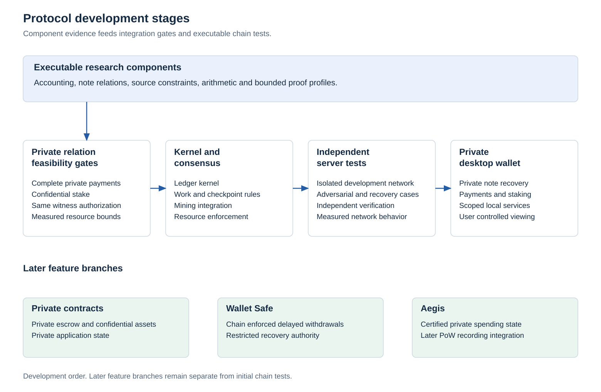

# Development stages and feature boundaries

Kova develops through independently reviewable increments. Each stage records its executable boundary, supporting evidence and remaining dependencies. Architecture documents describe intended rules. A feature becomes an implemented capability only after its required behavior and rejection cases are reproducible.

The current stage is private cryptographic feasibility. The workspace contains monetary accounting, transparent references and isolated hiding proof components. It has no running chain, complete private payment relation, confidential staking service or desktop wallet. Component results are recorded in [implementation milestones](development.md).

## Delivery sequence

| Stage | Scope | Completion evidence |
|---|---|---|
| Private authorization | Canonical key and signature decoding, connected private signature arithmetic, exact transaction binding and ownership of the same hidden inputs | Independent valid and invalid vectors, actual proof verification, causal splice rejection, bounded transport and measured resource use |
| Confidential stake | Private eligible weight, epoch and state binding, restricted voting authority and stake lifecycle | No duplicate weight or reused eligibility, bounded certificates, withdrawal and conflicting vote cases |
| Ledger and consensus | Authenticated roots, spent state, atomic persistence, issuance, reward maturity, supported auxiliary work and checkpoint rules | Independent state agreement, crash recovery, replay rejection, branch changes and miner/staker disagreement |
| Private server network | Peering, synchronization and the node RPC boundary | Multiple independent instances, restarts, partitions, reconnection and resource limit tests |
| Private application milestone | Private timed escrow and confidential assets through the common ledger rules | Release/refund conflict rejection, exact expiry boundaries, conservation and authorized issuance |
| Desktop wallet | Local validation, private Send, private scanning, scoped viewing, encrypted backup, recovery and restricted staking/voting | End to end private transfers, device restoration, reorganizations and metadata measurements |
| Private Safe | Chain enforced delayed withdrawal, restricted recovery cancellation and a separate protected balance view | Consensus transition tests, recovery monitoring and Qt integration against the same rules |
| Fast payment locks | Committee certified reservation of a fully authorized private payment | Conflicting certificate rejection, expiration, unavailable quorum, partition recovery and measured latency |
| Aegis later protocol | Spendable certified private state before PoW recording through a separately activated consensus version | Complete weighted consensus, confidential quorum, available payloads, exactly once recording, chained private payments, bounded backlog and independent review |
| Further verification and upgrades | Private migration, measured payment capacity protection and compact history research | Version transition tests, resource isolation measurements and complete history obligations |

Complete private payment and confidential stake feasibility both precede ledger integration. Private authorization includes ownership, membership, stable nullifiers, value conservation and delivery binding for the same transaction. Success in separate component harnesses does not complete that relation.

The initial public network depends on the applicable consensus, privacy, recovery, resource and independent review gates. Later application milestones may be delivered separately. An unfinished application is not an exception to the ledger rules.

Aegis is outside the first chain test milestone. The initial onward spending boundary remains checkpoint finality. Contract and Safe architecture can be developed before their executable stages, with unsupported operations rejected by the active protocol. Documentation alone does not represent partial runtime completion.

<picture>
  <source media="(prefers-color-scheme: dark)" srcset="../research/protocol-figures/figures/development-stages-dark.svg">
  
</picture>

## Core privacy boundary

Private payments are a core requirement. The normal wallet Send path has no transparent fallback. Input commitments, authentication paths, owner keys, signatures and signature intermediates remain private in the complete payment construction. Recipient delivery, restoration and global spent state are part of that construction rather than optional wallet additions.

The existing diagnostic proof statements do not define a production payment format. Publishing a key hash, sampled challenge or invertible polynomial cannot replace the required private connection. The full relation must prove that the exact signature authorizes the same transaction under the key committed by the same hidden note.

Early implementation also needs versioned cryptographic and application boundaries. Migration design begins before deployment even when its executable transition arrives later. Reward origin and maturity restrictions, asset policy, staking restrictions and pending Safe rights must survive every supported transition.

## Private Safe milestone

The [Safe specification](protocol-extensions.md#private-safe) and [wallet authority design](private-safe.md) remain architecture work until the common ledger and application relation can enforce them. The first implementation includes protected receiving, a user selected supported delay, an authenticated withdrawal request and recovery cancellation only to the predetermined protected destination. Cancellation and completion consume the same pending right.

The chain transition precedes the Qt presentation. A wallet label or local coin freeze cannot supply consensus protection. Later wallet work adds protected balance discovery, pending request monitoring, deadline display and recovery after restart or device loss. Key loss behavior, partial withdrawals and policy changes require explicit rules and tests.

Wallet completion requires three independent authority backups, authenticated receiving type checks, default wallet password encryption, optional separate Safe encryption and explicit local unencrypted storage. Restoration, password changes, locked Safe behavior, hostile recipient substitution and attempted policy weakening need validation alongside consensus cancellation and completion tests. Safe implementation remains outside the first runnable chain milestone.

## Fast payment milestone

The [payment lock specification](protocol-extensions.md#fast-private-payment-locks) defines a separate later milestone. A certified lock is distinct from inclusion, checkpoint finality and spendability. The initial onward spending rule remains checkpoint finality. No guaranteed instant transfer time is part of the current implementation.

The committee must first verify the complete private transaction and eligible inputs. Its certificate binds the exact transaction, state, chain, epoch, consumption rights and validity window. Development includes conflicting locks, expiration, stale messages, insufficient online stake and recovery after partitions. Latency is measured after local proof generation on named hardware.

## Cross stage requirements

1. The testnet timing target remains 60 second blocks, checkpoint opportunities every four blocks and 10080 block maturity for newly earned mining and staking rewards. These are development targets. The retained 120 second monetary model requires a separately versioned transition before the new cadence is executable.
2. The 60/20/10/10 allocation, cumulative issuance ceiling, actual earned stake accounting and completed burn accounting remain part of consensus work. Protocol pool governance and temporary developer allocation retirement retain their separate specifications.
3. Auxiliary mining, protocol pool governance, migration and private applications share the same authenticated state, canonical decoding, authority and rollback rules. No application can bypass maturity or consume a right twice.
4. Payment resource classes and recovery data availability need early protocol boundaries. Production capacities, fees and any compact verification mode require later measurements and review.
5. Every published increment identifies what was executed and what remains open. Roadmap entries do not imply an activation height, release date, completed audit or composed security proof.
