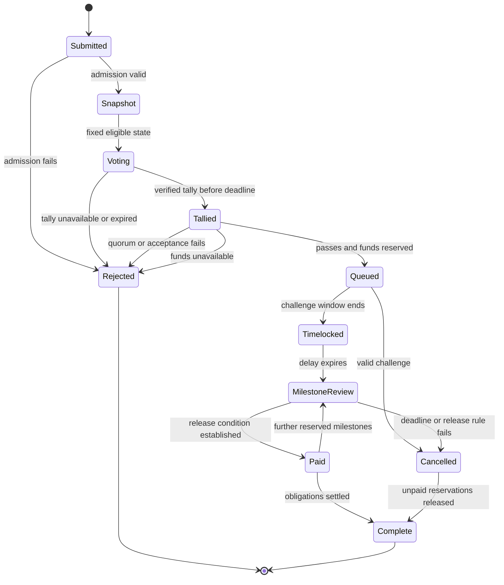

# Optional ecosystem funding governance

## Status and authority

1. This document defines a research design for native ecosystem funding controlled by eligible staked value. It does not activate a fund, change issuance, implement voting, or grant a wallet spending authority. The current Rust accounting profile remains a miner allocation of `floor(7 * S / 10)` and a staking budget containing the remainder. No governance network is implemented here.

| Area | Current reference status | Optional research scope |
|---|---|---|
| Native subsidy | Executable 70/30 accounting with cap clipping and earned staking inputs | A separately activated 60/30/10 profile |
| Checkpoint voting | Protocol requirements without a completed construction | Branch finality under the checkpoint protocol |
| Operator external treasury | Operator custody and execution policy documented, integration unimplemented | No automatic change of ownership or authority |
| Native ecosystem fund | No fund allocation or fund state in the accounting crate | Consensus controlled native balance and grant reservations |
| Funding ballots | Unimplemented | Eligible stake snapshots, restricted voting authority and verifiable decisions |
| Qt interface | Wallet architecture requirements, unimplemented | Grant submission, local verification and ballot construction |

2. Checkpoint support and treasury spending are separate authority domains. A checkpoint vote supports a valid branch under [checkpoint consensus](checkpoints.md). A funding ballot selects a bounded grant action. Neither message authorizes the other action. Restricted voting authority must not permit general spending, key recovery, software installation or unrestricted withdrawal.

3. The [operator external treasury](treasury.md) holds assets received on external networks under operator control. Native ecosystem governance cannot transfer those assets, change their destinations or acquire their keys merely because a ballot passes. Any transfer of external custody or accepted spending mandate requires a separate explicit authorization by its existing owner. An external receipt, a native fund balance and a pool worker liability must remain distinct accounting objects.

4. A Qt wallet can display grant content, reconstruct eligibility, verify state and prepare ballots. Consensus rules must validate the resulting transitions independently. Wallet settings, a displayed tally or a local majority cannot authorize a network payment. A private contract has only its explicitly defined capabilities. The existence of private contracts does not create treasury governance or a privileged mint path.

## Optional allocation and monetary conservation

1. The optional profile changes the planned allocation of a capped subsidy. Let `R(h)` be the existing nominal schedule, `I` cumulative actual issuance and `C` the existing cumulative issuance cap. All quantities below are integer atomic units.

```text
S = min(R(h), C - I)
M = floor(6 * S / 10)
K = floor(3 * S / 10)
F = S - M - K
M + K + F = S
0 <= earned_stake <= K
```

2. `M` is the miner allocation, `K` the staking budget and `F` the native ecosystem fund allocation. The fund receives the rounding remainder after both floors. These are planned 60/30/10 shares rather than exact percentages for every atomic amount. For `S = 1`, `M = 0`, `K = 0` and `F = 1`. This differs from the current 70/30 rule, whose final atom belongs to the staking budget. An activation specification must identify the exact block height and profile version. Existing source constants, reference fixtures and earlier state transitions retain their current meaning.

3. The research baseline credits `F` to a consensus controlled fund balance when the block is issued. That credit is issuance even if no grant has been selected. Unearned staking value `K - earned_stake` remains unissued and cannot be redirected to miners or the fund. It creates no reserve, debt or later catch up entitlement. A block must contain the required valid fund credit under an activated profile. Omitting that credit cannot silently change the allocation.

```text
actual_issued = M + earned_stake + F
I_after = I + actual_issued
unearned_stake = K - earned_stake
0 <= I_after <= C
```

4. Unawarded fund value remains an outstanding fund balance. Queueing a grant reserves existing value. Paying a grant transfers existing value. Neither action mints a second copy. Cancellation releases a reservation back to the same fund and does not create issuance capacity. A policy that instead leaves unawarded block allocations unissued would be a different monetary rule and requires separate specification, activation and vectors.

5. Let `T` be the authenticated fund balance and `Q` the sum of outstanding grant reservations. The kernel must maintain `0 <= Q <= T`. A newly queued grant of amount `g` requires `0 <= g <= T - Q` and atomically increases reservations. Concurrent accepted ballots cannot reserve the same value twice. Completed payments reduce both the remaining reservation and the fund balance. Native fund value counts within outstanding supply and cumulative issuance. Authorized burns reduce outstanding supply and never reduce historical issuance or reopen the cap. A fund burn must also preserve its existing reservations. Monetary sums and height arithmetic require bounded integers and explicit overflow rejection. The [existing accounting implementation](../crates/thorum-core/src/accounting.rs) does not yet represent these fund balances or reservations.

6. Reducing the planned miner share from 70% to 60% reduces the native miner subsidy for the same scheduled block budget, subject to atomic rounding. The 10 percentage point shift is a research change to the mining security budget. Treasury spending or expected ecosystem benefits do not establish that the resulting work incentives remain adequate. Evaluation must cover miner participation, work concentration, fees, unavailable staking and the period after the issuance cap binds.

## Eligible stake and voting weight

1. A contest identifier must bind the network, fund, governance version, round, proposal and ballot rules. A snapshot commits to an authenticated eligible stake set at a specified state root and height. Eligibility must establish native asset identity, owned or validly delegated voting authority, eligible locked value, maturity and an unspent position. A usable snapshot finality rule depends on the unfinished checkpoint construction.

2. Weight is linear in eligible atomic stake value. No address count, wallet count or claimed person count supplies extra weight. For positions eligible under the same contest rules:

```text
w(v) = v
w(v_1 + v_2) = w(v_1) + w(v_2)
sum(v_j) = v  implies  sum(w(v_j)) = w(v)
```

3. A partition of the same value across many eligible wallets or positions must therefore retain the same aggregate weight. Atomic values must be summed without a per wallet rounding bonus. Stake weight does not establish distinct human identities, equal influence per person or resistance to concentrated ownership. Borrowing, vote buying, coercion and concentrated custody require an explicit adversarial model.

4. The snapshot height `h_snapshot`, voting opening height `h_open`, closing height `h_close`, tally deadline `h_tally_deadline`, challenge duration `d_challenge`, execution delay `d_timelock` and stake release height `h_release` must be fixed before voting. The challenge window starts at the tally deadline so late tally publication cannot shorten the review period. The research baseline requires the following ordering. Concrete durations remain unset.

```text
h_snapshot <= h_open < h_close <= h_tally_deadline
h_execution_not_before = h_tally_deadline + d_challenge + d_timelock
h_release >= h_execution_not_before
```

5. Snapshot membership alone must not allow a position to be spent, moved, unlocked or reused to create fresh eligible value during the required lock. The kernel must enforce the lock and reject reuse of a snapshot ancestor together with its descendants. Lock release must not depend on an unbounded grant payment lifetime. The compatibility of governance locks with checkpoint stake activation, withdrawal and penalties remains to be specified.

6. A position contributes its full eligible weight once per contest under the research baseline. A valid delegation binds that position, contest scope, permitted choices and expiry to restricted voting authority. The owner and delegate cannot both contribute the same weight. Delegation replacement, revocation, conflicting signatures, offline owners and reorganizations require deterministic rules before ballots are accepted. Delegation does not transfer spending ownership.

7. Distinct proposal contests may intentionally reuse the same eligible weight. Their participation totals must not be added as if they represented distinct stake. Passing multiple contests does not expand the fund balance. Deterministic queue admission and atomic reservations must handle grants that compete for the same available value. A future ballot that divides weight between proposals requires a separate conservation relation for its voting budget.

## Quorum and acceptance variables

1. Let `W` be total eligible snapshot weight and let `Y`, `N` and `A` be valid participating weight for acceptance, rejection and abstention. A verified tally must establish `P = Y + N + A` and `0 <= P <= W`. Duplicate weight must be rejected before these totals are computed.

2. Quorum is a protocol variable `q_num / q_den` with `q_den > 0` and `0 <= q_num <= q_den`. An acceptance fraction is a separate variable `a_num / a_den` with `a_den > 0` and `0 <= a_num <= a_den`. No numeric quorum or acceptance threshold is selected here. The complete rules must also choose equality handling and whether abstention contributes to quorum. For a policy that includes abstention in turnout, the checks take this form:

```text
W > 0
Y + N > 0
P * q_den >= W * q_num
Y * a_den acceptance_comparison (Y + N) * a_num
acceptance_comparison is one fixed choice of > or >=
```

3. Products require bounded integers and checked or widened arithmetic. A contest with no eligible weight, no decisive votes, insufficient quorum or a failed acceptance comparison cannot authorize payment. A missing verifiable tally or expired tally deadline also cannot be interpreted as acceptance. Thresholds and timing must be frozen for a contest and cannot change after its snapshot.

## Privacy and post quantum construction questions

1. The eligibility relation must bind snapshot membership, private stake value, authority, lock context, contest identifier and ballot commitment without permitting weight forgery. It must compose with native post quantum authorization and the private ledger. A public key algorithm choice alone does not complete that relation. No such proof construction is implemented here.

2. A spent vote nullifier must identify reuse of the same eligible position within a contest while remaining consistent for direct and delegated authority. Domain separation must prevent replay between networks, funding contests and checkpoint messages. The kernel requires a global used nullifier set for the contest. A nullifier or eligibility proof that reveals identity across unrelated contests would weaken the intended privacy boundary. Exact derivation, unforgeability and linkage analysis remain unresolved.

3. Encrypted ballots require a specified encryption and proof relation, verifiable tally, key establishment, decryption policy, availability assumptions and failure handling. Research must address malformed ciphertexts, inconsistent weight, selective disclosure, withheld decryption shares, adaptive corruption, timing leakage, small participation sets, metadata correlation, coercion and transferable vote receipts. Confidential individual ballots do not by themselves make tallying private or available. No central tally operator or classical construction is implicitly trusted to satisfy these requirements.

4. Grant purpose, requested amount, milestones, evaluation criteria and status are public by default so voters can assess spending. A recipient may use a private payment commitment if the execution relation binds the authorized amount and destination to the approved grant. Optional disclosure must state its recipients and scope. A bounded grant receipt or scoped viewing capability must not become a general viewing authority over the recipient's other funds. Public content and released payment details cannot later be made private by encrypting a ballot.

## Grant lifecycle

1. Submission binds an immutable grant identifier to public purpose, maximum native amount, milestones, deadlines, cancellation rules and recipient commitments. Admission limits, proposal spam controls and any submission costs remain specification variables. Amendments that change spending authority require a new contest or an explicitly defined amendment procedure.

2. Snapshot and voting use the precommitted rules. Validators check eligibility, locks, ballot validity and nullifier uniqueness. Closing uses a verifiable tally. Insufficient quorum, failed acceptance, missing tally evidence or an expired tally deadline rejects the grant without a payment.

3. Successful voting allows queue admission only if available funds can be reserved atomically. Competing grants need a deterministic ordering rule specified before voting. Insufficient funds cannot trigger new issuance, consume worker liabilities or borrow from the operator external treasury. Queue admission records the amount, approved recipient commitments, milestone conditions and earliest execution height.

4. A fixed execution delay follows the challenge window. Valid challenges, cancellation authority and their deadlines must be explicit consensus rules. A wallet button, operator preference or unpublished administrative key cannot bypass the queue, change a recipient or shorten the delay.

5. Milestone payments consume only their reserved amounts after the defined release condition is established. Subjective work quality cannot be assumed to be proved by a private contract. The specification must identify any evaluator authority, evidence, appeal process and custody risk. Missed deadlines or valid cancellation release only the unpaid reservation. Every payment and release must remain correct under duplicate submissions, branch rollback and restart.



## Research gates

1. Activation requires a complete versioned state transition specification, exact allocation vectors, fund conservation tests, historical activation and rollback tests, voting replay tests, queue race tests and explicit upgrade rules. Neither the [current monetary research](../research/emission/README.md) nor the [current subsidy code](../crates/thorum-core/src/emission.rs) models the optional 60/30/10 profile.

2. Privacy and post quantum eligibility, nullifiers, ballots and tallying require a concrete construction with an adversarial analysis and independent review. Simulations must cover concentration, splitting, delegation, unavailable quorum, withheld tally data, borrowed stake, conflicting votes, snapshot changes, censorship and long execution delays.

3. The Qt interface follows those validated rules and exposes the grant amount, available balance, reservations, voting scope, lock expiry, tally evidence and payment status. UI completion, private contract support and arithmetic tests are separate milestones from secure governance.
