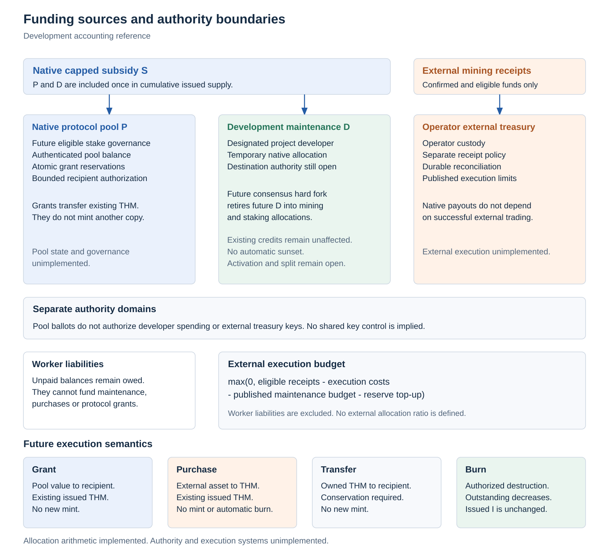
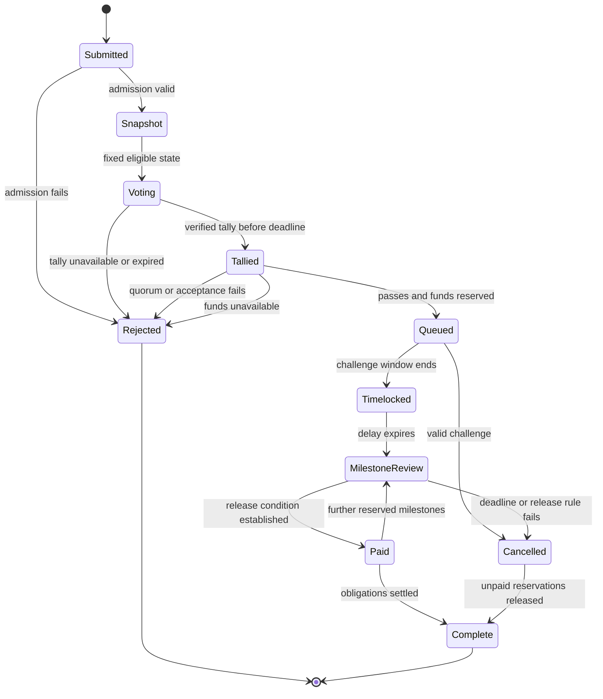

# Protocol pool governance research

## Status and authority

<picture>
  <source media="(prefers-color-scheme: dark)" srcset="../research/accounting-figures/figures/funding-authorities-dark.svg">
  
</picture>

1. This document defines research requirements for protocol pool spending through eligible stake ballots. The current [native subsidy profile](subsidy-allocation.md) allocates nominal shares of 60 percent to miners, 20 percent to eligible staking, 10 percent to the protocol pool, and 10 percent to temporary development maintenance for the designated project developer. The core calculates those amounts and supply counters. It does not create payout notes, authenticate destinations, implement pool balances or reservations, or grant a wallet spending authority. No governance network is implemented.

| Area | Current reference status | Research scope |
|---|---|---|
| Native subsidy | Executable 60/20/10/10 accounting, miner rounding, cap clipping and earned staking inputs | Authorized payout notes and destination validation |
| Checkpoint voting | Protocol requirements without a completed construction | Branch finality under the checkpoint protocol |
| Operator external treasury | Operator custody and execution policy documented, integration unimplemented | No automatic change of ownership or authority |
| Native protocol pool | Pool allocation counts as issued in monetary accounting, with no complete balance or spending state | Authenticated native balance, spending authority and grant reservations |
| Development maintenance | Separate allocation designated for the project developer | Destination authority and eventual retirement through a future consensus hard fork |
| Funding ballots | Unimplemented | Eligible stake snapshots, restricted voting authority and verifiable decisions |
| Qt interface | Wallet architecture requirements, unimplemented | Grant submission, local verification and ballot construction |

2. Checkpoint support and treasury spending are separate authority domains. A checkpoint vote supports a valid branch under [checkpoint consensus](checkpoints.md). A funding ballot selects a bounded grant action. Neither message authorizes the other action. Restricted voting authority must not permit general spending, key recovery, software installation or unrestricted withdrawal.

3. The [operator external treasury](treasury.md) holds assets received on external networks under operator control. Protocol pool governance cannot transfer those assets, change their destinations or acquire their keys merely because a ballot passes. It also does not authorize spending development maintenance credits. Any transfer of external custody or accepted spending mandate requires a separate explicit authorization by its existing owner. External receipts, protocol pool value, developer credits, and mining pool worker liabilities remain distinct accounting objects.

4. A Qt wallet can display grant content, reconstruct eligibility, verify state and prepare ballots. Consensus rules must validate the resulting transitions independently. Wallet settings, a displayed tally or a local majority cannot authorize a network payment. A private contract has only its explicitly defined capabilities. The existence of private contracts does not create treasury governance or a privileged mint path.

## Pool allocation and monetary conservation

1. The current native block subsidy rule uses the existing nominal schedule `R(h)`, cumulative actual issuance `I`, and cumulative ceiling `C`. All quantities below are integer atomic units. Fee distribution remains a separate specification item.

```text
S = min(R(h), C - I)
m0 = floor(6 * S / 10)
K = floor(2 * S / 10)
P = floor(S / 10)
D = floor(S / 10)
M = m0 + S - m0 - K - P - D
M + K + P + D = S
0 <= earned_stake <= K
```

2. `M` is the miner allocation, `K` the staking budget, `P` the protocol pool allocation, and `D` development maintenance for the designated project developer. Every remainder after the four floors belongs to the miner. For `S = 1`, `M = 1` and every other budget is zero. The first 16 THM budget gives 9.6 THM to miners, 3.2 THM to staking, 1.6 THM to the protocol pool, and 1.6 THM to development maintenance. No production genesis has been released.

3. The protocol pool and developer amounts count as issued when the monetary transition is applied, even if they remain unspent. Unearned staking value `K - earned_stake` remains unissued and cannot be redirected to any other recipient. It creates no reserve, debt or later catch up entitlement. The future kernel must create and authenticate the required payout outputs and prevent omission, substitution or duplicate issuance. Core arithmetic alone does not establish those properties.

```text
actual_issued = M + P + D + earned_stake
I_after = I + actual_issued
unearned_stake = K - earned_stake
0 <= I_after <= C
```

4. Once a complete pool balance system exists, unspent pool value remains outstanding rather than becoming new issuance when a grant is selected. Queueing a grant reserves existing value. Paying a grant transfers existing value. Neither action mints a second copy. Cancellation releases a reservation back to the same pool and does not create issuance capacity. Leaving the original pool allocation unissued would be a different monetary rule.

5. Let `T` be the future authenticated pool balance and `Q` the sum of outstanding grant reservations. The kernel must maintain `0 <= Q <= T`. A newly queued grant of amount `g` requires `0 <= g <= T - Q` and atomically increases reservations. Concurrent accepted ballots cannot reserve the same value twice. Completed payments reduce both the remaining reservation and the pool balance. Native pool value counts within outstanding supply and cumulative issuance. Authorized burns reduce outstanding supply and never reduce historical issuance or reopen the cap. A pool burn must preserve its existing reservations. Monetary sums and height arithmetic require bounded integers and explicit overflow rejection. The [existing accounting implementation](../crates/thorum-core/src/accounting.rs) does not yet represent these balances or reservations.

6. Native funding allocations do not establish that mining and checkpoint incentives remain adequate. Evaluation must cover miner participation, work concentration, staking availability, fees, pool spending, developer maintenance, and the period after the issuance cap binds. Expected ecosystem benefits do not replace that analysis.

## Temporary developer allocation and handover

The development maintenance allocation is separate from protocol pool governance and is temporary. Its retirement requires a future consensus hard fork after work completion and community handover. The future 10 percent is to be redistributed to mining and staking. The protocol pool remains at 10 percent unless a separate explicit change modifies it.

Completion criteria, the handover and consensus change process, activation height, and successor miner/stake ratio remain unresolved. A pool ballot, wallet setting, checkpoint vote, or developer key does not automatically change the allocation. There is no coded sunset, retirement height, or milestone key.

Only future subsidies under the changed rules are affected by retirement. Existing legitimately earned credits remain unaffected. The change requires a versioned consensus specification, integer conservation vectors, activation and rollback tests, and compatibility rules before deployment. Pool spending research does not supply that missing transition specification.

## Eligible stake and voting weight

1. A contest identifier must bind the network, fund, governance version, round, proposal and ballot rules. A snapshot commits to an authenticated eligible stake set at a specified state root and height. Eligibility must establish native asset identity, owned or validly delegated voting authority, eligible locked value, maturity and an unspent position. A usable snapshot finality rule depends on the unfinished checkpoint construction.

2. Weight is linear in eligible atomic stake value. No address count, wallet count or claimed person count supplies extra weight. For positions eligible under the same contest rules:

```text
w(v) = v
w(v_1 + v_2) = w(v_1) + w(v_2)
sum(v_j) = v  implies  sum(w(v_j)) = w(v)
```

3. A partition of the same value across many eligible wallets or positions must therefore retain the same aggregate weight. Atomic values must be summed without a per wallet rounding bonus. Stake weight does not establish distinct human identities, equal influence per person or resistance to concentrated ownership. Borrowing, vote buying, coercion and concentrated custody require an explicit adversarial model.

4. The snapshot height `h_snapshot`, voting opening height `h_open`, closing height `h_close`, tally deadline `h_tally_deadline`, challenge duration `d_challenge`, execution delay `d_timelock` and stake release height `h_release` must be fixed before voting. The challenge window starts at the tally deadline so late tally publication cannot shorten the review period. The research baseline requires the following ordering. Concrete durations remain unset.

```text
h_snapshot <= h_open < h_close <= h_tally_deadline
h_execution_not_before = h_tally_deadline + d_challenge + d_timelock
h_release >= h_execution_not_before
```

5. Snapshot membership alone must not allow a position to be spent, moved, unlocked or reused to create fresh eligible value during the required lock. The kernel must enforce the lock and reject reuse of a snapshot ancestor together with its descendants. Lock release must not depend on an unbounded grant payment lifetime. The compatibility of governance locks with checkpoint stake activation, withdrawal and penalties remains to be specified.

6. A position contributes its full eligible weight once per contest under the research baseline. A valid delegation binds that position, contest scope, permitted choices and expiry to restricted voting authority. The owner and delegate cannot both contribute the same weight. Delegation replacement, revocation, conflicting signatures, offline owners and reorganizations require deterministic rules before ballots are accepted. Delegation does not transfer spending ownership.

7. Distinct proposal contests may intentionally reuse the same eligible weight. Their participation totals must not be added as if they represented distinct stake. Passing multiple contests does not expand the fund balance. Deterministic queue admission and atomic reservations must handle grants that compete for the same available value. A future ballot that divides weight between proposals requires a separate conservation relation for its voting budget.

## Quorum and acceptance variables

1. Let `W` be total eligible snapshot weight and let `Y`, `N` and `A` be valid participating weight for acceptance, rejection and abstention. A verified tally must establish `P = Y + N + A` and `0 <= P <= W`. Duplicate weight must be rejected before these totals are computed.

2. Quorum is a protocol variable `q_num / q_den` with `q_den > 0` and `0 <= q_num <= q_den`. An acceptance fraction is a separate variable `a_num / a_den` with `a_den > 0` and `0 <= a_num <= a_den`. No numeric quorum or acceptance threshold is selected here. The complete rules must also choose equality handling and whether abstention contributes to quorum. For a policy that includes abstention in turnout, the checks take this form:

```text
W > 0
Y + N > 0
P * q_den >= W * q_num
Y * a_den acceptance_comparison (Y + N) * a_num
acceptance_comparison is one fixed choice of > or >=
```

3. Products require bounded integers and checked or widened arithmetic. A contest with no eligible weight, no decisive votes, insufficient quorum or a failed acceptance comparison cannot authorize payment. A missing verifiable tally or expired tally deadline also cannot be interpreted as acceptance. Thresholds and timing must be frozen for a contest and cannot change after its snapshot.

## Privacy and post quantum construction questions

1. The eligibility relation must bind snapshot membership, private stake value, authority, lock context, contest identifier and ballot commitment without permitting weight forgery. It must compose with native post quantum authorization and the private ledger. A public key algorithm choice alone does not complete that relation. No such proof construction is implemented here.

2. A spent vote nullifier must identify reuse of the same eligible position within a contest while remaining consistent for direct and delegated authority. Domain separation must prevent replay between networks, funding contests and checkpoint messages. The kernel requires a global used nullifier set for the contest. A nullifier or eligibility proof that reveals identity across unrelated contests would weaken the intended privacy boundary. Exact derivation, unforgeability and linkage analysis remain unresolved.

3. Encrypted ballots require a specified encryption and proof relation, verifiable tally, key establishment, decryption policy, availability assumptions and failure handling. Research must address malformed ciphertexts, inconsistent weight, selective disclosure, withheld decryption shares, adaptive corruption, timing leakage, small participation sets, metadata correlation, coercion and transferable vote receipts. Confidential individual ballots do not by themselves make tallying private or available. No central tally operator or classical construction is implicitly trusted to satisfy these requirements.

4. Grant purpose, requested amount, milestones, evaluation criteria and status are public by default so voters can assess spending. A recipient may use a private payment commitment if the execution relation binds the authorized amount and destination to the approved grant. Optional disclosure must state its recipients and scope. A bounded grant receipt or scoped viewing capability must not become a general viewing authority over the recipient's other funds. Public content and released payment details cannot later be made private by encrypting a ballot.

## Grant lifecycle

1. Submission binds an immutable grant identifier to public purpose, maximum native amount, milestones, deadlines, cancellation rules and recipient commitments. Admission limits, proposal spam controls and any submission costs remain specification variables. Amendments that change spending authority require a new contest or an explicitly defined amendment procedure.

2. Snapshot and voting use the precommitted rules. Validators check eligibility, locks, ballot validity and nullifier uniqueness. Closing uses a verifiable tally. Insufficient quorum, failed acceptance, missing tally evidence or an expired tally deadline rejects the grant without a payment.

3. Successful voting allows queue admission only if available funds can be reserved atomically. Competing grants need a deterministic ordering rule specified before voting. Insufficient funds cannot trigger new issuance, consume worker liabilities or borrow from the operator external treasury. Queue admission records the amount, approved recipient commitments, milestone conditions and earliest execution height.

4. A fixed execution delay follows the challenge window. Valid challenges, cancellation authority and their deadlines must be explicit consensus rules. A wallet button, operator preference or unpublished administrative key cannot bypass the queue, change a recipient or shorten the delay.

5. Milestone payments consume only their reserved amounts after the defined release condition is established. Subjective work quality cannot be assumed to be proved by a private contract. The specification must identify any evaluator authority, evidence, appeal process and custody risk. Missed deadlines or valid cancellation release only the unpaid reservation. Every payment and release must remain correct under duplicate submissions, branch rollback and restart.



## Research gates

1. Pool governance activation requires a complete versioned state transition specification, authenticated destinations and balances, reservation conservation tests, activation and rollback tests, voting replay tests, queue race tests and explicit upgrade rules. The [monetary research](../research/emission/README.md) and [subsidy code](../crates/thorum-core/src/emission.rs) account for the current 60/20/10/10 amounts. They do not implement pool spending or ballots.

2. Privacy and post quantum eligibility, nullifiers, ballots and tallying require a concrete construction with an adversarial analysis and independent review. Simulations must cover concentration, splitting, delegation, unavailable quorum, withheld tally data, borrowed stake, conflicting votes, snapshot changes, censorship and long execution delays.

3. The Qt interface follows those validated rules and exposes the grant amount, available balance, reservations, voting scope, lock expiry, tally evidence and payment status. UI completion, private contract support and arithmetic tests are separate milestones from secure governance.
