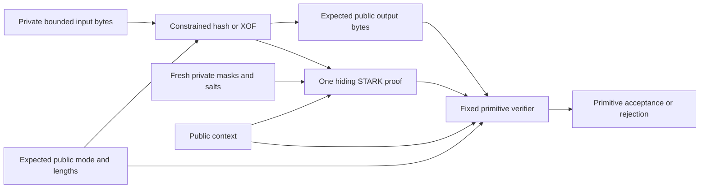

# SHA3 and SHAKE proof laboratory

## Authorization foundation boundary

The [hash proof component](../crates/thorum-hash-proof-lab/src/lib.rs) constrains unframed SHA3-512, SHAKE128 and SHAKE256 over a bounded private byte input. It includes exact absorption, padding, complete state transitions and extended output squeezing in one hiding STARK. Its expected public statement selects the mode, input length, output length, output bytes and context.

This is a primitive foundation for private authorization, without an ownership or signature verification claim. Public keys may be freely distributed. Knowing a public verification key, proving knowledge of it or hashing it does not establish permission to spend. A complete private ownership relation must verify a valid signature for the exact authorized transaction and connect the same private key to the owner binding in the same private input note.

The standalone hash output is public in this laboratory. That interface cannot be substituted for a private owner binding or hidden signature computation in a production payment. The complete composed relation must keep owner bindings, public keys, `tr`, `mu` and signatures private while connecting their internal computations to the same hidden notes, membership, stable nullifiers and authorized transaction. No production hash proof payment route exists.

The [stable nullifier component](nullifier-proof-lab.md) retains its exact existing format and hidden input boundary. It does not acquire authorization from this separate primitive component. Private payments by default remain the required wallet path. No transparent payment fallback, running ledger, owner proof, distributed node capability or wallet submission format follows from this increment.



The diagram records the implemented primitive boundary. It does not imply a relation to an owner binding or transaction in another proof.

## Exact hash functions

The functions use the unframed input $m$. There is no application domain, length prefix or implicit chain field inside $m$ unless the caller supplies those bytes as part of its intended message.

| Mode | Code | Rate | Capacity | Delimited suffix | Supported output |
|---|---:|---:|---:|---:|---|
| SHA3-512 | 1 | 72 bytes | 1024 bits | `06` | Exactly 64 bytes |
| SHAKE128 | 2 | 168 bytes | 256 bits | `1f` | 1 through 840 bytes |
| SHAKE256 | 3 | 136 bytes | 512 bits | `1f` | 1 through 840 bytes |

Every input length is at most 2592 bytes, including zero. Each function uses a 1600 bit state and all 24 Keccak rounds. State lane index is $x+5y$ and lane bytes are little endian. [NIST FIPS 202](https://nvlpubs.nist.gov/nistpubs/FIPS/NIST.FIPS.202.pdf).

Let $r$ be the mode's rate and $s$ its delimited suffix. Padding appends $s$, fills the remainder of the last rate block with zeros and sets that block's final high bit. When both operations occupy the same byte, the final byte is `86` for SHA3-512 or `9f` for SHAKE. An exact rate multiple input needs a separate padding block.

For private padded rate blocks $M_0,\ldots,M_{A-1}$, the state starts at $S_0=0^{1600}$ and absorbs

$$
S_{j+1}=\operatorname{Keccak}\!\left(S_j\mathbin\oplus(M_j\mathbin\Vert0^{1600-8r})\right).
$$

The first output block is the rate portion of $S_A$. If more output is required, squeezing computes

$$
S_{A+t+1}=\operatorname{Keccak}(S_{A+t})
$$

without adding input or resetting rate or capacity bytes. The output is the concatenation of rate portions, truncated to the requested length. Squeeze stages use a zero message block and preserve the complete prior state as the next permutation preimage.

For input length $n$ and positive output length $o$, the schedule requires

$$
A=\left\lfloor\frac{n}{r}\right\rfloor+1,
\qquad
Q=\left\lceil\frac{o}{r}\right\rceil-1,
\qquad
P=A+Q.
$$

The maximum supported permutation count is 37. A 2592 byte SHA3-512 input uses 36 data blocks and one padding block. SHAKE128 at the maximum input and output sizes needs 20 permutations. SHAKE256 needs 26.

## Statement, witness and acceptance

The interface constructs an expected statement through

```rust
Statement::new(
    mode: Mode,
    input_length: usize,
    output: &[u8],
    context: [u8; 64],
) -> Result<Statement, Error>
```

The output slice supplies the declared output length. The internal output buffer has 840 bytes and zero inactive padding. `Mode` admits only `Sha3_512`, `Shake128` and `Shake256`. Invalid lengths, unsupported output sizes and nonzero inactive output bytes fail validation. Proving and verification repeat statement validation before indexing or allocating backend data.

`Witness::from_bytes(&[u8])` accepts at most 2592 bytes. The witness has no `Debug`, `Clone`, general serialization or public plaintext export. The prover additionally requires its exact input length to match the expected statement. That host check is distinct from the constrained sponge computation and is not a verifier acceptance callback.

`prove_hash(&Witness, &Statement)` returns proof bytes or an error. `verify_hash(&[u8], &Statement)` receives no private input and requires an independently supplied expected statement. The mode and lengths select the verifier's schedule and are also explicitly constrained as public values. A proof for a different public mode, length, output or context cannot be accepted as proof of the unchanged expected statement.

The public vector has 913 base field elements in the exact order

$$
\operatorname{mode}_1\mathbin\Vert
\operatorname{u32be}(n)_4\mathbin\Vert
\operatorname{u32be}(o)_4\mathbin\Vert
\operatorname{output}_{840}\mathbin\Vert
\operatorname{context}_{64}.
$$

Each byte occupies one field element. Inactive output bytes are zero. Context is opaque transcript data and has no authenticated transaction meaning in this primitive component.

## Relation and proof profile

The profile is `thorum.hash-proof-lab.keccak.sha3-shake.serial.p3-0.8.0.v1`. It is distinct from all existing payment component profiles.

The original trace has 1024 rows and 5359 columns. Up to 37 complete 24 round stages occupy at most 888 real rows. There are 38 schedule selectors, including a terminal padding selector. Padding rows do not represent more input or XOF output. Each rate message and output bit is Boolean, inactive rate columns are zero, and the selected mode's framing, padding, complete rate and capacity transitions and public output mapping are constrained around the pinned permutation AIR. [Pinned permutation source](https://github.com/Plonky3/Plonky3/tree/a21e3ed42905040ad49c519e402f018381c12d0c/keccak-air).

| Profile property | Value |
|---|---|
| Original trace | 1024 rows and 5359 columns |
| Hiding extension | 2048 rows and stored degree bits 11 |
| Public vector | 913 base field elements |
| Maximum symbolic degree | Four under the pinned convention |
| FRI queries and log blowup | 64 queries and 3 |
| FRI folding rounds | 11 |
| Challenge extension | Degree 4 over BabyBear |
| Quotient openings | Eight chunks of four extension elements |
| Random codewords | Four |
| Merkle salts | 16 base field elements per committed row |
| Grinding difficulties | Zero bits |
| Proof byte cap | 8,388,608 bytes |

Both commitment layers use the inspected hiding Merkle configuration. Fresh operating system seeded generators supply private masks and salts for each proof. Verification samples no fresh entropy. The masking budget check is $1024\ge2(64+4\cdot2)=144$. This is one source enforced condition rather than a complete zero knowledge or knowledge soundness argument.

The local proof adapter domains are `thorum.hash-proof-lab.leaf.v1`, `thorum.hash-proof-lab.node.v1` and `thorum.hash-proof-lab.transcript.v1`. They retain complete SHA3-512 outputs. Upstream fixed interaction metadata additionally uses Keccak256 fingerprints. Digest sizes do not establish the classical or quantum security of the complete composition. [Pinned hiding PCS](https://github.com/Plonky3/Plonky3/blob/a21e3ed42905040ad49c519e402f018381c12d0c/fri/src/hiding_pcs.rs), [pinned pattern fingerprints](https://github.com/Plonky3/Plonky3/blob/a21e3ed42905040ad49c519e402f018381c12d0c/challenger/src/fs/pattern/sequence.rs).

Proof transport retains bounded JSON preflight, typed decoding, fixed shape checks and exact canonical reencoding before backend verification. Limits are depth 24, 1,000,000 tokens, 16,384 items per collection, 64 bytes per string and 20 digits per unsigned integer token. Shape validation fixes stored degree, roots, trace widths, quotient dimensions, masks, 64 query openings, 11 folding rounds, salt lengths and bounded Merkle paths. These bounds do not measure worst case runtime or peak memory.

## Independent evidence

The [reference corpus](../research/hash-proofs/README.md) contains 89 main relation cases, 66 satisfying cases and eight malformed statement cases. It compares a manual Keccak implementation with Python `hashlib` over 2409 deterministic mode and length combinations. Eleven selected traces retain all 158 full sponge transitions. The owner public key hash, contextual `mu` hash and matrix prefix additionally retain 1080 full round states. Three independent proof adapter goldens cover exact full digests and word encoding.

The corpus covers every rate boundary, same byte suffix and terminal padding, exact rate multiples, maximum input, partial and complete output blocks, maximum output, wrong modes and outputs, private input mutation, changed lengths and invalid squeeze state rules. Selected application inputs include an existing official public key, exact application framing, a synthetic canonical transaction envelope, contextual pure ML-DSA hashing and a bounded matrix stream prefix. Synthetic envelope bytes are structurally encoded rather than valid encryption evidence. A synthetic challenge hash does not establish valid `w1`, hints or signature state.

Reference classification, actual AIR checks and real verifier rejection are separate boundaries. A local witness precheck cannot replace proof verification. Finite test corpora do not establish exhaustive verifier correctness, witness indistinguishability, a cryptographic audit or a numerical quantum security level.

| Validation boundary | Executable coverage |
|---|---|
| Independent primitive relations | All 89 cases and their 913 field public encodings compared with the actual AIR |
| Full sponge states | Eleven selected messages, 158 complete transitions, 1080 round states and exact rate output projection |
| Wrapper linkage | 31 altered traces retain genuine permutations and matching published altered outputs but fail the complete constraints |
| Output projection | Four additional cases reject incorrect rate boundaries and the final partial output byte |
| Cryptographic rejection | Six raw invalid proofs bypass the local witness precheck and fail the actual verifier |
| Public binding | Each of 913 public field elements is mutated independently and rejected by backend verification |
| Real application sized inputs | Actual proofs cover all three modes, the retained public key, contextual hash input and five output block matrix prefix |

The two symbolic degree classes are exercised by real proofs. Single absorption schedules with squeezing derive degree three, while multiple absorption schedules derive degree four. The declared bound remains four and the verifier retains one fixed eight chunk quotient shape. Repeated proofs use fresh commitments. These finite observations do not establish a composed private authorization relation.

## Remaining private authorization work

The complete relation must connect the following inside one private proof:

```text
canonical input opening -> owner binding = SHA3-512(private public key)
same private public key and private signature -> valid authorization of exact transaction bytes
same opening -> canonical hidden commitment -> eligible root membership
same opening and retained nullifier key -> stable public nullifier
same input and output openings -> asset rules and bounded integer conservation
```

The existing pure contextual ML-DSA-87 interface signs a 196 byte framed authorization object under the 41 byte context `Thorum crypto laboratory authorization v1`. Its required hash input for `mu` is `tr || 00 || 29 || context41 || A196`, with 303 bytes. Replacing that context, using internal verification or changing to HashML-DSA would change the accepted authorization. The existing owner binding and note encodings remain unchanged.

The [modular multiplication foundation](arithmetic-proof-lab.md) supplies a separate bounded integer gadget over the signature modulus. Further constrained work includes canonical public key and signature decoding, strict norm bounds, hint rules, matrix rejection sampling, exact challenge sampling, signed coefficient conversion, the remaining arithmetic operations, NTT and inverse NTT, `UseHint`, `w1` encoding and complete challenge equality. A bounded 840 byte XOF prefix does not establish complete rejection sampling for every valid key or signature. Derived matrices, cached public key hashes and host signature results cannot be trusted witness inputs.

The signed transaction must bind the same public nullifiers, root, outputs, encrypted delivery, fee, protocol context and policy effects. The primitive context does not provide that connection. A signing seed may remain outside the proving process when an offline signer supplies a private signature for the exact reviewed object. Old notes still require their original owner authority after key rotation.

Complete private payment and confidential stake feasibility remain separate gates before kernel integration. Root authentication, atomic persistent spent state, authenticated recipient encryption, recovery and metadata testing remain required. No new timing, memory, throughput or effective anonymity result is retained for this primitive component. Existing source profiles, vectors and benchmark records remain unchanged.
