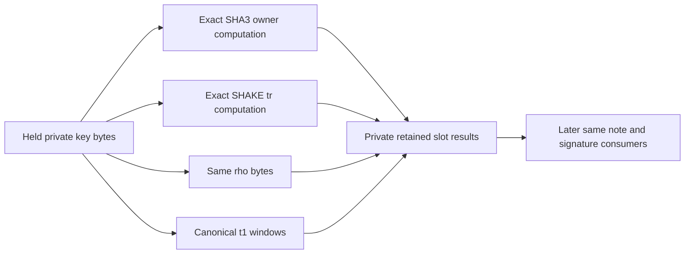

# Private verification key source constraints

The [key source module](../crates/thorum-hash-proof-lab/src/key_source.rs) connects two private ML DSA87 verification key encodings to their exact owner hashes, tr hashes, rho bytes and decoded t1 coefficients. Each key has exactly 2592 bytes. The same constrained source feeds every consumer before its bank is reused.

This is a source consistency relation. It does not establish signature validity, permission to spend, membership of a note or the exact transaction being authorized. The separate [owner binding component](owner-binding-proof-lab.md) remains a key preimage connection to hidden notes. Complete authorization must connect that same note, verification key, signature and transaction in a reviewed private construction. Independent positive component proofs cannot supply a missing identity constraint.

## Private source and retained outputs

One 2592 field byte bank holds the first encoded key through all its consumers, then holds the second key. Every owner and tr message byte reads the actual bank. Every key byte is linked to Boolean source bits. Canonical t1 windows consume the same bytes through the shared [decoder](coefficient-constraints.md).

For slot $s\in\{0,1\}$, the private retained values satisfy

$$
O_s=\operatorname{SHA3}_{512}(K_s),\qquad
T_s=\operatorname{SHAKE256}(K_s,64),\qquad
\rho_s=K_s[0:32].
$$

The remaining 2560 bytes encode 2048 little endian ten bit coefficients. Each fixed ten byte window returns eight actual decoder expressions with $0\le t_{1,s,i}\le1023$. These values remain private, including their exact scaled form $8192t_{1,s,i}<8380417$ for later arithmetic consumers.

All result banks begin at zero, receive their selected producer writes and hold thereafter. The two slots retain separate owner, tr, rho and t1 banks. Reloading the source bank cannot change a previously produced value. A complete consistent permutation of both private slots is a valid different witness in this isolated relation. Input note and transaction identity are later constraints.

## Hash and row schedule

Owner hashing uses a 72 byte rate. Exactly $2592=36\cdot72$ input bytes require a separate 37th padding permutation. The tr hash uses a 136 byte rate with 19 complete input blocks and a final block containing eight key bytes. Its suffix and terminal bit belong to that final block. Both computations retain the complete 200 byte state across every absorption, including capacity.

Four pinned Keccak rounds occupy each physical row. Each permutation still executes all 24 rounds. One key therefore requires

$$
R_K=(37+20)\frac{24}{4}=342
$$

hash rows. The 256 decoding events run alongside that schedule. The sole source reload is the transition from row 341 to row 342, after the first key's final tr output and decoder completion. It cannot occur at the owner to tr boundary.

| Private result | Slot zero first retained row | Slot one first retained row |
|---|---|---|
| rho | 1 | 343 |
| All t1 coefficients | 256 | 598 |
| Owner digest | 222 | 564 |
| tr digest | 342 | 684 |

The meaningful program finishes at row 684. All retained outputs hold through the remaining padding to height 1024. Each internal round link stays active in the final physical row. Only the last slot suppresses its outward transition at the finite trace boundary.

## Proof and visibility boundary

The separate profile is `thorum.private-key-source-proof-lab.mldsa87.two-slots.four-rounds.serial.p3-0.8.0.v1`. Its raw shape is height 1024, width 20168, 64 public fields and symbolic degree four. Stored degree is eleven, with eight quotient chunks and eleven FRI rounds. The configuration retains 64 queries, log blowup three, degree four extension, four random codewords, sixteen row salts and independently fresh operating system seeded hiding generators. Leaf, node and transcript adapters use distinct full SHA3 512 domains.

The only public values are 64 opaque context bytes. They enter the proof transcript, while the AIR has no canonical transaction mapping for them. Context mutation rejection does not establish transaction authorization. Keys, owner digests, tr, rho and t1 are private witness data. This interface supplies no public deterministic owner tag or payment format.

Closed transport bounds are 24 MiB, two million preflight tokens, 32768 collection members, depth 24, 64 byte strings and twenty digit integers. Shape checks and canonical reencoding precede actual verification. Verification consumes the proof and expected context without a private witness or host acceptance callback. This profile alone supplies no composed quantum security, recipient anonymity or complete private payment claim.

## Reference and rejection evidence

The [independent research record](../research/key-source/README.md) retains 13 represented encodings and 14 ordered cases. These include two retained distinct generated keys, equal key slots, coefficient endpoints, byte/window swaps and represented key joins. Synthetic encodings are not additional generated keys or an anonymity set.

Tests compare all private derived outputs, complete meaningful round states, dummy boundaries, source coverage and output lifetimes. Causal cases rebuild real local hash computations while breaking a common source, full state absorption or initialization boundary. Raw false proof tests bypass the normal witness precheck and require rejection by both the actual backend and the closed wrapper. Repeated honest proofs use fresh commitments. External API tests reject proofs from a different component profile.

Input commitments remain hidden in the payment membership and nullifier constructions. The complete same witness signature equation, owner note linkage, exact transaction, recipient delivery and confidential stake feasibility remain open before ledger integration. The standard wallet Send requirement remains private by default.
