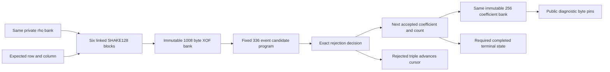

# Connected matrix sampling constraints

The [matrix sampler module](../crates/thorum-hash-proof-lab/src/matrix_sampler.rs) connects one private seed, six complete SHAKE128 output blocks and exact rejection sampling in the same AIR. It implements one length 256 matrix polynomial under the fixed ML-DSA-87 modulus $q=8380417$. The sampled coefficients already represent $\widehat A_{r,s}$ in the NTT representation. They require no additional forward transform.

The diagnostic statement publishes row, column, all 256 expected coefficients and a 64 byte context. Those outputs can identify repeated seeds. This interface supplies no recipient, key or coefficient anonymity, signature permission or production payment route. A complete private signature relation must connect the seed to the same hidden verification key and consume the sampled coefficients internally. Existing hidden input commitments, stable nullifiers and the mandatory private payment target retain their original requirements.

## Exact hash and rejection relation

For row $r\in[0,7]$, column $s\in[0,6]$ and the same private 32 byte $\rho$ bank, the hash input is

$$
\rho\mathbin\Vert\operatorname{u8}(s)\mathbin\Vert\operatorname{u8}(r).
$$

The column byte precedes the row byte. SHAKE128 uses rate 168 and capacity 32 bytes. The first permutation starts from the exact 34 byte input, suffix 31 at byte 34, zeros and the terminal 128 bit at byte 167. Each later squeeze starts from the complete previous 200 byte state and absorbs no new seed or padding. All rate and capacity limbs are linked directly.

All 1008 output bytes enter the same immutable XOF bank through individual eight bit links, including unused bytes in the sixth block. For each active candidate, the next three bytes give

$$
v=b_0+256b_1+65536(b_2\bmod128),\qquad0\le v<2^{23}.
$$

The high bit of $b_2$ is ignored. It is not required to be zero. A Boolean take flag $t$, active flag $a$ and 23 bit slack $u$ constrain the exact decision:

$$
t=1\Longrightarrow v+u=q-1,
\qquad
a-t=1\Longrightarrow v=q+u.
$$

The additional condition $t(1-a)=0$ forbids acceptance after completion. Under the declared bit ranges, the acceptance residual lies in $[-8380416,8396798]$ and the rejection residual lies in $[-16769024,8190]$. Both intervals are strictly within the BabyBear characteristic $p=2013265921$, so asserted field equalities are exact integer equalities.

Rejected candidates consume all three bytes without advancing the output count. Accepted candidates write the next output in order. The immutable output bank is connected to the same23 bit candidate. Completion visits every output slot once, establishing canonicality of all 256 coefficients without a host range verdict about private data.

## Fixed control and completion

The candidate program has 336 events and sticky terminal position 336. Its Boolean one hot selector starts at zero and advances once per row. A separate 257 position count selector starts at zero and advances only on take. If $P_j$ selects accepted count $j$, its transition is

$$
P'_0=(1-t)P_0,
\qquad
P'_j=(1-t)P_j+tP_{j-1}\quad(1\le j\le256).
$$

Count 256 disables further sampling. The byte cursor starts at zero, advances by $3a$ and freezes at completion. While active, it equals three times the fixed event index. Candidate and comparison auxiliaries are zero after completion, and all seed, XOF and coefficient banks hold across the entire trace.

Every program terminal row requires count 256. The final row also requires both terminal states. A 255 coefficient prefix cannot acquire its last acceptance from padding zeros. Source selection, rejection decisions, output slots and cursor changes are constrained directly, rather than supplied as a host acceptance callback.

## Bounded experimental support

The standard algorithm continues until256 candidates have been accepted. Neither 840 nor 1008 bytes is a proved completeness bound over the full seed domain. This profile covers executions completing within 1008 bytes and 336 candidates. `UnsupportedCapacity` is distinct from standard signature invalidity.

A production resource policy is unselected. Variable proof heights, padded classes, larger profiles or restricted supported inputs require explicit validity, liveness, privacy and denial of service analysis. A rare event estimate cannot silently become a consensus rule. A known injected stream completing at byte 843 is not evidence of a known SHAKE seed requiring that fallback.

## Fixed diagnostic proof profile

The public API is `prove_matrix_sampler(&Witness,&Statement)` and `verify_matrix_sampler(&[u8],&Statement)`. `Witness::from_rho` retains the private seed without a plaintext export or general serialization interface. `Statement::new` validates the public coordinate and canonical coefficient ranges. Verification repeats public validation and consumes no witness or private equality verdict.

| Property | Fixed value |
|---|---|
| Profile | `thorum.matrix-sampler-proof-lab.shake128.rejnttpoly.six-blocks.serial.p3-0.8.0.v1` |
| Trace | 512 rows and 7276 columns |
| Actual symbolic degree | Three |
| Public fields | 1090 |
| Stored hiding degree | Ten bits |
| Quotient chunks and FRI rounds | Eight chunks of four extension elements and ten binary rounds |
| FRI queries and log blowup | 64 and 3 |
| Challenge extension | Degree 4 over BabyBear |
| Random codewords and row salts | Four and sixteen base field elements |
| Grinding work | Zero |
| Transport caps | 16 MiB, 2000000 tokens, 16384 members, depth 24, string 64 bytes and 20 digit integers |

The public vector is row, column, 256 u32 little endian byte groups and 64 context bytes. Each accepted coefficient pins its separate eight, eight, seven and zero bytes. Byte distinct integers differing by $p$ therefore cannot exploit field reduction. Context remains opaque public transcript data and does not authenticate a whole transaction by itself.

Both commitment layers retain the hiding configuration and independent fresh OS seeded generators for every proof. Verification needs no private entropy. The complete SHA3-512 adapter domains are `thorum.matrix-sampler-proof-lab.leaf.v1`, `node.v1` and `transcript.v1`. The local mask budget is $512\ge2(64+4\cdot2)=144$. Canonical reencoding and fixed shape checks follow bounded preflight before cryptographic verification. These declarations establish no combined zero knowledge, quantum knowledge soundness or security bit claim.

## Evidence and remaining connection

The [reference record](../research/matrix-sampling/README.md) reproduces 224 genuine seed and coordinate cases, 1344 complete sponge states, 288 selected round states and ten injected streams. All 224 genuine cases pass the complete connected AIR, and exact expansion matches the independently retained full signature reference. Three injected cases demonstrate unsupported capacity. The standard algorithm is not replaced by a truncated prefix.

Actual proofs verify honest execution and fresh repeated witnesses. Changes to all 1090 public fields and a different profile reject. Thirteen raw false proofs bypass witness prechecks and fail direct backend verification. They cover a genuine wrong seed or coordinate with matching outputs, rate and capacity continuation faults, repeated padding, a swapped unused output block, byte aliases, broken seed and output holds, counter and cursor faults, acceptance during padding and a public integer alias. Canonical corruption tests exercise separate transport rejection.

Raw field array payload is $512\cdot7276\cdot4=14901248$ bytes. Hiding expansion two and blowup eight give main LDE payload $8192\cdot7280\cdot4=238551040$ bytes. Those calculations exclude other allocations and provide no measured peak memory, runtime, throughput or full signature feasibility claim.

The same hidden key, canonical signature decoding, challenge sampling, connected transforms and matrix accumulation, hint application, complete challenge equality and exact transaction binding remain required. Independent accepted component proofs do not establish that their private witnesses agree. Complete private payment and confidential stake feasibility remain gates before ledger kernel integration.
