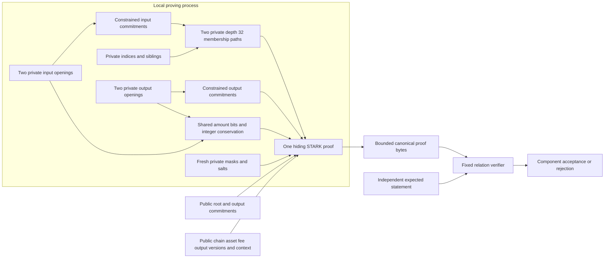

# Hidden input membership proof laboratory

## Implementation boundary

The [membership proof component](../crates/thorum-membership-proof-lab/src/lib.rs) places two input note commitments and both depth 32 authentication paths inside one hiding STARK relation. It derives each input commitment from a private canonical opening, proves membership against one public root and connects the same private amount bits to exact integer conservation. Both output commitments remain public. Input creation versions, commitments, path directions, indices and siblings are absent from the public statement.

This advances the earlier [note commitment component](note-proof-lab.md), which exposes both input commitments. It does not establish spending authorization. Ownership, stable nullifiers, spent state, replay protection, encrypted recipient delivery and accepted root policy remain outside the relation. The three key and secret bindings in each opening remain private committed byte strings without a constrained derivation from actual authority. A valid component proof alone cannot authorize a ledger transition.

Private payments by default remain a product requirement. The desktop wallet's standard payment path must use the complete private payment relation. An optional transparent Send mode is outside that requirement. This laboratory does not provide a wallet transaction submission path, a running private ledger or a release payment format.



The diagram describes relation dependencies. It does not establish endpoint security, root authenticity, anonymity or complete transaction privacy.

## Public interface

`Statement` contains the following exact public fields:

| Field | Rust type | Constraint meaning |
|---|---|---|
| `fee` | `u64` | Shared asset fee in the integer equation |
| `chain` | `[u8; 32]` | Shared chain inside every note and membership message |
| `output_creation_versions` | `[u32; 2]` | Creation versions of the two output notes |
| `asset` | `[u8; 32]` | Shared asset inside all four canonical openings |
| `root` | `[u8; 64]` | Common terminal root of both private paths |
| `output_commitments` | `[[u8; 64]; 2]` | Exact commitments of the two output openings |
| `context` | `[u8; 64]` | Opaque public transcript binding |

The public vector contains 392 base field elements. Its order is 64 least significant bit first fee bits, 32 chain bytes, eight big endian output creation version bytes, 32 asset bytes, 64 root bytes, 128 output commitment bytes and 64 context bytes. Typed integers and byte arrays prevent arbitrary public values from being reduced into one field element. Input creation versions are eight private bytes shared across the trace and bound to their canonical opening positions.

The private witness constructor is

```rust
Witness::from_openings_and_paths(
    openings: [[u8; 418]; 4],
    indices: [u32; 2],
    siblings: [[[u8; 64]; 32]; 2],
)
```

Opening order is input 0, input 1, output 0 and output 1. The witness has no `Debug`, `Clone`, serialization or public plaintext export. `prove_membership(&Witness, &Statement)` returns proof bytes or an error. `verify_membership(&[u8], &Statement)` accepts only proof bytes and an independently supplied expected statement. A host witness check or callback cannot substitute for cryptographic verification.

The opaque context has no authenticated ledger meaning in this component. The surrounding protocol must define its canonical transaction binding, accepted root history and branch rules before integrating the verifier.

## Canonical commitments and membership messages

For byte string $x$, define

$$
F(x)=\operatorname{u32be}(|x|)\mathbin\Vert x.
$$

Each private opening $O_j$ uses the existing 418 byte version 2 payment codec. The encoding version is the unsigned 16 bit value 2, and the policy byte is zero. All framing lengths, domains and constant bytes are constrained. The shared chain, asset and output creation versions occupy their exact canonical byte positions. Both input creation versions remain private. The private amount bits occupy opening bytes $[129,137)$ in unsigned 64 bit big endian form. The complete [opening field table](note-proof-lab.md#canonical-payment-opening) remains applicable with this changed input version visibility.

The four note commitments are

$$
C_j=\operatorname{SHA3\text{-}512}\left(F(D_C)\mathbin\Vert F(O_j)\right),
\qquad
D_C=\texttt{thorum.relation-lab.note-commitment.v2}.
$$

Each 464 byte commitment message pads to 504 bytes and requires seven Keccak permutations. The two input digests are stored as 32 canonical unsigned 16 bit little endian limbs per digest inside the trace. These same private cells enter the membership leaf messages and input distinctness equation. Output digests equal the public output commitments.

For chain $\chi$, the exact leaf and parent functions are

$$
L_\chi(C)=\operatorname{SHA3\text{-}512}
\left(F(D_L)\mathbin\Vert F(\chi)\mathbin\Vert F(C)\right)
$$

$$
P_\chi(L,R)=\operatorname{SHA3\text{-}512}
\left(F(D_P)\mathbin\Vert F(\chi)\mathbin\Vert F(L)\mathbin\Vert F(R)\right),
$$

where the exact domains are `thorum.relation-lab.merkle-leaf.v1` and `thorum.relation-lab.merkle-node.v1`. Both domains have 34 bytes.

| Membership message field | Leaf byte range | Parent byte range |
|---|---|---|
| Framed domain | `[0,38)` | `[0,38)` |
| Chain length prefix | `[38,42)` | `[38,42)` |
| Chain bytes | `[42,74)` | `[42,74)` |
| Commitment or left child length prefix | `[74,78)` | `[74,78)` |
| Commitment or left child bytes | `[78,142)` | `[78,142)` |
| Right child length prefix | Absent | `[142,146)` |
| Right child bytes | Absent | `[146,210)` |

The leaf has 142 bytes before padding. Its final two bytes are `06` at position 142 and `80` at position 143, producing two 72 byte blocks. The parent has 210 bytes before padding, followed by `06`, four zero bytes and `80`, producing three blocks and 216 bytes. These padding bytes are constrained alongside every structural zero byte. SHA3-512 uses a 1600 bit state, 576 bit rate, 1024 bit capacity and 24 rounds per permutation. Lane index is $x+5y$ with little endian lane bytes. [NIST FIPS 202](https://nvlpubs.nist.gov/nistpubs/FIPS/NIST.FIPS.202.pdf).

Every hash begins from a zero state. Interior sponge blocks XOR all rate bits and preserve the capacity lanes. The component constrains complete hash framing, padding, sponge transitions and digest connections around pinned `p3-keccak-air 0.8.0`. A host computed hash does not replace these constraints. [Pinned permutation source](https://github.com/Plonky3/Plonky3/tree/a21e3ed42905040ad49c519e402f018381c12d0c/keccak-air).

## Private path and common root

For private input $C_i$, let $d_{i,\ell}$ be the Boolean direction at level $\ell$ and $s_{i,\ell}$ its private 64 byte sibling. Starting with $r_{i,0}=L_\chi(C_i)$, the path requires

$$
r_{i,\ell+1}=
\begin{cases}
P_\chi(r_{i,\ell},s_{i,\ell}),&d_{i,\ell}=0,\\
P_\chi(s_{i,\ell},r_{i,\ell}),&d_{i,\ell}=1.
\end{cases}
$$

The direction is constant through all three blocks and 72 round rows of a parent hash. Each parent constrains the selected child to the previous constrained rolling digest. The other child is a private sibling. The final parent of each path must equal the same public root $R$:

$$
r_{0,32}=r_{1,32}=R.
$$

The 32 directions define the private index $j_i=\sum_{\ell=0}^{31}d_{i,\ell}2^\ell$. The witness constructor accepts this index as `u32` and supplies the directions in least significant bit first order. A prover cannot disconnect an opening's commitment from its leaf or substitute an unrelated rolling digest at an interior level while satisfying the relation.

The relation fixes path depth 32. The capacity $2^{32}$ describes potential leaf positions. It does not establish how many honest, unspent or indistinguishable notes exist under an accepted root. A node still needs a canonical append policy, root history, branch handling and input availability rules. A caller chosen arbitrary root has no ledger authority.

## Hidden input distinctness

Distinct path indices do not prevent the same commitment from appearing at multiple positions. The relation therefore proves $C_0\ne C_1$ directly inside the private trace.

Let $c_{i,k}$ denote the canonical unsigned 16 bit limb $k$ of commitment $C_i$. The relation introduces private field coefficients $z_k$ and requires

$$
\sum_{k=0}^{31}(c_{0,k}-c_{1,k})z_k=1.
$$

The base field prime is $2013265921$, greater than every limb. The limb encodings are therefore injective in the field. If the commitments are equal, every difference is zero and the equation is impossible. If at least one limb differs, its nonzero field difference has an inverse, yielding a satisfying coefficient assignment. The coefficients are witness values rather than fixed compression weights, so distinct differences cannot defeat the equality test through a fixed weighted cancellation.

The commitment limbs and coefficients repeat across the trace. Their digest linkage and the equation are constrained within the same proof as membership and conservation. This prevents duplicate input counting inside one component statement. It does not prevent spending the same note in another statement, establish nullifier correctness or replace persistent spent state.

## Exact integer conservation

The four canonical amounts and public same asset fee satisfy

$$
a_0+a_1=b_0+b_1+f=S,
\qquad 0\le S\le2^{64}-1.
$$

The amount bits are shared between canonical hash messages and both bitwise addition equations. Amount bits and the common sum are Boolean. Input carries are Boolean. Output carries lie in $\{0,1,2\}$. Initial carries and both terminal carries are zero. Each bit equation has a bounded residual whose absolute value is at most five, so it cannot wrap by the base field modulus. Summing the bit equations cancels interior carries and establishes exact bounded integer equality. Equal overflowing totals fail.

The shared public asset binds all four openings. The fee is denominated in that same asset for this laboratory. Production fee asset policy, confidential multiasset balancing, minting and burning authorization remain separate decisions and constraints.

## Proof profile and acceptance

The profile is `thorum.membership-proof-lab.v2-payment.depth32.sha3-512.serial.p3-0.8.0.v1`. It is distinct from earlier conservation and note proof profiles.

The fixed schedule evaluates four seven block note commitments, two two block leaves and 64 three block parents. This gives 70 hashes, 224 Keccak permutations and 5376 real round rows. The original trace has 8192 rows and 4595 columns. Remaining rows are padding work rather than additional notes. The pinned backend's symbolic degree convention gives maximum constraint degree four. Transition selectors have degree zero in that convention.

| Profile property | Fixed value |
|---|---|
| Private paths | Two paths of depth 32 |
| Canonical note openings | Four payment openings of 418 bytes |
| Original trace | 8192 rows and 4595 columns |
| Hiding extension | 16384 rows, stored degree bits 14 |
| Public vector | 392 base field elements |
| FRI log blowup | 3, a factor of 8 |
| FRI queries and folding rounds | 64 queries and 14 rounds |
| Challenge extension | Degree 4 over BabyBear |
| Quotient openings | Eight chunks of four extension elements |
| Random codewords | Four |
| Merkle arity and cap height | Binary, cap height zero |
| Merkle salts | 16 base field elements per committed row |
| Grinding difficulties | Zero bits |
| Proof byte limit | 8,388,608 bytes |

Both input and FRI commitments use the hiding Merkle scheme. Fresh operating system seeded generators supply masks and salts for every proof. Verification requires no fresh entropy. All proving and proof tests run serially because of the component's resource requirements. The fixed declarations and resolved dependency features are checked by the [profile guard](../research/membership-proofs/profile_check.py).

The inspected mask budget condition is $N\ge2(q+d\,o)$. For 8192 original rows, 64 queries, extension degree four and two trace opening points, $8192\ge144$. This is one source enforced condition of the hiding configuration. It is not an independent zero knowledge argument or a composed quantum security level. [Pinned hiding PCS](https://github.com/Plonky3/Plonky3/blob/a21e3ed42905040ad49c519e402f018381c12d0c/fri/src/hiding_pcs.rs).

The local proof commitment and application transcript adapters retain full SHA3-512 digests under `thorum.membership-proof-lab.leaf.v1`, `thorum.membership-proof-lab.node.v1` and `thorum.membership-proof-lab.transcript.v1`. These adapters are separate from the relation's canonical note tree hashes. Canonical base field integers use four little endian bytes, node words use eight little endian bytes, and the adapter preimages end with a big endian eight byte element count. Upstream typed metadata additionally uses Keccak256 fingerprints for fixed interaction patterns and algebra identities. Full width local digests do not establish the security level of the complete composition. [Pinned pattern fingerprints](https://github.com/Plonky3/Plonky3/blob/a21e3ed42905040ad49c519e402f018381c12d0c/challenger/src/fs/pattern/sequence.rs).

JSON preflight limits nesting depth to 24, tokens to 1,000,000, items in each collection to 16,384, string content to 64 bytes and unsigned integer tokens to 20 digits. Escaped strings and unsupported token forms fail. Typed decoding is followed by fixed shape checks and exact canonical reencoding before cryptographic verification. Shape checks include degree, roots, trace widths, quotient and randomization dimensions, 64 query openings, 14 folding rounds, salt lengths and bounded Merkle paths. These input limits are not peak memory or worst case execution measurements.

## Reference evidence and privacy limits

The [independent reference corpus](../research/membership-proofs/README.md) supplies complete canonical openings, sparse paths, full preimages, padded bytes and all 224 sponge block states. Its 40 cases include all direction bits, valid high indices, duplicate commitments at distinct positions, changed siblings and indices, disconnected commitments, changed roots and creation version binding. All 33 accepting fixtures have identical public statements. These are public synthetic relation data. Repeated commitments at multiple positions do not create independent notes or demonstrate an anonymity set.

Reference classification is separate from actual proof generation and verification. Release tests bypass the normal local witness precheck to require rejection by the real verifier. A malformed witness rejected by a host check alone does not establish verifier soundness. Source tests and reproduction commands retain the distinction, without treating a feasibility run as a benchmark.

| Validation boundary | Executable coverage |
|---|---|
| Independent relation cases | All 40 fixtures checked against the actual AIR, including 33 accepting private paths |
| Canonical hash computation | 70 complete messages, 224 full sponge transitions, 288 selected round states and three adapter digest goldens |
| Causal linkage | Seven altered traces retain genuine Keccak computations and matching terminal roots but fail the complete AIR |
| Cryptographic rejection | Five raw invalid proofs cover duplicate commitments and four detached or reversed path constructions |
| Public binding | 448 targeted fee, chain, asset, root, output version, output commitment and context mutations fail verification |
| Existing note interoperability | Fresh recipient capabilities and canonical notes enter a real depth 32 proof, with roots independently derived through the existing path interface |
| Transport and randomness | Malformed encodings, altered proof fields and resource overruns fail, while repeated valid proofs use fresh commitments |

These tests concern their stated constructions and cases. They are not exhaustive verifier analysis, a proof of witness indistinguishability or an independent audit.

The public statement still exposes the root, chain, asset, output creation versions, fee, two output commitments, context and fixed input and output counts. Output publication, root selection, timing, proof size, wallet queries, network traffic and recipient discovery can reveal additional relationships. The component does not measure metadata leakage or witness indistinguishability. Static endpoint data, private trace cells and generator state remain in process memory, without an established complete erasure guarantee.

The implementation does not supply ownership proofs, authorization, stable nullifier derivation, cross transaction double spend prevention, accepted root history, note tree state transitions, authenticated recipient encryption, recovery or a composed quantum soundness analysis. These remain gates before a private ledger kernel, distributed node trials or wallet payment submission. Confidential staking and checkpoint voting require their own complete private relation.

No timing, throughput, peak memory or effective anonymity size result follows from these fixtures or an informal local proof run. Historical [primitive measurements](../research/crypto/README.md) and [unbound conservation measurements](../research/proofs/README.md) remain evidence for their recorded source snapshots. A resource report for this relation requires a separate retained source revision, executable hash, machine and software description, workload, repetitions and raw observations.
