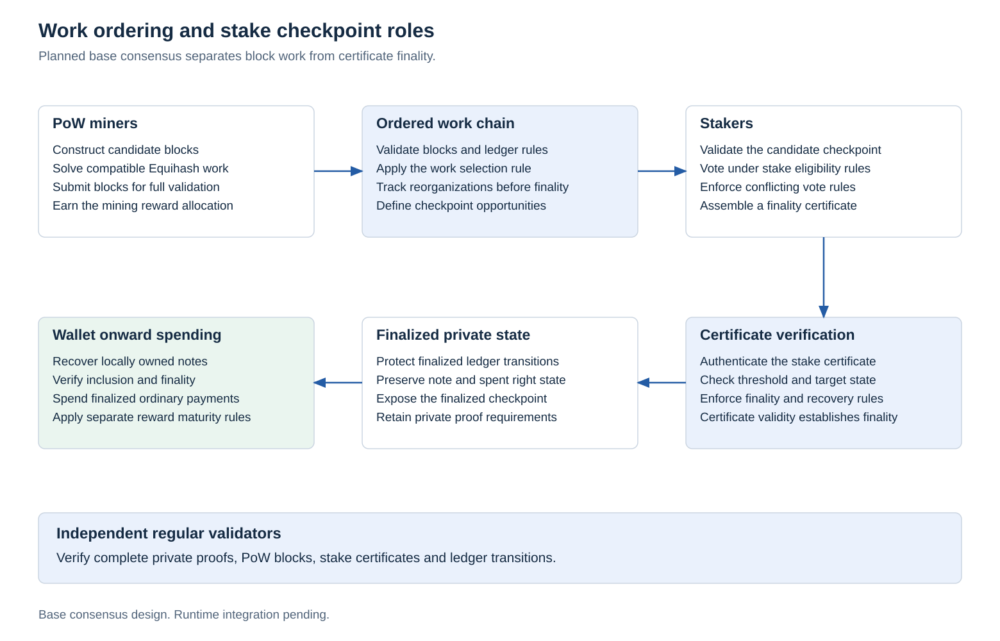

# Auxiliary work integration

## Implementation status

This document specifies the mining boundary. The repository does not implement an auxiliary work verifier, mining adapter, pool service or live parent submission path. The current monetary core calculates native allocations. Compatible work, destinations, payouts and external receipts require the separate validation and integration gates below.

## Operator roles

| Role | Required components |
|---|---|
| Pool operator | Synchronized Kova node, compatible parent full node under operator control, adapter for parent templates and submissions, worker accounting, treasury routing and monitoring |
| Solo mining operator | Both node stacks, equivalent job/commitment/submission integration, compatible Equihash work |
| Pool worker | Compatible miner, pool connection and native payout destination |
| Ordinary validator or staker | Kova node and relevant staking duties. No requirement to synchronize the parent network |

The first parent profile targets Equihash (200,9) work under the parent formats specified by the primary references below. Matching an algorithm name alone is insufficient: parameters, personalization, header rules, activated formats and child commitments must match.

The [bounded header work source selection](../research/work-authentication/README.md) identifies a concrete fixed-parameter verification component and pinned upstream references. It has not been implemented or executed. Full auxiliary child binding, history policy and bootstrap activation remain separate gates.

## Verification boundary

<picture>
  <source media="(prefers-color-scheme: dark)" srcset="../research/protocol-figures/figures/work-checkpoint-flow-dark.svg">
  
</picture>

An auxiliary witness must authenticate the intended child candidate, chain/domain identifiers, supported parent work, relevant parent transaction and authorization commitments, target and treasury destination commitment. Its encoding and resource limits require a dedicated specification and negative vectors.

The referenced parent transaction format requires careful treatment of both transaction and authorization commitments. The appropriate branches cannot be replaced by an unqualified check of the transaction ID alone. Parent format rules must be pinned to an evaluated version. [Transaction/authorization commitments](https://zips.z.cash/zip-0244), [miner/pool protocol](https://zips.z.cash/zip-0301)

A work result that satisfies the child target need not satisfy the external chain's harder target. A valid child witness also does not prove a winning external candidate was broadcast, accepted, remained canonical, or paid the treasury. Operators separately reconcile actual external receipts through their full nodes.

## Permissionless integration

Independent compatible operators can integrate under common verification rules without a certificate issued by a developer for each job. Treasury destination updates must be versioned and unambiguous for every validating node. A public registry does not automatically supply a secure construction for update governance.

Submit matching solutions to every supported compatible target. Additional auxiliary chains require tested simultaneous commitment and payout compatibility. Arbitrary algorithm or parent switching is outside the initial profile.

Expected external income depends on actual winning work, acceptance, difficulty, liquidity, fees, and settlement policy. Shares and submission acknowledgments are accounting events, not spendable external coins.

## Later certified state recording

The [Aegis architecture](aegis.md#certified-state-and-recorded-prefix) defines a separate later recording boundary. After its consensus activation, work candidates would authenticate contiguous certified batches while retaining the supported auxiliary witness rules. Recording cannot reapply payment state, issue duplicate rewards or override committed private consumption. The initial chain milestone retains its existing work and checkpoint scope.

The recording cursor, deterministic inclusion obligations, compatible fork selection and finalized reward imports require dedicated header and transition specifications. A node's locally newest certificate cannot define block validity. Mining keeps its own block cadence, and Aegis batch count creates no subsidy or evidence of external mining receipts.
