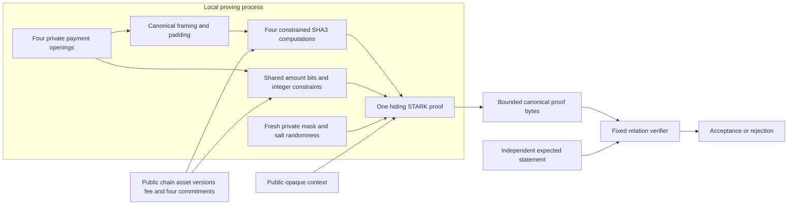

# Canonical note conservation proof laboratory

## Implementation boundary

The [note proof experiment](../crates/thorum-note-proof-lab/src/lib.rs) constrains four canonical payment openings and exact integer conservation in one hiding STARK proof. The same amount bits enter both the SHA3-512 note commitment constraints and the arithmetic equations. The verifier receives the public statement and proof bytes, without receiving the openings or an acceptance callback. This connects amount conservation to particular committed notes, beyond the earlier [unbound conservation component](proof-lab.md).

All four note commitments are public in this component, including both input commitments. Publishing this statement as a transaction would identify the consumed notes and expose their relationship to the output commitments. Hidden amounts do not establish transaction graph privacy. This is a component experiment rather than the production private payment format. A complete private payment relation must hide input commitments and membership paths behind an authenticated root and nullifiers, or use an independently justified alternative.

Ownership, spending authorization, membership, nullifier derivation and uniqueness, recipient encryption, bond policies and ledger state updates remain outside the relation. The three committed key or secret bindings are private byte strings here. Their derivation from actual keys and secret authority is not constrained. A valid proof alone does not authorize a payment or establish that any input note exists or remains unspent. The [complete payment and confidential stake gates](development.md) remain open.

The diagram shows data dependencies, without an endpoint security, memory erasure or transaction graph privacy claim.

`Witness::from_openings([[u8; 418]; 4])` accepts the four private canonical openings. The witness type has no `Debug`, `Clone`, serialization or public plaintext export. `prove_note_conservation(&Witness, &Statement)` returns proof bytes or an error. `verify_note_conservation(&[u8], &Statement)` returns acceptance or an error. These interfaces remain isolated from node or wallet transaction submission.

## Canonical payment opening

Define the frame of byte string $x$ by

$$
F(x)=\operatorname{u32be}(|x|)\mathbin\Vert x.
$$

The opening domain is the exact byte string `thorum.relation-lab.note-opening.v2`. Each opening is the concatenation of twelve framed fields. The amount is an unsigned 64 bit big endian integer. The encoding version is the constant unsigned 16 bit value 2. The final policy byte is zero, selecting a payment rather than a bond.

| Field | Value bytes | Opening value range | Commitment message value range | Relation binding |
|---|---:|---|---|---|
| Opening domain | 35 | `[4,39)` | `[50,85)` | Fixed exact bytes |
| Encoding version | 2 | `[43,45)` | `[89,91)` | Fixed value 2 |
| Chain identifier | 32 | `[49,81)` | `[95,127)` | Shared public chain |
| Creation version | 4 | `[85,89)` | `[131,135)` | Per note public version |
| Asset identifier | 32 | `[93,125)` | `[139,171)` | Shared public asset |
| Amount | 8 | `[129,137)` | `[175,183)` | Private integer bits |
| Owner key binding | 64 | `[141,205)` | `[187,251)` | Private committed bytes |
| Nullifier secret binding | 64 | `[209,273)` | `[255,319)` | Private committed bytes |
| Recipient key binding | 64 | `[277,341)` | `[323,387)` | Private committed bytes |
| Serial | 32 | `[345,377)` | `[391,423)` | Private committed bytes |
| Blinding | 32 | `[381,413)` | `[427,459)` | Private committed bytes |
| Payment policy | 1 | `[417,418)` | `[463,464)` | Fixed zero byte |

Ranges are zero based and exclude their upper bound. Every field length prefix is constrained, including prefixes whose value is zero in the high bytes. Each opening has exactly 418 bytes. The five private nonamount fields contain 256 bytes, giving 264 private bytes per opening after including the amount. The relation does not establish their entropy quality, uniqueness or cryptographic meaning.

For opening $O_j$, its public commitment is

$$
C_j=\operatorname{SHA3\text{-}512}\left(F(D_C)\mathbin\Vert F(O_j)\right),
\qquad
D_C=\texttt{thorum.relation-lab.note-commitment.v2}.
$$

The commitment domain has 38 bytes. Its frame has 42 bytes. The framed opening adds 422 bytes, so the complete hash message has 464 bytes and the opening begins at message byte 46. These are the existing recipient payment bytes, with no replacement commitment primitive or alternate amount encoding.

## Constrained SHA3 sponge

SHA3-512 uses a 1600 bit state, a 576 bit rate and a 1024 bit capacity. Each absorption invokes all 24 rounds of the permutation. State lanes use index $x+5y$ and little endian lane bytes, while the amount retains its canonical big endian byte encoding. These separate conventions are explicit in the constraints and [independent references](../research/note-proofs/README.md). [NIST FIPS 202, sections 3 through 6](https://nvlpubs.nist.gov/nistpubs/FIPS/NIST.FIPS.202.pdf).

For a 464 byte commitment message, byte aligned SHA3 padding places `06` at byte 464, zero bytes at positions 465 through 502, and `80` at byte 503. The padded message therefore has 504 bytes, or seven 72 byte rate blocks. Four openings require 28 real permutations and 672 round rows.

Each note starts with a zero sponge state. The first rate block supplies its initial rate lanes and the capacity lanes start at zero. For subsequent blocks, the next permutation input is

$$
S_{j,k}^{\mathrm{in}}
=S_{j,k-1}^{\mathrm{out}}\mathbin\oplus
\left(M_{j,k}\mathbin\Vert 0^{1024}\right),
\qquad k\in\{1,\ldots,6\},
$$

where $M_{j,k}$ is the 576 bit message block. Capacity lanes are carried unchanged across each absorption boundary. The rate XOR is constrained with Boolean operands. The first 64 bytes after the seventh permutation equal the public commitment. No host computed hash result substitutes for these constraints.

The [fixed schedule](../crates/thorum-note-proof-lab/src/sponge.rs) advances across the seven blocks of each note before starting the next note from a zero state. Message bits repeat through all rounds of their permutation. Structural bytes, padding, public chain and asset identifiers, per note versions and private amount bits are linked to their exact message positions. Each of the five remaining opening fields is represented by Boolean message bits, without a public plaintext export.

The permutation constraints come from pinned `p3-keccak-air 0.8.0`. The local wrapper constrains canonical framing, sponge absorption, note boundaries, output digests and amount linkage around that permutation. Correct permutation constraints alone do not establish those surrounding bindings. [Pinned permutation source](https://github.com/Plonky3/Plonky3/tree/a21e3ed42905040ad49c519e402f018381c12d0c/keccak-air).

## Integer conservation

Opening order is fixed as input 0, input 1, output 0 and output 1. Let their private amounts be $a_0,a_1,b_0,b_1$, with public fee $f$. All individual values are unsigned 64 bit integers. The relation requires

$$
a_0+a_1=b_0+b_1+f=S,
\qquad 0\le S\le2^{64}-1.
$$

The fee is denominated in the shared public asset of this component. This does not define the production fee asset, payment policy or THM fee consensus rules.

For bit $i$, let $s_i$ be the common sum bit, and let $c_{A,i},c_{B,i}$ be outgoing carries. With $c_{A,-1}=c_{B,-1}=0$, the constraints are

$$
a_{0,i}+a_{1,i}+c_{A,i-1}=s_i+2c_{A,i}
$$

$$
b_{0,i}+b_{1,i}+f_i+c_{B,i-1}=s_i+2c_{B,i}.
$$

Amount bits, common sum bits and A carries are Boolean. B carries satisfy $c(c-1)(c-2)=0$. The terminal carries $c_{A,63}$ and $c_{B,63}$ are zero. All amount and carry cells repeat across every row of the trace, connecting the arithmetic to all four commitment computations in the same proof.

The base field prime is $p=2013265921$. Once the range constraints hold, the A equation residual is between $-3$ and $3$, and the B residual is between $-5$ and $5$. Neither can equal a nonzero multiple of $p$. Field equality therefore implies the corresponding bounded integer equality. Multiplying bit equations by $2^i$ and summing cancels the interior carries. The shared 64 bit sum and zero terminal carries establish exact equality without overflow. Equal totals above $2^{64}-1$ fail.

The public wrapper rejects identical input commitments before proving or verifying. This check prevents counting the same public input commitment twice within the component. It does not establish membership, historical uniqueness, a spent set or nullifier based double spend prevention.

## Public observations and hiding boundary

The statement exposes a 32 byte chain identifier, a shared 32 byte asset identifier, four creation versions, the fee, four complete 64 byte commitments, a 64 byte context and the fixed two input, two output shape. Reusing a public input commitment identifies the same note. Public asset and creation version values also remain observable. No routing, network, timing or application privacy follows from the proof.

The public vector encodes the fee as 64 least significant bit first values, followed by chain bytes, four big endian creation versions, asset bytes, four commitment byte arrays and context bytes. It has exactly 464 base field elements. The wrapper accepts typed integers and byte arrays, avoiding reduction of arbitrary public values into one field element.

Chain, asset, creation versions, fee and commitments have direct constraint meanings. The context remains an opaque public transcript value. Binding the transcript to it does not define or authenticate its ledger meaning. The expected statement is supplied independently to verification. The upstream transcript absorbs the entire public vector before sampling its constraint batching challenge. [Pinned transcript source](https://github.com/Plonky3/Plonky3/blob/a21e3ed42905040ad49c519e402f018381c12d0c/uni-stark/src/transcript.rs).

The hiding configuration uses private masks and salted commitments. Private openings, amount bits, trace cells and generator state still exist in local process memory. Their removal is not established. The proof does not make private endpoint state safe to log or expose through debugging interfaces.

## Proof profile and acceptance

The original trace has 1024 rows and 4262 columns, including 2633 permutation columns, the fixed schedule, rate message and output bits, four amount bit arrays, common sum and carries. Rows after the 28 real permutations are padding work rather than additional notes. The pinned two adic backend reports a maximum symbolic constraint degree of 4, with transition selectors contributing degree zero in that accounting. The AIR pins that value rather than accepting a prover selected degree. Counting the raw transition selector product as an ordinary polynomial would give a different degree convention.

The transcript profile prefix is `thorum.note-proof-lab.v2-payment.sha3-512.serial.p3-0.8.0.v1`. The exact public fields are `fee: u64`, `chain: [u8; 32]`, `creation_versions: [u32; 4]`, `asset: [u8; 32]`, `commitments: [[u8; 64]; 4]` and `context: [u8; 64]`.

The hiding profile fixes 64 FRI queries, log blowup 3, challenge extension degree 4, four random codewords, binary folding and a constant final polynomial. Both input and FRI commitments use the hiding Merkle scheme with 16 base field salt elements per row. Execution remains serial. Local leaf, node and application transcript adapters retain all 512 SHA3-512 output bits. The distinct circuit profile and adapter domains prevent accidental reuse of the earlier conservation profile. These settings do not establish a numerical soundness or composed quantum security level.

| Profile property | Fixed value |
|---|---|
| Original trace | 1024 rows and 4262 columns |
| Hiding extension | 2048 rows, stored degree bits 11 |
| Public vector | 464 base field elements |
| FRI log blowup | 3, a factor of 8 |
| FRI queries and folding rounds | 64 queries and 11 rounds |
| Quotient openings | 8 chunks of 4 extension elements |
| Challenge extension degree | 4 |
| Random codewords | 4 |
| Merkle arity and cap height | Binary, cap height 0 |
| Merkle salts | 16 base field elements per committed row |
| Batch, commit, query and out of domain grinding | 0 bits |
| Leaf domain | `thorum.note-proof-lab.leaf.v1` |
| Node domain | `thorum.note-proof-lab.node.v1` |
| Application transcript domain | `thorum.note-proof-lab.transcript.v1` |

The mask budget condition inspected in the pinned PCS is

$$
N\ge2(q+d\,o).
$$

For 1024 original rows, 64 queries, extension degree four and two trace opening points, this gives $1024\ge144$. Source enforcement of that budget is one requirement for the selected hiding configuration. It is not an independent zero knowledge or quantum knowledge proof. Upstream typed transcript metadata additionally uses Keccak256 fingerprints for fixed interaction patterns and algebra identities. The application hash width does not replace analysis of the full composition. [Pinned hiding PCS](https://github.com/Plonky3/Plonky3/blob/a21e3ed42905040ad49c519e402f018381c12d0c/fri/src/hiding_pcs.rs), [pattern fingerprints](https://github.com/Plonky3/Plonky3/blob/a21e3ed42905040ad49c519e402f018381c12d0c/challenger/src/fs/pattern/sequence.rs).

Proving uses fresh operating system seeded generators. Verification requires no fresh entropy. The verifier fixes the AIR, statement layout, profile and accepted proof shape. A successful local constraint check is not accepted as proof verification. Decoder bounds, canonical encoding and exact structural checks are part of the public acceptance boundary. Reproduction commands and independent byte references are retained in the [research record](../research/note-proofs/README.md).

The proof byte cap is 8,388,608 bytes. JSON preflight limits nesting depth to 24, tokens to 1,000,000, items in each collection to 16,384, string content to 64 bytes and unsigned integer tokens to 20 digits. Escaped strings and unsupported token forms fail. Reencoding must reproduce the submitted proof bytes exactly. Shape checks require the fixed degree, trace widths, quotient and randomization dimensions, commitment roots, query and folding counts, salt lengths and bounded Merkle paths before cryptographic verification. These accepted input limits are not peak memory or worst case execution measurements.

## Validation boundaries

The [independent reference comparisons](../crates/thorum-note-proof-lab/src/reference.rs) compare four canonical note openings and exact integer classifications across all thirteen retained combined cases. They also compare complete absorption and permutation states, rather than only final hash bytes, and check separate full digest goldens for the leaf, node and application transcript adapters.

The [proof corpus](../crates/thorum-note-proof-lab/src/tests.rs) separates malformed witness constraints, public statement mutation, proof transport mutation and actual cryptographic verification. Its release path bypasses the normal local witness precheck and upstream debug assertions to construct deliberately invalid raw proofs. Rejection by the real verifier is a different boundary from early host rejection. Repeated valid proofs test fresh commitment randomization, without measuring statistical distance or proving witness indistinguishability by output inspection.

Local validation on Rust 1.94.1 passes 102 workspace tests. The note component's release suite passes 10 unit tests and one [recipient note integration test](../crates/thorum-note-proof-lab/tests/recipient_notes.rs). The raw release corpus constructs 28 invalid proofs with the expected shape and requires the actual verifier to reject each one. The integration test uses generated authorization and recipient keys with the existing recipient capability and `NoteOpening::new_recipient` interfaces, then proves all four actual note commitments and their conserved amounts together. This establishes interface and encoding agreement, without proving those keys' ownership or recipient encryption inside the relation.

The original proof component's 10 release tests and the monetary model's 20 Python tests also pass. Independent relation, recipient, unbound proof and note proof references, both profile guards, historical measurement summaries, dependency inventory, formatting, Clippy and strict rustdoc checks pass. These are local validation results. They do not establish independent review, deployed network behavior or a new performance report.

The research record supplies exact reproduction commands. The retained references and executable checks concern this component's framing, sponge and integer relation. They do not replace independent implementation review, quantum soundness analysis or the complete private payment and confidential stake gates.

The [profile guard](../research/note-proofs/profile_check.py) checks the fixed declarations and resolved dependency features under default and all workspace features. It rejects changes to pinned versions or a unified parallel configuration. This consistency check does not establish the arithmetic relation or a security level.

## Remaining integration gates

Complete private payments require ownership and authorization constraints, hidden input membership, stable nullifiers, recipient encryption and recovery, asset policy, malformed input handling and atomic ledger integration. Confidential stake eligibility and checkpoint voting require their own complete private relation. A conservation proof with public input commitments cannot replace either gate.

The full chain path includes state validation and persistence, node synchronization, branch changes, auxiliary mining, stake checkpoint rules and adversarial trials on multiple server nodes. The desktop wallet depends on those interfaces for local validation and proving, default private payments, restricted staking and voting authority, viewing permissions, backups and recovery. None of those network or wallet capabilities is established by this component.

The reference corpus establishes exact byte agreement and bounded integer classifications. Actual proof tests supply a separate verification boundary. Historical measurements for the earlier conservation component do not measure this substantially different relation. A performance report requires a separate retained source revision, hardware and software record, workload and raw observations. No timing estimate follows from an informal local run.
