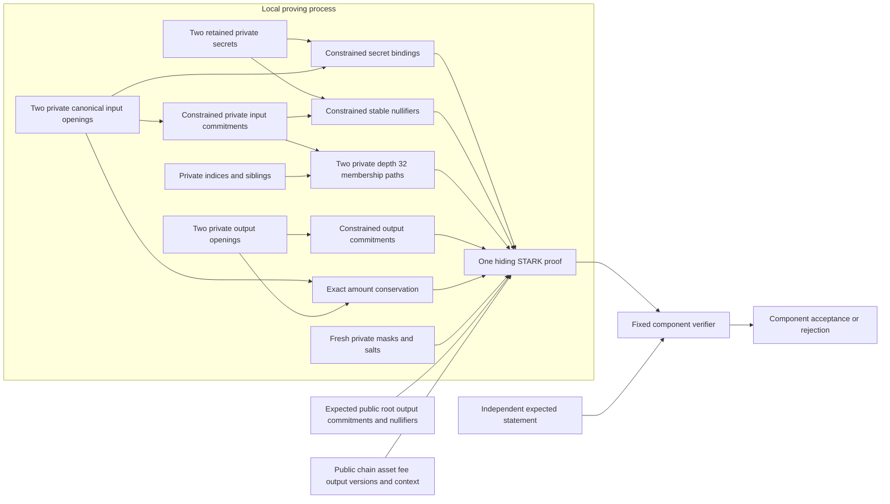

# Stable nullifier proof laboratory

## Implementation boundary

The [nullifier proof component](../crates/thorum-nullifier-proof-lab/src/lib.rs) extends hidden input membership with stable public spend identities. One hiding STARK derives two input secret bindings and two nullifiers from retained private secrets, connects them to the same canonical private note commitments used for depth 32 membership and enforces exact integer conservation. Both input commitments remain absent from the public statement.

The component does not establish ownership or permission to spend. Knowledge of a retained nullifier secret and note opening supplies nullifier authority rather than the separate owner authorization. Accepted root policy, persistent spent state, atomic nullifier consumption, branch rollback, authenticated recipient encryption and complete payment authorization remain separate implementation gates. A valid component proof alone cannot authorize a ledger transition.

Private payments by default remain the wallet requirement. The normal payment path must use the complete private relation. The earlier public commitment laboratories and legacy version 1 notes do not provide a transparent payment fallback. This component supplies neither a running private ledger nor a wallet transaction submission path.



The diagram describes constrained dependencies. It does not establish root authenticity, global unspentness, ownership, endpoint security or anonymity.

## Stable identity

For byte string $x$, define $F(x)=\operatorname{u32be}(|x|)\mathbin\Vert x$. For chain identifier $\chi$, private retained secret $k_i$ and private canonical note commitment $C_i$, the exact existing version 2 identities are

$$
B_i=\operatorname{SHA3\text{-}512}
\left(F(D_B)\mathbin\Vert F(\chi)\mathbin\Vert F(k_i)\right)
$$

$$
N_i=\operatorname{SHA3\text{-}512}
\left(F(D_N)\mathbin\Vert F(\chi)\mathbin\Vert F(k_i)\mathbin\Vert F(C_i)\right),
$$

where

```text
D_B = thorum.relation-lab.nullifier-secret-binding.v2
D_N = thorum.relation-lab.note-nullifier.v2
```

The relation constrains $B_i$ to the secret binding field inside input opening $O_i$. It derives $C_i$ from that same complete opening using `thorum.relation-lab.note-commitment.v2`. The same private commitment enters the membership leaf and the nullifier message. The same 32 private secret bytes feed both the binding and nullifier computations. A host hash calculation or precheck cannot substitute for these constraints.

The note nullifier excludes the root, index, path, transaction context, current network protocol version, fee, outputs and ciphertext. An immutable version 2 input therefore retains its nullifier across legitimate root changes and new transactions. A different public root or context still requires a proof bound to the new complete statement. Nullifier stability does not make an old proof reusable under altered public inputs.

The input creation version is already committed inside the immutable note opening. Changing that field creates a different commitment and a different note. The component has no authenticated current protocol version field. Historical note eligibility and network upgrade policy cannot be inferred from opaque context bytes.

Version 1 domains and encoded openings retain their existing identities and reference vectors. Version 1 openings contain the actual retained secret, permitting the sender to compute later identities. They remain excluded from this version 2 private payment component. A version 2 public recipient capability contains the secret's binding rather than the secret itself. This API separation does not prove sender unlinkability.

## Canonical framing and absorption boundaries

All byte ranges below are zero based and exclude their upper bounds.

| Message field | Secret binding | Note nullifier |
|---|---|---|
| Domain length prefix | `[0,4)` | `[0,4)` |
| Domain bytes | `[4,51)` | `[4,41)` |
| Chain length prefix | `[51,55)` | `[41,45)` |
| Chain bytes | `[55,87)` | `[45,77)` |
| Secret length prefix | `[87,91)` | `[77,81)` |
| Secret bytes | `[91,123)` | `[81,113)` |
| Commitment length prefix | Absent | `[113,117)` |
| Commitment bytes | Absent | `[117,181)` |

The binding message contains 123 bytes. SHA3 padding supplies `06` at byte 123, zero bytes through 142 and `80` at 143, giving two 72 byte absorption blocks. The nullifier message contains 181 bytes. It has `06` at 181, zero bytes through 214 and `80` at 215, giving three blocks. Domains, length prefixes, chain bytes, secret bytes, commitment bytes and padding are all constrained.

SHA3-512 uses a 1600 bit state, 576 bit rate, 1024 bit capacity and 24 rounds per permutation. Lane index is $x+5y$ with little endian lane bytes. Every hash resets the complete state. Later blocks XOR the rate and retain the capacity state. The component constrains these sponge transitions around the pinned permutation AIR. [NIST FIPS 202](https://nvlpubs.nist.gov/nistpubs/FIPS/NIST.FIPS.202.pdf), [pinned permutation source](https://github.com/Plonky3/Plonky3/tree/a21e3ed42905040ad49c519e402f018381c12d0c/keccak-air).

Two connections cross absorption boundaries at odd byte alignment:

1. The binding occupies opening bytes `[209,273)` and outer commitment message bytes `[255,319)`. Its digest bytes 32 and 33 occupy outer message bytes 287 and 288, on opposite sides of a 72 byte boundary. Bytewise binding registers connect every computed digest byte to the exact opening byte.
2. The nullifier's commitment begins at message byte 117. Commitment bytes 26 and 27 occupy message bytes 143 and 144 across another boundary. Explicit byte bridge cells connect both to the same canonical unsigned 16 bit commitment limb. Neither byte is omitted or read from an adjacent trace column.

The retained secret and binding registers are shared throughout the trace. Separate globally consistent commitment limbs retain their canonical digest linkage. Binding and nullifier hashes do not update the membership rolling digest. Membership transitions begin at the constrained leaf and continue only at complete leaf or parent hash boundaries.

## Public interface and visibility

`Statement` has the following public fields:

| Field | Rust type | Meaning |
|---|---|---|
| `fee` | `u64` | Shared asset fee in the integer equation |
| `chain` | `[u8; 32]` | Chain inside every canonical relation message |
| `output_creation_versions` | `[u32; 2]` | Creation versions of the two output notes |
| `asset` | `[u8; 32]` | Shared asset inside all four openings |
| `root` | `[u8; 64]` | Common terminal root for both private paths |
| `output_commitments` | `[[u8; 64]; 2]` | Exact commitments of the two output openings |
| `nullifiers` | `[[u8; 64]; 2]` | Exact stable identities of the two private inputs |
| `context` | `[u8; 64]` | Opaque transaction transcript binding |

The public vector has 520 base field elements. Its order is 64 least significant bit first fee bits, 32 chain bytes, eight big endian output creation version bytes, 32 asset bytes, 64 root bytes, 128 output commitment bytes, 128 nullifier bytes and 64 context bytes. Each nullifier retains all 64 digest bytes. Typed integers and bytes prevent arbitrary public integers from being reduced into one field element.

The witness constructor is

```rust
Witness::from_openings_secrets_and_paths(
    openings: [[u8; 418]; 4],
    secrets: [[u8; 32]; 2],
    indices: [u32; 2],
    siblings: [[[u8; 64]; 32]; 2],
)
```

Opening order is input 0, input 1, output 0 and output 1. Secret and path order follow their corresponding inputs. The witness has no `Debug`, `Clone`, general serialization or public plaintext export. `prove_nullifiers(&Witness, &Statement)` produces proof bytes or an error. `verify_nullifiers(&[u8], &Statement)` receives no private witness and requires an independently supplied expected statement.

Both interfaces reject equal public nullifiers within a statement. The private input commitment distinctness equation remains constrained inside the AIR:

$$
\sum_{j=0}^{31}(c_{0,j}-c_{1,j})z_j=1,
$$

with canonical 16 bit commitment limbs $c_{i,j}$ and private field coefficients $z_j$. The [membership laboratory](membership-proof-lab.md#hidden-input-distinctness) records the injective limb and inverse argument. Distinct indices alone do not establish distinct notes.

Both private paths satisfy the common root requirement. The four canonical private amounts and the public same asset fee satisfy

$$
\operatorname{PathRoot}(C_i,j_i,S_i)=R,
\qquad
a_0+a_1=b_0+b_1+f\le2^{64}-1.
$$

The existing [path constraints](membership-proof-lab.md#private-path-and-common-root) and [bounded integer equations](membership-proof-lab.md#exact-integer-conservation) remain part of the same proof. The fee uses the shared public asset in this laboratory. Production fee policy, confidential multiasset balancing, minting and burning authority remain separate.

Output secret and key bindings remain opaque committed bytes in this relation. Only the two input retained secrets are linked to derived bindings. Output authority, encryption key correctness and recipient delivery require further constraints.

## Profile and acceptance

The profile is `thorum.nullifier-proof-lab.v2-payment.depth32.sha3-512.serial.p3-0.8.0.v1`. Earlier conservation, note and membership profiles remain distinct and reproducible.

Four seven block note hashes are followed, for each input, by a two block binding, three block nullifier, two block leaf and 32 three block parents. The fixed schedule has 74 hashes, 234 permutations and 5616 real round rows. There are 235 schedule selectors including the terminal padding selector. The original trace has 8192 rows and 4801 columns. Padding rows do not represent additional notes.

| Profile property | Fixed value |
|---|---|
| Private paths | Two paths of depth 32 |
| Canonical openings and retained secrets | Four 418 byte openings and two 32 byte input secrets |
| Original trace | 8192 rows and 4801 columns |
| Hiding extension | 16384 rows and stored degree bits 14 |
| Public vector | 520 base field elements |
| Maximum constraint degree | Four under the pinned symbolic convention |
| FRI log blowup | 3, a factor of 8 |
| FRI queries and folding rounds | 64 queries and 14 rounds |
| Challenge extension | Degree 4 over BabyBear |
| Quotient openings | Eight chunks of four extension elements |
| Random codewords | Four |
| Merkle arity and cap height | Binary and cap height zero |
| Merkle salts | 16 base field elements per committed row |
| Grinding difficulties | Zero bits |
| Proof byte limit | 8,388,608 bytes |

Both input and FRI commitments use the hiding Merkle scheme. Every proof receives fresh operating system seeded masks and salts. Verification requires no fresh entropy. Proving and proof tests run serially. The [profile guard](../research/nullifier-proofs/profile_check.py) checks fixed declarations and resolved dependency features. These declarations do not establish a composed security level or a measured execution cost.

The source enforced mask condition is $8192\ge2(64+4\cdot2)=144$. It is one configuration check rather than an independent zero knowledge proof. [Pinned hiding PCS](https://github.com/Plonky3/Plonky3/blob/a21e3ed42905040ad49c519e402f018381c12d0c/fri/src/hiding_pcs.rs).

The full width local proof adapters use `thorum.nullifier-proof-lab.leaf.v1`, `thorum.nullifier-proof-lab.node.v1` and `thorum.nullifier-proof-lab.transcript.v1`. Upstream fixed interaction metadata additionally uses Keccak256 fingerprints. The complete proof composition needs its own classical and quantum analysis. [Pinned pattern fingerprints](https://github.com/Plonky3/Plonky3/blob/a21e3ed42905040ad49c519e402f018381c12d0c/challenger/src/fs/pattern/sequence.rs).

JSON preflight limits depth to 24, tokens to 1,000,000, collection items to 16,384, string content to 64 bytes and unsigned integer tokens to 20 digits. Unsupported tokens and escaped strings fail. Typed decoding is followed by fixed shape checks and exact canonical reencoding before proof verification. Shape checks cover degree, trace widths, roots, quotient chunks, randomization dimensions, 64 queries, 14 folding rounds, salts and bounded Merkle paths. These bounds are not peak memory or worst case runtime measurements.

## Reference evidence and remaining gates

The [independent reference corpus](../research/nullifier-proofs/README.md) contains 64 classified cases, 42 satisfying cases, 74 complete canonical preimages, 234 full sponge transitions, 408 selected round states and three proof adapter digest goldens. Ten additional malformed padded messages retain valid permutation calculations while violating expected canonical framing or padding. The generator independently checks SHA3 output against `hashlib` and imports neither Rust nor a proof backend.

The cases include reused and distinct retained secrets, stable identities under valid root and context changes, a wrong secret with its correctly recomputed nullifier and otherwise valid membership, mixed authority, both byte splits, domain and chain substitutions, duplicate commitments and nullifiers, public mutations, output binding scope and unsigned integer boundaries. Classification evidence is distinct from actual proof generation and verifier rejection. A witness rejected by a host precheck alone does not establish cryptographic soundness. These are finite tests rather than exhaustive analysis or an audit.

| Validation boundary | Executable coverage |
|---|---|
| Independent relation cases | All 64 classifications checked against the actual AIR, including 42 satisfying witnesses and integer boundaries |
| Canonical hash computation | 74 complete messages, 234 full sponge transitions, 408 selected round states and three adapter digest goldens |
| Public encoding | All 520 typed field values compared with independent vectors for every case |
| Malformed messages | Ten altered padded messages match their independent standalone digests but fail the complete constraints |
| Causal linkage | Twelve altered traces retain genuine permutations, matching nullifier digests and both membership roots but fail the complete AIR |
| Cryptographic rejection | Eight raw invalid proofs bypass local witness checks and fail backend verification, including separate attacks on both sides of each absorption boundary |
| Public binding | 576 targeted public mutations fail verification, and a different proof profile fails backend verification |
| Restored recipient authority | Two fresh authorities, typed recovery and two real proofs preserve existing nullifiers under different independently constructed roots and contexts |

The duplicate input raw proof also bypasses the public duplicate nullifier check at the backend call. Its rejection therefore exercises cryptographic constraints rather than relying on that public precheck. The recipient test constructs mathematical tree roots through the existing path interface. It does not establish their ledger eligibility or implement persistent spent state. Repeated valid proofs use fresh commitments, without treating randomization as a formal witness hiding result.

A ledger must authenticate the expected root and atomically check every public nullifier against persistent spent state before accepting a transaction. Successful proof verification does not establish that a nullifier is globally unused. Concurrent submissions, transactions in the same block, crash recovery and branch rollback require deterministic state transition rules. Repeated nullifiers deliberately identify repeated attempts to consume the same immutable note.

The version 2 opening does not contain the retained secret. Decrypting an opening therefore cannot recover a lost secret. Old notes require their original retained authority after key rotation. Backups and restricted viewing authority must account for this separation. Sharing a reused nullifier secret grants tracking authority across notes whose commitments are known to the recipient of that secret. Static trace and endpoint data remain in process memory without a complete erasure guarantee.

The keyed hash construction is experimental. A sender knows the binding image, can choose many notes under a reused capability, knows their commitments and may observe later nullifiers. Known image, chosen commitment and repeated secret observations require explicit analysis. Secret entropy, domain separation, collision and preimage assumptions, classical and quantum query models and composition with the hiding proof remain open research requirements. Full 512 bit digests and a 256 bit secret do not imply a numerical composed quantum privacy or soundness level. Deterministic low entropy fixture keys provide no entropy evidence.

The public statement still exposes root, chain, shared asset, fee, output creation versions, output commitments, two nullifiers, context and fixed input and output counts. Timing, proof size, root selection, recipient discovery, wallet queries and network traffic can reveal relationships. This component does not measure metadata leakage or prove sender unlinkability or witness indistinguishability.

Ownership, private spend authorization, authenticated recipient delivery, accepted roots and complete state transitions remain gates before a private ledger kernel, distributed node trials or wallet payment submission. Confidential staking and checkpoint voting require their own complete private relation. No throughput, peak memory or anonymity result follows from an informal proof run. Existing measured artifacts retain their original source revisions, hardware, workloads and raw observations.
