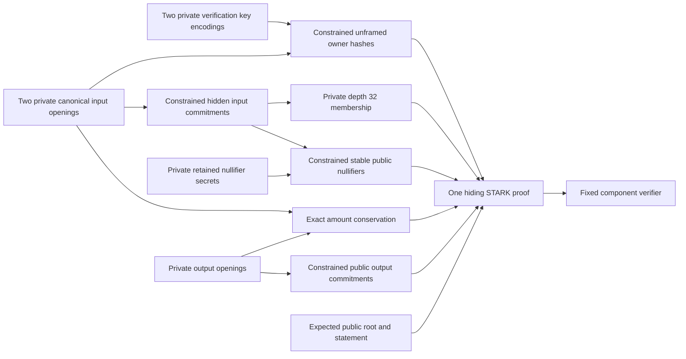

# Private owner key binding proof laboratory

## Implementation boundary

The [owner binding component](../crates/thorum-owner-binding-proof-lab/src/lib.rs) connects two private verification key byte strings to the exact owner hashes inside their canonical private input openings. The same proof retains hidden input commitments, depth 32 membership, stable nullifiers, private input distinctness and exact integer conservation. Verification keys and owner hashes remain private, and the public statement retains its existing 520 field values.

This is private preimage binding rather than signature verification or spending permission. Verification keys are public knowledge even when this relation hides their association with a note. Knowing a key or reopening its hash cannot authorize a transaction. The component does not prove possession of a signing key or a valid signature for the expected transaction.

Complete private ownership still requires the same hidden key, signature, hashes, matrices and signature computation to be connected to the same note and exact authorized transaction. There is no ledger acceptance path for this isolated component. Hidden input commitments, stable nullifiers and private payments by default remain unchanged. Complete payment and confidential stake feasibility remain required before kernel integration.



The diagram records constrained dependencies. It contains no signature verification or complete ownership claim.

## Immutable owner identity

The existing source function `key_binding` requires an encoded key length of exactly 2592 bytes and returns unframed SHA3-512 of those bytes. For input key bytes $K_i$ and canonical opening $O_i$, the relation requires

$$
B_i^{\mathrm{owner}}=\operatorname{SHA3\text{-}512}(K_i),
\qquad
|K_i|=2592,
\qquad
B_i^{\mathrm{owner}}=O_i[141,205).
$$

There is no implicit chain field, application domain or length prefix inside the owner hash. Adding one would change the immutable note identity rather than reproduce the existing version 2 relation. The exact source revision and byte digest are retained in the [source record](../research/owner-bindings/source_record.json).

With $F(x)=\operatorname{u32be}(|x|)\mathbin\Vert x$, the same complete input opening defines

$$
C_i=\operatorname{SHA3\text{-}512}
\left(F(\texttt{thorum.relation-lab.note-commitment.v2})\mathbin\Vert F(O_i)\right).
$$

Its owner bytes occupy the outer commitment message range $[187,251)$. Owner digest bytes 28 and 29 fall at message bytes 215 and 216 on opposite sides of a 72 byte absorption boundary. They correspond to opening bytes 169 and 170. Private owner byte registers connect every computed digest byte to its exact canonical opening position, including both sides of that boundary.

Changing an owner hash creates a different note commitment and nullifier. It does not rewrite the authority of an existing note or reset its identity. Existing notes, commitments, version domains and nullifier derivations remain unchanged. Legacy version 1 files remain compatibility records outside this version 2 component.

## Full unframed hashing and same note linkage

Each key has 2592 bytes, exactly 36 SHA3-512 rate blocks. The final padding requires a separate 37th block. It contains `06` at byte 2592, zeros through 2662 and `80` at 2663, giving 2664 padded bytes. A truncated 2591 byte message has a different padding layout. Framing the key also produces a different preimage.

Every hash starts from a zero 1600 bit state. Each 72 byte block XORs all nine rate lanes, preserves the 1024 bit capacity and applies all 24 Keccak rounds. Lane index is $x+5y$ with little endian lane bytes. Domain absence, full length, padding, rate and capacity continuity and all output connections are constrained around the pinned permutation AIR. [NIST FIPS 202](https://csrc.nist.gov/pubs/fips/202/final).

The added hashes do not replace any existing note relation. Each input still requires its retained secret binding, stable public nullifier, hidden leaf and full private path to the common root. The exact same canonical commitment enters nullifier derivation and membership. Its amount bits enter the same bounded integer equation

$$
a_0+a_1=b_0+b_1+f\le2^{64}-1.
$$

Private input commitment distinctness remains constrained, while the public interface rejects equal nullifiers within a statement. These conditions do not establish global unspentness or root eligibility. The [nullifier laboratory](nullifier-proof-lab.md) records their exact identity, path and arithmetic boundaries.

The output owner and recipient key fields remain opaque committed bytes in this component. Only the two input verification key hashes are derived. Complete output authority, key consistency and encrypted delivery require further constraints.

## Public and private interface

`Statement` retains the exact fields `fee`, `chain`, `output_creation_versions`, `asset`, `root`, `output_commitments`, `nullifiers` and `context`. The vector order remains 64 fee bits, 32 chain bytes, eight big endian output version bytes, 32 asset bytes, 64 root bytes, 128 output commitment bytes, 128 nullifier bytes and 64 context bytes.

The 520 public elements contain no input key, owner hash, input commitment, input creation version, path, index, opening or retained secret. The context remains opaque transcript binding rather than authenticated transaction bytes, protocol policy or a signature message.

The fixed private constructor is

```rust
Witness::from_openings_keys_secrets_and_paths(
    openings: [[u8; 418]; 4],
    public_keys: [[u8; 2592]; 2],
    secrets: [[u8; 32]; 2],
    indices: [u32; 2],
    siblings: [[[u8; 64]; 32]; 2],
)
```

Opening order is input zero, input one, output zero and output one. Key, secret and path order follows the corresponding input. The witness has no `Debug`, `Clone`, general serialization or plaintext export interface. Private arrays must remain inside the local proving boundary.

`prove_owner_binding(&Witness, &Statement)` produces proof bytes or an error. `verify_owner_binding(&[u8], &Statement)` receives an independently supplied expected statement and no witness. Host key hashing, a native signature result or a local witness precheck cannot substitute for the constrained relation and cryptographic verification.

## Profile and acceptance

The profile is `thorum.owner-binding-proof-lab.v2-payment.depth32.sha3-512.serial.p3-0.8.0.v1`. Earlier profiles remain distinct and reproducible.

Four seven block note commitments are followed, for each input, by the 37 block owner hash, two block secret binding, three block nullifier, two block leaf and 32 three block parents. This gives

$$
4\cdot7+2\cdot(37+2+3+2+32\cdot3)=308
$$

permutations, 76 complete hash messages and 7392 real round rows. The original 8192 row trace retains the full membership depth. Remaining rows are padding rather than more notes.

| Profile property | Fixed value |
|---|---|
| Original trace | 8192 rows and 5003 columns |
| Stored hiding degree | Fourteen bits with 16384 extended rows |
| Maximum symbolic constraint degree | Four under the pinned convention |
| Public vector | 520 base field elements |
| FRI queries and log blowup | 64 queries and 3 |
| FRI folding rounds | Fourteen |
| Challenge extension | Degree 4 over BabyBear |
| Quotient openings | Eight chunks of four extension elements |
| Random codewords | Four |
| Merkle salts | 16 base field elements per committed row |
| Grinding difficulties | Zero bits |
| Proof byte cap | 8388608 bytes |

Both commitment layers use the inspected hiding configuration. Fresh operating system seeded private masks and salts are used for every proof. Verification requires no fresh entropy. The masking budget check is $8192\ge2(64+4\cdot2)=144$. This is one source enforced condition rather than an independent zero knowledge or quantum knowledge soundness argument.

The separate adapter domains are `thorum.owner-binding-proof-lab.leaf.v1`, `thorum.owner-binding-proof-lab.node.v1` and `thorum.owner-binding-proof-lab.transcript.v1`, retaining complete SHA3-512 outputs. Upstream fixed interaction metadata additionally uses Keccak256 fingerprints. Full local digests do not establish the complete composition's security level.

The profile retains bounded JSON preflight, typed decoding, fixed proof dimensions and exact canonical reencoding before backend verification. Limits are 8 MiB encoded proof bytes, 1000000 tokens, 16384 collection items, nesting depth 24, 64 string bytes and 20 digits per unsigned integer. Shape checks fix degree, roots, trace width, quotient and masking dimensions, 64 queries, 14 FRI rounds, salts and bounded Merkle paths. These acceptance limits are not measured peak memory or worst case runtime guarantees. The [profile guard](../research/owner-bindings/profile_check.py) records the declarations and resolved dependency features.

## Independent references and remaining gates

The [reference corpus](../research/owner-bindings/README.md) contains 85 cases, including 46 satisfying cases, three fixed shape rejections and three independent adapter goldens. It records all 76 preimages and padded messages, 308 complete sponge transitions and 2184 selected round states. The manual Keccak implementation and canonical framing oracle import neither Rust nor a proof backend and compare canonical hashes with Python `hashlib`.

The first 64 cases reproduce the original nullifier corpus with matching synthetic key preimages. Their existing 42 accepting cases retain byte identical public statements, note openings, commitments, roots and nullifiers. The [retained identity record](../research/owner-bindings/retained_v2_identities.json) pins the original file digest and baseline identity bytes separately.

Seventeen additional hostile relation cases retain valid nullifier, membership, framing and conservation checks while failing only owner binding. They include substituted keys, crosswired keys or fields, both split owner bytes, truncated or framed hashes, extra prefixes, SHAKE substitution, altered padding and capacity faults. Full paths, roots, commitments and nullifiers are recomputed where needed. Zero byte key preimages remain accepted as a deliberate scope case, without a signing key or signature claim.

Reference classification, actual AIR comparison and real invalid proof rejection remain separate verification boundaries. A fixed array shape failure at a host boundary does not establish cryptographic soundness. Synthetic keys, fixture paths and openings are deliberately public data rather than production material, entropy evidence, an anonymity experiment or full NIST conformance validation.

| Validation boundary | Recorded result |
|---|---|
| Release tests | Fourteen unit tests and one recipient integration test pass |
| Selected debug tests | Nine constraint and independent reference tests pass |
| Raw false proofs | Eight constructions bypass witness prechecks and fail actual verification, including duplicate hidden inputs |
| Causal owner linkage | Twenty five traces retain genuine hash computations and matching roots and nullifiers while failing the complete relation |
| Expected statement | All 576 targeted mutations fail verification |
| Independent references | All 85 classifications and 520 public fields agree, with 76 messages, 308 sponge transitions and 2184 selected round states |
| Compatibility | All 64 retained nullifier cases preserve their original identity bytes and classifications |
| Recipient interoperability | Two fresh distinct owner keys bind recovered notes, while changed roots retain stable nullifiers and a substituted owner key fails |

The recipient test proves the same inputs under two independently constructed tree roots and contexts. It retains spending keys outside the proof witness. No signature is verified inside either proof, and no eligible ledger state or global spent set is established. The [transparent signature reference](../research/signatures/README.md) separately reproduces complete native verification over public synthetic data, without substituting that calculation for private proof constraints.

Canonical key and signature decoding, strict norms, canonical hints, exact matrix and challenge sampling, signed coefficient conversion, matrix and challenge products, `UseHint`, `w1` encoding and full signature challenge equality remain required. The same hidden key and signature must be linked to the same note and exact signed transaction, including roots, nullifiers, outputs, encrypted delivery, fee and authenticated context. A nullifier or viewing delegate who knows a verification key gains no spending permission from this preimage relation.

Authenticated roots, global spent state, atomic persistence, recipient encryption, recovery, confidential stake and metadata analysis retain their existing gates. The proof composition still needs its applicable knowledge soundness, quantum oracle and unforgeability arguments. No performance, privacy measurement, independent audit or numerical quantum security result is asserted by the retained dimensions or an informal proof run.
