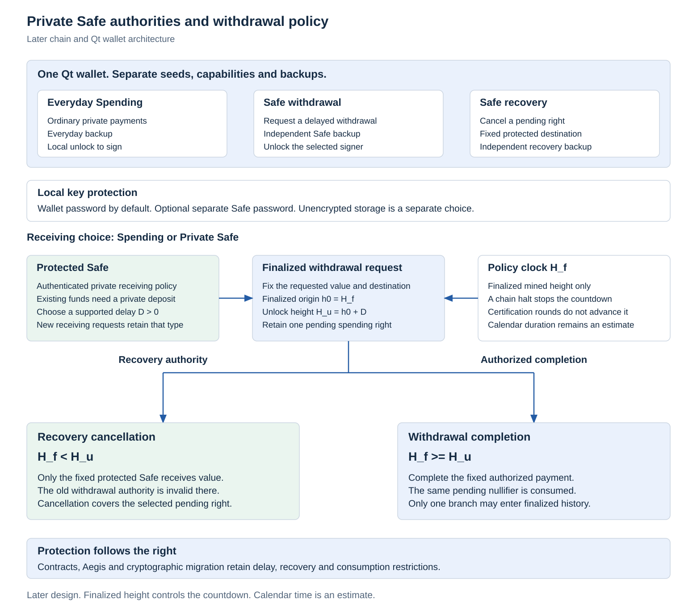

# Private Safe

## Scope and implementation status

The Private Safe is an optional protected balance managed through the Myrk Qt wallet and enforced by the chain. Users choose between ordinary Spending receiving and Safe receiving, with a supported withdrawal delay selected for each Safe policy. Both paths retain the private payment requirements. Spending does not mean a transparent payment mode.

This document defines later application and wallet architecture. Safe note encodings, private proofs, consensus transitions, monitoring and the Qt interface are not implemented. The first chain milestone retains its existing private payment, confidential stake, kernel and network gates. Safe delivery is a separate later milestone.

<picture>
  <source media="(prefers-color-scheme: dark)" srcset="../research/safe-design/figures/private-safe-dark.svg">
  
</picture>

The [figure record](../research/safe-design/README.md) retains fixed design data, source hashes and reproduction commands. The diagram describes required authority and state relationships, without a runtime or performance claim.

## Typed receiving and protected deposits

A receiving request identifies the network, version, recipient type and authenticated recipient capability. A Safe request additionally binds the selected policy. Its conceptual descriptor is

$$
R=(\mathit{network},\mathit{version},\mathit{type},\mathit{recipient},C_{\Pi},\mathit{authentication}),
\qquad \mathit{type}\in\{\mathrm{Spending},\mathrm{Safe}\}.
$$

Here $C_{\Pi}$ commits to the Safe policy. This notation does not select an address encoding, authentication construction or public policy representation. The sender must authenticate the request, validate the supported type and prove that the created output has that exact recipient policy. An unsupported Safe request fails before construction. It cannot silently become an ordinary Spending output.

Changing the wallet's default to Safe affects new receiving requests only. It does not alter an old ordinary address or protect existing ordinary notes. Existing Spending funds require an actual accepted private deposit transition into Safe protected notes. The wallet must distinguish that transition from a local balance label or display preference.

Safe policy may be carried by a typed address or an authenticated payment request under a future versioned format. Descriptor visibility, authentication, privacy of its fields and resistance to replacement remain construction gates. No public stable Safe identifier linking all deposits is required by this design. Reusing a recognizable descriptor can itself create a link for senders or observers and needs measurement.

## Policy and supported delay

The conceptual private policy commits to

$$
\Pi=(v,\mathit{network},A_W,A_R,D,C_{R},\mathit{updateRules}),
$$

where $A_W$ authorizes withdrawal requests, $A_R$ authorizes restricted recovery cancellation, $D$ is the withdrawal delay and $C_R$ binds the fixed protected recovery Safe. Withdrawal and recovery authorities must be distinct and separately controlled. The policy version determines canonical encoding, cryptography, resource bounds and accepted transitions.

Users choose $D$ from the active version's supported range or duration set:

$$
1\le D_{\min}\le D\le D_{\max},\qquad D\in\mathcal D_v.
$$

The production set $\mathcal D_v$, its minimum and maximum, and any wallet presets remain unset. No one day, seven day or other example is a fixed consensus value. The active rules must reject zero, unsupported values and arithmetic overflow. Every sender accepting a Safe request must bind the chosen supported value rather than substituting a wallet default.

A withdrawal delay applies whenever value is requested from the Safe. It is different from a one time calendar lock. Funds may remain protected indefinitely, but a new withdrawal still creates its own response interval. Fixed date locks would require separate typed semantics.

Current canonical v2 Payment notes cannot be reinterpreted as Safe notes. The Safe requires a new versioned note or policy encoding and a complete private relation. Enabling a wallet control or a contract method cannot activate that encoding.

## One application and three independent authorities

| Authority | Permitted actions | Backup and storage boundary |
|---|---|---|
| Everyday Spending | Authorize ordinary private spending and an authorized deposit into a Safe | Everyday seed and backup |
| Safe withdrawal | Request a withdrawal under the committed delay and payout conditions | Independent Safe withdrawal seed and backup |
| Safe recovery | Cancel an eligible pending right only into its fixed protected recovery Safe | Independent recovery seed and backup, preferably kept away from the online withdrawal signer |

The same Qt app can display all three roles. Its everyday backup must not recreate the Safe withdrawal or recovery authority. Deriving different role keys from one stolen seed would not provide independent protection against theft of that seed. The same local password can protect distinct seeds, but does not make those seeds identical.

Independent seed generation, backup verification and physical storage are wallet setup and threat model requirements. Consensus can verify the required authorization and distinct committed identities. It cannot prove that a person kept backups independent or stored a recovery seed offline.

Safe creation prepares the independent authorities, selects a supported policy, verifies the required backups and establishes the recovery destination before offering Safe receiving. The future backup format, seed derivation and verification procedure require a versioned specification. This document selects no phrase length or word list.

Normal withdrawal signing does not require repeated backup phrase entry. The user unlocks the relevant local key store or external signer, reviews the amount and destination and confirms the request. The signer then authorizes the exact transaction. Recovery phrases are restoration material, not routine form fields or data sent to nodes.

A view only wallet may show Safe balances, pending requests and deadlines using deliberately granted capabilities. Display and monitoring do not grant withdrawal, cancellation or ordinary spending permission. The app need not keep the withdrawal or recovery secrets on the computer that monitors the Safe.

## Local passwords and encryption

Local key protection and chain policy have different purposes:

| Local choice | Required behavior |
|---|---|
| Wallet password, default | Encrypt the independently generated Safe withdrawal key under the configured wallet protection. No additional Safe password is required |
| Separate Safe password | Encrypt the Safe withdrawal store separately. It remains locked while the everyday wallet is unlocked |
| Unencrypted storage | A separate explicit decision with a clear storage exposure indication. Absence of an extra Safe password is not this choice |

If wallet encryption is not configured, the Safe setup must obtain a local encryption choice or an explicit unencrypted Safe decision. It must not silently inherit unencrypted storage while displaying the encrypted default. Recovery storage has its own protection and location rather than being automatically unlocked with Spending.

Password changes reencrypt local storage. They do not change a Safe address, seed, chain policy, delay, recovery destination or existing pending request. New salts, authenticated storage, password derivation parameters, unlock caching, timeouts and crash recovery require implementation and measurement. An encrypted file does not prevent malware using a key after it is unlocked. Keeping all authorities and backups on one compromised device also limits their practical separation.

A separate Safe password is not an additional device or factor when both stores are unlocked on the same infected computer. Its local lock separation remains useful, with that compromise boundary stated explicitly.

Passwords and backup phrases never enter transaction bytes, proofs, consensus state, RPC logs or public records. Nodes verify the required private authorization and policy relation. They do not verify a user's local password.

## Finalized origin and policy clock

Let $H_f$ be the authenticated finalized mined height of the active consensus version. A request's countdown starts when the request first becomes part of finalized state, not when it is signed, submitted, first included or seen by a wallet. Its origin is assigned from that finalization context:

$$
h_0=H_f(S_{\mathrm{first\ final\ request}}),\qquad H_u=h_0+D.
$$

In the base profile this refers to the checkpoint finalized context. A request must not arrive in finalized state with a backdated origin which has already exhausted a small delay. The requester cannot select an old mined height, creation timestamp or earlier checkpoint as $h_0$.

The exact assignment, encoding and proof of $h_0$ require a consensus specification. In particular, a pending private commitment constructed before checkpoint finality needs a reviewed authenticated origin binding. The design cannot assume that a wallet predicts the future finalization height or that a later unbound metadata field is trustworthy. This is an implementation gate rather than a completed note format.

$H_f$ advances only through valid finalized mined history. A chain halt stops this clock. Wall time, wallet receipt time, confirmation estimates, Aegis certification sequence and additional voting rounds cannot advance it. The wallet may display an estimated calendar duration using the current block target, with the actual finalized height and remaining height interval visible. Such an estimate is not a calendar deadline guarantee.

## Request, cancellation and completion

A private withdrawal request consumes eligible protected value and creates a pending right P binding its original Safe policy, requested value, fixed withdrawal destination, authenticated finalized origin and unlock condition. Any protected change remains under the Safe policy. Ordinary Spending change cannot release the rest of a protected input around the delay.

For a single native asset, a possible conservation layout is

$$
\mathrm{Safe}(v)\longrightarrow
\mathrm{Pending}(w,d,h_0,D)+\mathrm{Safe}(v-w-f_{\mathrm{request}}),
\qquad 0<w,\quad w+f_{\mathrm{request}}\le v.
$$

This is an accounting relationship, not a selected fee or output encoding. Every asset and any fee funding path retain the common conservation and authorization rules. Existing reward maturity, staking restrictions and application conditions survive deposits and withdrawal paths.

The branch boundary remains

$$
\operatorname{cancel}:H_f<H_u,\qquad
\operatorname{complete}:H_f\ge H_u.
$$

Cancellation is therefore unavailable at equality. Let $P_v$ be the live pending representation under version $v$ and $I_P$ its logical pending request identity. Cancellation and completion of that representation use the same deterministic nullifier:

$$
\mathrm{NF}_{\mathrm{cancel}}(P_v)=\mathrm{NF}_{\mathrm{complete}}(P_v)=\mathrm{NF}_v(P_v),
\qquad \operatorname{AcceptedConsumptions}(P_v)\le1.
$$

Within that live representation, the consumption identity cannot vary with the branch, destination, current anchor, transaction nonce or application. The authenticated spent set and atomic state transition must reject a second consumption. Each authorized branch must derive the same identity without gaining unrestricted access to the other authority's funds.

The logical request identity records the continuing withdrawal obligation across any supported migration. It is distinct from the consumption identity of one version's note representation. Across the complete migration lineage, the required terminal conflict rule is

$$
\operatorname{AcceptedTerminalOutcomes}(I_P)\le1.
$$

This identity is conceptual and need not be a public stable tag. The private version transition and authenticated state must enforce the shared conflict domain without allowing a migrated request to be completed or cancelled again under an older version.

A cancellation needs recovery authorization and must enter finalized history under the valid before unlock context. A local Cancel button, queued message or unfinalized inclusion is insufficient. Deterministic validation context assignment, checkpoint jumps, competing branches, deadline ordering and unavailable finality need explicit rules and tests. Monitoring cannot guarantee inclusion before a deadline during congestion, censorship, network failure or unavailable consensus.

Completion must establish the original request authorization, fixed destination, permitted value, satisfied clock and remaining restrictions. Whether completion also requires a fresh withdrawal signature or permits another executor to relay the already fixed action remains an explicit construction choice. An executor must not gain destination or amount control.

## Fixed protected recovery destination

Recovery cancellation sends the selected pending value only to the protected Safe committed by $C_R$. It cannot select an arbitrary recipient, substitute an ordinary output, mint funds or bypass other restrictions. The destination must be controlled so the compromised old withdrawal credential is invalid there:

$$
A_W(\mathrm{recovery\ Safe})\ne A_W(\mathrm{original\ Safe}).
$$

Distinct keys alone are insufficient if both are recoverable from the compromised seed. The recovery target must have independently protected control and verified restoration material. It can be an existing independently controlled Safe. Creating another target may need additional credentials. The three authority roles above are not a maximum count of secrets for every recovery setup.

The destination's exact policy, authority initialization, backup readiness and compatibility checks remain specification gates. Recovery authority must not become an unrestricted spending key merely to simplify that setup. No automatic arbitrary destination update is defined.

Cancellation protects only P. If a request used part of a balance, other protected notes or Safe change remain separate rights. Recovering or migrating those remaining notes requires an additional explicitly authorized and proved transition. Direct emergency recovery of all protected notes is not defined by the pending cancellation path and remains open. The wallet must not announce that the whole Safe has been recovered after cancelling one request.

## Monitoring, data and loss cases

Monitoring needs authenticated encrypted delivery, pending note discovery, policy and clock information, consumption status and the data needed to reconstruct a valid recovery witness. A capability that permits observation does not itself authorize cancellation. A recovery signer needs the restricted authority and the necessary private witness data.

The construction must provide cancellation data and fee handling without granting general spending control. Its pending nullifier material, encrypted payload recipients, rescan behavior, scoped disclosure and resource limits require a complete private design. A watch service cannot be assumed to infer private requests from public amounts or a global viewing key.

| Loss or compromise | Required boundary |
|---|---|
| Everyday seed compromised | Safe withdrawal and recovery seeds remain independent |
| Safe withdrawal seed compromised | The valid delay and independent recovery path provide a response opportunity, subject to detection and inclusion |
| Recovery seed unavailable | The cancellation path is unavailable unless an already specified recovery rule applies. No administrative bypass is implied |
| Safe withdrawal seed lost | Backup restoration is separate from cancellation. Pending cancellation does not establish recovery of remaining protected notes |
| Password lost but seed available | Local restoration depends on the supported backup format and necessary encrypted historical data |
| Encrypted delivery or archive missing | Recovery is incomplete until authenticated data is available |
| Completed payment | Cancellation cannot reverse it. The policy does not identify scams or undo a willingly authorized completed withdrawal |

Backup and restoration tests must cover all three authority stores, separate signer devices, stale backups, missing archives, multiple restored devices and interrupted writes. Recovery of secrets alone does not reconstruct unavailable encrypted state.

## Policy updates and migration

Reducing D, changing withdrawal or recovery control, removing protection or replacing the fixed recovery destination can weaken protection. Such changes require their own reviewed authorization and protected delay. They cannot execute immediately using the very withdrawal credential whose compromise the Safe addresses.

A future update right must bind the old and new policies, required authorities, its own positive bounded update delay and an authenticated origin. Its veto, cancellation, finality and activation conditions remain unset. An update cannot rewrite an existing pending request's destination, origin, deadline or consumption identity. The classification and authorization of strengthening changes also need explicit rules. No immediate policy update method is activated here.

Cryptographic migration must preserve the Safe policy, logical pending request identity, origin, remaining delay, fixed recovery destination, conservation, reward maturity and other restrictions. It consumes the old representation exactly once and authenticates a live successor representing the same pending obligation. An already consumed nullifier must not be treated as live for the successor. Any successor consumption identity must be derived by the reviewed version transition rather than supplied through an arbitrary relabeling path.

Migration, cancellation and completion cannot independently consume the same old representation. The transition must exclude old version replay and preserve one terminal cancellation or completion across the lineage. A migration must prove a unique continuation of the live pending obligation. Any split or combination needs separate reviewed rules. The exact private construction linking representation consumption, lineage and cross version state remains open. No additional public linking identifier or selected migration algorithm is implied here.

Moving between cryptographic versions is not a withdrawal or a way to reset the response interval. A compromised or broken old scheme cannot be assumed to distinguish legitimate migration after the fact.

Contracts on Myrk may use a supported Safe interface only through the same kernel and private relation. A contract, privileged wallet endpoint or later Aegis path cannot bypass the policy. Aegis must use the specified finalized mined clock and retain the pending consumption identity rather than replacing it with certification sequence. Unsupported rights remain unsupported under every client.

## Privacy target and observable limits

The target keeps Safe balances, selected input commitments, owner and recovery keys, withdrawal destination and private policy fields inside the complete proof and encrypted recovery construction wherever the final statement permits. Receiving descriptors may deliberately reveal some policy to a sender. Exact public fields and their leakage must be enumerated before encoding is frozen.

Withdrawal, recovery, policy authentication, commitments, private proofs and encrypted recovery data retain the existing native post quantum evaluation requirements. No Safe authority or application path is exempt from the complete construction and composition gates.

Timing, transaction sizes, resource classes, fees, request/cancellation patterns, reused recipient descriptors, network traffic and wallet queries can still reveal information. No public stable Safe ID or public balance is required. Application fingerprints and the privacy of policy authentication remain research questions, not measured protections.

Evaluation must measure observer traces for deposit, request, cancellation, completion, partial change, monitoring, restart, restoration and migration. It must also test that ordinary receiving remains private and that selecting Safe cannot silently downgrade output policy.

## Acceptance gates

| Boundary | Required evidence |
|---|---|
| Receiving | Type, network, version and policy authentication, tampered descriptor rejection, unsupported type rejection and no retroactive ordinary note conversion |
| Origin and delay | First finalized request origin, D bounds, overflow, exact before/equal/after cases, chain halt and checkpoint jumps |
| Shared consumption | Cancel/complete conflicts on the same active representation, repeated submission, branch changes and restart using one shared pending nullifier |
| Recovery destination | Fixed target binding, old withdrawal key rejection at the recovery Safe and no arbitrary recipient or unprotected return |
| Partial value | Protected change, multiple pending rights, conservation, fee restrictions and explicit remaining note recovery scope |
| Authorities and storage | Independent seeds/backups, ordinary unlock versus separate Safe unlock, explicit unencrypted choice and password rotation without policy change |
| Monitoring and restore | Scoped capabilities, missing delivery, unavailable signer, fee construction, interrupted scan and independently restored cancellation |
| Updates and migration | Protected policy weakening delay, old pending invariants, no maturity reset, exactly one old representation consumption, live successor identity, old version replay exclusion and one terminal outcome across the lineage |
| Private relation | Complete authorization, hidden membership, stable identity, conservation, encryption and recovery without public witness substitutes |

Implementation follows the [common private transaction relation](private-transactions.md), [wallet boundary](wallet.md), [protocol restrictions](protocol-extensions.md) and [delivery sequence](delivery-roadmap.md). None of the architecture above changes current monetary parameters, consensus behavior or the first chain prerequisite set.
