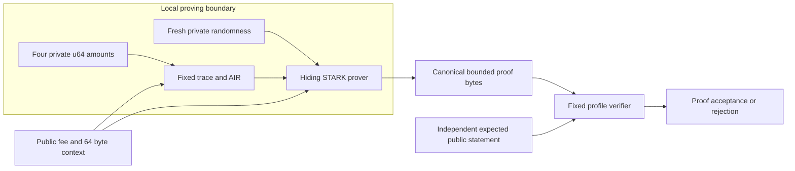

# Hiding conservation proof laboratory

## Implementation boundary

The [proof laboratory](../crates/thorum-proof-lab/src/lib.rs) generates a hiding STARK proof for four private unsigned 64 bit amounts and a public unsigned 64 bit fee. Verification receives proof bytes and an independently supplied public statement. It receives no private amount witness or host acceptance callback.

The component constrains bounded integer conservation. Its amounts are not linked to ledger notes, commitments, ownership, nullifiers, recipient encryption or asset policy. The public context is an opaque 64 byte value without ledger semantics in this relation. This is not a private payment proof, confidential stake proof, wallet, ledger or complete post quantum privacy construction. The [private protocol target](research-target.md) and both feasibility gates in [development](development.md) remain separate requirements.

`prove_conservation([u64; 4], &Statement)` returns proof bytes or an error. `verify_conservation(&[u8], &Statement)` returns acceptance or an error. Raw trace construction and backend configuration remain private implementation helpers. No externally committed amounts bind the private assignment in this component, so its public statement alone cannot certify a particular payment or note value.



Private witnesses and prover data remain inside the local proving process. The diagram describes the API boundary. It does not establish endpoint security, memory erasure or a measured metadata privacy guarantee.

## Integer relation

Let $a_0,a_1,b_0,b_1$ be private amounts and $f$ the public fee. All are in $[0,2^{64}-1]$. The relation requires

$$
a_0+a_1=b_0+b_1+f=S
\qquad
0\le S\le2^{64}-1.
$$

The sum bound applies to both complete sides. Equal overflowing totals fail. Every output amount is nonnegative, so the output sum without the fee is also bounded. This component has one implicit amount domain. It does not identify an asset or prove conservation across an asset registry.

For each bit $i\in\{0,\ldots,63\}$, write $a_{j,i}$ and $b_{j,i}$ for the private amount bits, $f_i$ for the public fee bit, and $s_i$ for a shared sum bit. Let $c_{A,i},c_{B,i}$ be incoming carries and $d_{A,i},d_{B,i}$ outgoing carries. Every bit satisfies

$$
a_{0,i}+a_{1,i}+c_{A,i}=s_i+2d_{A,i}
$$

$$
b_{0,i}+b_{1,i}+f_i+c_{B,i}=s_i+2d_{B,i}.
$$

Amount bits, sum bits and both A carries satisfy $x(x-1)=0$. Each B carry satisfies $x(x-1)(x-2)=0$. Carries obey

$$
c_{A,0}=c_{B,0}=0,
\qquad
c_{A,i+1}=d_{A,i},
\qquad
c_{B,i+1}=d_{B,i},
\qquad
d_{A,63}=d_{B,63}=0.
$$

The base field is BabyBear with prime $p=2^{31}-2^{27}+1=2013265921$. The A equation has integer residual between $-3$ and $3$, and the B equation between $-5$ and $5$. After the bit and carry constraints hold, equality in this field therefore implies the corresponding integer equality. A large amount is decomposed into all 64 bits rather than reduced to one field element.

Multiplying bit $i$ by $2^i$ and summing cancels every interior carry. The zero initial and terminal carries give

$$
a_0+a_1=\sum_{i=0}^{63}2^i s_i=b_0+b_1+f.
$$

The common sum has 64 binary digits, which proves the stated sum bound. This reasoning concerns the constrained relation. The cryptographic argument still depends on the exact proof configuration and its assumptions.

## Fixed trace schedule

The [AIR implementation](../crates/thorum-proof-lab/src/air.rs) has exactly 256 original rows and 77 columns. Four consecutive rows repeat one bit's nine data cells. The repeated rows provide the selected masking budget without introducing additional amount bits.

| Columns | Count | Meaning |
|---|---:|---|
| Phase indicators | 4 | Exactly one active phase from 0 through 3 |
| Bit selectors | 64 | Exactly one active amount bit from 0 through 63 |
| Private amount bits | 4 | $a_{0,i},a_{1,i},b_{0,i},b_{1,i}$ |
| Common sum bit | 1 | $s_i$ |
| A carry cells | 2 | Incoming and outgoing carry in $\{0,1\}$ |
| B carry cells | 2 | Incoming and outgoing carry in $\{0,1,2\}$ |

Every phase and bit selector is Boolean, and each selector family sums to one. Since $p>64$, these sums cannot wrap into a false unique selection. Let $q_{r,j}$ be phase $j$ and $z_{r,i}$ bit selector $i$ at row $r$. For transitions before the final row,

$$
q_{r+1,(j+1)\bmod4}=q_{r,j}
$$

$$
z_{r+1,i}=z_{r,i}+q_{r,3}\bigl(z_{r,(i+63)\bmod64}-z_{r,i}\bigr).
$$

The first row pins phase 0 and bit 0. The final row pins phase 3 and bit 63. During phases 0 through 2 all nine data cells repeat into the next row. During phase 3 each outgoing carry becomes the next group's incoming carry. Both arithmetic equations apply on every row, including the final row. Transition constraints stop before the final row, while its outgoing carry constraints remain active.

The verifier requires the exact trace degree associated with 256 original rows. Terminal selectors alone would permit repeated 64 bit schedule cycles at a larger trace height. The fixed height is part of acceptance, rather than a prover selected parameter. The maximum AIR constraint degree is 3.

## Public statement and transcript binding

`Statement` contains `fee: u64` and `context: [u8; 64]`. The wrapper expands the fee into 64 least significant bit first field values, then appends each context byte as a separate field value. The public vector has exactly 128 elements. No arbitrary field element vector is accepted by the public verification wrapper.

The active fee bit at row $r$ is $\sum_{i=0}^{63}z_{r,i}f_i$. The context bytes are public transcript data rather than arithmetic constraints or note commitments. The backend absorbs the complete public vector before sampling its constraint batching challenge. Changing the expected context therefore changes the verification transcript. This binding does not authenticate what the context means. [Pinned transcript source](https://github.com/Plonky3/Plonky3/blob/a21e3ed42905040ad49c519e402f018381c12d0c/uni-stark/src/transcript.rs).

The verifier selects the fixed AIR, public vector layout and proof configuration. Its exact transcript profile prefix is `thorum.proof-lab.u64-conservation.sha3-512.serial.p3-0.8.0.v1`. This is a versioned circuit namespace and does not replace trusted selection of the constraint implementation. The upstream transcript binds the AIR shape, while the verifier directly evaluates its own constraint polynomials.

## Proof and hash profile

The selected backend packages are pinned to `p3-* 0.8.0`, whose retained registry source identifies upstream commit `a21e3ed42905040ad49c519e402f018381c12d0c`. They are experimental dependencies of this laboratory, without selection for consensus. Upstream source licensing remains `MIT OR Apache-2.0`, subject to the repository's dependency inventory and copied original notices. [Pinned upstream source](https://github.com/Plonky3/Plonky3/tree/a21e3ed42905040ad49c519e402f018381c12d0c), [dependency notices](../THIRD_PARTY_NOTICES.md).

| Parameter | Fixed value |
|---|---|
| Base field | BabyBear |
| Challenge extension degree | 4 |
| Original trace | 256 rows, 77 columns |
| Hiding extension | 512 rows, stored proof degree bits 9 |
| FRI query count | 64 |
| FRI log blowup | 2, a factor of 4 |
| Maximum log folding arity | 1, binary folding |
| Final polynomial length | 1 |
| Random codewords | 4 |
| Hiding Merkle salt elements | 16 base field elements per row |
| Merkle arity and cap height | Binary, cap height 0 |
| Batch, commit, query and out of domain proof of work | 0 bits |
| Execution | Serial |

Both the input and FRI commitment schemes use `MerkleTreeHidingMmcs`. The PCS is `HidingFriPcs`, and the STARK includes its separate randomization polynomial. The local Merkle hashing and application transcript chaining retain all 512 SHA3-512 output bits. SHA3 is a primitive within this composition, without a complete protocol security claim. [Hash standard](https://csrc.nist.gov/pubs/fips/202/final).

The local hashing adapters use a four byte big endian domain length followed by the domain. Leaf hashing then absorbs each canonical base field element as four little endian bytes and finally the element count as an eight byte big endian integer. Node hashing absorbs each input word as eight little endian bytes and the same count encoding. Transcript hashing absorbs the input bytes followed by their eight byte big endian count.

For Merkle digests, output word $j$ is the little endian decoding of SHA3 output bytes $8j$ through $8j+7$, for $j\in\{0,\ldots,7\}$. All eight words are retained. The [hash adapters](../crates/thorum-proof-lab/src/hash.rs) use these exact separate domains:

| Adapter | Domain |
|---|---|
| Leaf | `thorum.proof-lab.leaf.v1` |
| Node | `thorum.proof-lab.node.v1` |
| Application transcript | `thorum.proof-lab.transcript.v1` |

This domain separated encoding is local research code and has no independent composition review. Upstream typed transcript metadata also uses Keccak256 to fingerprint fixed interaction patterns and algebra basis identities. Those internal fingerprints are distinct from the application hash adapters. The fixed profile does not accept attacker supplied pattern metadata, but its complete quantum composition remains unproved. [Pattern fingerprint source](https://github.com/Plonky3/Plonky3/blob/a21e3ed42905040ad49c519e402f018381c12d0c/challenger/src/fs/pattern/sequence.rs#L103), [algebra fingerprint source](https://github.com/Plonky3/Plonky3/blob/a21e3ed42905040ad49c519e402f018381c12d0c/challenger/src/fs/pattern/step.rs#L223).

## Hiding budget and private state

The inspected PCS enforces the conservative bound

$$
N\ge2(q+d\,o),
$$

where $N$ is the available mask height, $q$ the query count, $d$ the challenge extension degree and $o$ the supplied opening point count. The trace opens at two points, giving $2(64+4\cdot2)=144\le256$. Each of eight quotient chunks has mask height 256 and opens at one point, satisfying the smaller bound 136. The profile also supplies four random codewords, matching extension degree four. Commitment and verification enforce their actual opening budgets. This is the backend's masking condition, without a numeric soundness or quantum knowledge claim. [Pinned hiding PCS contract](https://github.com/Plonky3/Plonky3/blob/a21e3ed42905040ad49c519e402f018381c12d0c/fri/src/hiding_pcs.rs#L51).

Each proof invocation creates newly seeded hiding generators from operating system randomness. Both hiding commitment schemes require private salts, and the PCS requires unpredictable mask randomness. Private prover data is used for one opening only, including across clones. Another proof requires a fresh commitment. The wrapper returns canonical proof bytes or an error and exposes no private prover data export.

Verification needs no fresh entropy. A private verifier configuration supplies public dummy generators solely to instantiate unused proving interfaces in the shared backend type. That configuration is not exposed as a proving option.

The inspected STARK source describes its randomization approach as statistical rather than perfect zero knowledge. Selecting this path and satisfying its source checks is evidence about the implemented configuration. It is not an independent proof of the local hash adapters, a quantum knowledge extraction bound or a complete application privacy argument. [Pinned randomization source](https://github.com/Plonky3/Plonky3/blob/a21e3ed42905040ad49c519e402f018381c12d0c/uni-stark/src/prover.rs#L344), [STARK masking analysis](https://eprint.iacr.org/2024/1037).

Proof randomization does not establish removal of private amounts, trace cells, RNG state or prover data from process memory. Those values must not enter logs or debug output. The dependency exposes debugging interfaces for private internal structures. Endpoint handling and erasure require separate evaluation.

## Verification resource boundary

The proof byte limit is 2,097,152 bytes. A JSON preflight runs before deserializing owned proof collections. It limits nesting depth to 24, tokens to 200,000, collection items to 16,384, string content to 64 bytes and integer tokens to 20 digits. Escape sequences and unsupported token forms fail. Canonical serialization must reproduce the supplied bytes exactly.

Fixed shape validation additionally checks the stored degree, commitment caps, trace widths, extension widths, quotient chunks, masks, FRI rounds, query counts, salts, opening matrices and conservative Merkle path maxima before backend verification. No preprocessed trace or nonzero proof of work witness is accepted. The expected public statement and every algorithm parameter come from the verifier. A successful local constraint check is not accepted as a substitute for proof verification.

| Proof shape | Accepted value |
|---|---|
| Stored degree bits | 9 |
| Trace, quotient and randomization caps | One root each |
| Local and next trace openings | 77 extension elements each |
| Quotient openings | 8 chunks of 4 extension elements |
| Randomization opening | 4 extension elements |
| Hiding opening rounds | 3, with matrix/point counts $(1,1)$, $(1,2)$ and $(8,1)$ |
| Random codeword openings | 4 extension elements per matrix and point |
| FRI commitment and opening rounds | 9 |
| Query rows | 64 |
| Input batch matrix widths | 8, 81 and 8 base elements, with matrix counts 1, 1 and 8 |
| Merkle salt fields | 16 per matrix and query |
| Sibling digest maximum | 704 per Merkle multiproof |
| Final polynomial | One extension coefficient |

The byte and structure limits bound accepted input. They are not measured peak memory or worst case execution results. Decoder allocation overhead, malformed input costs, process limits and service isolation remain resource evaluation work.

## Validation evidence

The [test corpus](../crates/thorum-proof-lab/src/tests.rs) distinguishes local constraint rejection, transport rejection and actual proof verification. The frozen source validation passes nine debug tests and ten release tests, with Clippy and documentation warnings treated as errors.

| Evidence | Cases |
|---|---|
| Valid integer proofs | Zero values, B carry reaching two, maximum public fee and maximum bounded sum |
| Invalid integer witnesses | Unequal totals, a field modulus treated as an integer, equal overflowing totals and output overflow |
| Targeted trace mutations | First and final carries, final row arithmetic, repeated data, carry transitions, schedule cells and nonbinary bits or carries |
| Independent public statement | Rejection after mutation of each of 64 context byte positions and each of 64 fee bit positions |
| Cryptographic proof mutations | Changed commitment, trace opening, mask opening and final polynomial |
| Shape and transport | Degree changes, dimensions, salts, unused grinding witnesses, truncation, noncanonical bytes and parser limits |
| Fresh proof generation | Repeated witnesses produce different proof bytes and commitments, while both proofs verify |

The release only raw trace test bypasses the normal witness precheck and the backend's debug constraint check. It constructs 17 proofs from invalid integer or cell traces, retains the expected fixed proof shape, and requires the actual verifier to reject every proof. This is separate evidence from an early host rejection. The raw trace and configuration helpers remain private.

Three [independent reference tests](../crates/thorum-proof-lab/src/reference.rs) compare the Rust implementation with retained Python generated artifacts: 13 exact integer cases, all 256 trace rows, all 128 public values, and three hash encoding goldens. The [proof research record](../research/proofs/README.md) retains their generator and inputs, plus a separate source identified run of forty actual proof constructions and verifications with raw durations, lengths and a reproducible figure. These fixtures and workloads are deliberately public synthetic data, without secret production randomness. Measurements do not establish witness indistinguishability, complete payment costs or a quantum security level.

Fresh proof differences confirm that randomization executes. They do not measure statistical distance or prove witness privacy by inspection of output fields. No timing or memory estimate follows from this corpus.

The reproduction commands from the repository root are:

```text
cargo test -p thorum-proof-lab --locked --offline
cargo test -p thorum-proof-lab --release --locked --offline
cargo clippy -p thorum-proof-lab --all-targets --locked --offline -- -D warnings
python research/proofs/reference_vectors.py --check
python research/proofs/profile_check.py
```

The profile guard checks fixed declarations and the resolved dependency graph under default and all workspace features. It rejects a changed version or a unified parallel feature. It is a profile consistency check rather than a security audit.

The measurement example has a separate executable name from primitive laboratory measurements:

```text
cargo run --release -p thorum-proof-lab --example conservation_measure --locked --offline
```

Its output requires a retained source, executable, compiler and machine record before supporting a measurement report. Historical primitive measurements do not measure this proof component.

## Operational and security gates

Parallel proving is disabled. The pinned upstream release holds RNG locks across work that can execute through Rayon, with a documented shared instance deadlock. The experiment uses the serial feature configuration. Enabling parallel execution requires a reviewed dependency change and separate concurrency tests. [Upstream issue](https://github.com/Plonky3/Plonky3/issues/2363), [upstream fix](https://github.com/Plonky3/Plonky3/pull/2368).

A complete payment relation still needs amount linkage to authenticated notes, ownership and authorization constraints, stable nullifiers, membership, asset policy, recipient encryption, ranges and atomic ledger integration. A complete confidential stake relation remains independently required before the ledger kernel gate. The selected hash widths, challenge field, query count and hiding implementation do not by themselves establish a composed post quantum security level.

Formal soundness, knowledge soundness, the quantum oracle model, hash and transcript composition, witness hiding with all auxiliary information, independent implementation review and reproducible resource measurements remain explicit gates in the [backend feasibility record](proof-feasibility.md). A single local proof or debug run supplies no public performance estimate.
