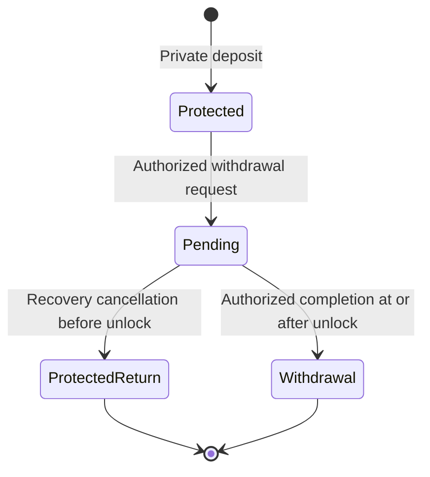

# Protocol safety and verification requirements

These requirements extend the private payment, confidential application, post quantum, auxiliary work and stake checkpoint architecture. They define development targets and implementation gates. A running chain, private Safe, payment lock service, migration protocol and compact history verifier are not implemented yet. Complete private payment and confidential stake feasibility remain prerequisites for ledger integration.

## Testnet timing profile

| Property | Development target |
|---|---|
| Average block target | 60 seconds |
| Checkpoint opportunity interval | Four blocks |
| Mining reward maturity | 10080 blocks from its authenticated reward origin |
| Staking reward maturity | 10080 blocks from its authenticated reward origin |
| Ordinary payment maturity | Network acceptance and checkpoint finality rules, without the reward delay |
| Onward spending | After checkpoint finality in the initial construction |
| Fast payment indication | Valid stake committee lock certificate, separately from inclusion and finality |

At the target cadence, $10080\cdot60=604800$ seconds is approximately seven days, and four blocks represent approximately four minutes between checkpoint opportunities. Actual block production and quorum availability determine elapsed time. A valid consensus certificate establishes finality. Counting blocks or displaying a payment lock does not.

The existing monetary implementation and historical figures retain their 120 second reference cadence. The new cadence needs a separately versioned schedule, independent integer vectors and atomic allocation tests before activation. Halving block time must not double intended nominal issuance.

For reference subsidy $S_{120}(j)$ at non genesis height $j\ge1$, an exact atomic unit mapping is

$$
S_{60}(2j-1)=\left\lceil\frac{S_{120}(j)}2\right\rceil,
\qquad
S_{60}(2j)=\left\lfloor\frac{S_{120}(j)}2\right\rfloor.
$$

Thus each pair totals the original subsidy. A reference period of 21900 blocks becomes 43800 blocks at the new target. This mapping preserves the nominal schedule at pair boundaries. Actual issuance still depends on earned staking, cap clipping and integer allocation. Per block rounding needs its own vectors. The 60/20/10/10 allocation and cumulative issuance ceiling retain their existing requirements. No production schedule or genesis is activated by this specification.

## Reward origin and maturity

Each mining or staking reward must retain its own consensus authenticated origin height $h_r$. At validation height $h$, its maturity condition is

$$
h\ge h_r\quad\land\quad h-h_r\ge10080.
$$

The comparison must use bounded integer arithmetic. The origin is assigned by the valid issuance transition and bound into authenticated state. A wallet receipt time, user supplied creation height or local clock cannot replace it. The exact note or leaf encoding must be versioned before implementation.

Every consumption path must enforce maturity before using a reward as a spendable input. Ordinary transfers, change, contract calls, confidential assets, Safe transitions, migration and staking registration must not strip immature origin metadata or wrap it into an immediately spendable right. Once a reward is mature, a later ordinary payment does not start another week.

Staking principal has separate bonding, unbonding, delegation and penalty rules. A mature staking reward does not unlock principal. Issuance and spendability are separate: a delayed reward still counts as issued once legitimately created. The protocol pool and developer allocations are separate issuance classes. This seven day rule does not select their spending or maturity policy.

The initial onward spending rule also requires the creating transition to belong to finalized history. Reward maturity and checkpoint finality are independent conditions. Tests must cover exact boundary heights, overflow, mixed input classes, late issuance, forks, restored wallets and attempts to bypass a delay through an application.

## Private Safe

The Qt wallet requires a separate protected savings view backed by consensus enforced state. A wallet setting alone cannot protect funds from a different client or a compromised spending key. Deposits and withdrawals retain the mandatory private transaction relation and value conservation.

A Safe policy commits a spending authority, distinct recovery authority, withdrawal delay and protected return destination. A withdrawal request creates a pending right with an authenticated request origin, fixed destination and unlock condition. Its delay cannot be shortened by changing wallets, transferring a pending note or using another application.

Cancellation by the recovery authority returns value only to the protected destination committed by the policy. It grants no general permission to choose a recipient, mint assets or withdraw arbitrary wallet value. Changes to that protected destination need their own reviewed authorization and delay rule.

For authenticated request origin $h_0$ and delay $D>0$, the initial branch boundary is

$$
\operatorname{cancel}:h<h_0+D,
\qquad
\operatorname{complete}:h\ge h_0+D.
$$

The exact cancellation deadline and validation context must be frozen with the application. Both branches consume the same pending spending right and therefore the same deterministic nullifier. Only one branch can enter finalized history, including when different versions or applications reference the same right. Competing provisional histories require normal fork selection and atomic rollback. The origin must be authenticated by consensus rather than backdated by the requester. Delay arithmetic must reject overflow.

Implementation must specify partial withdrawals, minimum and maximum delays, policy changes, finalized request handling, reorganization, fee payment, missing encrypted data and each key loss case. Cancellation alone does not promise recovery when a key is lost. Protection depends on detecting the request and getting a valid cancellation included before its deadline. Monitoring must work with local private scanning and preserve recoverability after restart or device restoration. Private escrow and the common note kernel provide the initial application boundary. Arbitrary private contracts may build on it later.

## Private cryptographic migration

Versioned upgrade boundaries must exist before an old scheme loses its required protection. An authorized migration proves valid ownership under the accepted old relation, consumes the existing old spending identity atomically and creates valid notes under the new relation without revealing the old input commitments or membership paths.

Migration must preserve value, asset policy, issuance accounting, reward maturity, staking restrictions and Safe conditions. It cannot reinterpret an old note, reset its nullifier or make the same value spendable through both schemes. New output rights may have new identities only after the old right is consumed exactly once.

The proof statement must bind both versions, accepted roots, old consumption identities, new commitments, encrypted delivery, fees and authenticated upgrade context. It must not publish an explicit old commitment to new commitment mapping. Public nullifiers, output sets, timing, fees and version information still require metadata evaluation.

Deployment requires an overlap policy, recovery data retention, downgrade prevention, eligibility cutoffs and rollback tests. An upgrade cannot erase prior disclosure or reliably recover legitimate ownership once the old protection can be forged. Historical v1 limitations remain visible in the research record and cannot be repaired by renaming a version.

## Fast private payment locks

A lock certificate must bind the exact authorized transaction, input nullifiers, outputs and delivery commitments, fee, chain, protocol version, committee epoch, validity window and referenced state. A committee must verify the complete private proof and input eligibility before reserving consumption rights.

The construction needs a quorum and authority model that prevents conflicting locks for the same spending right, with explicit equivocation evidence, expiration, reorganization and unavailable committee behavior. A lock must not freeze a note indefinitely through stale or unauthenticated messages. No stake finality or payment lock status exists before the corresponding bootstrap activation rule is satisfied.

The wallet distinguishes received data, local proving, certified lock, inclusion, checkpoint finality and spendability. The initial construction allows onward spending after checkpoint finality. It does not accept chains of unmined locked outputs. Fast lock latency is a measurement target after proof generation, without a promised number of seconds or a finality deadline.

## Later Aegis protocol

[Thorum Aegis](aegis.md) is a later consensus milestone for ordinary private outputs that become spendable after a completed stake commit and before mining. It requires an authoritative ordered state, global spent identities, complete payload availability, confidential quorum evidence, durable signing and compatible PoW recording. A preliminary lock cannot supply this eligibility.

The initial construction and first chain scope remain unchanged. A separately reviewed activation would replace its ordinary onward spending boundary for supported Aegis transactions. Mining and staking rewards still require their authenticated maturity, and Safe, stake, asset and migration restrictions remain applicable. Certified payments cannot expire merely because mining is delayed. The architecture includes figures, failure requirements and independent implementation gates without claiming an executable protocol.

## Capacity for ordinary payments

Ordinary private payments need a reserved share of bounded network resources, with separate ceilings for contract work. Classification must follow the validated transaction relation rather than a caller supplied cheap payment label.

For deterministic resource cost vector $c(t)$ and block budget $B$, validation requires

$$
\sum_{t\in\mathrm{block}}c(t)\le B
$$

componentwise. Costs include bytes, proof verification work, execution work and state effects. Local measured CPU time cannot be a consensus cost function. The payment reservation, contract ceiling, unused budget borrowing and fee rules need explicit deterministic parameters after measurements.

Fees, relay admission limits, proof preflight checks and bounded state growth must prevent the payment class from becoming a cheap spam channel. A reservation preserves available room without forcing a producer to include a particular transaction. Adversarial tests cover contract bursts, fake class labels, oversized proofs, cheap state creation and sustained ordinary payment spam.

## Compact chain history verification

Research must target proofs of valid state transitions and chain history that ordinary computers can verify with bounded resources. This is separate from the existing compact polynomial transform component. A smaller arithmetic trace is not a chain history proof.

The history construction must bind consensus rules, cumulative state, accepted work and checkpoint context, upgrade versions and a trusted starting point. Chain selection, freshness, data availability and recovery archives retain separate obligations. A validity proof cannot supply private note data that was never made available.

Targets must be measured on named ordinary hardware: initial bytes, verification time, peak memory, retained state and update cost. Wallet modes must distinguish full local validation, pruning and any later compact verification mode. The construction must retain the post quantum and private relation requirements throughout any recursion or accumulation scheme.

## Delivery gates

1. Record versioned timing, origin metadata, migration domains, resource classes and Safe authority rules before production interfaces are frozen.
2. Finish complete private payment authorization and confidential stake feasibility before kernel integration.
3. Implement durable consensus state, reward maturity and finalized input eligibility with atomic rollback and independent reference cases.
4. Implement private escrow and Safe transitions, then Qt views, recovery and monitoring against the same consensus rules.
5. Demonstrate committee locks and four block checkpoint opportunities under partitions, conflicting votes, missing quorum and miner/staker disagreement.
6. Measure payment and contract resource isolation before selecting production capacities or fees.
7. Evaluate compact history proofs after the proved transition and consensus boundaries exist. Retain independent review and public testnet gates before release.
