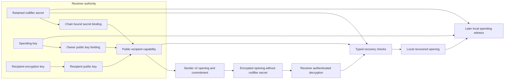

# Recipient capability laboratory

## Scope and version boundary

The v2 recipient capability interface separates sender output construction from the recipient's nullifier secret. The receiver retains that secret and supplies a public capability containing its chain, owner binding, nullifier secret binding, and recipient encryption public key. The sender constructs a v2 opening and encrypted payload without receiving the secret itself.

This interface removes deliberate sender possession of the secret in v2 construction. It does not establish formal sender unlinkability, nullifier pseudorandomness, recipient anonymity, or a composed quantum privacy argument. The [relation laboratory](relation-lab.md) still checks private witnesses directly in local memory. It generates no hiding proof and performs no ledger state change.

Legacy v1 openings and their original vectors remain unchanged. A v1 payload contains its actual nullifier secret, which the sender knows and can use to recognize later spending. The v2 format has distinct note domains and excludes that secret from its encoded opening. Neither format implements a wallet, production address encoding, consensus, governance, or persistent recovery.

V1 support is laboratory compatibility evidence rather than approval for a production privacy default. A production design must exclude sender known v1 notes or specify their explicit migration. Changing a current protocol version cannot reinterpret an existing note's committed encoding or give it a fresh nullifier.

## Capability and authority flow



The capability may leave the receiver's process. Spending keys, recipient decryption keys, and the nullifier secret are separate private authorities. A sender needs the public capability and fresh local output randomness. A recipient needs its retained secret, spending key, and recoverable note data for later consumption. The diagram describes an experimental local flow, not authenticated network routing or a private proof.

## Local interfaces and canonical encoding

The [capability implementation](../crates/thorum-relation-lab/src/capability.rs) and [note implementation](../crates/thorum-relation-lab/src/note.rs) expose the following local interfaces. `NoteOpening` contains distinct legacy and recipient encoding variants. A separate sender type is not introduced.

| Interface | Inputs and result |
|---|---|
| `NullifierSecret::generate()` | Generates 32 secret bytes using the operating system entropy source |
| `NullifierSecret::from_bytes(bytes)` | Imports an explicit 32 byte secret with caller responsibility for its origin |
| `NullifierSecret::export_backup()` | Deliberately exports secret authority in a zeroizing 32 byte buffer |
| `RecipientCapability::new(chain_id, owner_public_key, recipient_public_key, secret)` | Receiver construction from public keys and retained secret |
| `RecipientCapability::to_bytes()` | Encodes a public capability |
| `RecipientCapability::from_bytes(bytes, expected_chain)` | Decodes a bounded canonical capability for the expected chain |
| `NoteOpening::new_recipient(parameters, capability, blinding)` | Constructs a v2 opening from public capability data without the actual nullifier secret |
| `NoteOpening::recover_recipient(bytes, context, capability, secret)` | Recovers an already decrypted v2 opening with independent creation context and retained authority |
| `NoteOpening::encoding_version()` | Returns 1 for legacy notes or 2 for recipient capability notes |

`NoteParameters` supplies chain, creation version, asset, amount, serial and policy. `RecoveryContext` supplies `chain_id`, `creation_version` and the full 64 byte `expected_commitment`. These are explicit caller inputs. The local type does not authenticate their source. Authenticated envelope decryption precedes typed opening recovery.

Every row below is a separate field with a four byte unsigned big endian length prefix. Integers use fixed width big endian representation. The capability domain is `thorum.relation-lab.recipient-capability.v2`. The maximum accepted capability length is 2,048 bytes.

| Order | Capability field | Bytes before framing |
|---|---|---:|
| 1 | Capability domain | Domain text |
| 2 | Capability format version, value 2 | 2 |
| 3 | Chain identifier | 32 |
| 4 | Owner key binding | 64 |
| 5 | Nullifier secret binding | 64 |
| 6 | Recipient ML-KEM-1024 public key | 1,568 |

The decoder checks the exact domain, version, fixed field lengths, expected chain and canonical KEM public key encoding. It rejects excess length, truncation and trailing bytes, then requires exact reencoding. The owner binding is a digest rather than the owner's public key. Decoding does not establish possession of any corresponding private key, entropy quality, intended recipient identity or capability authenticity. The encryption key binding is derived from the serialized KEM key rather than carried as a redundant capability field.

The v2 opening domain is `thorum.relation-lab.note-opening.v2`. Its maximum accepted recovery length is 1,024 bytes. Payment and bond policies share the first twelve fields.

| Order | V2 private opening field | Bytes before framing |
|---|---|---:|
| 1 | Opening domain | Domain text |
| 2 | Note encoding version, value 2 | 2 |
| 3 | Chain identifier | 32 |
| 4 | Note creation protocol version | 4 |
| 5 | Asset identifier | 32 |
| 6 | Nonnegative atomic amount | 8 |
| 7 | Owner key binding | 64 |
| 8 | Nullifier secret binding | 64 |
| 9 | Recipient encryption key binding | 64 |
| 10 | Note serial | 32 |
| 11 | Commitment blinding | 32 |
| 12 | Policy discriminator, payment 0 or bond 1 | 1 |
| 13 through 16, bond only | Voting key binding, activation epoch, maturity epoch, exclusive unlock epoch | 64, 8, 8, 8 |

The private payload has no field for the actual nullifier secret. The note encoding version is separate from its creation protocol version. Statement, authorization, output context and Merkle domains remain at their existing v1 formats. A mixed local payment can consume a legacy note and create a recipient capability note without redefining the legacy bytes.

## Binding relations

For a byte string $x$, let $F(x)=\operatorname{u32be}(|x|)\mathbin{\|}x$. Let $H(D,x_1,\ldots,x_n)$ be full 64 byte SHA3-512 over the framed domain and framed fields. Let $d$ be the 32 byte chain identifier, $k_N$ the retained 32 byte nullifier secret, $pk_A$ the spending public key, and $pk_E$ the recipient encryption public key. The v2 bindings are

$$
b_A=\operatorname{SHA3\!\_512}(pk_A)
\qquad
b_N=H(D_{N,2},d,k_N)
\qquad
b_E=H(D_{E,2},d,pk_E)
$$

The owner binding uses the complete ML-DSA-87 public key. The encryption binding uses the exact recipient KEM public key and chain. A v2 opening commits all three bindings. A sender cannot replace only the encryption key while retaining the same committed capability fields and valid encryption witness.

For v2 private opening bytes $E_2$ and commitment $c_2$,

$$
c_2=H(D_{C,2},E_2)
\qquad
\nu_2=H(D_{\nu,2},d,k_N,c_2)
$$

For epoch $e$ and 32 byte duty identifier $q$, the v2 vote identity is

$$
\nu_{V,2}=H(D_{V,2},d,k_N,c_2,\operatorname{u64be}(e),q)
$$

The exact domain values are:

| Symbol | Domain text |
|---|---|
| $D_{N,2}$ | `thorum.relation-lab.nullifier-secret-binding.v2` |
| $D_{E,2}$ | `thorum.relation-lab.recipient-key-binding.v2` |
| $D_{C,2}$ | `thorum.relation-lab.note-commitment.v2` |
| $D_{\nu,2}$ | `thorum.relation-lab.note-nullifier.v2` |
| $D_{V,2}$ | `thorum.relation-lab.vote-nullifier.v2` |

The separately retained secret must reproduce the opening's $b_N$ before its nullifier is derived. The current protocol version, selected root, membership path, recipient ciphertext, and later spending decision do not supply fresh nullifier identities for the same note. A vote identity additionally binds its authenticated epoch and duty while remaining independent of the selected decision.

These equations are an experimental framed hash construction, without a standardized PRF claim. Publishing a known hash image $b_N$ is not itself a proof that the nullifier function is pseudorandom or unlinkable. Its keyed hash assumptions, known image setting, entropy requirements, quantum query model, repeated observations, and exact composition require analysis under the [backend feasibility gates](proof-feasibility.md). A 64 byte digest is not a demonstrated security level for the complete protocol.

## Recipient consistency and routing

Output consistency requires the public KEM key used for encryption to match the full encryption binding committed in the v2 opening. The local relation also recomputes the entire encapsulation and authenticated ciphertext from the sender encryption witness. This binds the encrypted bytes to the same opening used by the commitment, without requiring the recipient secret key inside sender construction.

Replacing an entire capability can still create an internally consistent output for a different recipient. Internal consistency does not authenticate a person, an application destination, a copied payment request, or a public address. The application must obtain and authenticate the intended recipient capability through a defined routing and identity policy. The current laboratory implements no such policy.

Capability sharing and reuse also create visible relationships. An identical public capability exposes the same owner binding, nullifier binding, and static KEM key to parties receiving it. Note discovery, address reuse, capability rotation, scope separation, relay metadata, and observer correlation remain separate privacy gates. The binary capability representation is experimental and does not implement the `myrk` wallet address namespace.

## Recovery and backup boundary

The source includes `PaymentStatement::recover_recipient_output` for local recovery of one selected output. It bounds the output count and index, matches the statement to independent creation chain, version, validation tag and full commitment, and matches the actual recipient key to the retained capability. It derives the existing encryption context from the selected statement fields and index, opens that same envelope, then passes the zeroizing plaintext into the existing typed v2 recovery checks. It returns only a sensitive local `NoteOpening` and adds no plaintext export API. The typed decoder retains its internal canonical reserialization.

The expected creation version and validation tag belong to the original creation statement. They must not be replaced with a wallet's current version or tag during later restoration. The caller authenticates this creation association and index through its own accepted historical data. Equality with caller supplied context is not authentication. This method does not validate the whole payment, unselected outputs, proof, inclusion, reward origin, finality, maturity, spent state, data availability or permission to credit or spend. It does not implement note discovery or an encrypted backup store. Diagnostic errors and retained secrets stay within the local private wallet boundary.

This composition changes the existing sender discard recovery test and adds two source tests for context and authority substitutions, encrypted byte changes, restoration and an independently indexed second output. The two output fixture conserves `100 = 49 + 50 + 1` under the local host relation. Moving its second envelope to index zero must fail even when its expected commitment remains aligned. These changes have source review only. Compilation, rustfmt, cryptographic operations and test execution remain unverified under separate gates. Earlier executed results do not validate this modified consumer or the new tests.

Typed v2 recovery checks the expected commitment, chain, creation version, capability fields, and retained nullifier secret binding. It rejects noncanonical bytes, unsupported formats, malformed lengths, invalid policies, truncation, and trailing data. A bond additionally requires ordered activation, maturity and exclusive unlock epochs, and distinct owner and voting key bindings. Decrypting an envelope and accepting a typed opening are distinct checks. Neither one authenticates the application's intended recipient by itself.

The v2 encrypted payload does not contain $k_N$. Retaining ciphertext and a recipient decryption key therefore does not reconstruct missing nullifier authority. The receiver must separately preserve its nullifier secret and spending authority with an explicit backup and compromise model. There is no seed only recovery claim, wallet restore process, archival availability protocol, or automatic key recovery in this interface.

KEM public key reuse does not establish forward secrecy. Historical ciphertext, endpoint compromise, lost secrets, copied capabilities, and backups need separate evaluation. Rotating a KEM key creates a different capability and does not rewrite an existing opening. Recovery of an old note still requires its old committed capability and relevant retained authority. Rotation and migration policy remain separate work. Erasure support for owned buffers does not demonstrate removal of every compiler copy, allocator record, crash dump, swap page, or hardware trace.

## Restricted staking disclosure

A restricted voting service can deliberately receive a bond opening and the associated nullifier secret without receiving the spending key. The stake checker still requires the committed voting key and keeps voting authority separate from payment authorization.

Disclosure of a capability's shared nullifier secret grants tracking authority across notes using that same secret. It is not a narrow bond only disclosure. A holder who also obtains the relevant commitments can derive their spend identities and recognize consumption. Per bond disclosure, capability separation, and confidential eligibility require additional construction and analysis. This interface does not make the stake claims confidential or establish checkpoint finality.

## Required evidence and remaining gates

The original nine [recipient tests](../crates/thorum-relation-lab/tests/recipient.rs) cover the local evidence below without claiming private proof validation. The modified recovery consumer and two additional source tests have the unverified execution status stated above.

| Evidence | Valid case | Invalid or boundary case |
|---|---|---|
| Receiver authority | Generated secret, explicit backup, restored capability and chain bound bindings | Different chains produce different secret and encryption key bindings |
| Public capability codec | Exact public round trip | Every truncation, wrong domain/version/chain/length, noncanonical KEM key, trailing data and size limit |
| Typed opening recovery | Exact payment and bond opening recovery | Every truncation, altered fixed width fields, unknown policy, legacy format, trailing data and size limit |
| Independent recovery context | Expected commitment, creation context, capability and retained secret | Wrong chain/version/commitment/secret, changed owner/nullifier/KEM capability binding and invalid bond policy |
| Sender and receiver flow | Sender uses only public capability, its witness is discarded, receiver decrypts and recovers, then authorizes later local consumption | Wrong nullifier authority and wrong spending key fail even with an otherwise valid signed statement |
| Delivery binding | Exact sender encryption under the committed KEM key | A valid sender signature and valid ciphertext for an attacker KEM key still fail the committed key check |
| Routing boundary | An internally consistent alternate capability passes the relation | Intended receiver recovery rejects that alternate capability, without preventing its earlier substitution |
| Restricted voting | Deliberately shared nullifier authority and separate restricted voting key | Incorrect nullifier authority fails, with stable vote identity across changed snapshot and protocol contexts |

The later consumption fixture preserves its spend nullifier across changed anchor and current protocol version. Existing payment and stake tests separately cover spent identities, duplicate inputs and duplicate voting weight. [Independent v2 reference vectors](../research/relations/README.md) cover exact capability and opening bytes, bindings, full commitments, note and vote nullifiers, and Merkle digests for payment and bond notes. The [Rust vector test](../crates/thorum-relation-lab/tests/reference_capability.rs) also recovers typed openings against those independently generated values.

The laboratory commands are:

```text
cargo test -p thorum-relation-lab --locked --offline
cargo clippy -p thorum-relation-lab --all-targets --locked --offline -- -D warnings
python research/relations/reference_vectors.py --check
python research/relations/recipient_vectors.py --check
```

Legacy v1 fixtures must continue to reproduce exactly. Local functional checks and independent encoding vectors do not prove witness hiding, nullifier security, recipient identity, wallet recovery, or composed post quantum privacy. Complete private payment and confidential stake feasibility remain prerequisites for ledger kernel integration under the [development gates](development.md) and [research target](research-target.md).
