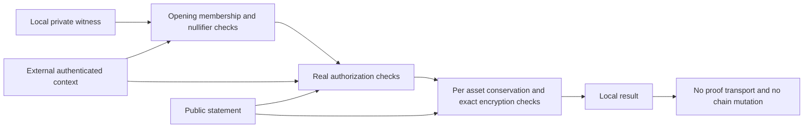

# Transparent local relation laboratory

## Implementation status

1. [thorum-relation-lab](../crates/thorum-relation-lab/src/lib.rs) checks a concrete ordinary payment witness and a focused stake eligibility witness in local memory. It receives private note openings, nullifier secrets, membership paths, public keys, signatures and sender encryption randomness directly. These values are not hidden from the checker. There is no proof object, proof generation, proof transport or remote private validation interface.
2. The laboratory uses actual ML-DSA-87 authorization and the existing [experimental recipient envelope](crypto-lab.md). It does not implement a private ledger, anonymous recipients, consensus, persistence, a wallet, bond registration or bond withdrawal. It does not establish zero knowledge, knowledge soundness, reviewed commitment security, nullifier pseudorandomness or a secure composed protocol.
3. Legacy v1 construction gives the sender an output note's actual nullifier secret and carries that secret in its encrypted payload. The sender can predict later spending. The distinct [v2 recipient capability interface](recipient-capability.md) uses public bindings for sender construction and keeps the actual secret with the receiver. This removes deliberate sender possession through that interface. It does not prove unlinkability, nullifier pseudorandomness, recipient identity or composed quantum privacy. The legacy bytes and their linkage remain unchanged.
4. Monetary issuance remains in the [accounting core](../crates/thorum-core/src/accounting.rs). The payment checker has no native mint path and cannot authorize the miner, staking, protocol pool or development maintenance allocations. It neither updates monetary counters nor creates spendable wallet state.

Legacy support records laboratory compatibility rather than a production privacy default. Production must exclude sender known v1 notes or specify explicit migration. A current protocol upgrade cannot reinterpret an existing note's committed encoding or change its canonical nullifier.



## Canonical fields and note construction

1. `F(x)` is a four byte unsigned big endian byte length followed by the bytes of `x`. All integers inside a field use their fixed width big endian representation. `H(D, x_1, ..., x_n)` is full 64 byte SHA3-512 over `F(D) || F(x_1) || ... || F(x_n)`. No commitment, Merkle node or nullifier is truncated. The statement and legacy note format version is `u16` value 1. Recipient capability notes have a distinct note encoding version of 2. The current protocol version and a note's creation version are separate `u32` fields.
2. An owner or restricted voting key binding is exactly `SHA3-512(public_key_bytes)` for the complete 2,592 byte ML-DSA-87 public key. The following table preserves the legacy v1 private encoding. The domain text is `thorum.relation-lab.note-opening.v1`. The separate [v2 encoding table](recipient-capability.md#local-interfaces-and-canonical-encoding) replaces the actual secret field with the full recipient encryption key binding and uses distinct note domains.

| Order | Field | Bytes before framing |
|---|---|---:|
| 1 | Opening domain | Domain text |
| 2 | Laboratory format version | 2 |
| 3 | Chain identifier | 32 |
| 4 | Note creation protocol version | 4 |
| 5 | Asset identifier | 32 |
| 6 | Nonnegative atomic amount | 8 |
| 7 | Owner key binding | 64 |
| 8 | Nullifier secret binding | 64 |
| 9 | Actual nullifier secret | 32 |
| 10 | Note serial | 32 |
| 11 | Commitment blinding | 32 |
| 12 | Policy discriminator, payment 0 or bond 1 | 1 |
| 13 through 16, bond only | Voting key binding, activation epoch, maturity epoch, exclusive unlock epoch | 64, 8, 8, 8 |

3. The v1 actual secret is private recovery data, not a public nullifier field. A v2 encoded opening excludes it and requires separate receiver backup. `NoteOpening` and `NullifierSecret` have no Debug, cloning or general serialization implementation. `private_opening_bytes` is an explicit private export for local encryption and returns a zeroizing buffer. `NullifierSecret::generate` uses the operating system entropy source, while `from_bytes` imports caller supplied bytes and `export_backup` deliberately exports authority. Secret and blinding storage uses zeroizing wrappers. This is not a claim that all compiler copies, allocator history, process memory or endpoint compromise are erased. The caller supplies note serial and blinding entropy and remains responsible for their quality and uniqueness. Fixed values in tests are synthetic fixtures.
4. With chain `D`, nullifier secret `k`, private encoding `E` and commitment `c`, the exact legacy v1 hash domains and formulas are:

```text
secret_binding = H("thorum.relation-lab.nullifier-secret-binding.v1", D, k)
c = H("thorum.relation-lab.note-commitment.v1", E)
note_nullifier = H("thorum.relation-lab.note-nullifier.v1", D, k, c)
vote_nullifier = H("thorum.relation-lab.vote-nullifier.v1", D, k, c, epoch_u64, duty_id)
```

5. V2 uses the corresponding distinct `.v2` secret binding, commitment, spend nullifier and vote nullifier domains documented in the [recipient capability relations](recipient-capability.md#binding-relations). Both variants check that the supplied secret opens the committed secret binding. The note commitment already contains the immutable creation version. Its spend nullifier does not take a current protocol version, anchor, epoch, membership path or spending branch. The same existing note therefore retains its nullifier when the current context changes. A vote nullifier additionally binds a specific epoch and duty. It excludes the decision, anchor, owner key and delegate key so those fields cannot supply a fresh voting identity for the same bond and opportunity.
6. A Merkle leaf is `H("thorum.relation-lab.merkle-leaf.v1", chain, commitment)`. An internal node is `H("thorum.relation-lab.merkle-node.v1", chain, left, right)`. A path contains at most 32 siblings, ordered from leaf level upward. Bit zero of its index selects the first branch. Indices with any set bit above the path depth are rejected. A depth zero path requires index zero and has the leaf hash as its root.
7. The native asset identifier is the laboratory value of 32 zero bytes. Asset registry rules and production note encodings remain outside this module. Inputs may use a creation version no greater than the current protocol version. New outputs must use the current protocol version. This numerical version ordering is a local profile assumption and does not implement a network migration policy.

## Ordinary payment relation

1. A payment has one through eight inputs and one through eight outputs. Canonical statement encoding is limited to 65,536 bytes. Its framed fields are the payment statement domain, format version, chain, current protocol version, authenticated validation tag, anchor, input count and ordered nullifiers, output count and ordered full commitments plus complete encoded envelopes, then the native fee. Counts are `u32` and the fee is `u64`. There are no authorization or proof fields in this encoding.
2. All input owners authorize the same 64 byte digest `H("thorum.relation-lab.payment-authorization.v1", canonical_statement)`. Each input supplies the actual public key and signature. The checker matches the key's SHA3-512 binding to its note and invokes the crypto laboratory's ML-DSA verification. Its crypto context uses the statement chain and protocol version. The context's 32 byte tag is the first 32 bytes of `H("thorum.relation-lab.payment-auth-context.v1", authorization_digest)`. Input signatures cannot be substituted between statements, owners or relation domains.
3. Each input must open an ordinary payment note, derive its exact declared nullifier and have membership under the declared accepted anchor. Duplicate input nullifiers and entries in the external spent set are rejected. Bond notes cannot be consumed through this ordinary payment path, even with a valid owner signature. Bond exit and its lock rules are unimplemented.
4. For each output, the checker recomputes the full commitment from its private opening. It rejects duplicate output commitments. It reconstructs the output crypto context from chain, current protocol version, validation tag, output index and full commitment. The tag is the first 32 bytes of `H("thorum.relation-lab.output-encryption-context.v1", chain, version_u32, validation_tag, index_u32, commitment)`. This tag is a separate binding and is not described as a full 512 bit commitment.
5. For a v2 output, the checker first requires the recipient public key to reproduce the committed chain bound encryption key binding. `verify_encryption_witness` receives that public key, the full private opening bytes and the local sender encryption witness. It repeats actual ML-KEM encapsulation, context binding, experimental key derivation and AEAD encryption. Both the complete encapsulation ciphertext and complete note ciphertext must match. The relation never requires a recipient secret key. A ciphertext hash or successful signature alone cannot replace this check. Matching encryption does not prove an intended human recipient, address authenticity, recipient key privacy or that a recipient still possesses its secret key. Substitution of an entire capability remains an authenticated routing requirement.
6. The dependency order is opening, commitment, output encryption context, envelope, canonical statement and then authorization. The output encryption context contains no final envelope, transaction identifier, authorization evidence or proof. Authorization binds the completed envelope. The v1 private payload includes the actual nullifier secret. The v2 payload contains its binding and full encryption key binding instead. Both include note fields, serial and blinding. V2 typed local recovery checks an already decrypted opening against independent expected commitment, chain and creation version, capability, retained secret and canonical encoding. A wallet restore process, persistent storage and durable recovery data availability remain unimplemented.
7. Amounts and per asset totals use checked `u64` atomic arithmetic through the accounting amount type. Every asset must satisfy:

```text
sum(input_values[asset])
    = sum(output_values[asset]) + native_fee_if_this_is_the_native_asset
```

8. Ordinary payments cannot mint, substitute one asset for another or fund a native fee from a different asset. Overflow is rejection rather than modular equality. There is no general asset mint, burn, contract execution or fee distribution path in this checker.

## Focused stake eligibility oracle

1. A bond note commits its restricted voting key binding, activation epoch, maturity epoch and exclusive unlock epoch. The constructor requires `activation <= maturity < unlock` and a voting key binding distinct from the owner's spending key binding. Registration authority, allowed delegation and the legitimacy of the snapshot root must already have been established by the external ledger. The oracle cannot create a bond or authenticate its origin by itself.
2. A stake statement binds chain, protocol version, validation tag, snapshot anchor and epoch, current epoch, duty identifier, decision digest, required lock horizon and ordered claims. Each claim contains its canonical vote nullifier, voting key binding and exact atomic weight. The decision digest is signed but does not enter the vote nullifier. The duty identifies the opportunity independently of the choice. The caller validates the meaning and admissibility of both duty and decision.

The statement exposes each claim's weight and voting key binding. This is a transparent eligibility oracle, without confidential stake or a hidden participant construction. A production private stake relation needs its own visibility specification and proof.
3. Only the committed restricted voting key authorizes the statement. An owner signature or owner signing key is not required for each ballot. This preserves the authority boundary for an online voting service whose spending key remains offline. The service still receives sensitive local opening and nullifier data in this transparent laboratory. Disclosure of a reused capability's nullifier secret grants tracking authority across notes using that secret, without granting their spending keys. It is not a narrow bond only disclosure. A reviewed private delegation construction and protected operational key management remain separate work.
4. The caller supplies authenticated snapshot parameters and fresh read only spent bond and used vote sets. Eligibility requires positive native value, valid membership and:

```text
activation_epoch <= snapshot_epoch
maturity_epoch <= snapshot_epoch <= current_epoch
current_epoch <= required_lock_through_epoch < unlock_epoch
```

5. Concrete epochs in tests are fixtures, not production durations. A bond consumed after its snapshot is rejected when its stable spend nullifier appears in the supplied current spent set. A new bond activated after the snapshot cannot retain that snapshot's weight. The oracle does not implement spending, rebonding, rollback, registration, withdrawal or synchronization of those sets.
6. Each bond contributes its exact committed amount once in a checked batch of at most eight bonds. Duplicate bond spend nullifiers and duplicate vote identities are rejected. Previously used vote nullifiers are rejected through the external used set. Weight sums use checked integer arithmetic. Partitioning the same eligible value across several positions does not increase its aggregate weight. No wallet count multiplier or proof of distinct human identity exists.
7. Decision mutation invalidates the original signature while retaining the same vote nullifier. An authorized signer can still create conflicting signed statements. The external kernel must record used vote identities and define equivocation handling. This oracle does not establish checkpoint finality, quorum, liveness or a complete voting protocol.

## External state and verification evidence

1. `PaymentContext` supplies accepted anchors, spent nullifiers, chain, version and validation tag. `StakeContext` supplies the snapshot and its time parameters, spent bonds and used votes. These are explicit borrowed inputs. Their Rust types do not authenticate them. A malicious caller can invent a context and obtain a result only relative to that invented context. No hidden accepted root, default trusted snapshot or implicit empty spent set is selected by a checker.
2. Checking succeeds repeatedly against the same unchanged context. The functions perform no state mutation. A future kernel must atomically validate current context, consume nullifiers, append outputs, account fees and monetary effects, and persist all related state. It must also reject globally repeated output identities and perform consistent rollback. The local result does not replace those operations.
3. Legacy tests cover real owner authorization, exact recipient payload recovery including the nullifier secret, complete ciphertext binding, wrong recipient and sender witness, opening and context substitution, per asset conservation, native fees, minting, overflow, duplicate inputs, spent sets, alternate roots and protocol versions, path indices and resource limits. Stake tests cover activation, maturity, lock boundaries, spent bonds, new activation after a snapshot, wrong epochs and keys, decision binding, duplicate weight and linear partitioning. V2 capability and typed recovery evidence is recorded separately in the [recipient capability laboratory](recipient-capability.md#required-evidence-and-remaining-gates).
4. [Independent reference vectors](../research/relations/README.md) check the exact private encoding and full commitment, nullifier and Merkle digests. A separate integrated test checks two assets, distinct owners, native change and recovery of all three output payloads. Commands from the repository root are:

```text
cargo test -p thorum-relation-lab --locked --offline
cargo clippy -p thorum-relation-lab --all-targets --locked --offline -- -D warnings
python research/relations/reference_vectors.py --check
python research/relations/recipient_vectors.py --check
```

5. These results establish functional agreement and rejection behavior for this local profile. They do not complete the [private protocol research target](research-target.md). Production work still requires a suitable private authorization and execution relation, reviewed recipient capability and nullifier security, authenticated routing, discovery and reuse policies, explicit security models, reviewed hash and encryption composition, authenticated ledger integration, private stake construction, wallet recovery and independent review. The v2 binary capability codec is experimental and does not implement the `kova` production address format.
