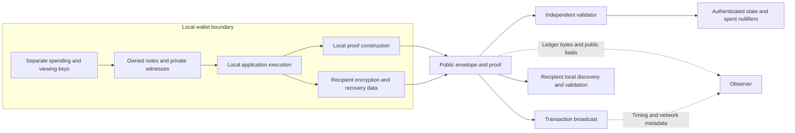
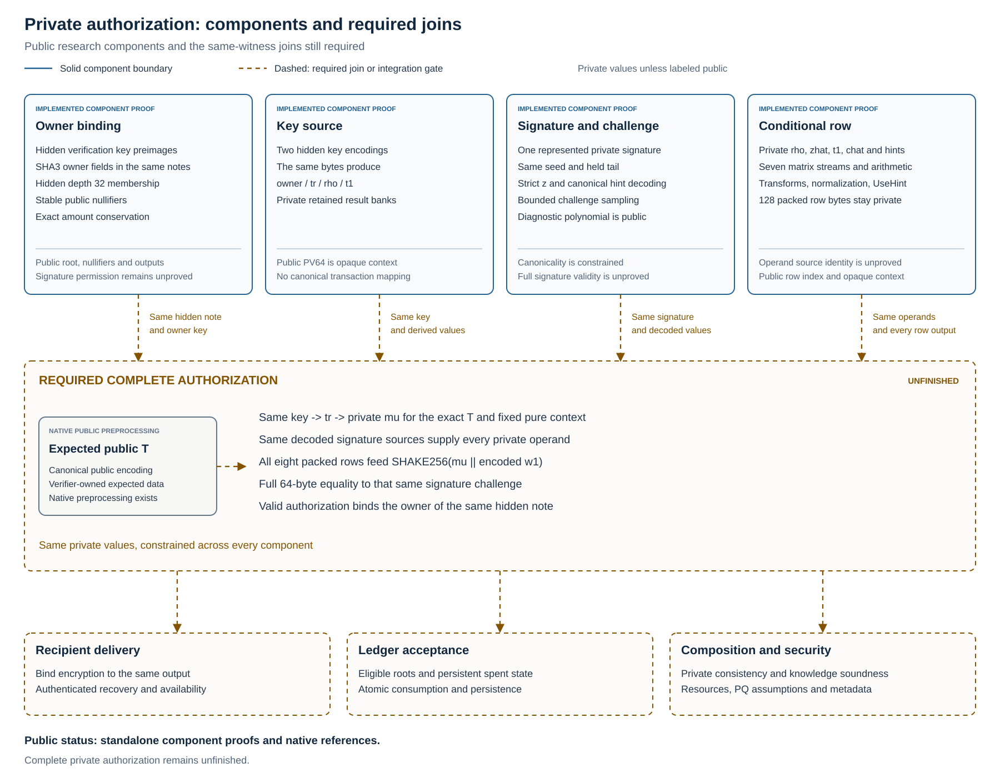

# Protocol research specification

## Abstract

Kova studies a private note ledger with local witness construction, post quantum authorization and encryption, independently verified state transitions, auxiliary work and stake checkpoint consensus. The required relation combines hidden ownership and membership, stable consumption identities, exact monetary conservation, policy enforcement and recoverable encrypted outputs. Public metadata, state authority, cryptographic assumptions and failure behavior remain explicit parts of that construction.

This specification defines requirements and evidence gates. The executable workspace contains a monetary core, transparent references and bounded proof components. A complete payment, confidential stake, network node and wallet remain unfinished. The [implementation record](development.md), [component map](../README.md#proof-research-map) and [delivery roadmap](delivery-roadmap.md) separate that evidence from the required protocol. Later Aegis, Safe and application work retains its own activation and implementation boundaries.

## Implementation status and scope

The executable implementation covers deterministic monetary accounting, an independent reference model, reproducible emission research, an isolated [primitive laboratory](crypto-lab.md), a [transparent relation laboratory](relation-lab.md), and eight isolated hiding proof laboratories for [unbound conservation](proof-lab.md), [canonical notes](note-proof-lab.md), [hidden membership](membership-proof-lab.md), [stable nullifiers](nullifier-proof-lab.md), [SHA3 or SHAKE primitives](hash-proof-lab.md), [exact modular multiplication](arithmetic-proof-lab.md), [normal residue NTT](ntt-proof-lab.md) and [private owner key binding](owner-binding-proof-lab.md). The transparent laboratory checks synthetic payments and stake eligibility with plaintext witnesses. Its [v2 recipient capability](recipient-capability.md) excludes the recipient nullifier secret from sender construction and note payloads, and supports typed recovery against explicit bindings and an expected commitment. Legacy v1 notes retain sender recognition of output nullifiers, while stake claims remain exposed. Neither encoding establishes a formal unlinkability result.

The original private witness proof covers unbound integer conservation over four u64 amounts. The canonical note component additionally constrains four exact SHA3-512 payment commitments and the same private amount bits. The membership component further hides both input commitments, creation versions, indices and depth 32 paths while enforcing common root membership, distinct hidden input commitments and conservation in one proof. It does not derive nullifiers. The nullifier component adds input secret binding and stable public nullifier derivation from the same private retained keys and canonical commitments inside its membership and conservation proof. Ownership, authenticated eligible root policy, persistent spent state, recipient encryption and ledger authorization remain outside these components. Exact `p3-* 0.8.0` dependencies and inspected hiding configurations remain confined to the laboratories. Complete private payment proofs, production note delivery, confidential application execution, checkpoint consensus, and a wallet remain research and implementation requirements. This document defines acceptance conditions for that work, without establishing a complete protocol, measured transaction privacy, a deployed network capability or an independently reviewed security claim.

The separate hash component adds bounded unframed SHA3-512, SHAKE128 and SHAKE256 computation with exact absorption, padding and extended output squeezing. It is a primitive prerequisite to private ML-DSA verification. Its mode, lengths and expected hash outputs are public within that experiment, without an owner proof, valid signature proof or complete transaction binding. A hash of a freely distributed verification key does not establish spending authority. The future composed relation must keep owner keys, owner bindings, `tr`, `mu` and signatures internal to its private witness and connect them to the same hidden note and authorized transaction. No production hash proof acceptance route exists.

The separate [arithmetic component](arithmetic-proof-lab.md) adds exact canonical multiplication under the ML-DSA modulus with bounded integer limbs. Its harness publishes operands and result only to validate the primitive. It does not implement a private NTT, signature verification or owner permission. Future composition must keep matrices, keys, signatures and intermediate operands internal while proving the complete dataflow and transaction binding. It does not change the hidden input, stable nullifier or private payment targets.

The arithmetic crate also supplies [canonical coefficient windows and exact hint application](coefficient-constraints.md). It constrains strict response norms, canonical signed conversion, decomposition and four bit hint outputs. Its synthetic diagnostic tests and test only hint proofs do not complete canonical signature parsing, sampling, private transform linkage or final challenge equality. Returned expressions must be connected to the same hidden witnesses throughout the complete authorization relation.

The hash crate's [connected matrix sampler](matrix-sampling.md) constrains one complete polynomial within its six block resource class, including full hash continuation and exact rejected candidates. Its separate [sparse challenge sampler](challenge-sampling.md) connects two full SHAKE256 blocks, sign bits, accepted indices and signed relocation. Their diagnostic coefficients are public, and capacity outside each class remains unsupported. The [private key source](key-source.md) separately implements canonical key parsing and private owner, tr, rho and t1 derivations. Joining those exact sources to the complete signature and authorized hidden note remains unfinished. No production restriction of standard signature validity follows from these experiments.

The [joint signature decoder and challenge relation](signature-challenge.md) connects canonical signature bytes, private response registers and private hint state to the same challenge seed. It reuses the constrained challenge and arithmetic implementations. The [conditional row](reconstructed-row.md) separately connects matrix arithmetic, transforms, hints and packed reconstruction. Canonicality and conditional computation do not imply a valid signature or permission. Their common key, signature, all eight row, final challenge and hidden note/transaction connections remain unfinished.

The separate [NTT component](ntt-proof-lab.md) connects forward and inverse normal residue stages with exact arithmetic, fixed ordering, normalization and bytewise input and output. Its polynomials are public, and the transform is invertible. This harness therefore establishes neither coefficient confidentiality nor spending permission. A future private signature relation must keep coefficients, keys, signatures, hashes and matrices internal while connecting signed decoding, sampling, norms, hints and full challenge equality to the same note and authorized transaction.

The separate [compact transform profile](compact-ntt.md) replaces permanent coefficient bit banks with canonical write windows, constrained initialization and complete scalar register transitions. It reuses the same diagnostic statement and exact arithmetic. Its layout optimization supplies no private witness composition or transaction authority, and the original profile remains unchanged.

The [owner binding component](owner-binding-proof-lab.md) connects private exact verification key preimages to owner hashes in the same hidden note relation. It retains existing stable nullifier identities, membership, conservation and 520 public values without publishing the keys or owner hashes. This does not establish permission to spend, because verification keys and their hash preimages can be publicly known. The same hidden key and a valid signature for the exact authorized transaction still need complete coupling.

Both input commitments remain public in the earlier canonical note component. The membership component instead publishes one root, two output commitments, output creation versions, shared asset, chain, fee, context and fixed two input, two output shape. The nullifier component additionally publishes two complete stable nullifiers while retaining hidden input commitments, keys, bindings and paths. Public shared asset visibility remains a component boundary exceeding the private field target below. The context remains opaque transcript data, and an arbitrary supplied root has no ledger authority. These components are relation evidence rather than production payment formats or transaction graph privacy results. Fixed depth 32 describes tree capacity, without demonstrating an effective anonymity set. Repeated synthetic commitments in the sparse fixture do not represent independent notes.

The [proof feasibility record](proof-feasibility.md) identifies exact inspected backend versions, isolated proof component adoption and unresolved security obligations. Local reference equations, independent encoding vectors, constrained note conservation, hidden membership, stable nullifier linkage and primitive hash constraints advance the specification without freezing their experimental construction for production. Both complete private payment and confidential stake feasibility remain open before kernel integration.

Ordinary payments and application state must use private transitions by default. The normal Send path must not select between public and private payment pools. Private input notes, amounts, asset identities, authorization material, and application witnesses must remain local unless a user deliberately discloses a defined subset. Selected recipients recover their own output notes from bound ciphertext. The public envelope still reveals information needed for validation and delivery. Its exact encoding and leakage budget require specification and measurement.

The [private transaction relation](private-transactions.md), [architecture](architecture.md), [wallet requirements](wallet.md), and [implementation milestones](development.md) define adjacent boundaries. This target adds mathematical relations and evidence requirements without changing the implemented monetary rules.

## Information flow

The diagram specifies required information boundaries. It does not demonstrate that an implementation hides witnesses or resists network observation. Required validator input consists of the public envelope, proof, output commitments, authenticated input roots, nullifiers and bound ciphertext data. It must exclude private input commitments, input creation versions, indices, membership paths and other private witness data unless a separately justified construction establishes the declared privacy target. A network observer has a separate channel to timing, connection, and address information.

## State, notes, and domains

Let $D$ identify the chain, protocol version, relation version, and operation domain through a canonical encoding. Distinct domains are required for spending authorization, note commitments, nullifiers, encryption, viewing, recovery, and checkpoint voting. A field used in a domain must have an unambiguous encoding and migration rule.

An abstract authenticated state is

$$
S = (R_C, U_N, R_A, R_P, M)
$$

Here $R_C$ authenticates created note commitments, $U_N$ records consumed nullifiers, $R_A$ authenticates asset policy state, $R_P$ authenticates application state, and $M$ contains the implemented monetary counters and their required kernel context. The concrete data structures and root history policy remain open. A root is a commitment to state, not evidence that its contents satisfy the protocol.

A private note and its commitment have the abstract form

$$
n = (a, v, P_{\mathrm{auth}}, s, \rho)
\qquad
c = \operatorname{Com}_{D_C}(\operatorname{Encode}(n), r)
$$

The asset identifier is $a$, the amount is $v$, the authorization policy is $P_{\mathrm{auth}}$, the private application state is $s$, the note identifier randomness is $\rho$, and the commitment randomness is $r$. Values are integers in an explicitly specified range. Encoding must prevent ambiguous notes and policies. Hiding, binding, randomness generation, and their quantum adversary models require analysis for the exact commitment construction.

A consumed note produces a public nullifier

$$
\nu = \operatorname{PRF}_{k_N}(D_N \mathbin{\|} \operatorname{Id}(n,c))
$$

The relation must bind $k_N$ to the note's authorized spending right and derive the same nullifier for every attempted consumption of that right. A spender must not choose a fresh nullifier key for the same note. The nullifier cannot vary with the selected root, transaction nonce, height, recipient, or release/refund path. For an existing note, its nullifier domain and derivation must remain stable across protocol upgrades. Any migration must make consumption through old and new rules mutually exclusive. The exact identifier, derivation, and uniqueness rules remain construction work. Nullifier pseudorandomness must hide its association with a public note commitment from an observer without the relevant secret.

The version 2 laboratory fixes an experimental framed SHA3-512 derivation from chain, retained secret and immutable note commitment, with a separate hash image binding the secret into the opening. The new component constrains those exact existing bytes without asserting that this keyed hash realizes the abstract PRF target. Sender known binding images, chosen commitments under reused capabilities, repeated secret observations and classical or quantum oracle access require a dedicated argument. Sharing the retained secret grants tracking authority over disclosed commitments, without establishing owner permission. Its stable nullifiers do not replace global spent state, atomic consumption or authenticated root policy. The component has no authenticated current protocol version field, and a changed committed creation version is a different note.

## Transaction relation and kernel acceptance

The abstract public statement is

$$
x = (D, q, R_{\mathrm{in}}, R_{\mathrm{out}}, N, C_{\mathrm{out}}, E, f, u)
$$

The context $q$ identifies the authenticated validation context, $N$ is the input nullifier sequence, $C_{\mathrm{out}}$ contains output commitments, $E$ binds encrypted delivery and recovery data, $f$ is the native fee, and $u$ contains declared resource limits and any public application or policy fields. Public fields, their necessity, and their leakage must be enumerated before encoding is frozen. Asset identities and application identifiers must not become public implicitly through an implementation shortcut.

The earlier canonical note laboratory's public input commitments are not part of this production privacy target. The membership and nullifier components hide those inputs and their paths, while retaining a shared public asset and same asset fee. The nullifier component additionally connects stable identities to the same private retained authority and commitments. Those component choices do not freeze production asset visibility or native fee consensus. The complete relation must additionally establish authenticated eligible roots, owner permission, encrypted recipient delivery, persistent spent state and the same authorized transition context.

The private witness $w$ contains input notes and openings, membership paths, authorization keys or authorization witnesses, output notes and openings, private execution state, policy witnesses, and any encryption randomness needed by the relation. Witness construction, execution, and proof generation must occur locally. An unrestricted remote proving service must not receive these values.

The required proof interface is

$$
\pi \gets \operatorname{Prove}(pp,x,w)
\qquad
\operatorname{Verify}(vp,x,\pi)=1
$$

The relation $\mathcal{R}(x,w)=1$ must establish all of the following.

1. Every input opens an eligible existing commitment under an allowed authenticated root. Note identity, asset identity, and application state use canonical encodings.
2. Every consumed right is authorized for a digest of the same transition. The digest binds the chain, version, context, input nullifiers, output commitments, ciphertext commitments, fee, and policy effects. It excludes the proof and authorization evidence themselves to avoid circular encoding.
3. Every nullifier is derived from the corresponding note and authorized secret. Duplicate input rights are rejected even when witnesses use different membership paths.
4. Values, intermediate sums, asset supply counters, and execution counters remain within specified integer ranges. Finite field arithmetic cannot hide an integer overflow or negative amount.
5. Each asset satisfies conservation, and each mint, burn, fee, and application effect has the required authority.
6. The private program executes under a specified instruction set, metering rule, and state transition semantics. The resulting commitments and public effects describe that same execution.
7. Encrypted delivery data is bound to the intended output note, recipient capability, protocol context, and output commitment through a specified encryption relation. Merely hashing arbitrary ciphertext does not prove that a recipient can recover the note. Any weaker delivery guarantee must be explicit and tested.

Proof verification alone does not establish kernel acceptance. The kernel additionally enforces

$$
\begin{aligned}
\operatorname{Accept}(S,T) ={}&
\operatorname{Canonical}(T)
\land \operatorname{AllowedContext}(S,x)
\land \operatorname{Verify}(vp,x,\pi) \\
&\land \operatorname{Distinct}(N)
\land (N \cap U_N = \varnothing)
\land \operatorname{Limits}(T)
\land \operatorname{FeePolicy}(S,T)
\land \operatorname{ValidStateUpdate}(S,x)
\end{aligned}
$$

Accepted changes to commitments, nullifiers, application state, asset policies, and monetary counters must persist atomically. Rejection leaves every component unchanged. Rollback restores them from the same state version. Independent validators must agree on acceptance, root selection, fee accounting, and rollback for identical bytes.

## Separate authorization and cryptographic evaluation

The implemented component boundaries and required missing joins are illustrated below. Dashed relationships identify future coupling rather than a verified composition.

<picture>
  <source media="(prefers-color-scheme: dark)" srcset="../research/authorization-figures/figures/private-authorization-gates-dark.svg">
  
</picture>

Spending authorization, encryption, viewing, recovery, recipient discovery, and checkpoint voting require separate capabilities. Possession of a viewing key, an encryption secret, or an online voting key must not imply spending authority. Key derivation requires explicit domains, compromise analysis, backup rules, and versioned migration.

ML-DSA-87 is the required signature evaluation target. ML-KEM-1024 is the required key establishment evaluation target. Their parameter definitions come from [NIST FIPS 204](https://csrc.nist.gov/pubs/fips/204/final) and [NIST FIPS 203](https://csrc.nist.gov/pubs/fips/203/final). Selection of these targets does not establish the security of a transaction, proof relation, wallet, or consensus protocol.

An abstract authorization condition is

$$
\operatorname{VerifySig}(pk_A, m(x), \sigma)=1
\quad\land\quad
\operatorname{PolicyBinds}(P_{\mathrm{auth}},pk_A)=1
$$

The construction must establish this condition without exposing a reusable spending public key or signature when that exposure would violate the declared privacy target. Verifying the authorization inside a private relation is a research requirement whose feasibility and cost must be measured. A publicly verified signature path requires a separate leakage analysis and cannot silently replace the private authorization target.

The current version 2 owner binding is unframed SHA3-512 over the complete encoded ML-DSA-87 public key. Existing pure contextual authorization uses the exact application object and the 41 byte context `Kova crypto laboratory authorization v1`. The original primitive hash profile supplies SHA3 and SHAKE computation. The separately documented key, signature, sampler, transform, hint and conditional row components supply their own bounded relations. Their exact common witness integration and complete final challenge equality remain unfinished. A finite sampler class also requires a production completeness and resource policy. The signed transaction's relation to public roots, nullifiers, outputs, delivery bytes, fee and authenticated protocol context remains a required internal connection.

The arithmetic laboratory proves exact canonical multiplication rather than a weaker equality modulo the unrelated AIR field. That primitive does not establish signed coefficient conversion, matrix generation, hint use or signature challenge equality. The separate NTT laboratory supplies its own transform dataflow. All these operations still require connection to the same complete private signature relation.

The NTT laboratory supplies standalone connected normal residue transforms, without decoding actual signature polynomials or binding their full verification computation. Signed conversion, matrix and challenge sampling, norm checks, hints, reconstructed `w1` and challenge equality remain required. Independently valid hash and transform proofs do not establish that they used the same hidden key, signature, matrix or signed transaction.

The owner binding laboratory connects the full private key preimage to the same input opening, commitment, nullifier and membership relation. This advances the key identity connection without satisfying `VerifySig`. A verification key can be public knowledge. The exact same hidden key still needs a valid private signature for the same authorized transaction, with all required decoding and verification operations constrained together.

Recipient delivery requires a complete encapsulation, key derivation, and authenticated encryption construction. Its abstract dependency order is

$$
(ct_K,z) \gets \operatorname{Encaps}(pk_E)
\qquad
b = \operatorname{Encode}(D_E,D,q,c,\mathrm{format},ct_K)
$$

$$
k = \operatorname{KDF}(z,b)
\qquad
ct_N = \operatorname{AEAD.Enc}(k,\eta,\operatorname{Encode}(n,r),b)
$$

The associated data $b$ binds the chain, protocol version, validation context, output commitment, delivery format, and encapsulation ciphertext. It excludes $ct_N$, its commitment in $E$, authorization evidence, and the proof to prevent circular construction. The construction must define a nonce rule, decryption failure behavior, recipient key validation, and secret erasure. Recipient tests must verify decapsulation, authenticated decryption, and commitment reopening, with an explicit bound on cryptographic correctness failure. KEM establishment alone does not define sender authorization, recipient anonymity, forward secrecy, or a safe encryption composition. Ciphertext key privacy and discovery tags need explicit evaluation.

AEAD confidentiality and integrity are required. The exact algorithm, key size, nonce size, limits, and implementation remain unspecified. [NIST SP 800-38D](https://csrc.nist.gov/pubs/sp/800/38/d/final) is a primary reference for one standardized AEAD mode, not a selection of a mode or backend for Kova. A construction using it must address its nonce and usage requirements and the revision status recorded by NIST.

This target does not select a proof backend, commitment scheme, hash function, pseudorandom function, key derivation function, or cryptographic implementation for consensus. Laboratory profiles pin their own exact dependencies and parameters. Their versions, assumptions, and composition must be recorded. The evaluation must cover proof soundness and zero knowledge against the stated quantum adversary, proof parameter generation and setup trust, any random oracle model, transcript challenges, commitment hiding and binding, nullifier unlinkability, symmetric security margins, entropy quality, malformed inputs, resource exhaustion, and leakage through timing, memory access, or faults. Authorization based on possession of a private witness requires knowledge soundness with a stated extraction model. Mere existence of an authorization witness is insufficient. Standardized signature and KEM components do not supply these missing arguments.

## Private escrow and canonical expiry

Escrow commits one asset amount and one spending right to a private state containing release policy $P_R$, refund policy $P_F$, expiry height $\tau$, and application conditions. Release and refund consume that same right and therefore publish the same deterministic nullifier for the escrow input. The construction must make the required nullifier witness available to either authorized branch without granting unauthorized spending authority.

Let $h$ be the block height supplied by the authenticated validation context. The mutually exclusive branch condition is

$$
\begin{aligned}
\operatorname{EscrowSpend}(e,h,m) ={}&
\bigl(h < \tau \land \operatorname{Auth}(P_R,m)
\land \operatorname{ReleaseConditions}(e)\bigr) \\
&\lor \bigl(h \ge \tau \land \operatorname{Auth}(P_F,m)
\land \operatorname{RefundConditions}(e)\bigr)
\end{aligned}
$$

The expiry boundary belongs to the refund branch. Local clocks, receipt timestamps, or wallet estimates cannot decide the branch. Height and root context must be checked again for the branch in which the transaction is included. A reorganization can change eligibility and requires consistent rollback. This rule does not establish checkpoint finality, which remains a separate research requirement.

The private relation must enforce the appropriate authority, branch condition, conservation, output policy, and common nullifier. Both paths cannot create independent claims on the same escrow value. Expiry visibility, release condition visibility, ciphertext shape, failed submissions, and refund timing belong to the leakage budget. Tests must include $h=\tau-1$, $h=\tau$, $h=\tau+1$, conflicting submissions, stale roots, branch changes, and unauthorized release or refund.

## Confidential fungible assets and conservation

For every canonical asset identifier $a$, an ordinary transition must satisfy

$$
\sum_{i \in I_a} v_i + \mu_a
= \sum_{j \in O_a} v_j + \beta_a + f_a
$$

Here $I_a$ and $O_a$ are input and output notes of asset $a$, $\mu_a$ is authorized minting, $\beta_a$ is authorized destruction, and $f_a$ is the fee denominated in that asset. All terms are nonnegative integers within explicit bounds. Under the native fee policy, $f_a=0$ for every non native asset. The relation must not substitute one asset identifier for another or balance unrelated assets through a shared numerical total.

Each fungible asset has a canonical identity and an authenticated policy defining issuance authority, supply limits, transfer conditions, and permitted policy changes. Transfer or destruction of existing notes requires their spending authority and the applicable asset policy. Minting additionally requires the policy's issuance authority and allowance. Any freeze, clawback, or administrative power must be explicitly encoded and disclosed in the asset policy. No such power follows implicitly from the existence of an issuer.

If a policy tracks outstanding supply $Q_a$, it must enforce

$$
Q'_a = Q_a + \mu_a - \beta_a
\qquad
0 \le Q'_a \le Q_{a,\max}
$$

Whether $Q_a$, its limit, the asset identifier, or policy state is public or committed is part of the visibility specification. A hidden counter still needs a valid opening, range proof, and authenticated update. The kernel must credit any separately accounted fee to its authorized destination. Fee transfers do not reduce supply. A policy limiting cumulative issuance needs a separate cumulative counter whose allowance is not restored by burns.

Ordinary transactions have $\mu_{\mathrm{THM}}=0$. Native issuance uses a separate kernel path bound to block height, subsidy allocation, eligible duties, actual earned issuance, and the cumulative issuance ceiling. The existing monetary implementation supplies arithmetic for that path and does not establish its authorization. Completed native burns reduce outstanding value and do not reopen issuance allowance.

## User controlled disclosure and recovery

A disclosure capability has an explicit scope such as one payment, one account domain, one asset, one interval, or one application field. The construction must state the fields revealed, the records discoverable through derivation, the ability to link past and future records, and whether recipients can transfer the capability. Selective proofs must bind disclosed facts to the actual transaction without revealing unrelated witnesses.

There is no mandatory global viewing authority. A viewing capability must not authorize spending, minting, policy updates, or checkpoint votes. Capability expiry or rotation cannot erase plaintext or derived records already disclosed. Tests must include accidental authority escalation, scope extension, malformed requests, copied capabilities, and combinations of several disclosures.

Recovery requires both secret backup material and the encrypted historical data needed to reconstruct current notes and private application state. The protocol must specify where that data is retained, how it is authenticated, when availability is checked, and what pruning preserves. A recovery secret cannot recreate unavailable ciphertext or missing application data.

Restore tests must reconstruct the same owned state from an independently initialized wallet and declared backups. They must cover stale backups, interrupted writes, duplicate delivery, missing archives, corrupted ciphertext, key rotation, reorganization, pruning, multiple restored devices, and version migration. Decryption and recovered openings require local validation before a note is treated as spendable. Checkpoint voting authority restored on several devices requires separate safeguards against conflicting use.

## Privacy experiment and measurable leakage

The threat model includes passive ledger observers, active transaction submitters, malicious recipients, malicious validators, network observers, colluding services, and adversaries retaining historical ciphertext for future cryptanalysis. Endpoint compromise, deliberate disclosure, and counterparties' knowledge require explicit boundaries. A private ledger relation alone does not hide a network address or prevent a recipient from recording its payment details.

Define a security parameter $\lambda$ and a leakage function $\mathcal{L}$ listing the public fields, resource classes, ciphertext lengths, timing features, delivery tags, and network observations allowed by an experiment. A challenge pair consists of two valid executions $e_0,e_1$ with the same declared leakage and an identical distribution of information the adversary is already entitled to know. Denote that information by $Z_{\mathcal{A}}$. It includes auxiliary information, corrupted party state, deliberate disclosures, and outputs delivered to an adversary controlled recipient. A pair that changes such a recipient's plaintext is inadmissible as a challenge about hiding that plaintext.

For an admissible challenge pair, sample $b$ uniformly, expose the adversary's view $V_b$, and measure

$$
\operatorname{Adv}_{\mathrm{link}}(\mathcal{A},\lambda)
= \left|\Pr[\mathcal{A}(V_b)=b]-\frac{1}{2}\right|
\quad\text{where}\quad
\mathcal{L}(e_0)=\mathcal{L}(e_1)
\quad\land\quad
Z_{\mathcal{A}}(e_0) \overset{d}{=} Z_{\mathcal{A}}(e_1)
$$

The formal target is advantage bounded by $\operatorname{negl}(\lambda)$ for every efficient adversary in the chosen quantum model and every admissible challenge pair under the recorded assumptions. The game must specify auxiliary information, adaptive corruption and disclosure queries, any restrictions on later compromise, and any quantum oracle access. These rules must preserve the admissibility condition and state which secrets remain protected. Empirical classifiers do not prove that target. Experiments report estimated advantage, confidence intervals, sample counts, and limitations for the tested observers and workloads. A zero knowledge argument and an empirical metadata report answer different questions and both are required.

Reproducible evaluation must include the following evidence.

1. Ledger linkage experiments vary ownership, amount, asset, application branch, input/output counts, fees, and resource classes while controlling the stated public leakage. Report anonymity set construction, successful linkage rates, nullifier linkage tests, and ciphertext or tag distinguishability.
2. Network experiments record timing correlation, address exposure, relay behavior, wallet synchronization queries, and observer placement. Report the effect of any padding, batching, delayed broadcast, or relay support with the same workload and explicit latency costs.
3. Malformed input and active attack corpora cover invalid commitments, repeated nullifiers, ciphertext substitution, recipient key mismatch, decryption failures, proof mutation, authorization replay, policy substitution, and execution exhaustion. Rejection must not leak private data through distinguishable errors or secret dependent behavior beyond a documented boundary.
4. Performance measurements include proof construction time, verification time, peak memory, proof size, public envelope size, encrypted recovery data size, scanning cost, restore cost, and worst supported resource class. Report machine, operating system, compiler, implementation revision, dependency versions, parameters, repetitions, raw samples, and uncertainty.
5. Each result includes input generation procedures, deterministic fixture seeds where appropriate, exact commands, dataset hashes, raw data, analysis procedures, and expected outputs. Deterministic research fixtures must never supply production secret randomness. Independent reproduction must separate analytical projections from executable measurements.

Required relation fixtures must contain a case identifier, construction version, synthetic seed, initial state, canonical public statement, private synthetic witness, expected result, and violated condition for rejection cases. A fixture runner must reproduce the same statement and result from the recorded inputs. The [original proof fixtures](../research/proofs/README.md) cover the unbound integer relation. The [canonical note fixtures](../research/note-proofs/README.md) additionally cover complete canonical openings, all sponge round states, exact amount cases and distinct adapter hash domains. The [membership fixtures](../research/membership-proofs/README.md) add sparse depth 32 paths, every index direction, internal input distinctness, disconnected digest rejection and full tree hash messages and block states. The [nullifier fixtures](../research/nullifier-proofs/README.md) further cover exact secret binding and nullifier preimages, stable identities under valid root and context changes, shared private key linkage, absorption boundary bytes and genuine hash computations with invalid authority connections. The separate [hash fixtures](../research/hash-proofs/README.md) cover exact rate, padding and XOF transitions, complete selected states and authorization hash inputs, without signature or transaction coupling. The [owner binding fixtures](../research/owner-bindings/README.md) further connect private key hash preimages to the same hidden note relation while preserving the exact original 64 nullifier cases and immutable identities. These preimage cases do not verify signatures or grant spending permission. Their synthetic capacity is not anonymity evidence. No runner implements the complete private ledger relation specified here.

| Fixture | Expected result |
|---|---|
| Valid owned native transfer with a conserved value and bound ciphertext | Accept under valid kernel context |
| Same note consumed twice through different membership paths | Reject duplicate spending right |
| Same input submitted against a different allowed root | Derive the same nullifier and reject after its first consumption |
| Changed recipient commitment or ciphertext after authorization | Reject transition binding |
| Different asset identifiers used to cancel equal numerical amounts | Reject per asset conservation |
| Unauthorized fungible mint or hidden supply counter overflow | Reject policy or integer range violation |
| Ordinary transaction claiming native issuance | Reject native mint path |
| Escrow release at $h=\tau-1$ with valid release authority | Accept if all other conditions hold |
| Escrow release at $h=\tau$ with no refund authority | Reject expired release branch |
| Escrow refund at $h=\tau$ with valid refund authority | Accept if all other conditions hold |
| Both escrow branches attempt to consume the same committed state | Accept at most one spend in a valid branch |
| Failed persistence followed by restart or branch rollback | Recover one consistent state version without partial consumption |
| Viewing or voting capability used as spending evidence | Reject authority escalation |
| Missing or corrupted recovery ciphertext | Report incomplete recovery and do not invent a spendable note |

## Sequential acceptance gates

Each gate requires a recorded result before work can claim the dependent capability. Passing a later benchmark does not waive an earlier unresolved security condition. Complete private payment and confidential stake feasibility are both prerequisites for ledger kernel integration. Their research tracks may progress independently, but neither can substitute for the other.

1. Freeze a reviewable threat model, public/private field inventory, leakage function, canonical encodings, integer ranges, operation domains, and state/rollback invariants. Record all open assumptions and visibility decisions.
2. Demonstrate isolated real primitive operations in a feasibility laboratory. Record backend versions, parameters, signing and verification, encapsulation and decapsulation, authenticated encryption, altered input rejection, sizes, costs, and reproduction commands. Conformance claims require applicable reference vectors and recorded coverage. Primitive results do not establish a private relation or a composed security claim.
3. Specify exact note, commitment, nullifier, authorization, encryption, and recovery constructions. Define versions, parameters, setup trust, security reductions or arguments, quantum models, malformed input behavior, migration rules, dependencies, licenses, and upstream notices.
4. Demonstrate one complete local private payment relation with valid and invalid vectors. Establish authorization, hidden input membership under authenticated eligible roots, nullifier determinism, ranges, conservation, output encryption binding, and recipient recovery. Measure feasibility on named hardware. Primitive round trips, unbound conservation, canonical note proofs, isolated hidden membership, stable nullifier components, standalone SHA3 or SHAKE proofs, exact modular multiplication, public polynomial NTT proofs and private owner key preimage binding do not satisfy this complete relation gate.
5. Demonstrate a complete confidential stake eligibility relation with committed weight, ownership, chain/epoch/state binding, restricted voting authority, and rejection of duplicate or reused weight after spending, withdrawal, delegation changes, and reorganization. Record the native post quantum assumptions, eligibility randomness requirements, bounded support representation, adversarial tests, and measured costs. Payment privacy and monetary tests do not satisfy this gate.
6. Integrate independent kernel validation with authenticated roots, global spent nullifiers, native fees, monetary accounting, resource bounds, atomic persistence, branch selection context, and rollback. Independent implementations must agree on the rejection corpus and resulting state.
7. Demonstrate escrow and fungible asset relations against that common ownership, nullifier, conservation, and execution boundary. Pass exact expiry, conflicting spend, unauthorized mint, asset substitution, hidden counter, policy update, and overflow cases. This is the first application demonstration.
8. Integrate supported auxiliary work with difficulty, branch selection, stake lifecycle, bootstrap, and the complete checkpoint protocol. Establish quorum assumptions, safety, liveness, stalled finality recovery, and consistent validation under partitions and branch changes. Confidential eligibility alone does not establish these consensus properties.
9. Demonstrate wallet discovery, scoped disclosure, backup, restore, pruning, migration, and operation on supported machines. Reproduce ledger and network leakage experiments and publish the practical limits of each privacy claim.
10. Complete the combined synthetic demonstration specified in [implementation milestones](development.md). Its checklist includes payment, escrow release/refund, confidential asset conservation, private data recovery, valid and altered auxiliary witnesses, stake reuse rejection, and a mock treasury purchase, withdrawal, and native burn cycle. The treasury cycle uses no real funds. Each component retains reproducible valid and invalid cases and measured results.
11. Complete independent review of the composed protocol and implementations, resolve material findings, reproduce distributions and tests, and run adversarial network trials. Release decisions require evidence for the actual versions and parameters being distributed.

## References and research records

The primary cryptographic references are NIST FIPS 204, published August 13, 2024, NIST FIPS 203, published August 13, 2024, and NIST SP 800-38D, published November 2007. The linked publication records were checked on October 26, 2026. The FIPS records identify potential errata, and the AEAD reference records a planned revision. Evaluation records must pin the exact publication versions, incorporated corrections, test vectors, and implementation revisions used.

Each construction report must retain citations, required attribution, source licenses, and dependency notices. This research target does not replace a complete technical specification, a formal security argument, implementation evidence, or the repository's release evaluation.
