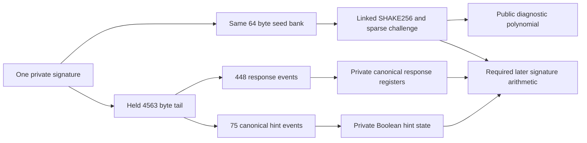

# Same signature canonicality and challenge constraints

The [joint signature module](../crates/thorum-hash-proof-lab/src/challenge_sampler/signature.rs) connects one private signature representation to strict response decoding, canonical hint decoding and bounded challenge sampling in one AIR. The signature has exactly 4627 bytes. Its first 64 bytes form the challenge seed and its remaining 4563 bytes form a held tail bank.

This is a diagnostic canonicality relation. It does not verify the complete signature equation, hidden owner key or exact transaction. A canonical signature encoding can have invalid final challenge equality. The public diagnostic is the same sampled polynomial and opaque context as the parent [challenge component](challenge-sampling.md). That polynomial can identify a repeated challenge. The normal payment path must keep signature intermediates internal to complete authorization, with hidden input commitments and stable nullifiers.

## One represented signature

The joint AIR evaluates the retained challenge constraints on their exact 6598 column prefix. Its private seed bank is the only representation of the first 64 signature bytes. The same seed feeds both linked SHAKE256 permutations and the sampled polynomial. A held field bank supplies every tail byte. No external proof comparison, public deterministic key tag or host signature verdict establishes this connection.

For tail $T=\sigma[64:4627]$, every byte is covered by exactly one canonical decoding source:

| Signature range | Tail range | Consumer |
|---|---|---|
| `[64,4544)` | `[0,4480)` | 448 ten byte response windows |
| `[4544,4619)` | `[4480,4555)` | 75 hint index events |
| `[4619,4627)` | `[4555,4563)` | Eight cumulative cuts |

Each source byte is independently bound to Boolean bits or a bounded canonical cut. No 40 bit word is equated directly in the base field. All tail cells hold through every phase, including rows after their last read.

## Strict response registers

The 448 event response program reads ten bytes per event. Two calls to the existing arithmetic [response decoder](coefficient-constraints.md) return four actual canonical normal residues. The joint relation uses those expressions directly, without separately supplied host coefficients.

For each packed 20 bit word $d$, the retained constraints enforce

$$
121\le d\le1048455,
\qquad z_q=524288-d+s\cdot8380417,
\qquad 0\le z_q<8380417,
\quad s\in\{0,1\}.
$$

These bounds express the strict response norm. The 1792 scalar registers begin at zero. For register $k$ with its fixed destination selector $P_{\lfloor k/4\rfloor}$ and decoded lane $v_{k\bmod4}$, the transition is

$$
Z'_k=Z_k+P_{\lfloor k/4\rfloor}(v_{k\bmod4}-Z_k).
$$

Every register receives exactly one constrained write. Other registers hold, and all retain their values after the terminal event. Inactive response windows and auxiliary bits are zero. The program reaches its sticky terminal state only after all response bytes have been covered.

## Canonical private hint state

Eight cumulative cuts satisfy $0\le C_0\le\cdots\le C_7\le75$. Seven bit complements and nonnegative differences establish those bounds exactly. The cuts are directly equal to the corresponding held signature bytes. Constant cut metadata holds separately from the changing index message.

At each fixed position $j\in[0,74]$, an active flag is exactly $j<C_7$. A selected polynomial must satisfy $C_{i-1}\le j<C_i$, where $C_{-1}=0$. A Boolean index selector refers to the exact original byte. Indices inside each polynomial are strictly increasing, while active index zero, empty polynomial segments and repeated indices across different polynomials remain valid. Every unused tail index byte is zero.

The private 2048 bit hint matrix begins at zero and updates by

$$
H'_{i,k}=H_{i,k}+G_iE_k.
$$

All matrix cells remain Boolean. Last index and seen state enforce strict ordering. Unselected cells and all padding rows hold. The final active hint write is part of the transition relation, including an execution with exactly 75 active hints. No public hint matrix or claimed parser success supplies canonicality.

## Reuse and proof profile

The child namespace is `challenge_sampler::signature`. It reuses the parent `Statement`, `Error` and actual challenge AIR, with a separate `Witness::from_signature`, `prove_signature_challenge` and `verify_signature_challenge` interface. The arithmetic crate supplies the same constrained response gadget through an explicit workspace dependency. The original hash, challenge and arithmetic proof profiles retain their own parameters and verification rules. The direct workspace dependency edge intentionally changes the lock file without adding registry packages.

| Property | Fixed value |
|---|---|
| Profile | `thorum.signature-challenge-proof-lab.mldsa87.canonical-sampleinball.serial.p3-0.8.0.v1` |
| Trace | 512 rows and 16650 columns |
| Actual symbolic degree | Three |
| Public vector | 1088 fields, shared with the challenge diagnostic |
| Stored hiding degree | Ten bits |
| Quotient chunks and FRI rounds | Eight chunks of four extension elements and ten binary rounds |
| Queries and log blowup | 64 and 3 |
| Challenge extension | Degree four over BabyBear |
| Random codewords and row salts | Four and sixteen |
| Grinding work | Zero |
| Closed transport | 16 MiB, 2000000 tokens, 32768 members, depth 24, strings 64 bytes and integers 20 digits |

The member bound covers a main opening width of 16654. Verification performs bounded preflight, exact shape validation and canonical reencoding before cryptographic verification. Both commitment layers retain hiding MMCS, independent fresh OS seeded proving generators and distinct full SHA3-512 domains. These settings do not establish a composed quantum knowledge or privacy guarantee. Opaque public context does not authenticate transaction semantics.

## Evidence and remaining obligations

The [reference record](../research/signature-challenge/README.md) reproduces 124 represented signatures, 63 canonical acceptances and 61 canonical rejections. Canonical classification and private final response/hint values agree with independent reference computations. A deliberately joined challenge prefix and a different canonical tail is a positive scope case. It represents one byte string in this limited relation. Full signature arithmetic must supply the remaining mathematical coupling.

Actual proof checks cover fresh repeated witnesses, all 1088 public mutations, a wrong profile and canonical transport corruption. Fifteen raw false proofs bypass witness prechecks and reject at the backend. They exercise seed and tail source replacement, bank and register holds, first and last response writes, byte aliases, program skips, rebuilt descending hint state, wrong polynomial routing, the final active hint update, both strict norm endpoints and padding. The external interface also rejects cross acceptance between parent and child proof profiles.

Raw field payload is $512\cdot16650\cdot4=34099200$ bytes. Hiding expansion gives $1024\cdot16654\cdot4=68214784$ bytes and main LDE payload is $8192\cdot16654\cdot4=545718272$ bytes. These are analytical array dimensions without a runtime, peak memory or throughput claim.

The bounded challenge class remains 272 XOF bytes. Unsupported capacity is distinct from invalidity of the complete signature scheme. Same hidden key and owner note linkage, full matrix arithmetic and transforms, hint application, encoded reconstruction, final challenge equality, exact transaction binding and recipient delivery remain unfinished. Complete private payment and confidential stake feasibility still precede kernel integration.
