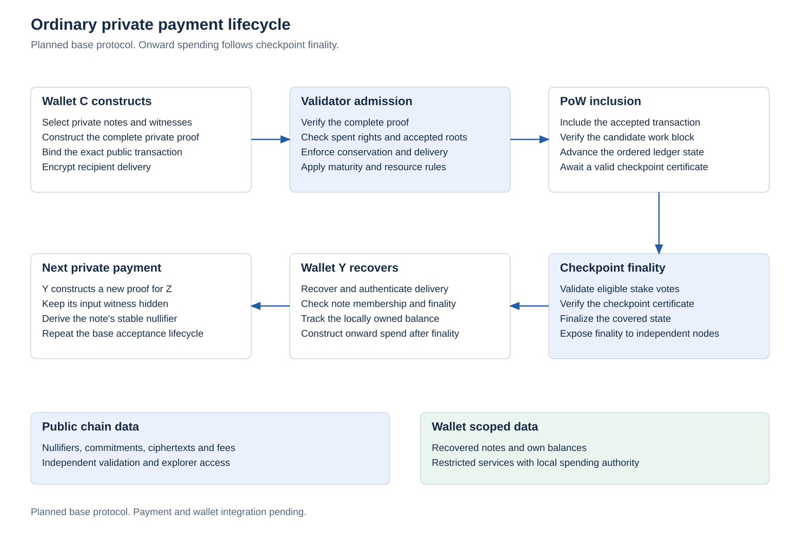

# Wallet, disclosure and recovery

## Local operation

The desktop architecture targets a Qt interface with Rust wallet, node and execution boundaries. The wallet implementation must start local validation and note scanning, expose background operation after close and login startup as explicit settings, and distinguish synchronization, inclusion, confirmation depth, checkpoint finality, and staking readiness. These are interface requirements. No wallet implementation is present.

The normal Send path must construct a private transaction. A separate public payment pool or optional privacy toggle is not part of the design.

The [RPC and data boundary](rpc-and-data.md) defines local private scanning, public encrypted data retrieval and scoped service access. Wallet balances and private history require the relevant capability. Complete transaction proofs permit ordinary nodes and explorers to verify public effects while spending witnesses stay local.

The [delivery sequence](delivery-roadmap.md) places the initial private wallet before Safe presentation and fast payment lock integration. Those later features retain separate consensus and recovery gates. Private Send, local validation and reliable recovery remain core wallet requirements.

The later [Aegis protocol](aegis.md#latency-target-and-wallet-states) reserves distinct wallet states for provisional locks, committed data awaiting recovery, certified available funds, policy restrictions and subsequent mining recording. The wallet must verify the complete certificate, local note and accepted membership before offering onward spending. This is future integration after separate consensus activation. The initial wallet continues to use checkpoint finality.

The [private Safe](protocol-extensions.md#private-safe) requires a protected balance, pending withdrawal state, authenticated unlock condition and separate recovery cancellation restricted to the committed protected destination. Consensus enforces its rules. The wallet must distinguish certified payment locks, checkpoint finality, reward maturity and staking principal availability. Ordinary transfers do not inherit the seven day mining/staking reward delay.

Private cryptographic migration and compact history verification remain separate development targets. Migration must preserve old consumption identity and restrictions while hiding input commitments. Any later compact wallet mode must retain explicit chain selection, data availability and note recovery requirements.

## Private Safe setup

The [Safe design](private-safe.md) separates ordinary spending, delayed Safe withdrawals and restricted emergency recovery within one application. Each authority has independent key material and backup. Reusing the wallet password for local encryption does not make the Safe backup depend on the ordinary wallet backup.

Safe setup offers the existing wallet password as its default encryption choice and a separate Safe password as an alternative. With a separate password, the Safe remains locked when the ordinary wallet is unlocked. Unencrypted local key storage is a separate explicit choice. These settings affect local storage, while every payment retains the mandatory private relation.

The Receive view selects ordinary spending or a supported Safe policy for new authenticated receiving requests. The user chooses a supported withdrawal delay when creating the Safe. Changing that preference does not protect existing ordinary notes or alter previously issued receiving requests. A withdrawal uses normal confirmation and signing after unlock. Backup phrases are restoration material and are not entered for each withdrawal.

Monitoring and balance display may operate with scoped viewing data without loading withdrawal or recovery secrets. The recovery destination and authority must be verified during setup. Cancellation protects the selected pending right under the chain rules, with recovery material kept independently from the everyday device where practical.

## Address namespace

The main network wallet address target uses the human readable prefix `thm`, followed by a versioned recipient payload and a checksum. The namespace is compatible with private payments and contract applications. It does not determine the cryptographic key representation or execution model.

The address specification must define the separator, alphabet, checksum construction, network domain, version, recipient type, maximum length, and supported key representation. Network and type fields must be bound by the checksum and checked before transaction construction. Test and development networks require distinct address namespaces. No production encoding or address decoder is implemented.

Contract references and asset identifiers require explicit types. A wallet must reject them in an ordinary recipient field unless the corresponding payment type and spending semantics are supported. Selected key representations determine payload length and require evaluation for QR presentation, copying, recipient discovery, and recovery.

## Authority separation

Spending, viewing, recipient discovery/encryption, recovery, and restricted staking authority require distinct domains and documented capabilities. An online voting service must not gain unrestricted spend/withdraw authority. Delegation must describe operator influence, availability, privacy leakage, and any misconduct consequences.

Running a validating node alone does not earn a subsidy. Eligible stake and compatible mining work have separate protocol duties.

## Governance interface research

The governance extension requires proposal creation, authenticated proposal content, eligible stake status, ballot submission, tally verification, funding status, and payment history in the desktop interface. These actions are separate from automatic checkpoint voting. Wallet submission cannot grant authority that is absent from consensus rules.

The interface must explain the voting snapshot, lock duration, disclosed information, delegation scope, fee, and irreversible actions before signing. Proposal content is untrusted input and must not execute code or silently request wallet permissions. No governance interface or native ecosystem fund is implemented. The authority and research constraints are specified in [ecosystem governance](governance.md).

## Recovery data

<picture>
  <source media="(prefers-color-scheme: dark)" srcset="../research/protocol-figures/figures/private-payment-flow-dark.svg">
  
</picture>

The protocol must define encrypted note and application data availability and the backup material necessary for a complete restore. A recovery secret alone cannot recover essential offchain data that was never made available.

Pruning removes selected historical block data only after validation and must retain live consensus state. It must not silently destroy the only recovery source for private notes. Tests include missing archives, stale backups, interrupted writes, duplicates, reorganizations and restored signers on multiple devices.

## Disclosure and metadata

Scoped viewing and payment proofs are deliberate disclosures. They do not grant general spending access or establish a mandatory viewing authority over other users.

Local scanning, minimized remote queries, encrypted transport where appropriate, anonymous relay support, careful logs, padding/resource classes, and traffic analysis have distinct threat models. A private ledger alone does not hide every IP address, timing pattern, or fact already known to a counterparty.
