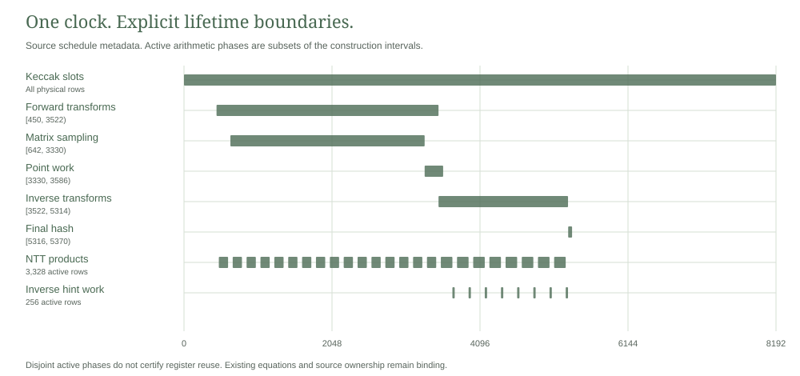

# Clock bound arithmetic workspace

This component implements one shared workspace for integer multiplication and inverse hint processing. Two constrained modes select the original integer equations under the retained global clock. Held operand sources and result updates remain in the same relation.

It follows the [packed lifetime inventory](../packed-lifetimes/README.md). The full packed signature layout remains unchanged. This component does not generate a private signature proof or change payment data.

## Mode and state relation

Let $\chi_r(t)$ be the original clock's selector for row $r$. The fixed product and hint schedules define

$$
m_P(t)=\sum_{r\in R_P}\chi_r(t),\qquad
m_H(t)=\sum_{r\in R_H}\chi_r(t).
$$

Both modes are Boolean and $m_Pm_H=0$. The AIR binds them to those exact clock expressions. A witness cannot suppress an operation by supplying an inactive flag.

The bank has 1,688 columns, enough for eight original 211 column multiplication gadgets. Hint mode uses eight original 125 column UseHint gadgets in the first 1,000 columns. Every original Boolean, range, complement, carry, decomposition and hint equation remains constrained under its mode. If $B_j$ is a shared cell, canonical inactive rules require

$$
(1-m_P-m_H)B_j=0,\qquad
m_HB_j=0\quad\text{for }j\geq1000.
$$

The two dormant gadget encodings differ, so they are not imposed simultaneously. Expressions returned from a gated gadget are used only under their corresponding mode.

Thirty two synthetic operand fields hold through every transition. Each active gadget binds its inputs to the same held fields. Sixteen result fields start at zero and record actual gadget outputs. For a product result $g_P(B)$,

$$
z_P(t+1)=z_P(t)+m_P(t)\bigl(g_P(B(t))-z_P(t)\bigr).
$$

Hint results use the corresponding $m_H$ update. The last row binds those result fields to sixteen synthetic public values. These values are a component diagnostic statement, not a payment wire format or a disclosure of private note commitments.

<picture>
  <source media="(prefers-color-scheme: dark)" srcset="../packed-lifetimes/schedule-dark.svg">
  
</picture>

## Executed constraints

One symbolic collection measured 5,889 assertions per row and degree three. One 8,192 by 1,930 trace passed a complete native constraint scan. The trace contains 63,242,240 field bytes and retains one maximum live allocation.

| Clock class | Actual rows |
|---|---:|
| Product mode | 3,328 |
| Hint mode | 256 |
| Idle mode | 4,608 |

Eight multiplication cases use existing independent bit vectors and expected results. Eight hint cases use previously saved boundary decomposition values and expected outputs. The selection includes both signs of the low component and edge, borrow and overflow encodings. The constructor copies those literals and does not calculate expected arithmetic results. Actual constraints determine acceptance.

Sixteen controls reject through the original native checker. They cover suppressed and simultaneous modes, a forged idle mode, a nonBoolean bit, product result and carry corruption, changed held operands, hint input and bit corruption, stale suffix and idle cells, result updates, the final clock indicator and a changed public result. Each mutation checks both affected global frames, including last to first where applicable. Every exact restoration passes. The run records 32 negative and 32 restored positive frame evaluations.

These are actual constraint rejections. No proof backend, commitment scheme, signature verifier callback or private ledger admission is selected.

## Resources and evidence

The release diagnostic passed on 1 November 2026 with Rust 1.94.1 on an Intel Core i9-13900H running Windows x86_64. The unchanged external guard installed 512 MiB process and aggregate job limits, required 2 GiB freshly available memory and imposed a 120 second deadline. Peak process and job commit were 64,753,664 and 66,060,288 bytes. The harness reported 0.24 seconds. This component duration is not proof generation or payment latency.

The [measurement](results/measurement.json), [validation](validation.json), [source manifest](provenance.json), [saved literals](fixtures.json) and [notices](NOTICE.md) bind the tested scope. Dependency versions remain a subset of the root lock and reviewed feature basis, with parallel execution disabled.

## Integration boundary

Applying this bank to the full relation would remove 998 net columns after adding the two bound modes. Height remains 8,192 and the intended public authorization shape remains 196 values. That full layout is not implemented by this component.

Integration must retain the actual NTT operand mux, scratch updates, hint source reads, w1 writes, constructors and late consumers. Its complete degree and dataflow require new checks. The separate matrix product workspace remains necessary because its schedule overlaps NTT work. Existing full signature resource refusals, hidden inputs, stable nullifiers and same witness payment obligations remain unchanged.

## Build and reproduce

The default library excludes diagnostics. The sole native test is ignored in ordinary test runs. CI selects saved evidence, explicit formatting, strict lints and compilation without repeating the native trace.

```sh
python -I -S research/arithmetic-overlay/static_check.py
cargo clippy --manifest-path research/arithmetic-overlay/Cargo.toml --release --lib --locked --offline -- -D warnings
cargo clippy --manifest-path research/arithmetic-overlay/Cargo.toml --release --features diagnostics --lib --test overlay --locked --offline -- -D warnings
cargo test --manifest-path research/arithmetic-overlay/Cargo.toml --release --features diagnostics --test overlay --locked --offline --no-run --jobs 1
```

A fresh native execution requires exact source, graph, fixture and executable review followed by a separate finite admission through the [unchanged Windows guard](run_guarded_windows.ps1). Select only the ignored test clock_bound_arithmetic_overlay_and_hostile_controls with one test thread. Fixed exclusive output cannot overwrite an earlier record.
