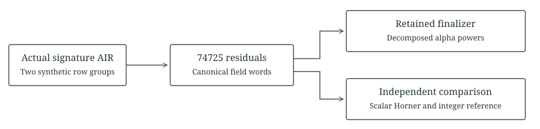

# Retained constraint folding

This laboratory evaluates the complete current signature and ownership AIR through the retained `ProverConstraintFolder`. Two synthetic local and next row groups exercise all 74725 constraint emissions at width 47058. The resulting fold matches a scalar extension computation. An independent Python integer implementation also reproduces every coefficient of the first captured fold.

The input rows are deterministic public data, not a valid signature witness. The configuration types identify the existing backend, but no PCS is initialized and no commitment, quotient domain evaluation, proof or verifier is invoked. This is a finite evaluation and folding gate for later proof engineering.

## Relation and comparison

For emitted residuals $c_0,\ldots,c_{m-1}$ and extension challenge $\alpha$, the retained folder uses descending powers:

$$
R(\alpha)=\sum_{i=0}^{m-1}\alpha^{m-1-i}c_i,
\qquad r_0=0,\quad r_{i+1}=\alpha r_i+c_i.
$$

The retained implementation separates base and extension streams, transposes alpha powers into basis coefficients and performs base field dot products. The comparison computes the second expression directly in each lane. The independent integer reference uses

$$
\mathbb F_p[Z]/(Z^4-11),\qquad p=2013265921.
$$

These are conditional component choices, without selection of a complete protocol security profile. The fixed challenge coefficients are public synthetic constants. They test folding and do not model transcript entropy or establish hiding, soundness, knowledge extraction or quantum security.



Both groups use nonzero selectors at points of the disjoint 65536 point quotient coset for the 8192 row trace domain. Only the selected points are computed. No full selector table or signature trace is allocated. The test asserts the actual emission count and the absence of extension constraints. Python separately checks the inverse vanishing values.

## Recorded scope

The [measurement fixture](fixtures/measurement.json) records the exact groups, compiler dependent packing width and finite evaluation/finalization timings. The [validation record](validation.json) identifies the source, executable and installed external limits. This build uses one lane per packed value. It makes no SIMD throughput claim.

The selected test evaluates the actual AIR twice. One changed residual and one changed alpha coefficient each produce a different result through the retained finalizer, with restored positive controls. These are fold integrity controls, not proof rejection tests. Eight small independent extension vectors additionally check the Rust field implementation in ordinary CI. Four Python tests cover extension reduction, Horner order, malformed lengths, canonical words, changed captured residuals and wrong inverse vanishing values.

The two row input buffer contains 376464 field bytes and the collected residual buffer contains 298900 field bytes on the recorded build. Alpha powers, temporary control copies, library code and allocator costs are additional. The process and aggregate limits are installed and read back at 512 MiB, with at least 2 GiB free memory before launch and a 120 second deadline. The final recorded peaks are in the validation record. Public synthetic residual data is bounded to 298900 bytes and uses canonical little endian words.

These measurements do not extrapolate full proof time or memory. Polynomial preparation, commitments, the full quotient, masks, salt and tree storage, reductions, FRI, openings and verification remain outside this execution. Existing large proof limits are unchanged. The [signature relation](../signature-scheduling/README.md) and the [proof feasibility boundary](../../docs/proof-feasibility.md) retain their separate obligations.

## Source boundary

The AIR is compiled directly from the versioned signature scheduling laboratory. Hash framing types are compiled from the existing stored proof laboratory only to define the retained PCS and challenger types. Runtime folding uses the pinned `p3-* 0.8.0` crates. Original licenses remain in place. [Provenance](provenance.json) pins repository sources, selected registry source files and the root lock subset without replacing upstream code.

## Reproduction

```text
python research/constraint-folding/static_check.py
python research/constraint-folding/reference.py --check
python -m unittest discover -s research/constraint-folding -p test_reference.py -v
cargo fmt --manifest-path research/constraint-folding/Cargo.toml --all -- --check
cargo test --manifest-path research/constraint-folding/Cargo.toml --release --locked --lib -- --test-threads=1
cargo clippy --manifest-path research/constraint-folding/Cargo.toml --release --all-targets --locked -- -D warnings
```

The ignored probe requires a separate finite resource admission. On Windows, build the release test executable, set `KOVA_FOLD_PROBE_GATE` to `reviewed-external-resource-admission`, then use `run_guarded_windows.ps1` with that executable, the exact test `tests::actual_retained_folder_and_scalar_reference`, `--exact --ignored --nocapture --test-threads=1`, `ExpectedTests 1` and `TimeoutSeconds 120`. Ordinary tests do not execute the probe. Generated results refuse overwrites and remain outside version control.
