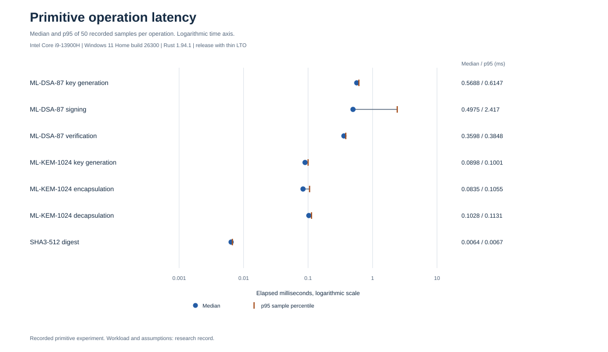
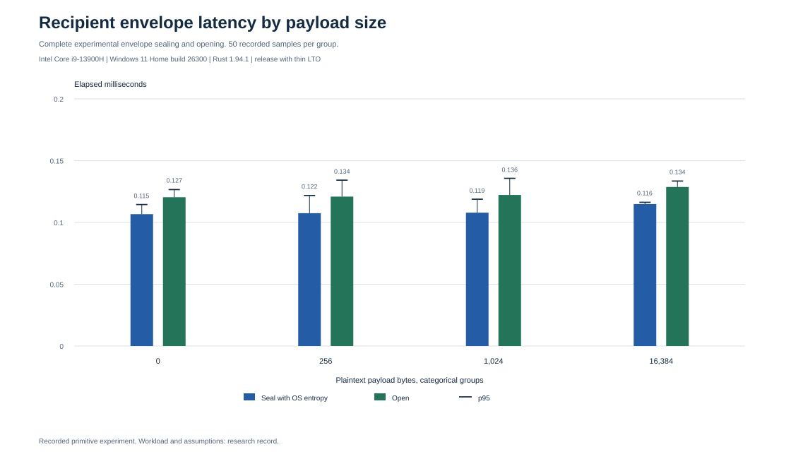

# Cryptographic feasibility evidence

The isolated [primitive laboratory](../../docs/crypto-lab.md) supplies real signature, key establishment, encrypted envelope, and rejection experiments. It does not implement private ledger authorization, private transaction proofs, confidential stake, or anonymous recipient discovery.

The [relation laboratory](../../docs/relation-lab.md) applies these primitives to local transparent payment and stake checks. The separate [proof feasibility record](../../docs/proof-feasibility.md) records backend evidence and the remaining private proof gates. Historical primitive measurements below retain their original source revision and are not measurements of these later interfaces.

## Evidence records

| Record | Content |
|---|---|
| [Selected official vectors](vectors/README.md) | Eight pinned NIST sample cases, original source hashes, exact expected outputs and verification verdicts |
| [Dependency inventory](dependency-inventory.json) | Exact registry versions, archive checksums, original license texts and a dated advisory source check |
| [Raw measurements](results/raw.csv) | 1,150 timed observations, 50 samples per operation and payload group |
| [Measurement metadata](results/metadata.json) | Source revision and hashes, lock hash, executable hash, hardware, compiler, operating system, workload and limitations |
| [Summary](results/summary.csv) | Minimum, median, nearest rank p95 and maximum for 23 groups |
| [Chart manifest](charts/manifest.json) | Source and figure hashes with rendering versions |

The local run used an Intel Core i9-13900H, Windows 11 Home build 26300, Rust 1.94.1, and the release profile with thin LTO. Source bytes are checked against the recorded Git revision. Workspace and Git hashes are retained separately so any line ending difference is visible.

## Reproduction

From the repository root:

```text
cargo fetch --locked
cargo test --workspace --locked --offline
cargo run --release -p thorum-crypto-lab --example measure --locked --offline -- 50
python research/crypto/dependency_inventory.py --check
python research/crypto/plot_results.py --summary-only --check
```

The measurement command writes CSV to standard output. A new timing run belongs in a separate experiment with new hardware and source metadata. It must not overwrite the published observations while retaining their old metadata.

`plot_results.py` reads the retained raw CSV and reproduces the summary using the Python standard library. Complete figure reproduction additionally requires ReportLab 4.4.9. Optional PNG previews require Node.js and sharp 0.35.5 available to module resolution.

```text
python research/crypto/plot_results.py --check
node research/crypto/render_previews.cjs --check
```

SVG figures and source hashes identify the canonical plotted content. PNG rasterization and font rendering may depend on the platform. Ordinary workspace tests require neither plotting tool. Vector source extraction is a separate documented operation with HTTPS access or an exact local copy of the pinned upstream tree.

## Local observations

The [transparent display variants](../presentation/README.md) preserve the original plot geometry, data labels and recorded measurements. Detailed notes accompany the research record, and the historical benchmark scope remains unchanged.

<picture>
  <source media="(prefers-color-scheme: dark)" srcset="../presentation/figures/crypto-primitive-latency-dark.svg">
  
</picture>

<picture>
  <source media="(prefers-color-scheme: dark)" srcset="../presentation/figures/crypto-envelope-latency-dark.svg">
  
</picture>

Primitive operations ending in `_os` include operating system entropy costs. Median and p95 describe this sample distribution and are not confidence bounds. The log scale in the first figure is explicitly marked. Payload groups in the second figure use equal categorical spacing.

In the envelope figure, bars show medians, while caps and numeric labels show p95. The percentile calculation uses the nearest rank rule recorded with the source observations.

Envelope overhead is an analytical encoding result of 1,618 bytes above plaintext length. The payload is synthetic. Byte columns count selected public artifacts and payloads, with exclusions documented in the laboratory specification. No graph measures private proof cost, network capacity, consensus throughput, memory use, or side channel resistance.
