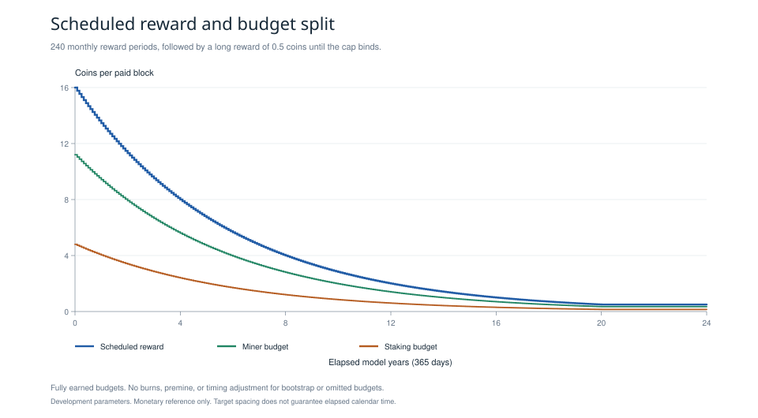
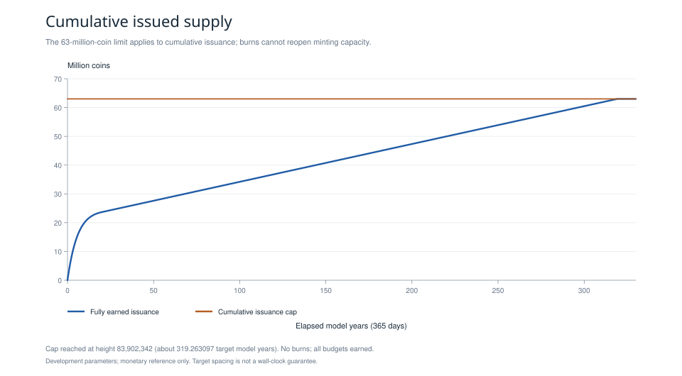
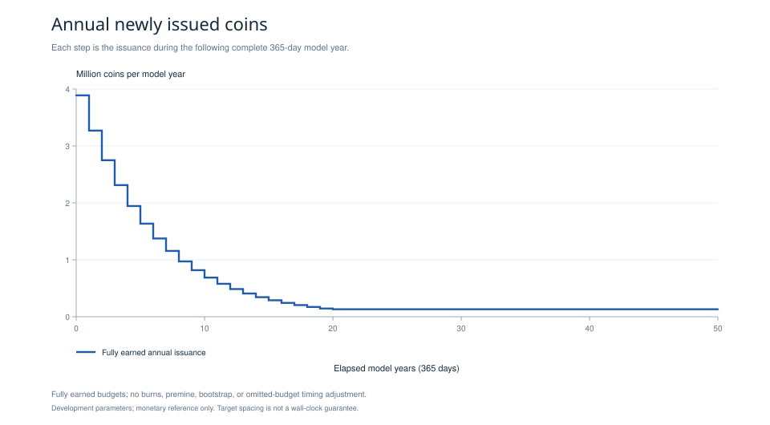
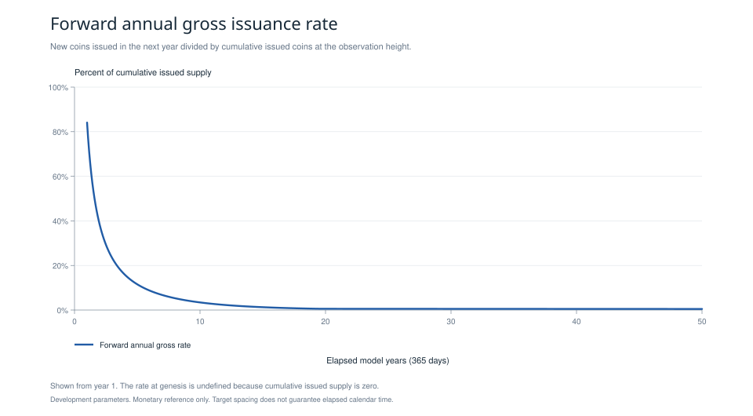

# Emission and monetary accounting reference

This directory contains an executable monetary research reference, frozen atomic unit data, accounting vectors for tests across languages, and charts generated from data. It specifies development parameters and tests their arithmetic. Stake eligibility, consensus, privacy, post quantum security, network behavior, bootstrap rules, and a mainnet implementation remain open construction work. Passing these tests establishes arithmetic consistency within the stated model. It does not establish network security or complete the broader research.

## Definitions and development parameters

| Quantity | Value or meaning |
| --- | --- |
| Atomic precision | 8 decimal places. 100,000,000 atomic units per coin |
| Cumulative issuance cap | 63,000,000 coins. 6,300,000,000,000,000 atomic units |
| Genesis | Height 0. No reward |
| First paid block | Height 1. Reward block index 0 |
| Target spacing | 120 seconds |
| Reward period | 21,900 consecutive heights after genesis. One twelfth of a 365 day model year at target spacing |
| Declining schedule | 240 periods |
| Long reward | Nominal 0.50000000 coin per block after genesis, subject to remaining issuance capacity |
| Miner budget | Floor of 70% of the capped reward |
| Staking budget | Capped reward minus miner budget, including the split remainder |

For height `h >= 1` after genesis, define the reward block index `i = h - 1` and period `m = floor(i / 21,900)`, independently of actual issuance. The nominal scheduled reward in atomic units is

```text
R(h) = floor(16 * 10^8 * 2^(-m / 48)),  0 <= m < 240
R(h) = 50,000,000,                     m >= 240
R(0) = 0
```

The first block with the long reward has height 5,256,001 and reward block index 5,256,000. The preceding height 5,256,000 still uses entry 239. The declining phase lasts 20 target model years, with a nominal four year half life at the period boundaries.

`emission.py` computes each table entry with an exact integer 48th root. If `A = 16 * 10^8` and the resulting entry is `r`, the tests establish both inequalities

```text
r^48 * 2^m <= A^48 < (r + 1)^48 * 2^m.
```

No floating point or transcendental rounding determines atomic unit rewards. The frozen table has SHA256 `ab8097f05a6993a38a3666ca5056c0cd30a6609ab2d5c3192a038bf2e27c8f7b`, using ASCII lines `period:reward_atoms` with a final LF after every entry. `metadata.json` records hashes of the complete generated files as well.

## Cap, earned issuance, and burns

Let `I` be cumulative actual issuance and `B` cumulative burns, with `0 <= B <= I <= C`, where `C` is the cap. The reference clips the nominal block budget before splitting it:

```text
remaining       = C - I
capped          = min(R(h), remaining)
miner           = floor(7 * capped / 10)
staking_budget  = capped - miner
0 <= earned_staking <= staking_budget
actual_issued   = miner + earned_staking
unearned_stake  = staking_budget - earned_staking
I_after         = I + actual_issued
B_after         = B + burn_after
outstanding     = I_after - B_after
```

The miner budget is assumed earned for a valid issued block. Stake eligibility and distribution must be supplied by a future consensus construction. Unearned staking budget remains unissued: it does not enter outstanding supply, cumulative issuance, or a reserve. Later rewards still use the schedule based on height. No catch up payment is defined. This can delay cap exhaustion.

Burns reduce outstanding supply and never reduce cumulative issuance. They cannot reopen issuance capacity. A burn cannot exceed outstanding supply after the block's issuance. Fees transfer existing value and are outside the subsidy model. They are not counted as new issuance in these artifacts.

Clipping before splitting matters near the cap. With seven atomic units of capacity, the budgets are four miner units and three staking units. With one unit of capacity, the miner budget is zero and the staking budget is one. If that stake is unearned, the unit remains unissued. No special rule forces the cap to be reached.

## Frozen artifacts

| File | Content |
| --- | --- |
| `schedule.csv` | Exactly 240 declining entries, atomic amounts, coin amounts with eight decimal places, and inclusive index/height bounds |
| `golden_vectors.json` | 18 independent transitions, split remainder vectors, invalid inputs, and explicit accounting semantics |
| `golden_vectors.csv` | The same 18 successful transitions in a plain numeric CSV for tests across languages |
| `projection_monthly.csv` | Target model months from year 0 through year 330 |
| `projection_annual.csv` | Target model years 0 through 330, including issuance during the following year and gross issuance rate |
| `metadata.json` | Parameters, assumptions, content hashes, and the exact block that exhausts the cap |
| `charts/manifest.json` | Plotting dependency version, source hashes, and canonical SVG hashes |

Golden transitions are independent input states rather than one consecutive chain. Every amount field ending in `_atoms` is an integer. `height` and `reward_block_index` are integer indices. Genesis uses JSON `null` and an empty CSV field for the reward block index. Each transition includes the input state, scheduled and capped budgets, earned and unearned staking amounts, actual newly issued amount, burn applied after issuance, final state, outstanding amount, and remaining capacity. JSON consumers must preserve the full integer width of heights: the maximum `u64` height vector cannot be represented exactly by a JavaScript `Number`.

## Projection assumptions and results

The projections assume every scheduled miner and staking budget is fully earned, genesis with no reward, average block spacing at the target, 365 day years, no burns, no premine, and no timing adjustment for bootstrap or omitted budgets. A reward period is exactly 21,900 blocks rather than a civil calendar month. Accounting by height is exact. Calendar timing is illustrative. Unavailable staking, unissued budgets, launch adjustments, or deviations from target spacing change actual issuance timing and the time at which the cap is reached.

Under these assumptions:

| Observation | Result |
| --- | --- |
| Cumulative issuance after 20 target model years | 23,676,829.37882100 coins |
| Full long reward issuance per 365 day model year | 131,400.00000000 coins |
| First block reaching the cap | Height 83,902,342. Reward block index 83,902,341 |
| Last capped reward | 0.12117900 coin |
| Last miner / staking budgets | 0.08482530 / 0.03635370 coin |
| Target elapsed time to cap | 10,068,281,040 seconds, about 319.263097412481 model years |

The forward annual gross issuance rate is `100 * next_year_issued / cumulative_issued` at the observation height. It is undefined at genesis and encoded as an empty CSV field. It measures new supply relative to issued supply. It does not estimate purchasing power, staking yield, or a holder's dilution after accounting for fees or burns. With no burns in the projection, outstanding supply equals cumulative issued supply. The charts never treat fees or burns as issuance.

After the cap binds, the nominal long reward schedule remains defined but the payable capped subsidy is zero. The security budget and incentive behavior at that point require separate research.

## Reproduction

The monetary generator and tests use Python 3.10 or later and only the standard library. Run from this directory:

```sh
python emission.py
python emission.py --check
python -m unittest -v
```

The tests cover exact floor inequalities, all period boundaries, genesis, maximum height, conservation, invalid states, cap clipping, unavailable and partial staking, split remainders, burns, the last capped block, and exact reproduction of frozen artifacts. Reference validation used Python 3.14.5.

Chart rendering is separate and optional. It requires ReportLab, validated with version 4.4.9. The canonical SVGs use `reportlab.graphics.charts.lineplots.LinePlot` and read the frozen CSVs:

```sh
python plot_emission.py
python plot_emission.py --check
```

The `--check` commands compare generated bytes without rewriting artifacts. SVG reproducibility checks require the recorded ReportLab version. Optional PNG previews use Node.js with `sharp` 0.35.5 available to module resolution:

```sh
node render_chart_previews.cjs
```

PNG font rasterization can vary by platform. The SVG and source data hashes in the manifest identify the canonical chart content. The plotting dependencies are unnecessary for generating or verifying the monetary fixtures. No dependency installation is performed by these scripts.

## Charts








