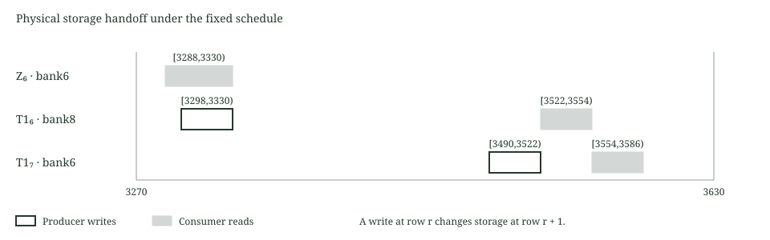

# Output lifetimes

This laboratory checks temporal storage reuse under the retained signature schedule. Sixteen logical outputs share nine physical banks. The actual AIR constrains the clock, immutable source values, producer updates, holds and consumer comparisons. It has 8192 rows, 274 columns, 776 assertions per row and symbolic degree three.

The executed model contains two representative coordinates per logical output, corresponding to coefficients 0 and 255. Sources are arbitrary held field elements. The test fixture uses distinct public synthetic values. An independent integer certificate checks conservative intervals for all 256 coordinates. Neither model implements transform arithmetic, signature verification, a hiding proof or payment admission.

## Producer and consumer relation

Let $s_{t,k}$ be a held source, $d_{t,k,r}$ a dedicated output and $b_{j,k,r}$ a shared output. The coordinate index $k$ selects the first or last output group. The constrained clock supplies $\chi_{t,k}(r)$ for the fixed producer row.

$$
d_{t,k,r+1}=d_{t,k,r}+\chi_{t,k}(r)(s_{t,k}-d_{t,k,r})
$$

$$
b_{j,k,r+1}=b_{j,k,r}+\sum_{t:\,m(t)=j}\chi_{t,k}(r)(s_{t,k}-b_{j,k,r})
$$

Both output banks start at zero. Sources hold through all transitions. A single aggregate update constrains each physical cell, including rows without a producer. At each scheduled consumer, the AIR requires $b_{m(t),k,r}=d_{t,k,r}=s_{t,k}$. The mapping and schedule are constants, not witness supplied flags. Producer values share the same source inside the relation.

For representative coordinates, producer rows are $610+192t$ and $641+192t$. Writes become visible in the following row. Thus a prior consumer at row $r$ may still use the old value even when a producer writes at that row. A conservative handoff requires $\operatorname{lastRead}(t)<\operatorname{firstVisible}(u)$.



## Fixed mapping

| Logical output | Physical bank |
| --- | --- |
| Z0 through Z5 | 0 through 5 |
| Z6 | 6 |
| Challenge | 7 |
| T1_0 through T1_5 | 0 through 5 |
| T1_6 | 8 |
| T1_7 | 6 |

Matrix consumers include every potential sampler iteration in the retained windows. The certificate does not shorten a lifetime based on early witness dependent completion. The ninth bank is necessary for this fixed whole bank mapping because T1_6 starts writing while Z6 remains live. This does not establish a global minimum over alternative schedules or coordinate routing designs.

The deliberate eight bank control places T1_6 in bank6 alongside Z6 and T1_7. The integer certificate finds 3968 conflicting coefficient and row pairs for Z6/T1_6 and 8192 for T1_6/T1_7. The native negative control evaluates the row3299 frame with the first overwritten coordinate. Exactly the Z6 consumer assertion rejects. This is a local diagnostic frame, not a complete unsafe trace execution.

## Verified scope

One complete synthetic trace passes the actual native constraint checker. Its 5728 representative consumer reads match an independent modular checksum. Twelve single cell mutations reject through affected borrowed frames, each followed by an exact restored positive. They cover omitted and early producers, stale ownership, wrong live values, source holds, clock corruption and late holds.

The first symbolic run rejected an expected degree four assertion. The actual measured degree was three. Only the expected test value changed before the successful corrected run. No relation equation changed. The independent certificate expectation also includes both conflict pairs in the unsafe map.

The raw synthetic trace contains 8,978,432 field bytes. Separate installed and verified 512 MiB process and aggregate limits, a fresh 2 GiB available memory admission and a 120 second deadline bound each selected execution. The validation record retains the measured peaks. These are measurements of this small model, not a full signature prover resource bound.

At 256 coordinates, replacing sixteen dedicated output banks with nine would remove 1792 gross columns before other routing changes. The current complete verifier remains unchanged. Applying this layout to it requires real producer routing, updated constructor and consumer references, complete native equivalence checks and a separate resource admission. Existing proof settings and limits remain unchanged.

## Reproduction

```text
cargo fetch --manifest-path research/output-lifetimes/Cargo.toml --locked
python research/output-lifetimes/static_check.py
python research/output-lifetimes/reference.py
python -m unittest discover -s research/output-lifetimes -p test_reference.py -v
cargo test --manifest-path research/output-lifetimes/Cargo.toml --release --locked --offline --lib
cargo clippy --manifest-path research/output-lifetimes/Cargo.toml --release --all-targets --locked --offline -- -D warnings
```

The symbolic and synthetic trace selections are ignored by ordinary test runs. Their source must be reviewed and frozen before separately bounded execution through the retained Windows guard. No proof backend is linked. Source identities, exact dependency tuples and finite measurements are retained in provenance.json and validation.json. The constrained clock is imported directly from the unchanged signature scheduling source.
