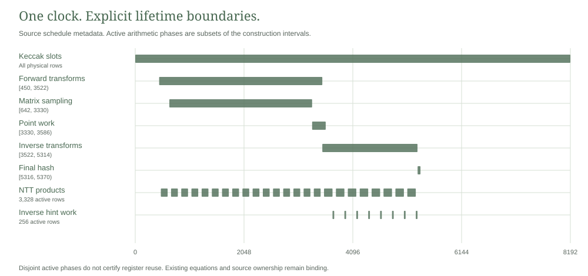

# Packed relation lifetime inventory

The complete packed authorization relation has 67 physical regions spanning 43,176 columns under one 8,192 row clock. This source inventory connects those regions to their producers, consumers and retained state rules before changing their layout.

The [inventory](inventory.json) parses bounded integer constants from the actual source paths and records their identities. Family descriptions below are reviewed source annotations, not automatically extracted dataflow or a proof of register reuse. No AIR, native witness, symbolic collector or proof backend was executed.

<picture>
  <source media="(prefers-color-scheme: dark)" srcset="schedule-dark.svg">
  
</picture>

## Physical state and source obligations

Every region has an exact start, end and width in the saved inventory. The region widths sum to the complete layout without gaps or overlaps. The following families retain distinct obligations.

| Family | Producer and consumer boundary | Hold, encoding and endpoint obligations |
|---|---|---|
| Clock | Low and high indicators select the fixed program | Boolean one hot state, first and last boundaries, nonwrapping high bank |
| Sponge | Initial, matrix and final message absorption | Four Keccak slots execute on every row, including dummy rows and internal joins |
| Private sources and read ports | Original key, signature and note words feed fixed consumers | Held words, Boolean byte ports, unused port zeros and tail padding |
| Derived hashes | Source sponge output writes owner, tr, mu, note digest, rho and challenge bytes | Initial zeros, exact write rows and holds through subsequent consumers |
| Canonical decoding | Key and signature bytes produce t1 and z coefficients | Shared bit windows, integer bounds, canonical residues and held coefficient banks |
| Hint decoding | Ordered encoded indices produce hint bits | Cuts, segment bounds, order, initial state and held hints through inverse output |
| Challenge sampling | The signature seed XOF drives SampleInBall | Count, signs, accepted destinations, source cursor and final completion |
| NTT outputs | Actual transform writes feed matrix and point operations | Aggregate physical update, initial zeros, retained mapping and late consumers |
| NTT workspace | Forward and inverse integer operations update scratch | Canonical product encodings, range complements, carries, flags and all inactive holds |
| Matrix sampling | Sponge XOF bytes feed bounded candidate acceptance | Causal counts and cursors, stream reset, completion and bound activity |
| Matrix products | Actual selected coefficients update accumulators | Unconditional operand mux, integer multiplication, reductions and idle equations |
| Accumulators | Matrix accumulation and point subtraction feed inverse input | Initial zeros and transition holds across inactive rows |
| Inverse hints and w1 | Normalized inverse coefficients and decoded hints produce w1 bytes | Exact same coefficient and hint, canonical encoding and holds into final hashing |
| Activity | Clock phase and actual completion state determine enables | Boolean flags with an enforced producer relation |

The full relation calls these equations together. The [source module map](../signature-packed/src/lib.rs) imports several implementations from earlier packages. Their actual paths and contents remain pinned. Constructor passes do not establish which registers are free in the relation.

## Output bank conflicts

Sixteen logical transform outputs share nine physical banks. For each logical output $t$, the inventory uses a conservative reservation interval $I_t=[a_t,b_t)$ from its first writer row through the final possible consumer. Two whole bank reservations conflict when

$$
m(t)=m(u)\quad\land\quad
\max(a_t,a_u)<\min(b_t,b_u).
$$

The retained mapping has no conflict under this model. The physical row calendar reaches nine simultaneous reservations during rows 3,298 through 3,329. Moving logical output fourteen into any existing bank zero through seven produces a conservative conflict. Bank six conflicts with both logical outputs six and fifteen.

These intervals overapproximate coefficient lifetimes and include writer rows. Writes become visible in the next row. The result concerns this fixed whole bank model, not a general minimum over different schedules or coordinate routing. The earlier [output lifetime laboratory](../output-lifetimes/README.md) retains its separate actual AIR and coefficient specific diagnostic results. Those tests were not replayed here.

## Arithmetic workspace candidate

The NTT and matrix product schedules overlap on 1,700 physical rows. Their real operand equations prevent direct workspace aliasing. In contrast, the active NTT product and inverse hint schedules have the following counts.

| Schedule class | Physical rows |
|---|---:|
| NTT products | 3,328 |
| Inverse hint outputs | 256 |
| Both | 0 |
| Neither | 4,608 |

Disjoint active schedules do not remove the existing dormant equations. An idle multiplication encoding still constrains complements and carries, while an idle hint encoding has its own equations. Reusing those cells requires an explicit mode bound construction.

The source design reserves one bank of 1,688 columns for eight integer multiplication gadgets or eight 125 column hint gadgets. Two additional Boolean mode columns would be bound to the original global schedule. Each original integer gadget, operand source and consumer must remain constrained under the correct mode. The unused hint suffix and fully idle bank require explicit canonical rules.

With the same height and public statement, the conditional width is

$$
W'=43176-8\cdot125+2=42178.
$$

Under the same conditional resource equations, retaining 998 fewer columns would reduce field contents by $19\cdot8192\cdot4\cdot998=621346816$ bytes. The resulting conditional source payload is 26,300,841,984 bytes. Main row contents at 64 distinct queries would occupy 10,798,592 bytes. These remain far outside the current small class and do not establish proof size or peak memory.

This candidate is source design only. Its constraint count and degree are unmeasured. Mode binding, complete branch equations, constructor routing, degree control, adversarial mode forgery and full dataflow equivalence require implementation and review. Existing source, native results, raw width refusal, security parameters and private payment obligations remain unchanged.

## Recorded scope

One isolated Python 3.14.5 run completed on 1 November 2026. It covered all 67 regions, checked the conservative output calendar, recorded eight remap conflicts and rejected four unsupported constant expressions. The parser accepts only bounded constants, known names, addition, subtraction and multiplication. It uses no eval or exec.

The unchanged Windows guard enforced 512 MiB process and aggregate limits, required 2 GiB freshly available physical memory and imposed a 120 second deadline. Peak process and aggregate job commit were 11,071,488 and 12,365,824 bytes. These are static inventory process observations, not signature prover measurements. The [validation](validation.json), [source inventory](inventory.json) and [notices](NOTICE.md) bind the exact scope.

```sh
python -I -S research/packed-lifetimes/static_check.py
```

This checks saved source and artifact identities without importing or replaying the inventory. A fresh separately admitted run uses isolated Python, the [inventory source](inventory.py) and the [unchanged Windows guard](run_guarded_windows.ps1). Inputs are bounded to 128 KiB each and the exclusive synchronized report to 64 KiB. Existing output cannot be overwritten.
