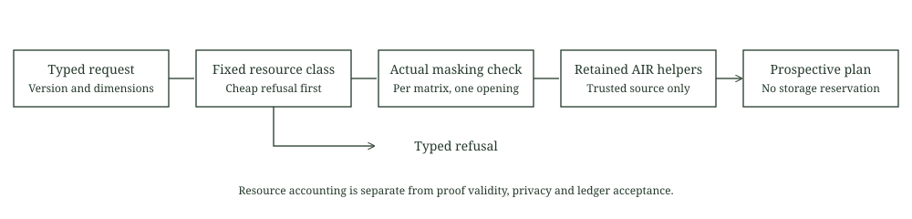

# Proof resource preflight

This adapter exposes the retained masking check and computes a versioned resource plan before witness construction. It imports the unchanged storage backend source. The new methods read configuration and source dimensions without opening prover data, drawing entropy or constructing field storage.

A ResourcePlan describes a prospective operation in a fresh resource class. It does not reserve storage or establish proof validity. Hash policy, transcript binding, complete transport bounds, hiding, classical theorem applicability, quantum and knowledge composition, private ledger joins and prover entry integration remain separate obligations.



## Actual helper and typed shape

The adapter calls the existing private checker inside the [retained hiding PCS source](../storage-pcs/backend/src/hiding_pcs.rs). Its arithmetic is unchanged:

$$
r\ge e,\qquad N\ge2\bigl(q+e\max(1,P)\bigr).
$$

Here r is the configured random codeword count, e the actual Rust extension dimension, q the configured query count and N the mask height. P counts the complete point vector for one opening call for that matrix. The primitive conservatively treats zero points as one. The versioned main resource request separately requires two points. Private prover data retains its original single opening restriction across clones. Preflight neither consumes nor renews that opening.

The resource method requires compatible DFT, base and extension MMCS, cryptographic RNG and storage interfaces. The declared extension must equal the Rust type. Actual configuration fields supply query count, blowup, folding and grinding. This is PCS type compatibility, not an authenticated complete proof configuration or a hash security certificate.

Cheap version, lifetime, quotient declaration, shape and resource checks run before symbolic inference. Only trusted, reviewed AIR source is eligible for inference. A narrow AIR can still contain a large symbolic expression or panic. This generic research interface does not sandbox arbitrary Rust code.

For compatible shapes, the actual retained quotient helper and batching helper derive the quotient and opening dimensions. The checked quotient and file bound precedes the batching helper's arithmetic. Current request version one requires eight quotient chunks. Unsupported declarations cannot trigger symbolic inference.

## Current finite class

The class retains raw width at most 8, random columns at most 4, stored dimensions at most 4096 by 12, at most 16 field files and 2 MiB aggregate field contents. The retained comparison uses BabyBear, blowup eight, 64 queries, binary folding and zero grinding.

For height H, width W, extension e, random count r and derived quotient count c, the conditional field payload is

$$
F=4\left(2H(W+r)+16H\left(W+r+(c+1)(e+r)\right)\right).
$$

This covers the prepared source and committed fields. It is not simultaneous resident memory, complete proof size or verification work. The stored backend's declared 2 MiB serialized proof cap is recorded as policy metadata. Preflight does not enforce serialization or parsing, and does not establish a complete transport bound.

| Retained small case | Derived value |
| --- | ---: |
| Raw shape | 256 by 2 |
| Prepared source | 512 by 6 |
| Main LDE | 4096 by 6 |
| Auxiliary LDE | 4096 by 8 |
| Quotient chunks | 8 |
| Batched opening functions | 84 |
| Field files | 11 |
| Field bytes | 1290240 |

The small result matches the earlier actual storage validation record. Current complete signature requests and the extension eight candidate are refused under the unchanged class. No full signature AIR evaluation, trace or proof follows from those requests. The extension eight masking helper is tested independently as arithmetic, not selected as a proving profile.

## Executed scope

Four bounded integration tests pass. They exercise exact mask boundaries, insufficient masks and random columns, checked overflow, zero point normalization, incompatible metadata, resource refusals before symbolic evaluation and actual small AIR helper results. Counted real test RNGs and a fail stop storage policy observe no preflight entropy or storage operations. The retained PCS and MMCS cloning paths draw seed material through those counters, so a forking clone would also be detected. Test configuration construction uses fixed public seeds and is outside that observation interval. Production seeding is not tested.

The first source review found unchecked batching could precede the quotient/file refusal. Both the declared and derived quotient bounds now precede that operation. The final source and executable were frozen before one selected four test process. Its installed 512 MiB process and aggregate limits were read back, with a fresh 2 GiB available memory admission and a 120 second deadline. No trace, commitment, proof or field file was created.

## Source boundaries

Source inclusion creates new nominal Rust types. Reusing proof and verifier source does not establish serialized interoperability. No compatibility proof was run. The original backend, proof records and all existing limits remain unchanged.

The inherited library unit test harness and doctests are disabled. Only the new integration target is selected. Imported storage code retains its original unsafe Matrix trait signatures and checked implementation. New preflight modules forbid unsafe code. The retained verifier boolean expression has its existing narrow lint exception. Source identities and the selected lint commands are recorded explicitly.

The reported relation type name is informational. It is not a stable protocol identifier or committed transcript value. A full payment still needs the same hidden input in membership, stable nullifier, ownership, conservation and encrypted delivery constraints, with atomic ledger consumption. This preflight is not a private payment verifier.

## Reproduction

```text
cargo fetch --manifest-path research/proof-preflight/Cargo.toml --locked
python research/proof-preflight/static_check.py
python research/proof-preflight/reference.py
cargo fmt --manifest-path research/proof-preflight/Cargo.toml --all -- --check
cargo test --manifest-path research/proof-preflight/Cargo.toml --release --locked --offline --test preflight -- --test-threads=1
cargo clippy --manifest-path research/proof-preflight/Cargo.toml --release --lib --test preflight --locked --offline -- -D warnings
```

The selected target excludes the frozen backend's internal tests. Those earlier results remain at their recorded revision. See NOTICE.md and the retained license texts for original source attribution.
