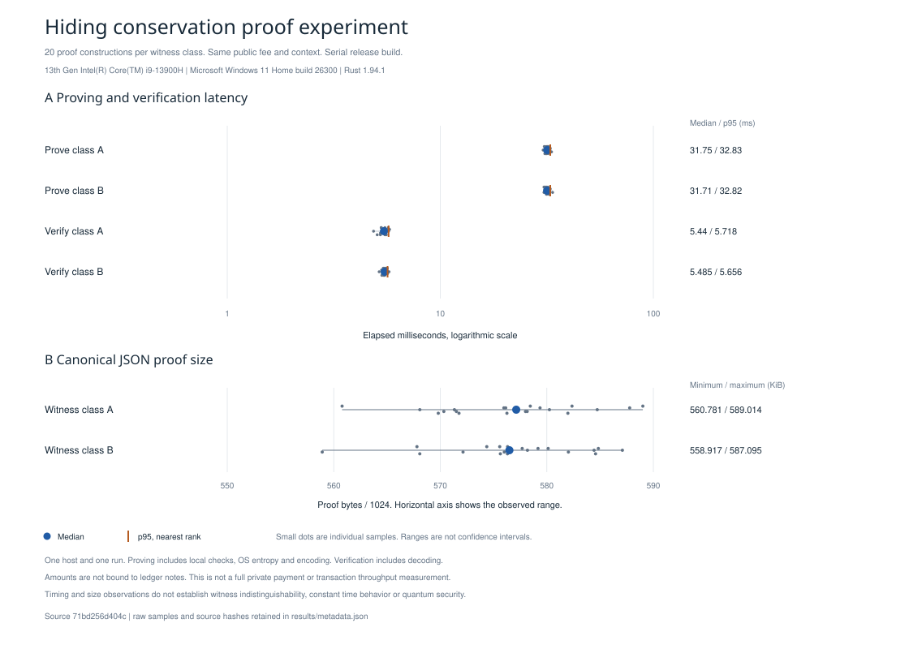

# Conservation proof evidence

The isolated [proof laboratory](../../docs/proof-lab.md) proves checked integer conservation with private amount bits and a public fee and context. It uses a pinned hiding STARK configuration. The four amounts have no binding to ledger notes, assets, ownership, membership, nullifiers, authorization or encrypted delivery. A valid proof therefore does not authorize a payment.

For private amounts $a_0,a_1,b_0,b_1$ and public fee $f$, the relation is

$$
a_0+a_1=b_0+b_1+f,\qquad
0\le a_0+a_1\le 2^{64}-1,\qquad
0\le b_0+b_1+f\le 2^{64}-1.
$$

All individual values are unsigned 64 bit integers. Bit and carry constraints establish integer equality rather than equality modulo the proof field. The complete [feasibility gates](../../docs/proof-feasibility.md) for private payments and confidential stake remain open.

## Independent reference artifacts

| Artifact | Content |
|---|---|
| [Conservation cases](conservation_vectors.csv) | Thirteen exact integer cases, including modulus aliasing and overflow rejection |
| [Trace fixture](trace_vector.csv) | All 256 rows of a synthetic amount and carry trace |
| [Public values](public_values.csv) | Sixty four fee bits followed by 64 context bytes |
| [Hash fixtures](hash_vectors.csv) | Complete framed preimages, SHA3-512 bytes and little endian digest words |
| [Reference generator](reference_vectors.py) | Python integer arithmetic and standard library hashing, independent of the Rust proof backend |
| [Feature guard](profile_check.py) | Resolved dependency version and serial feature checks |

The trace and amounts in these fixtures are deliberately public synthetic data. They are not serialized private proof witnesses. Rust unit tests compare the actual AIR trace, public inputs, hash adapters and constraint verdicts with these retained fixtures. Backend proof tests separately generate proofs and invoke verification without the witness.

The dependency source review, original license texts, archive checksums and dated advisory lookup are retained in the workspace [dependency inventory](../crypto/dependency-inventory.json). A dependency advisory lookup and passing tests do not establish cryptographic security.

## Reproduction

From the repository root:

```text
cargo fetch --locked
cargo test -p thorum-proof-lab --locked --offline
cargo test -p thorum-proof-lab --release --locked --offline
python research/proofs/reference_vectors.py --check
python research/proofs/profile_check.py
```

The release test suite bypasses the wrapper's local constraint checks for deliberately false traces and checks rejection by the real verifier. Debug builds retain upstream constraint assertions and therefore cannot exercise that same proving path. The serial feature guard rejects feature unification that would enable an unreviewed parallel configuration. It does not replace source review after any dependency change.

The measurement example runs actual proving and verification on two synthetic witness classes with the same public fee and context:

```text
cargo run --release -p thorum-proof-lab --example conservation_measure --locked --offline
```

CSV output contains sample indices, public experiment class labels, operation durations and encoded proof sizes. A retained measurement run requires its own source revision, source and executable hashes, compiler, hardware and operating system record. Timing and proof size observations do not establish witness indistinguishability, constant time behavior or a quantum security level.

## Retained local observation

The retained run used source revision [`71bd256d404c1391204bb96aae6506414ea6a7ff`](https://github.com/th0rigin/Thorum/commit/71bd256d404c1391204bb96aae6506414ea6a7ff), an Intel Core i9-13900H, Windows 11 Home build 26300, Rust 1.94.1 and the serial release profile with thin LTO and overflow checks. The locked offline build completed after checking source bytes against that commit. Incremental compilation was disabled. There was no separate warmup. All samples, including the first, are retained.

Forty proofs were constructed and verified, producing 80 timed observations. The two classes each have twenty independently randomized proofs. Their public fee is one and their 64 public context bytes are `00` through `3f`. Class A uses amounts $(50,50,60,39)$. Class B uses $(2^{64}-1001,0,2^{64}-1003,1)$. Classes alternate in the fixed order A prove, A verify, B prove, B verify. The values are synthetic public experiment parameters, without a production privacy claim.

| Class | Operation | Samples | Median milliseconds | p95 milliseconds | Proof byte range |
|---|---|---|---|---|---|
| A | Prove | 20 | 31.753 | 32.831 | 574240 to 603150 |
| A | Verify | 20 | 5.440 | 5.718 | Same paired proofs |
| B | Prove | 20 | 31.713 | 32.820 | 572331 to 601185 |
| B | Verify | 20 | 5.485 | 5.656 | Same paired proofs |



The median is the arithmetic mean of the central pair for these even sample counts. The percentile is the nearest rank observation at $\lceil0.95n\rceil$. Dots and ranges describe recorded samples, rather than confidence intervals. Latency uses a logarithmic axis. The size panel shows a cropped linear axis in KiB, where one KiB is 1024 bytes.

Proving includes local constraint checks, fresh operating system entropy, actual proof construction, encoding and JSON preflight. Verification includes bounded parsing, fixed shape checks, canonical encoding and actual proof verification. It does not obtain operating system entropy. Compilation, process startup, CSV output and destruction of the returned proof vector are outside the timers.

| Record | Content |
|---|---|
| [Raw observations](results/raw.csv) | Every duration and paired proof length, without proof bytes or secret material |
| [Measurement provenance](results/metadata.json) | Measured source revision and byte hashes, executable and lock hashes, hardware, compiler, profile and limits |
| [Exact summary](results/summary.csv) | Minimum, exact median, nearest rank p95, maximum and size bounds |
| [Figure manifest](charts/manifest.json) | Raw, summary and SVG hashes and renderer version |
| [Summary and figure generator](plot_results.py) | Standard library summary and ReportLab 4.4.9 SVG rendering |

Summary reproduction requires only the Python standard library. Complete figure reproduction additionally requires ReportLab 4.4.9:

```text
python research/proofs/plot_results.py --summary-only --check
python research/proofs/plot_results.py --check
```

A new timing run needs a separate experiment directory and new provenance. It must not replace these observations while retaining the old metadata. The retained primitive measurements in [research/crypto](../crypto/README.md) belong to their earlier source snapshot and remain unchanged.

The observations cover one host and one run, without controlling scheduling, background work or thermal state. They do not measure peak memory, power, network behavior, complete private payments, confidential stake or transaction throughput. Similar sample distributions cannot establish that a witness is hidden or that execution is constant time. This profile and its JSON sizes are laboratory evidence, without selection of production parameters or a composed quantum security level.
