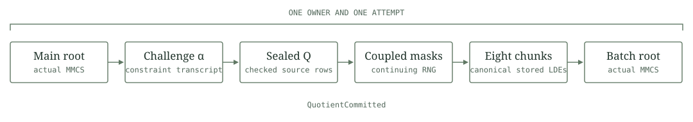

# Coupled quotient commitment

This laboratory consumes canonical quotient evaluations from the same owned attempt that produced the main commitment. It constructs and commits eight masked chunks through the retained polynomial commitment backend. Construction ends at `QuotientCommitted`.

The fixed relation has 256 trace rows, two main columns and public values 5 and 260. Its quotient domain has 2048 points and four extension basis coordinates. Each chunk has 256 rows and four additional random columns. Its committed LDE has 4096 rows and eight columns. The full signature relation remains a separate resource and security integration problem.

## Source construction

Let `Q` denote the sealed 2048 by 4 source and `E_i` the input to chunk i. Source rows follow the original domain split order.

$$
E_i[r,c]=Q[8 r+i,c],\qquad
0\leq i<8,\quad 0\leq r<256,\quad 0\leq c<4.
$$

The adapter first samples all trailing random columns in chunk, row and column order. It then samples the first seven mask banks. Only one widened 256 by 8 input chunk is assembled at a time. The source remains noncloneable and supplies checked four field windows. The original main root and transcript derived challenge remain inside the fixed context.

For chunk domain `H_i` with first point `a_i`, the retained normalization is

$$
c_i=\left(\prod_{j\ne i}Z_{H_j}(a_i)\right)^{-1}.
$$

For each of the 2048 mask coordinates, the final bank satisfies

$$
t_{7,k}=-\sum_{i=0}^{6}\frac{c_i}{c_7}t_{i,k},
\qquad \sum_{i=0}^{7}c_i t_{i,k}=0.
$$

All eight columns participate, including the four added random columns. The actual retained masked extension performs the inverse transform, coefficient masking and forward transform. The eight canonical output files then enter one actual batch Merkle commitment. The original unopened prover data metadata and shared single opening flag are retained.



The transcript prefix used to obtain the quotient challenge is explicitly aborted. This component never resumes it or marks a proof as produced. A complete prover must preserve an uninterrupted original transcript through auxiliary commitment, out of domain sampling and the original batched opening.

## Measured construction

The single admitted Windows diagnostic passed on 31 October 2026 with Rust 1.94.1 on an Intel Core i9-13900H. Its test body completed in 0.98 seconds. The external guard imposed 512 MiB on both process and aggregate job, required at least 2 GiB free physical memory and enforced a 120 second ceiling. Recorded peak process commit was 9,129,984 bytes and aggregate job commit 10,420,224 bytes. These are component observations on that fixture and hardware.

| Observation | Result |
|---|---|
| Main fields compared |24,576 equal|
| Quotient chunk fields compared |262,144 equal|
| Actual main and quotient roots |Both equal to the retained dense route|
| Input batch commitments |Two per side|
| Masked inverse and forward boundary calls |Eight of each per side|
| Main extension tile boundary calls |Two candidate, one dense reference|
| Delivered synthetic RNG byte fingerprints |Equal for masks and salts|
| Continuing mask stream |Eight equal 32 bit words per side|
| New failure controls |Ten completed|
| Openings, verifier calls and proofs |Zero|

The dense reference follows the original coupled mapper after its own real main commitment under identical continuing synthetic seeds. It shares the quotient source values and retained DFT and MMCS implementations. Equivalence with that route does not provide an independent implementation of those algorithms. The separate [quotient evaluation laboratory](../quotient-source/README.md) records its independently implemented integer comparison.

The ten controls cover foreign ownership, reserved chunk metadata, phase, duplicate claim, wrong shift, invalid input chunk shape, domain, noncanonical source, truncated source and a collision at the eighth output file. Six constant sealed source fixtures are explicitly whitebox storage tests. They perform no main commitment. Two malformed source cases fail after mask sampling and before a transform or commitment. The late collision preserves its unowned sentinel after seven successful output writes. Two actual committed matrix leases also reject reads after the unfinished attempt drops. Real panic injection, poisoned locks and operating system sync faults have separate coverage requirements.

## Storage and failure semantics

The existing 13 role reservation remains 1,325,056 field bytes under the 16 file and 2 MiB ceilings. The quotient source remains reserved throughout construction. No extra spool files or reservation release is used to fit the profile.

The adapter retains 32,768 bytes of random column banks, 65,536 bytes of coupled mask banks and one 8,192 byte assembled input chunk. The retained transform still creates dense coefficient and scratch buffers. Diagnostic dense reference data also remains live. Source consumption establishes neither zero dense allocation nor a bound for the complete signature proof.

A single atomic owner claim precedes entropy sampling. No owner mutex spans I/O, field work, transforms or commitment. The original mask RNG guard spans all eight constructions and ends before MMCS. Source reads now occur after entropy advances. A subsequent source or storage failure closes the owner without rewinding randomness or retrying the operation. Typed storage failures retain their first cause. Infallible DFT and MMCS trait methods can still unwind.

## Reproduction

The default library has no diagnostic entry. The diagnostic feature is isolated and uses only the retained public synthetic fixture. Cargo.lock and provenance.json pin the dependency graph and source adaptations. The saved measurement and validation record can be verified without replaying construction.

```sh
python -I -S research/quotient-mask/static_check.py --check-results
cargo clippy --manifest-path research/quotient-mask/Cargo.toml --release --locked --offline --lib -- -D warnings
cargo clippy --manifest-path research/quotient-mask/Cargo.toml --release --locked --offline --features diagnostics --lib --test masking -- -D warnings
cargo test --manifest-path research/quotient-mask/Cargo.toml --release --locked --offline --features diagnostics --test masking --no-run --jobs 1
```

The unchanged Windows guard runs the compiled test with external resource limits. An existing fixed output is refused. CI checks saved source identities, formatting, compilation and lints. It does not repeat the admitted construction merely to validate documentation.

## Remaining integration

Independent mask arithmetic, adversarial commitment entry faults, live transcript composition, auxiliary commitment and the original single batched opening remain subsequent work. Hiding assumptions, production entropy, opening lifetime budgets and complete private signature proof resources require their own analysis. Same witness membership, nullifiers, value conservation and delivery remain mandatory ledger joins. This laboratory introduces no payment acceptance callback, wallet operation, consensus rule or production network.
