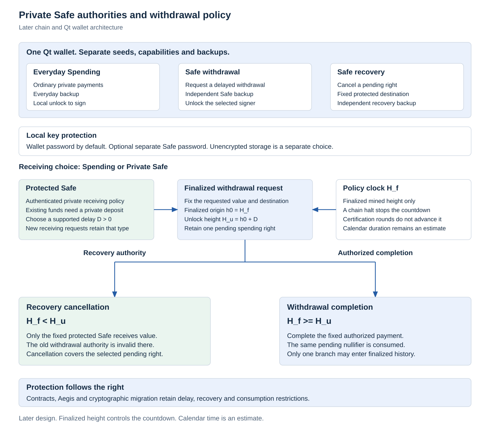

# Private Safe design figure

The [Private Safe specification](../../docs/private-safe.md) defines optional protected receiving, three independent authorities, local key protection, a finalized request origin and mutually exclusive pending cancellation or completion. This figure describes a later application and wallet design. It contains no implemented Safe, latency measurement or completed security claim.

Safe receiving requires an authenticated typed policy. Selecting it as a wallet default affects new requests, while existing ordinary notes need an accepted private deposit. Delay is a user selected supported positive value. Production delay bounds and presets remain unset.

The policy clock is finalized mined height. A halt stops its progress and calendar duration remains an estimate. Cancellation before unlock and completion at or after unlock consume the same pending right. Recovery returns that selected value only to its fixed protected Safe, with the compromised old withdrawal authority invalid there. Recovery of remaining protected notes requires a separate transition and specification.

<picture>
  <source media="(prefers-color-scheme: dark)" srcset="figures/private-safe-dark.svg">
  
</picture>

## Deterministic reproduction

```text
python research/safe-design/generate_figures.py
python research/safe-design/generate_figures.py --check
```

Generation uses the standard library and the existing original Thorum renderer at `research/aegis/generate_figures.py`, pinned to SHA256 `08a29659344c2e17601a4c6410cf042f5b70126caffbfb428e7212c288be4430`. A changed renderer fails before import. It is read without modification and its main generation path is not called. No external package, network access or font file is needed for SVG reproduction.

The [fixed data](figure-data.json) records the exact design scope. The [source record](source_record.json) hashes the generator, pinned renderer, specification, this research text and both SVG variants. A light variant and matching dark variant share geometry and labels. Their outer canvas is transparent and their text uses Arial with Helvetica and sans serif fallbacks. The renderer checks XML, coordinates, transparency and contrast against reference canvases. These are presentation checks rather than protocol tests.

Optional previews require an already installed Pillow and explicit local fonts:

```text
python research/safe-design/generate_figures.py --png-directory PREVIEW_DIRECTORY --font-directory FONT_DIRECTORY
```

Previews use explicit theme canvases to review text fit. They are separate from the transparent SVGs. No fonts are distributed. All source and drawing code is original project source under the existing [MIT license](../../LICENSE). The canonical historical figures and their frozen records remain unchanged.

The complete private payment and confidential stake gates still precede ledger integration. Safe encoding, private recovery witness construction, origin binding, fee handling, policy update delays, encrypted availability and Qt behavior require later implementation and adversarial evidence under the specification.
