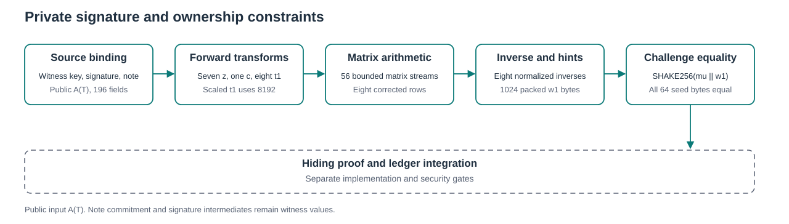

# Private signature and ownership constraints

This native laboratory constrains a complete bounded ML DSA 87 verification calculation and canonical note ownership in one AIR. Its witness contains the raw 2592 byte verification key, 4627 byte signature and 418 byte note opening. The public input is the 196 byte authorization frame derived from a typed transaction. The input note commitment, key, signature and intermediate values remain witness columns.

<picture>
  <source media="(prefers-color-scheme: dark)" srcset="constraints-dark.svg">
  
</picture>

## Connected relation

Let $K=(\rho,t_1)$ denote the encoded verification key held in the private witness, $\sigma=(\widetilde c,z,h)$ the encoded signature and $N$ the canonical note opening. The constrained owner field satisfies

$$
\operatorname{owner}(N)=\operatorname{SHA3\!\!\text{-}\!512}(K).
$$

The same key supplies $tr=\operatorname{SHAKE256}(K,64)$. With the retained contextual framing $M'(A(T))$, the private message digest is

$$
\mu=\operatorname{SHAKE256}(tr\parallel M'(A(T)),64).
$$

The [transaction and ownership reference](../signature-ownership/README.md) defines every framing byte. The challenge is sampled from the same signature seed $\widetilde c$. Canonical decoding constrains every response coefficient, hint position, ordering rule and unused hint byte.

For $q=8380417$, sixteen connected forward transforms produce seven $\widehat z_j$, one $\widehat c$ and eight $\widehat t_i=\operatorname{NTT}_q(8192t_{1,i})$. Matrix sampling consumes the actual private $\rho$ and the fixed column then row nonce. Its accepted coefficient order supplies

$$
v_i=\sum_{j=0}^{6} A_{i,j}(\rho)\odot\widehat z_j
-\widehat c\odot\widehat t_i\pmod q,
\qquad r_i=\operatorname{NTT}_q^{-1}(v_i),\quad 0\le i<8.
$$

Every inverse coefficient is normalized by $256^{-1}=8347681\pmod q$. The actual signature hint at the same coefficient index supplies $w_{1,i}=\operatorname{UseHint}(r_i,h_i)$. Packing uses the lower nibble first and produces 1024 private bytes. The final equation checks all 64 received seed bytes:

$$
\widetilde c=\operatorname{SHAKE256}\left(\mu\parallel\operatorname{Pack}(w_1),64\right).
$$

The preimage has 1088 bytes, exactly eight SHAKE256 rate blocks. A separate ninth permutation applies padding. Every sponge continuation carries all 100 state limbs. Each private source, decoded value, accumulator and packed byte has an explicit producer and hold rule. Inverse inputs and decoded hints have no independent caller interface.

## Native validation

The [execution record](execution_record.json) identifies the tested source, toolchain, raw selected outcomes and installed resource limits. The six tests cover the declared schedule, bounded typed fixture reader, symbolic constraints, construction alone, ten reference tuples and rebuilt false suffixes. Construction alone does not evaluate the AIR.

The frame has 8192 rows, 55049 columns and 196 public field elements. Its main field payload is 1803845632 bytes. Symbolic inspection measures 205201 constraints per row and degree four. These dimensions and local native results do not select a proof profile or establish a quantum security level.

The ten tuples distinguish five accepting and five rejecting signature and owner relations. Tests compare the supported matrix and signature stages with independent integer references. Hostile cases include a genuine alternate matrix nonce stream, a changed corrected row with rebuilt inverse, hint and final hash stages, an exact detached multiplication, boundary mutations, canonical range rejection and all 64 received seed routes. Diagnostic primitives and restored full relations provide positive controls. Several mutations break multiple joins. The seed route cases do not isolate individual final equality equations.

For the 64 single cell seed mutations, the unchanged full AIR is evaluated on both affected frames with their original global row selectors. A full baseline is checked first. Since each constraint reads only the current and next row, changing row $r$ can affect only constraint frames $r-1$ and $r$. Each case retains positive checks before mutation and after exact restoration. Bytes zero and 63 additionally retain full trace rejection checks. All 77 mutation cases remain in the suite.

Both samplers have fixed capacities. Capacity refusal ends construction and is reported separately from AIR rejection. The existing synthetic signatures and fixtures are reused without signing or regeneration.

## Reproduction and limits

From the repository root:

```text
cargo test --manifest-path research/signature-complete-native/Cargo.toml --release --lib --no-run --locked --jobs 1 --target-dir target/signature-complete-native
cargo fmt --manifest-path research/signature-complete-native/Cargo.toml -- --check
cargo clippy --manifest-path research/signature-complete-native/Cargo.toml --release --all-targets --locked --target-dir target/signature-complete-native -- -D warnings
cargo test --manifest-path research/signature-complete-native/Cargo.toml --release --lib --locked --target-dir target/signature-complete-native -- --ignored --list
python research/signature-complete-native/generate_figure.py --check
python research/signature-complete-native/static_check.py
```

All six tests are ignored and externally gated. Run one exact selected test per process, serially, with process and aggregate memory ceilings, fresh memory admission and a finite deadline. The retained measurements use 2 GiB process and aggregate limits and at least 5 GiB available before each action. Environment markers acknowledge setup and do not install those limits. Exact selectors and markers are in `src/full_tests.rs`.

The authorization module exposes deterministic transaction data. Witness fields remain private. The [provenance record](provenance.json) retains source, fixture and license identities, formatting changes and equivalent iterator and selector adaptations. The sixteen transform laboratory remains a separate snapshot.

## Remaining gates

Native evaluation receives private witness data directly. A hiding proof backend, its knowledge and quantum model, practical proving memory, proof size and verifier cost remain separate requirements. This laboratory has no proof or payment acceptance API.

Private payment composition must additionally bind the same input notes to authenticated membership, stable nullifiers, creation eligibility, conservation, spent state and encrypted delivery. No native result here supplies those missing ledger conditions.
