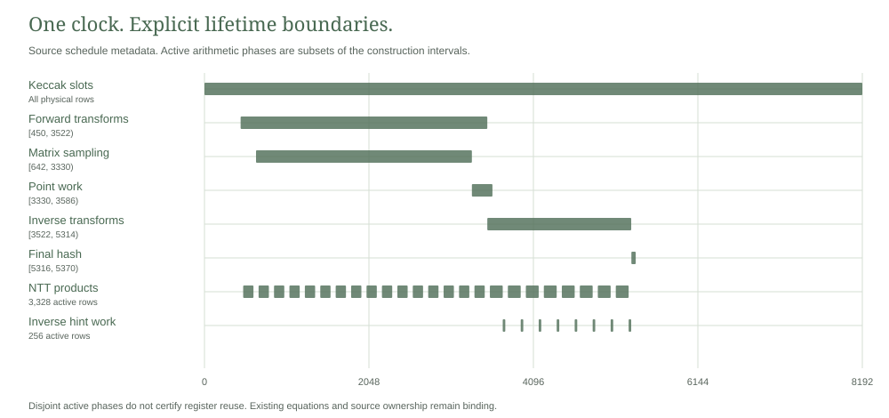

# Complete signature arithmetic overlay

This laboratory integrates a shared arithmetic workspace into the complete packed signature and note ownership source. It retains the original private key, signature and note byte inputs, canonical transaction authorization, transform and matrix computation, inverse hint applications and final hash comparison. The complete relation compiles. One complete symbolic collection measures 71,623 assertions of maximum degree four. A satisfying full signature witness and backend proof remain separate validation stages.

<picture>
  <source media="(prefers-color-scheme: dark)" srcset="../packed-lifetimes/schedule-dark.svg">
  
</picture>

## Shared relation

The retained clock has 64 low and 128 high Boolean indicators. Its original boundary and transition equations bind the physical row. For a row position $t$, write its indicator as $s_t=\ell_{t\bmod64}u_{\lfloor t/64\rfloor}$. Product and hint modes satisfy

$$m=\sum_{t\in\mathcal R_M}s_t,\qquad h=\sum_{t\in\mathcal R_H}s_t,\qquad m(m-1)=h(h-1)=mh=0.$$

The product set contains forward butterflies, inverse butterflies and inverse normalization. The hint set contains inverse output rows. Original operation selectors define both sets under the same clock. The matrix computation overlaps transform work and retains its own integer workspace. All nine physical transform output banks remain separate.

Let $B$ be the shared bank of 1,688 fields. Eight original modular multiplication gadgets use 211 fields each. Eight original UseHint gadgets use the first 1,000 fields. Actual source operands and consumers remain in the full relation. Its equations impose

$$mF_M(B,x,y)=0,\qquad hF_H(B,r,\eta)=0,$$

$$ (1-m-h)B_j=0\quad(0\le j<1688),\qquad hB_j=0\quad(1000\le j<1688).$$

Here $x,y$ are the original twiddle and scratch operand expressions, $r$ is the normalized inverse coefficient and $\eta$ is its decoded signature hint. These are derived from the same private witness. Each returned arithmetic expression enters its consumer only under the original operation selector. A gadget gated off in one interpretation does not supply an independently verified result in that row.

The original scratch and output updates, bounded write complements, flags, partial inverse reloads, ordered W1 packing and final signature equality remain present. The source interfaces add no public input commitment or free decoded operand. The synthetic sources, result sinks and sixteen public values of the earlier component are absent from this relation.

## Construction order

The forward pass writes product encodings only on actual forward butterfly rows. The inverse pass writes them on actual inverse butterfly and normalization rows. The hint pass writes its encoding only on inverse output rows and preserves the product rows. All other shared cells follow the canonical idle and suffix rules. Original decoded source, accumulation, scratch and hash state timing is retained.

The public constructor returns `ExecutionNotAdmitted` by default before decoding, cryptographic preflight or trace allocation. The dormant `native-execution` feature remains a separate execution boundary. The symbolic diagnostic target refuses that feature at compile time. Compilation executes neither constructor nor signature verification.

## Measured scope

| Quantity | Recorded result |
| --- | ---: |
| Physical rows | 8,192 |
| Columns | 42,178 |
| Public values | 196 |
| Reduction from retained packed source | 998 columns |
| Complete symbolic assertions | 71,623 |
| Maximum symbolic degree | 4 |
| Symbolic collections | 1 |
| Native traces and backend proofs | 0 |

The column calculation is $1688+1000-(1688+2)=998$. The independent assertion count prediction is $69242+5+1688+688=71623$. Gating existing gadgets and operand equations keeps their assertion count. Actual collection agrees with that prediction. Its degree histogram is $[72,3295,46690,20884,682,0,0,0]$ for degrees zero through seven.

A dense base field trace would contain $8192\cdot42178\cdot4=1,382,088,704$ field bytes. That trace was not allocated. The symbolic run used 405,774,336 bytes of process commit and 407,068,672 bytes of aggregate job commit under separate 512 MiB limits. It required at least 2 GiB available memory and a 120 second deadline. The host was a Core i9-13900H on Windows with Rust 1.94.1. These are symbolic construction observations, not full proof memory, latency or transport measurements.

The [symbolic record](results/symbolic.json), [validation](validation.json) and [source provenance](provenance.json) bind that tested scope. The earlier [arithmetic component](../arithmetic-overlay/README.md) retains its own native trace and sixteen hostile rejection controls. Those controls do not establish native equivalence for the complete overlaid signature relation.

## Reproduction and remaining validation

```text
python -I -S research/signature-overlay/static_check.py
cargo fetch --manifest-path research/signature-overlay/Cargo.toml --locked
cargo clippy --manifest-path research/signature-overlay/Cargo.toml --release --lib --locked --offline -- -D warnings
cargo clippy --manifest-path research/signature-overlay/Cargo.toml --release --features diagnostics --lib --test shape --locked --offline -- -D warnings
cargo test --manifest-path research/signature-overlay/Cargo.toml --release --features diagnostics --test shape --locked --offline --no-run --jobs 1
```

The ignored symbolic test requires a separate external resource admission and an exclusive new output. It collects the full actual AIR once, saves observations before comparing the count and degree, and drops the expression graph before reporting success. The static check reads source and saved evidence without replaying the collection. CI prepares the ignored target and checks the retained record.

Complete native validation must use real typed source fixtures, independently saved derived values and the original ownership, authorization and consumer equations. A bounded streamed construction requires its own state ownership, pass ordering and resource validation. Full hiding proof construction, composed security and private payment integration remain unfinished. The existing wide signature admission remains refused. This source reduction selects no larger proof class or weaker cryptographic profile.
