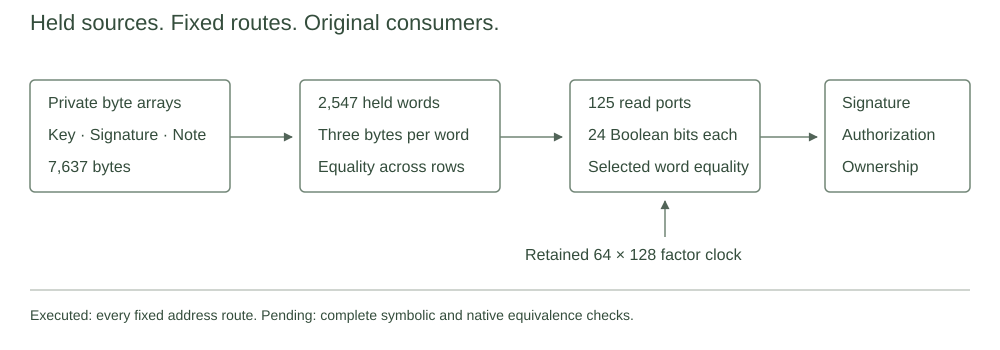

# Complete packed signature sources

This laboratory replaces the private byte banks of the retained complete signature and note ownership source with held three byte words and fixed Boolean read ports. It retains the actual hash, decoder, transform, matrix, hint, authorization and ownership equations. The candidate compiles in both feature configurations. The executed test checks fixed routing metadata against the frozen independent source inventory.



## Source relation

For private bytes $b_i$, the held word is

$$w_j=b_{3j}+2^8b_{3j+1}+2^{16}b_{3j+2}.$$

Each port contains 24 Boolean variables $u_{p,k}$. For clock selected route $r(t,p)$, the equations impose

$$u_{p,k}(u_{p,k}-1)=0,\qquad \sum_{k=0}^{23}2^ku_{p,k}=w_{r(t,p)}.$$

An unused port selects zero. The two virtual bytes in each partial signature and note word are constrained to zero. Every held word is equal to its next row value on transitions. All 2,547 words are read somewhere in the fixed program. Since $2^{24}<2,013,265,921$, Boolean reconstruction has no modular carry alias in the base field. These observations explain the intended source equivalence under the retained clock constraints. They are not a complete machine checked equivalence proof.

The factor clock has 64 low indicators and 128 high indicators. Interval selectors use a high indicator for a whole low clock block, and a high indicator times a sum of low indicators for a partial block. This compression depends on the retained Boolean, one sum and transition equations. The full interval selector is one.

`byte_at` returns an ungated expression for the port assigned at one physical row. Its consumer applies the original clock selector once. `byte_all` already selects the correct port across all rows. Its consumer adds no outer selector. Six row sponge intervals are split where actual port ranks change inside an interval. The immutable cache contains program addresses only.

## Layout and measured scope

| Quantity | Record |
| --- | ---: |
| Physical rows | 8,192 |
| Original private bytes | 7,637 |
| Held words | 2,547 |
| Read ports | 125 |
| Boolean port columns | 3,000 |
| Candidate columns, compiled constant | 43,176 |
| Public values | 196 |
| Column reduction from retained source | 2,090 |
| Literal peak words and first peak row | 125 at row 234 |
| Literal word selections over the schedule | 423,569 |

The source column arithmetic is $7,637-(2,547+125\cdot24)=2,090$. A dense base field trace would contain $8,192\cdot43,176\cdot4=1,414,791,168$ raw bytes. That trace was not allocated. This arithmetic is not a measurement of total proof memory or proof performance. The 125 port strategy follows the literal inventory and is not claimed to be optimal.

The actual route test constructs the new Rust address cache and compares every row, demanded port and byte offset against the frozen inventory. It checks full word coverage, first and last use, repeated cross purpose reads, and a rank change within one sponge interval. Eight invalid fixed address requests are refused. These are metadata refusals, not adversarial AIR or proof rejections.

The test constructs no field row, calls no AIR evaluation or constructor, and generates no proof. The complete constraint count, degree, selector arithmetic, row filling and native equivalence corpus remain unmeasured for this candidate. Complete private signature proofs and payment integration remain subsequent work.

## Construction boundary

The witness interface accepts only the original typed verification key, signature and note byte arrays, held privately in the witness. Authorization public values are derived from the canonical transaction statement. No free decoded operands or acceptance callbacks are added. Existing producer and consumer equations retain their joins.

The full constructor returns `ExecutionNotAdmitted` by default before preflight, cache initialization or allocation. The `native-execution` feature only provides a future execution boundary. Its library body has been compiled and linted, not executed. No full trace or wide prover is admitted by this record.

## Reproduction

Rust 1.94.1 and the exact Cargo.lock define the compiled source. The recorded Windows route run used a Core i9-13900H, one test thread, a 120 second deadline, 512 MiB process and aggregate commit limits, and at least 2 GiB available memory before launch. Its result and resource summary are retained in [validation.json](validation.json). Formatting and strict library lints passed for default and `native-execution` configurations.

```text
python research/signature-packed/static_check.py
cargo fetch --manifest-path research/signature-packed/Cargo.toml --locked
cargo fmt --manifest-path research/signature-packed/Cargo.toml --all -- --check
cargo test --manifest-path research/signature-packed/Cargo.toml --release --locked --offline --test routes --jobs 1 -- --exact complete_fixed_routes_match_frozen_inventory --test-threads=1
cargo clippy --manifest-path research/signature-packed/Cargo.toml --release --lib --test routes --locked --offline -- -D warnings
cargo clippy --manifest-path research/signature-packed/Cargo.toml --release --lib --features native-execution --locked --offline -- -D warnings
```

The static check only validates retained identities, dependency inventory and recorded artifacts. It does not repeat the route test. Fresh CI route results must match [fixtures-routes.json](fixtures-routes.json). The Windows guard can enforce the recorded process limits around the exact compiled test executable.

[Source origins](origins.json), the [adaptation diff](adaptation.patch), [provenance](provenance.json) and [notice](NOTICE.md) preserve the derivation. This laboratory does not establish complete payment privacy, post quantum security or a runnable network.
