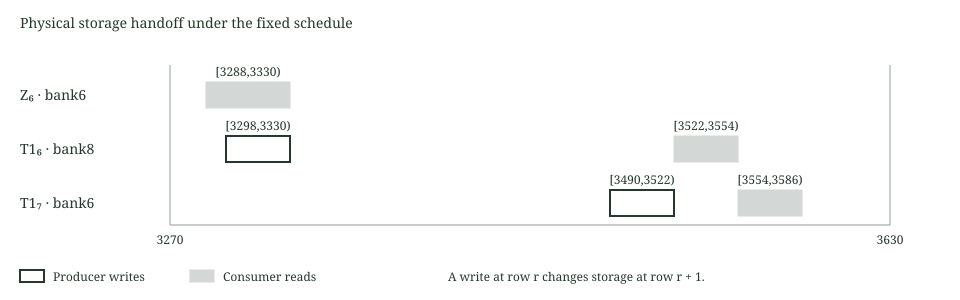

# Private signature output storage

This laboratory connects the reviewed output lifetime mapping to the complete bounded native signature and note ownership relation. The key, signature and note remain private witness inputs. All source hashing, ownership comparisons, canonical arithmetic, activity producers, matrix streams, inverse transforms and final challenge checks retain their existing equations.

The isolated [temporal model](../output-lifetimes/README.md) establishes the fixed handoff mechanism. Here each output update uses the actual constrained NTT write, and every matrix or point consumer reads its mapped physical column. The constructor follows the same local to next row timing. The original [signature scheduling laboratory](../signature-scheduling/README.md) remains unchanged as the source reference.

## Physical output relation

For coefficient $k$, let $w_{k\bmod8,r}$ be the actual canonical write value on row $r$, and $\chi_{t,k}(r)$ its fixed producer selector. The physical bank update is

$$
b_{j,k,r+1}=b_{j,k,r}+\sum_{t:m(t)=j}\chi_{t,k}(r)(w_{k\bmod8,r}-b_{j,k,r}).
$$

The constrained factor clock makes the producer routes exclusive. Each physical output starts at zero and has one aggregate transition equation. Values hold exactly outside their scheduled writes. Source operands, modular products, canonical bounds and scratch updates are unchanged.

The map is $(0,1,2,3,4,5,6,7,0,1,2,3,4,5,8,6)$ for logical transforms 0 through 15. Banks 0 through 5 hold the corresponding Z transforms before T1 reuse. Bank6 holds Z6 and later T1_7. Challenge remains in bank7 and T1_6 uses bank8. Matrix windows and the final point windows overlap, so arithmetic scratch storage is kept separate.



## Source and reference checks

Independent transform references are observed immediately after complete production and again at the final potential consumer. Reading every logical output at the end of the trace would be invalid after its physical bank is reused. Every matrix accumulator, point product, inverse output, hint, ordered W1 byte, message and final challenge reference remains checked at its original location.

The A0 selection includes twelve additional actual output handoff corruption cases. Each changes one cell of the complete native trace, evaluates its affected borrowed frames, restores the original value and requires the restored frames to pass. Existing activity controls, the remaining signature and ownership tuples, and the reconstructed hostile source routes retain their separate selections.

| Dimension | Retained schedule | Output storage layout |
| --- | ---: | ---: |
| Rows | 8192 | 8192 |
| Columns | 47058 | 45266 |
| Public field values | 196 | 196 |
| Assertions per row | 74725 | 71141 |
| Symbolic degree | 4 | 4 |
| Raw native field bytes | 1541996544 | 1483276288 |

Removing seven 256 coefficient banks saves 1792 columns and 3584 initialization and transition assertions. These are measured layout dimensions and source counts, not proving speed claims. Under the existing conditional extension4, random4 and expansion comparison, field payload falls from 27,796,045,824 to 26,739,081,216 bytes. This arithmetic estimate excludes file system overhead and other prover memory. Existing storage and proof limits remain unchanged.

## Native execution record

All ten signature and ownership tuples match the independent verdicts, with five accepted and five rejected. Nine activity mutations and twelve output handoff mutations reject with exact restoration. The final reconstructed source selection rejects all 77 hostile routes, with the retained complete positive and negative controls. At most one wide trace is live. No proof backend runs.

The final source selections completed in 71.99 seconds for A0, 516.63 seconds for the remaining nine tuples and 854.89 seconds for the hostile routes on the recorded Windows system. The largest observed job commitment was 1,490,407,424 bytes under installed 2 GiB process and aggregate limits. These are finite constraint checks on named source and hardware, not controlled proving benchmarks.

## Evidence boundary

validation.json records the exact final source executions and resource peaks. Source identities, the original references, package checksums, feature boundaries and source differences are reproducible. The complete relation here concerns one bounded authorization and note ownership witness. A hiding proof and its security composition, hidden membership and stable nullifier joins, multi input conservation, encrypted output delivery and persistent ledger admission remain separate integration requirements.

## Reproduction

```text
cargo fetch --manifest-path research/signature-storage/Cargo.toml --locked
python research/signature-storage/static_check.py
cargo fmt --manifest-path research/signature-storage/Cargo.toml --all -- --check
cargo test --manifest-path research/signature-storage/Cargo.toml --release --locked --offline --lib -- --test-threads=1
cargo clippy --manifest-path research/signature-storage/Cargo.toml --release --all-targets --locked --offline -- -D warnings
```

Ordinary tests exercise clock, dimensions, producer activity and reconstruction without constructing the complete signature trace. The ignored symbolic and native selections require separately reviewed source and external limits through the retained Windows guards. They execute serially, with fresh memory admission before each selection. The symbolic guard installs 512 MiB process and aggregate limits. Native selections install 2 GiB limits and require 5 GiB available memory. Neither guard runs a proof backend.
