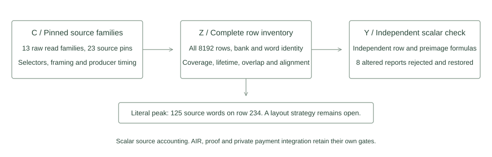

# Full source read inventory

This scalar inventory covers the reviewed private source consumers in the retained full signature relation. Two independently organized programs agree across all 8192 physical rows. One traverses fixed read families and compressed message segments. The other uses explicit row formulas and separately assembled framed preimages.

The result accounts for every key, signature and note byte, repeated use, first and last use, source word identity and alignment. It records source locations, selectors, current and next frame dependencies, conditional range provenance and occupied scratch. It is source accounting. An integrated packed layout and its AIR constraints remain the next implementation stage.



## Word identity and alignment

Three canonical bytes fit within one base field element:

$$w_{B,j}=b_{B,3j}+256b_{B,3j+1}+65536b_{B,3j+2},\qquad 2^{24}<2013265921.$$

The bank identifier B is part of each word identity. Equal values or equal indices in different banks cannot merge their spending authority or source provenance. For a row r, let A(r) be its bank-qualified byte addresses. The literal word demand is

$$W(r)=\{(B,\lfloor i/3\rfloor):(B,i)\in A(r)\}.$$

The full triplets associated with W(r) also contain alignment bytes that a consumer may not emit. Every future instantiated packed equality needs range-proven expressions for those bytes. Signature and note tail words each contain two virtual zero bytes. Real note byte 417 is a separate canonical zero byte.

## Measured scalar result

| Item | Result |
|---|---:|
| Physical rows per program |8192|
| Raw read families |13|
| Source bank byte counts |2592,4627,418|
| Held triplet counts before constant elimination |864,1543,140|
| Maximum distinct source words |125 at row 234|
| Maximum distinct source bytes |346 at row 234|
| Maximum extra alignment bytes |28 at row 1|
| Maximum triplet bytes without an assigned local range route |87 at row 0|
| Entire fixed note triplets identified |25|
| Serialized inventory bytes |97665|

The maxima describe separate metrics and need not occur on the same row. Conditional range routes refer to retained producer, Boolean and hold equations. They are analysis annotations rather than new range proofs. Public field elements are not intrinsically bytes. The canonical transaction mapping and complete MU input equations remain explicit prerequisites.

On row 234, the first TR block, t1 and z decoders, all cut comparisons, note context and note owner comparisons already require 91 distinct words before additional fixed note fields. The full literal inventory reaches 125. Byte holds are recorded separately and do not require decoding all 2547 held words on every row.

The 25 constant note triplets identify an elimination opportunity. No new layout is selected here. The difference between 7637 byte columns and 2547 triplet columns is a gross storage count. Net width also depends on every range, alignment, clock, routing, hold and scratch obligation. Existing forced-zero columns remain occupied until their equations are explicitly replaced and reviewed.

## Coverage and lifetime

The record includes both key hashes, challenge prefix, framed note hash, RHO producer, t1 and z windows, hints, all-row cuts, all-row fixed note and context bytes, private owner comparison and the complete late 64 byte challenge equality. Initial preimages preserve all 69 permutations, all six rows of each permutation, original domains, rates, padding and continuation boundaries. Matrix and final preimages remain separately catalogued as unchanged derived inputs.

All-row note and cut constraints persist through row 8191. OWNER written on row 233 becomes available on row 234. TR written on row 353 feeds MU on row 354. The full challenge equality executes on row 5369. Partial words can couple different consumers and lifetimes, so a source hash finishing does not by itself retire its source words.

The lexical access list and reviewed classifications distinguish declarations, constructors, holds and consumers. Their source hashes and narrative classifications are shared reviewed inputs. The independent arithmetic comparison does not turn a source scan into a formal semantic completeness proof.

## Executed comparison

One bounded process completed one producer sweep and one independent reference sweep. The saved inventory passed validation before eight altered reports were rejected. Each alteration was restored and accepted again, giving nine positive and seventeen total report validations. These are metadata checks, with zero symbolic collections, native traces or backend proofs.

The external Windows guard installed and read back 512 MiB process and aggregate ceilings, freshly required 2 GiB available memory and enforced a 120 second deadline. The actual complete artifact is below its 512 KiB limit. The process and aggregate memory peaks were 14368768 and 15667200 bytes. Interpreter, hardware and exact source identities are recorded in validation.json and provenance.json. The standard library and host tools remain trusted execution assumptions.

## Reproduction

```text
python research/source-certificate/static_check.py
python -I -S research/source-certificate/experiment.py
```

The experiment requires fresh output names and preserves partial results on failure. It performs both scalar sweeps once. Source identities and resource admission precede execution. It does not import the retained AIR or construct a field matrix. Full signature ownership, hidden note membership, stable nullifier state, conservation, encrypted delivery and proof security retain their own implementation and review gates.
