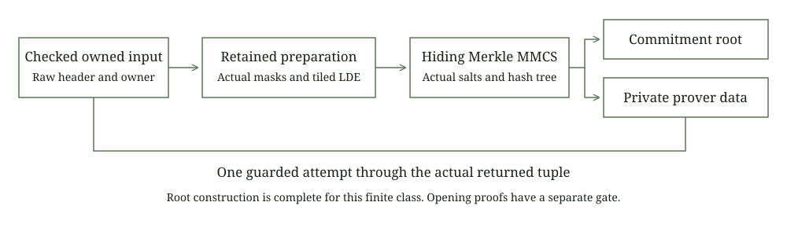

# Owned source commitments

This laboratory connects checked owned inputs to the retained hiding Merkle commitment implementation. The source entry uses the actual PCS mask generator, the existing preparation and streaming kernels, the actual DFT, retained commit_stored_ldes and the original private prover data constructor.

Three returned commitments match exactly: the new owned convenience entry, its dense convenience entry and retained ordinary dense Pcs::commit. Every unsalted matrix field and the continuing mask and salt streams match. Independent Python SHA3 reconstruction reproduces the complete root from 4,096 public synthetic salted leaves.

No PCS opening, FRI proof, STARK, complete private signature proof or payment transaction is produced by this experiment. Hash equality and successful construction do not establish hiding, knowledge soundness or a composed post quantum security level.



## Actual construction

The finite class uses raw height 256, width 2, challenge extension degree 4, four random columns, 64 queries, two reserved opening points and blowup 8. The actual local PCS checks its own parameters and the retained masking helper before attempting preparation. Its domain has size 512 and shift 1. Raw and prepared headers remain distinct.

The frozen preparation kernel retains the exact W source fields followed by W+2r actual samples per raw row and width reinterpretation W+r. The source owner reserves raw, prepared and main LDE files before sampling. A continuing CryptoRng supplies masks. The actual hiding MMCS supplies salts after the LDE is ready.

The commitment leaf for physical row i is

$$
\ell_i=H_{\mathrm{leaf}}\!\left(L_{i,0}\Vert\cdots\Vert L_{i,5}\Vert s_{i,0}\Vert\cdots\Vert s_{i,15}\right),
\qquad d_{j+1,k}=H_{\mathrm{node}}(d_{j,2k}\Vert d_{j,2k+1}).
$$

Both hash domains include their length and final element count. Fields use canonical little endian u32 encoding. Digest words use little endian u64 encoding. The retained leaf and node functions use SHA3-512. The captured fixture uses public deterministic masks and salts exclusively for reproduction.

The borrowed older PCS object is a resource profile anchor for the frozen source constructor. It is not the actual commitment engine. It is never cloned from the actual target PCS and supplies neither masks nor salts. Observations verify unchanged anchor entropy and zero anchor commitment calls. The actual target independently validates its own full finite profile.

## Entry and failure boundary

The new nominal MatrixStore and RowSource types bridge the existing checked storage. Windows are forwarded exactly. Invalid bounds return None. Genuine storage failures abort through typed errors rather than fabricated fields. Whole matrix conversion and every unused MatrixStore default explicitly refuse before sampling or a dense fallback.

The dense convenience method is distinct from the unchanged ordinary Pcs trait entry. The associated storage bridge does not imply that ordinary commit dispatch supports this policy. Tests compare the convenience method with the genuine retained ordinary entry.

The outer attempt distinguishes Preparing, LdeReady, Committing, Committed and Failed. Its guard stays live across mask preparation, DFT, MMCS salt generation, real commitment reads and prover data construction. Committed follows the actual returned tuple. No owner state lock remains held during those operations. A failure closes all outer clones. Successful inner LDE files keep their real leases and conservative reservations after later MMCS failure.

The original prover data retains false preprocessing, the actual random count and blowup, and a fresh shared single-opening flag. This stage inspects and preserves that construction. Consumption and opening compatibility require their separate execution gate.

| Route | Owned field files | Reserved field bytes |
| --- | ---: | ---: |
| Owned source | 3 | 112640 |
| Dense convenience | 2 | 110592 |

Salts, Merkle nodes and test observations occupy additional measured process memory. The existing 16 file, 2 MiB field, height 4096 and width 12 limits remain unchanged. The old storage threat boundary also remains: descriptor leases and canonical decoding do not authenticate active paths against external modification or provide durable production secret storage.

## Executed evidence

Four serial test groups pass under installed and verified 512 MiB process and aggregate limits, a fresh 2 GiB available memory admission and a 120 second deadline:

1. Exactly three returned roots, every unsalted field, actual continuing entropy, unchanged profile anchor and prover data leases after external store and PCS release.
2. Profile, domain, shape and foreign owner refusals with unchanged mask and salt journals and zero commitment calls.
3. Every unsupported matrix hook refuses before entropy or materialization.
4. One separately counted invocation delegates to the actual hiding MMCS, then injects an unwind before returning. Failed clones refuse reuse and retain inner LdeReady reservations.

The full inventory is four actual input MMCS commit invocations, of which three return. Extension MMCS commits and opening calls are zero. Three postcommit PCS clone controls observe continuing fork bytes without producing more commitments or cloning private prover data. The lease control uses the actual borrowed domain view and performs no DFT or opening.

The test leaf observer delegates the real retained hash. Its 360,448 byte synthetic capture is written exclusively. The independent reference parses canonical fields, recomputes all Merkle levels, detects a changed field and refuses truncated or noncanonical captures. These reference controls are distinct from cryptographic proof rejection.

## Reproduction

```text
cargo fetch --manifest-path research/source-commitment/Cargo.toml --locked
python research/source-commitment/static_check.py
python research/source-commitment/reference.py
cargo fmt --manifest-path research/source-commitment/Cargo.toml --all -- --check
cargo test --manifest-path research/source-commitment/Cargo.toml --release --locked --offline --test roots --jobs 1 -- --test-threads=1
cargo clippy --manifest-path research/source-commitment/Cargo.toml --release --lib --test roots --locked --offline -- -D warnings
```

The next gate uses fresh commitments and actual opening proofs with the retained verifier. The top uni-STARK prover still takes a dense raw trace. Hidden input membership, stable nullifiers, same witness ownership, conservation, encrypted delivery and persistent ledger consumption remain mandatory for complete private payments.
