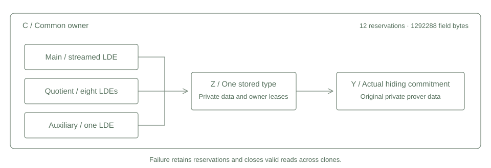

# Composite commitment storage

One private matrix type carries main, quotient and auxiliary data through the retained hiding commitment implementation. A complete attempt reserves its field files before raw construction. Every matrix holds the common owner, so a failed attempt closes subsequent valid reads across clones while preserving reservations and existing leases.



## Construction

The fixed laboratory class has a raw 256 by 2 main input, four random columns, extension degree four, 64 queries and blowup eight. The actual resource planner and the PCS parameter checks establish this class. A caller cannot supply an accepted resource record or a witness validity callback.

The main path prepares the owned input and streams its 4096 by 6 LDE through the unchanged kernels. Its concrete stored matrix is wrapped before the actual MMCS call and original private prover data construction. Quotient and auxiliary matrices use the same associated stored type and the same PCS instance.

Eight quotient outputs and one auxiliary output use the retained dense construction kernels, followed by canonical owned files. Those bounded intermediate matrices remain in memory. They are not streamed. The quotient mapper retains its original eight coupled masks, coset shifts, entropy order and RNG guard through its construction closures. The auxiliary sampler does not apply the main randomization step again.

## Reserved field lifetime

| Role | Files | Shape per file | Bytes |
| --- | ---: | --- | ---: |
| Raw input | 1 | 256 by 2 | 2048 |
| Prepared main | 1 | 512 by 6 | 12288 |
| Main LDE | 1 | 4096 by 6 | 98304 |
| Quotient LDE | 8 | 4096 by 8 | 1048576 |
| Auxiliary LDE | 1 | 4096 by 8 | 131072 |
| Total | 12 | | 1292288 |

For four byte canonical field elements,

$$R = 4\left(256\cdot2 + 512\cdot6 + 4096\cdot6 + 9\cdot4096\cdot8\right) = 1292288.$$

Plans become actual records without adding their bytes a second time. Partial cleanup retains the reservation. The limits remain 16 files, 2 MiB of field storage and at most 4096 by 12 per file. Salts, tree nodes, dense scratch, captured reference data and allocator overhead are outside this field sum and remain subject to the process limit.

Private variants prevent a component handle from escaping the common owner. An owned descriptor is released before its directory lease. Writes use exclusive creation, canonical encoding and explicit closure before partial cleanup. Cleanup retries only recorded orphan paths and serializes its claim across clones. No directory enumeration or recursive removal is used. Invalid window bounds do not change the attempt. A valid read that encounters storage failure closes the common owner.

## Implementation scope

This package implements construction and commitment storage. Its attempt guard has no success method. Dropping it closes the composite matrices. The later complete prover entry must extend that lifetime through the actual batched opening and returned proof.

The construction comparison uses canonical synthetic quotient evaluations, not an AIR quotient. Equal roots, fields and continuing entropy establish compatibility for the tested storage paths. They do not establish AIR validity, a complete private signature or a private payment. No complete STARK proof is constructed here. The retained verifier and proof format remain unchanged.

Two serial construction groups passed. They made six actual input MMCS commitments, with zero openings or FRI commitments, and captured ten final matrices containing 1277952 bytes. Main, quotient and auxiliary views refused reads after the attempt guard closed. Owner, metadata, short raw input and raw iterator unwind controls ran without extra commitments. Partial other file write faults, orphan retry failures, cleanup interleavings, poisoned metadata and DFT unwind coverage remain separate work.

## Reproduction

```text
cargo fetch --manifest-path research/source-composition/Cargo.toml --locked
python research/source-composition/static_check.py
python research/source-composition/reference.py
cargo test --manifest-path research/source-composition/Cargo.toml --release --locked --offline --test construction --jobs 1 -- --test-threads=1
python research/source-composition/reference.py --check-results
cargo clippy --manifest-path research/source-composition/Cargo.toml --release --lib --test construction --locked --offline -- -D warnings
```

The Windows runner installs and checks a 512 MiB process and aggregate limit, requires 2 GiB of available memory and enforces a 120 second deadline. Fresh output names prevent accidental reuse of a local execution receipt. The exact executed scope and independent artifact checks are recorded in validation.json.
