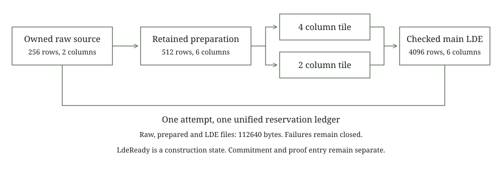

# Streamed commitment input

This laboratory expands an owned prepared source into the main low degree extension, abbreviated LDE, without constructing the whole raw, prepared or output matrix in the owned path. It reuses the frozen preparation kernel through checked inherent methods. Four column tiles and the final two column tile use the retained DFT and physical bit reversal.

The current boundary ends at LdeReady. No MatrixStore dispatch, PCS entry, commitment root, salt leaves, opening proof or STARK is implemented by this policy. Complete private payments and composed post quantum security remain separate engineering and review obligations.



## Profile and order

Construction calls the actual retained resource planner on the fixed quartic relation before creating an owner. The accepted class has raw height 256, width 2, extension degree 4, four random columns, 64 queries, two main opening points and blowup 8. The actual retained masking helper requires raw height at least 144 for this opening demand. This arithmetic is not a proof security certificate.

The PCS domain has size 512 and natural shift 1. Preparation uses raw Domain::natural(256). These are different headers. Unsupported headers and malformed dense lengths refuse before output creation or random draws.

The existing kernel writes W original fields followed by W+2r actual sampled fields for each raw row, then reinterprets the sequence at width W+r. Both owned and new dense paths call that same implementation. The caller's continuing generator must implement CryptoRng. Deterministic public seeds are used only for these synthetic fixtures.

For prepared column values y, interpolation gives coefficients a, and physical output row i contains

$$
a_k=N'^{-1}\sum_{j=0}^{N'-1} y_j\omega_{N'}^{-jk},\qquad
L_{i,c}=\sum_{k=0}^{N'-1} a_{k,c}(g\omega_M^{\operatorname{rev}_{12}(i)})^k,
\quad N'=512,\ M=4096,\ g=31.
$$

The field modulus is 2,013,265,921. The independent integer reference computes inverse interpolation directly for two captured columns and checks sixteen physical output cells across both tiles. The Rust comparison checks all 24,576 fields against the retained dense implementation and checks continuing RNG state.

## Reservations and ownership

| Route | Raw bytes | Prepared bytes | Main LDE bytes | Field files | Reserved bytes |
| --- | ---: | ---: | ---: | ---: | ---: |
| Owned raw source | 2048 | 12288 | 98304 | 3 | 112640 |
| Ordinary dense input | 0 | 12288 | 98304 | 2 | 110592 |

The unified reservation includes planned preparation and LDE files before sampling. Once the retained owner records its preparation reservation, that actual reservation replaces the planned bytes. Source snapshot failure never becomes zero usage. A first-draw observation checks this transition in the executed preparation path. Direct reservation controls check the earlier planned state without drawing randomness.

At most four columns enter one DFT batch. The largest input tile contains 2,048 fields and the largest output tile 16,384 fields. These are buffers of 8,192 and 65,536 bytes respectively. DFT caches and allocator scratch are additional process resources. The unchanged field class is sixteen files, 2 MiB, height 4,096 and width 12.

Raw and prepared handles stay private to the wrapper. No old preparation policy handle escapes. Attempt locks are released before I/O, DFT and source reads. LdeReady means successful file construction only. A future commitment entry must keep its own failure guard alive across actual MMCS salting and commitment.

Any preparation or extension failure closes this attempt across clones. Successful old preparation files retain their ordinary leases after a later LDE failure. Cleanup cannot force the old Complete owner into a fabricated failure. New pending LDE files close before deletion, and successful create_new ownership is tracked separately from ledger updates. Orphan failures retain reservations. Removed and uncreated paths are skipped, preserving caller replacements and preexisting unowned files. Cleanup never reopens a failed attempt.

Drop cleanup is best effort. Durable recovery and authentication against external modification of active paths are not implemented. Checked decoding and descriptor leases do not provide immutable secret storage. Only public synthetic data is used.

## Executed scope

Eight groups pass under installed and verified 512 MiB process and aggregate limits, a fresh 2 GiB available memory admission and a 120 second deadline:

1. All dense and owned LDE fields, continuing RNG, reservation transitions, full and partial tiles and descriptor leases.
2. Actual profile, header, exact dense length and foreign owner refusals without output or sampling.
3. Actual noncanonical and truncated prepared files.
4. Injected partial output and cleanup refusal, orphan accounting and replacement preservation.
5. An injected writer panic exercising actual unwind guards and clone refusal.
6. Actual outer owner mutex poison, with no empty budget fallback.
7. Explicitly injected missing, short and poisoned reader results.
8. Preexisting unowned output preservation and whole matrix conversion refusal.

Captured reference data is created exclusively and cannot overwrite a prior run. Intentional caught panics are fail stop controls, not cryptographic proof rejection. No commitment, opening, full symbolic signature relation or native signature trace ran.

## Reproduction

```text
cargo fetch --manifest-path research/source-extension/Cargo.toml --locked
python research/source-extension/static_check.py
python research/source-extension/reference.py
cargo fmt --manifest-path research/source-extension/Cargo.toml --all -- --check
cargo test --manifest-path research/source-extension/Cargo.toml --release --locked --offline --lib --jobs 1 -- --test-threads=1
cargo clippy --manifest-path research/source-extension/Cargo.toml --release --lib --tests --locked --offline -- -D warnings
```

The next boundary is a source PCS entry with real commitment and opening comparison through the retained verifier. The top uni-STARK prover still accepts a dense raw matrix. Hidden membership, stable nullifiers, same witness authorization, conservation, encrypted delivery and persistent ledger consumption remain mandatory for complete private payments. No transparent payment fallback is introduced.
