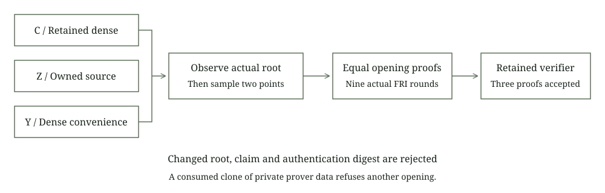

# Source opening compatibility

This laboratory produces actual PCS opening proofs from the owned source entry and compares them with retained ordinary dense verification. The source commitment, preparation, storage, transcript and verifier implementations remain unchanged. A separate test harness observes the real operations and applies the fixed resource limits.

The owned entry, new dense convenience entry and retained ordinary dense entry produce identical commitments, opening points, claimed values and complete encoded proofs. The retained verifier accepts all three proofs. Changed roots, claimed values and authenticated input digests are rejected. A preexisting private prover data clone refuses a second opening through the original shared consumed flag.



## Statement and transcript

Each fixture commits one masked polynomial matrix derived from 256 raw rows and two original columns. Its prepared domain has size 512. The main LDE has 4096 rows and six base field columns, including four random codewords. The caller observes the actual commitment before sampling two distinct nonbase extension points with the retained challenger. No point is resampled.

For each original masked column j, the statement asserts

$$
f_j(z_0)=y_{0,j},\qquad f_j(z_1)=y_{1,j},\qquad
z_0,z_1\in\mathbb F_p[u]/(u^4-11),\quad p=2013265921.
$$

These are evaluations of committed masked polynomials. The claim domain has size 512 and width 2. The four random codeword evaluations are retained in the hiding proof component rather than the caller's original-column claims. The actual masking checker admits this fixed two-point lifetime. This admission is not a proof security certificate.

Verification reconstructs the commitment observation and both point samples. Its next transcript sample agrees with the prover after the real verification. The three tamper controls use copies of the saved canonical state before opening, so they measure backend rejection relative to that fixed transcript.

## Actual operation inventory

| Operation | Count across three paths |
| --- | ---: |
| Fresh input MMCS commitments | 3 |
| FRI MMCS commitments | 27 |
| Successful PCS opening proofs | 3 |
| Input MMCS multi-openings | 3 |
| FRI MMCS multi-openings | 27 |
| Scalar MMCS openings | 0 |
| Consumed clone opening refusals | 1 |
| Positive retained verifications | 3 |
| Verifier mutations rejected | 3 |
| STARK proofs | 0 |

Every opening uses nine binary FRI rounds. The extension matrices have width 2. Flattening their four basis coefficients gives base MMCS width 8 at heights 2048, 1024, 512, 256, 128, 64, 32, 16 and 8. Each multi-opening receives 64 query indices. Repeated indices are permitted, and the retained authentication implementation deduplicates paths.

The new observer checks main commitment work while the source owner is Committing and FRI work while it is Committed. It delegates the real hash, MMCS, opening and verification operations. It captures salted leaves only during commitments, so verifier hashing cannot be mistaken for additional construction. Main masks and input salts do not advance during opening. All actual child salt rows are compared across the three paths without changing the initial fork order.

The one consumed-clone invocation happens after a successful opening, with valid same-class metadata. It reaches the original already-opened assertion before additional inner work. Counts, entropy journals and leaf capture remain unchanged. This refusal is distinct from the three completed proofs and the three verifier rejections.

## Independent reference and bounds

One canonical proof occupies 341711 encoded bytes, within the unchanged 2 MiB cap. One public synthetic leaf capture occupies 752896 bytes. The independent Python reference reconstructs the main root and all nine FRI roots with canonical SHA3 encodings. It also interpolates the two masked input polynomials from the physical main LDE and independently checks all four claimed extension values with integer arithmetic modulo p and u^4-11.

The serial experiment passed under installed and verified 512 MiB process and aggregate limits, a fresh 2 GiB available memory admission and a 120 second deadline. Only one set of FRI prover trees is live at a time. One current capture is compared with the baseline and dropped before the next path. Encoded output is bounded during serialization and fixtures are created exclusively.

The existing 16 file, 2 MiB field, height 4096 and width 12 construction class is retained. FRI salts, nodes, reduction vectors and proof buffers occupy additional measured process memory. The inherited file policy provides checked decoding and leases, with external path modification and durable secret storage still outside its tested boundary.

## Reproduction

```text
cargo fetch --manifest-path research/source-opening/Cargo.toml --locked
python research/source-opening/static_check.py
python research/source-opening/reference.py
cargo fmt --manifest-path research/source-opening/Cargo.toml --all -- --check
cargo test --manifest-path research/source-opening/Cargo.toml --release --locked --offline --test opening --jobs 1 -- --test-threads=1
python research/source-opening/reference.py --check-results
cargo clippy --manifest-path research/source-opening/Cargo.toml --release --lib --test opening --locked --offline -- -D warnings
```

The historical proof and native test records keep their original scope and budgets. This experiment verifies source PCS opening compatibility for a small synthetic class. The top uni-STARK prover still requires a dense raw trace. Complete signature AIR validity, same witness ownership, hidden membership, stable nullifiers, conservation, encrypted delivery, ledger integration and composed quantum or knowledge security remain separate obligations.
