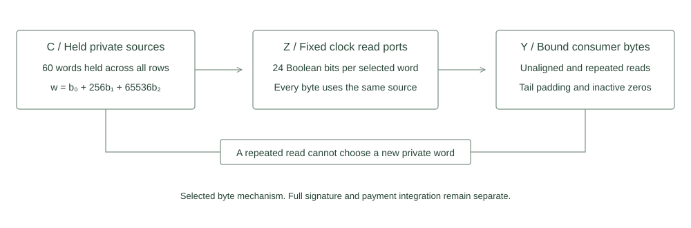

# Private packed source read ports

This small AIR mechanism holds selected private source words across a fixed clock and constrains every selected byte read. One actual symbolic collection measures 1451 constraints of degree 2. Native checks accept valid witnesses and reject eighteen adversarial mutations. Full signature integration remains separate work.



Three canonical bytes fit injectively in one field element:

$$w=b_0+256b_1+65536b_2,\qquad 0\leq b_i<256,\qquad 2^{24}<2013265921.$$

Each read port decomposes its selected held word into 24 Boolean bits. The consumers use those same constrained bits. Selection depends on the anchored nonwrapping clock and fixed source addresses. A port cannot choose a different private word for a repeated read. Held words remain equal across active and inactive transitions. Unused ports and consumer columns evaluate to zero. Since the packed value is below the modulus, changing one byte and compensating with a carry cannot preserve a valid Boolean decomposition.

## Fixed mechanism scope

| Dimension | Source constant |
|---|---:|
| Rows |16|
| Held private words |60|
| Three byte read ports |48|
| Consumer byte columns |136|
| Total width |1364|
| Raw matrix bytes |87296|

The source routes cover eight selected windows. They include the first key decode window, a 136 byte key hash block, a repeated signature prefix, selected note context and owner bytes, the final signature cut byte and final note byte. Two high padding bytes are constrained to zero in each partial signature and note tail word. The canonical final note byte is also zero. These sixteen mechanism rows do not represent the original full signature schedule.

The selected addresses derive from retained source, decoder, sponge and final challenge consumers. They cover a subset of the full source relation. The mechanism provides byte outputs for later integration. It does not execute the larger hash, decoder, owner comparison or public context equations. No complete route certificate, signature verification, ownership proof, private payment, proof backend or network capability is established by this package. Full integration must preserve all consumer framing, byte order, overlapping lifetimes and same note ledger joins. Net width and proof resource savings for that integration remain unmeasured.

## Executed controls

Two exact serial groups passed. The symbolic group ran first and exited before allocation of the native trace. The native group constructed one live matrix, compared every field with independent scalar vectors, then performed 21 actual positive checks and 18 actual rejections. The positive checks include 18 restored witnesses and a consistent alternative private source. Changing a private word and every read of it remains valid. Using a stale value for one repeated read of that changed word is rejected.

| Negative family | Cases |
|---|---|
| Read selection | Different bank, different word, stale repeated read |
| Source lifetime | Active and inactive held word changes |
| Fixed clock | Wrong first tick, restart, wrong final tick |
| Alignment | Key and note byte offsets |
| Canonical tails | Signature padding, note padding, fixed final note byte |
| Range | Non Boolean bit and compensated carry alias |
| Unused state | Unused active port, inactive port, inactive consumer |

The two padding cases, fixed final note byte and compensated carry preserve the other intended equations. They each produce exactly one failure at independently identified indices 1263,1266,1450 and 117. Other mutations can fail several equations in one row. The retained Some(1) checker stops between rows, so its threshold is not a strict one failure cap. Every observed case is saved before interpreting its result, and every mutation is restored and accepted afterwards.

Each Windows invocation installed and read back 512 MiB process and aggregate ceilings and freshly required 2 GiB available memory. Each exact group had a 60 second external timeout, preserving a combined selected test process allowance of 120 seconds. Observed group durations were 0.00 and 0.02 seconds. Maximum aggregate private memory across the serial groups was 3629056 bytes. Hardware, source identities and per-group observations are recorded in validation.json. Native evaluation and symbolic degree measurement do not establish proof security, hiding or a full private payment.

## Reproduction

```text
cargo check --manifest-path research/source-packing/Cargo.toml --release --locked --offline
python research/source-packing/static_check.py
python research/source-packing/reference.py
cargo test --manifest-path research/source-packing/Cargo.toml --release --locked --offline --test mechanism --jobs 1 -- --exact a_symbolic_shape_without_trace --test-threads=1
cargo test --manifest-path research/source-packing/Cargo.toml --release --locked --offline --test mechanism --jobs 1 -- --exact b_native_reads_and_eighteen_rejections --test-threads=1
python research/source-packing/reference.py --check-results
cargo clippy --manifest-path research/source-packing/Cargo.toml --release --lib --test mechanism --locked --offline -- -D warnings
```

Run each exact test as a separate process and stop if the symbolic check fails. The Windows guard requires new output paths and fresh memory admission for each group. It preserves partial observed cases on failure. No large signature trace or backend prover is selected by these commands.
